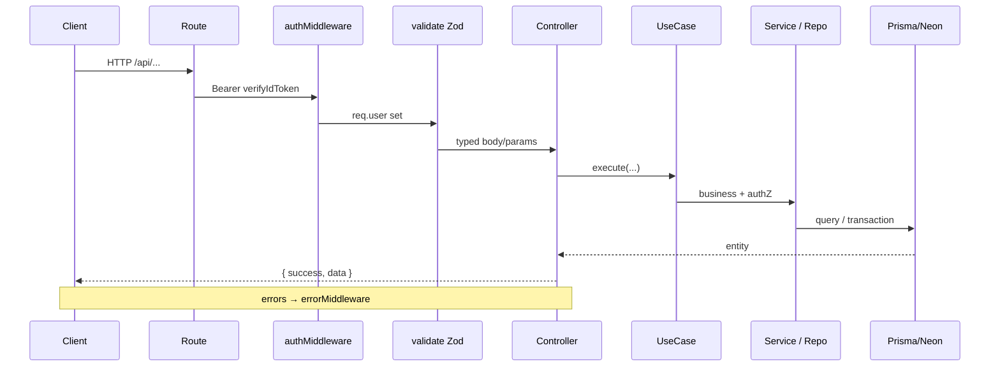

# Yalla 5roga — Backend Architecture

| Metadata | Value |
|----------|-------|
| Last verified | 2026-11-08 |
| Documentation version | 1.0.0 |
| Entry | `backend/src/server.ts` → `app.ts` |
| Needs verification | Production logging/monitoring exporters; WhatsApp provider credentials per env |

## 1. Style

Layered Express API with Use Cases:

```
Route → Middleware (auth, validate) → Controller → UseCase → Repository/Datasource → Prisma → Neon
```

Domain helpers live under `services/` (access control, vote resolution, notification fan-out).

## 2. Folder structure

```
backend/src/
  app.ts                 # Express app, CORS, JSON, health, swagger, routes, errorMiddleware
  server.ts              # prisma connect, listen, start jobs
  config/                # database, firebase, swagger, notifications
  routes/                # HTTP mounts under /api/*
  controllers/
  usecases/
  repositories/ + datasources/
  services/              # auth, outings, notifications, chat, groups, whatsapp
  validators/            # Zod schemas
  middleware/            # auth, validate, error
  jobs/                  # voting deadline, outing completion, notification worker
  types/
  utils/                 # errors, helpers
backend/prisma/schema.prisma
backend/tests/           # lifecycle, authz, concurrency, etc.
```

## 3. Application initialization

`server.ts`:

1. `dotenv/config`
2. `prisma.$connect()`
3. `http.createServer(app)` + `attachRealtime(httpServer)` (Socket.IO on `/socket.io`)
4. `httpServer.listen(PORT, HOST)` (default `0.0.0.0:3000`)
5. `startOutingCompletionJob()`, `startVotingDeadlineJob()`, `startNotificationWorker()`

`app.ts` middleware stack: CORS → `express.json()` → `/` + `/health` → `/api-docs` → mounted routes → `errorMiddleware`.

Realtime modules: `src/realtime/` (`socket-server`, `socket-auth`, `chat.gateway`, `chat-emitter`, `rooms`). In-memory Socket.IO adapter only (single Node process; no Redis).

## 4. Request lifecycle



## 5. Routes (modules)

Mounted from `routes/index.ts`. Feature folders compose responsibility routers; each index preserves static-before-dynamic order (`cuser`, `drafts`, `saved`, `nearby`, `sync`, FCM).

| Mount | Folder / modules |
|-------|------------------|
| `/api/auth` | `auth/index.ts` |
| `/api/users` | `users/` — profile, sync, FCM (`/cuser/fcm-token`) |
| `/api/groups` | `groups/` — crud, members, invitations |
| `/api/outings` | `outings/` — crud, drafts, saved, participants, voting, chat |
| `/api/places` | `places/` — crud, meta (hours/images/prices), saved |
| `/api/notifications` | `notifications/` — inbox |

Chat lives under `/api/outings/:outingId/messages` and `/read` (not a separate `/api/chat` mount).

Full endpoint list: [`API_CONTRACTS.md`](API_CONTRACTS.md).

## 6. Controllers and use cases

Controllers are thin HTTP adapters (e.g. `OutingController`). Business logic lives in use cases such as:

- `CreateOutingUseCase`, `UpdateOutingUseCase`, `DeleteOutingUseCase`
- Voting: classes in `usecases/outings/voting.usecase.ts`
- `UpsertAttendanceUseCase`, guests invite/accept/decline
- Chat send / mark read
- Auth login/signup; user sync
- FCM register/unregister
- Group invite / members

## 7. Authentication middleware

`middleware/auth.middleware.ts`:

- Extracts Bearer token (tolerates Swagger paste quirks).
- Verifies Firebase ID token via Admin SDK.
- Sets `req.user = { uid, email, name, phone, signInProvider }`.
- Does **not** upsert Neon users — that is `POST /api/users/sync`.

Public: `POST /api/auth/login`, `POST /api/auth/signup`, health, some place GETs.

## 8. Authorization

Resource checks in services/use cases, not global roles:

- `assertIsOutingCreator` — Owner-only (`outings.created_by`)
- `assertEligibleVoter` / `listEligibleVoterIds` — Owner + accepted `outing_guests` + group members of `outing.group_id`
- Group owner/member via `group_members.role`
- Owner attendance forced to `going`

## 9. Validation

Zod schemas in `validators/**` applied by `validate` middleware (`body` / `params` / `query`).

## 10. Prisma and transactions

- Single Prisma client from `config/database.js`.
- Critical mutations use `prisma.$transaction` (candidate replace, vote resolution with row locks, create outing + attendance).
- Vote resolution: `services/outings/vote-resolution.ts`.

## 11. Error handling

Custom errors in `utils/errors.ts` (`ValidationError`, `UnauthorizedError`, `ForbiddenError`, `NotFoundError`, `ConflictError`, …). `errorMiddleware` maps to HTTP status + JSON error body.

## 12. Background jobs

| Job | File | Interval behavior |
|-----|------|-------------------|
| Voting deadline | `close-voting-deadline.job.ts` | ~30s; closes `status=voting` with `vote_ends_at <= now` |
| Outing completion | `complete-outings.job.ts` | Moves due confirmed outings to `past` |
| Notification worker | `notification-worker.job.ts` | Claims `notification_events`, delivers via channels |

These are in-process `setInterval` workers (not Redis/Bull unless added later).

## 13. Notifications

- Fan-out helpers: `outing-notifier.ts`, `notification-publisher.ts`
- Channels: `PushChannel`, `WhatsAppChannel`
- Outbox tables: `notification_events`, `notification_delivery_logs`
- In-app: `notifications` with unique `event_key`

## 14. File / image storage

Places and outings store URL strings (`image_url`, `cover_image_url`). No in-repo object-storage upload API verified.

## 15. Logging / env

- `console.log` / `console.error` with tagged prefixes (`[Firebase Auth]`, `[notifications]`, …).
- Env via `dotenv` (`DATABASE_URL`, `FIREBASE_*`, `PORT`, notification config).
- OpenAPI at `/api-docs` from `config/swagger.ts`.

## 16. Response conventions

Success typically `{ success: true, data }`. Create often `201`. Errors `{ success: false, message, ... }` via middleware.

## 17. Testing

Under `backend/tests/` — notably `outing-lifecycle.test.ts`, `resource-authz.test.ts`, `voting-concurrency.test.ts`. Prefer extending these for lifecycle regressions.

## Related

- [`API_CONTRACTS.md`](API_CONTRACTS.md)
- [`DATABASE_ARCHITECTURE.md`](DATABASE_ARCHITECTURE.md)
- [`AUTHENTICATION_AND_AUTHORIZATION.md`](AUTHENTICATION_AND_AUTHORIZATION.md)
