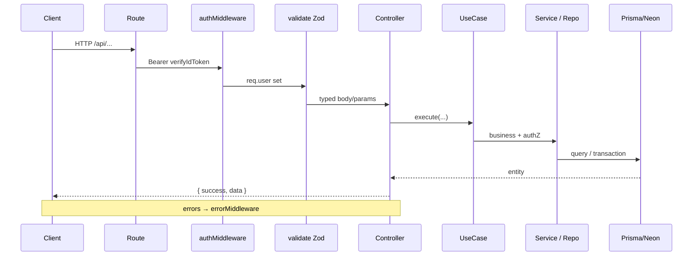

# Yalla 5roga — Backend Architecture

| Metadata | Value |
|----------|-------|
| Last verified | 2026-11-08 |
| Documentation version | 1.0.0 |
| Entry | `backend/src/server.ts` → `app.ts` |
| Needs verification | Production logging/monitoring exporters; WhatsApp provider credentials per env |

## 1. Style

Layered Express API with Use Cases:

```
Route → Middleware (auth, validate) → Controller → UseCase → Repository/Datasource → Prisma → Neon
```

Domain helpers live under `services/` (access control, vote resolution, notification fan-out).

## 2. Folder structure

```
backend/src/
  app.ts                 # Express app, CORS, JSON, health, swagger, routes, errorMiddleware
  server.ts              # prisma connect, listen, start jobs
  config/                # database, firebase, swagger, notifications
  routes/                # HTTP mounts under /api/*
  controllers/
  usecases/
  repositories/ + datasources/
  services/              # auth, outings, notifications, chat, groups, whatsapp, media
  validators/            # Zod schemas
  middleware/            # auth, validate, error
  jobs/                  # voting deadline, outing completion, notification worker, media cleanup
  types/
  utils/                 # errors, helpers
backend/prisma/schema.prisma
backend/tests/           # lifecycle, authz, concurrency, etc.
```

## 3. Application initialization

`server.ts`:

1. `dotenv/config`
2. `prisma.$connect()`
3. `http.createServer(app)` + `attachRealtime(httpServer)` (Socket.IO on `/socket.io`)
4. `httpServer.listen(PORT, HOST)` (default `0.0.0.0:3000`)
5. `startOutingCompletionJob()`, `startVotingDeadlineJob()`, `startNotificationWorker()`

`app.ts` middleware stack: allowlisted CORS → `/api` rate limiter → `express.json()` → `/` + `/health` → `/api-docs` → mounted routes → `errorMiddleware`. Browser origins come from `CORS_ORIGINS`; native clients without an `Origin` header remain supported.

Realtime modules: `src/realtime/` (`socket-server`, `socket-auth`, `chat.gateway`, `chat-emitter`, `rooms`). In-memory Socket.IO adapter only (single Node process; no Redis).

`data-changes.ts` emits post-write `data:changed` invalidations to deduplicated, server-resolved user rooms. Controllers publish group/outing/profile hints, invitation linking publishes membership changes, and vote resolution/completion jobs invalidate outing state. Audience lookup failures are logged without undoing committed state; clients repair missed events via REST on reconnect/resume. Chat delivery checks the current participant audience even if a socket remains in an old outing room. Chat client UUIDs reuse the existing PostgreSQL unique key for offline replay; no generic replay endpoint exists.

## 4. Request lifecycle



## 5. Routes (modules)

Mounted from `routes/index.ts`. Feature folders compose responsibility routers; each index preserves static-before-dynamic order (`cuser`, `drafts`, `saved`, `nearby`, `sync`, FCM).

| Mount | Folder / modules |
|-------|------------------|
| `/api/auth` | `auth/index.ts` |
| `/api/users` | `users/` — profile, sync, FCM (`/cuser/fcm-token`) |
| `/api/groups` | `groups/` — crud, members, invitations |
| `/api/outings` | `outings/` — crud, drafts, saved, participants, voting, chat |
| `/api/places` | `places/` — crud, meta (hours/images/prices), saved |
| `/api/notifications` | `notifications/` — inbox |
| `/api/media` | `media/` — presigned upload, confirm, signed delivery, delete |

Chat lives under `/api/outings/:outingId/messages` and `/read` (not a separate `/api/chat` mount).

Full endpoint list: [`API_CONTRACTS.md`](API_CONTRACTS.md).

## 6. Controllers and use cases

Controllers are thin HTTP adapters (e.g. `OutingController`). Business logic lives in use cases such as:

- `CreateOutingUseCase`, `UpdateOutingUseCase`, `DeleteOutingUseCase`
- Voting: classes in `usecases/outings/voting.usecase.ts`
- `UpsertAttendanceUseCase`, guests invite/accept/decline, and `OutingArrivalsUseCase` for participant-scoped check-ins
- Special-event create writes phone invitation outbox rows with the outing in the same Prisma transaction when the WhatsApp sender is configured
- Chat send / mark read
- Auth login/signup; user sync
- FCM register/unregister
- Group invite / members

Phone membership binding uses `services/phone/phone-identity.ts`. Signup verifies recent Firebase OTP proof and retains its UID. Login links pending associations for the canonical identity’s verified phone. Authenticated sync can repair an unused legacy OTP identity after fresh proof without changing Neon IDs. Pending membership linking uses locked rows, a bulk insert and a bulk status update in one transaction. Nested group creation writes its first owner atomically. The roster reads active profiles and pending associations from one repeatable-read snapshot. REST and Socket.IO accept Firebase phone and custom-session ID tokens. `GroupDatasource` accepts an optional Prisma transaction client so HTTP/database regression tests can exercise production membership queries in a rolled-back fixture transaction.

## 7. Authentication middleware

`middleware/auth.middleware.ts`:

- Extracts Bearer token (tolerates Swagger paste quirks).
- Verifies Firebase ID token via Admin SDK.
- Sets `req.user = { uid, email, name, phone, signInProvider }`.
- Does **not** upsert Neon users — that is `POST /api/users/sync`.

Public: `POST /api/auth/login`, `POST /api/auth/signup`, health, some place GETs.

## 8. Authorization

Resource checks in services/use cases, not global roles:

- `assertIsOutingCreator` — Owner-only (`outings.created_by`)
- `assertEligibleVoter` / `listEligibleVoterIds` — Owner + accepted `outing_guests` + group members of `outing.group_id`
- Group owner/member via `group_members.role`
- Owner attendance forced to `going`

## 9. Validation

Zod schemas in `validators/**` applied by `validate` middleware (`body` / `params` / `query`).

## 10. Prisma and transactions

- Single Prisma client from `config/database.js`.
- Critical mutations use `prisma.$transaction` (candidate replace, vote resolution with row locks, create outing + attendance).
- Vote resolution: `services/outings/vote-resolution.ts`.

## 11. Error handling

Custom errors in `utils/errors.ts` (`ValidationError`, `UnauthorizedError`, `ForbiddenError`, `NotFoundError`, `ConflictError`, …). `errorMiddleware` maps to HTTP status + JSON error body.

## 12. Background jobs

| Job | File | Interval behavior |
|-----|------|-------------------|
| Voting deadline | `close-voting-deadline.job.ts` | ~30s; closes `status=voting` with `vote_ends_at <= now` |
| Outing completion | `complete-outings.job.ts` | Moves due confirmed outings to `past` |
| Notification worker | `notification-worker.job.ts` | Claims `notification_events`, delivers via channels |
| Media cleanup | `media-cleanup.job.ts` | Removes expired pending upload intents and failed assets (storage object + row) |

These are in-process `setInterval` workers (not Redis/Bull unless added later).

## 13. Notifications

- Fan-out helpers: `outing-notifier.ts`, `notification-publisher.ts`
- Channels: `PushChannel`, `WhatsAppChannel`
- Outbox tables: `notification_events`, `notification_delivery_logs`
- In-app: `notifications` with unique `event_key`

## 14. File / image storage

Object storage is Cloudflare R2 behind the `MediaStorageAdapter` interface in `services/media/`:

- `config/media.ts` resolves the provider from env: valid `R2_ACCOUNT_ID`, `R2_ACCESS_KEY_ID`, `R2_SECRET_ACCESS_KEY`, `R2_BUCKET_NAME` → `r2`; otherwise `mock` for local development. Switching providers is env-only.
- `r2-storage.adapter.ts` uses `@aws-sdk/client-s3` + `@aws-sdk/s3-request-presigner` (R2 S3-compatible endpoint). `mock-storage.adapter.ts` keeps bytes in memory and backs the dev-only upload/download routes.
- `media.service.ts` owns the lifecycle: `requestUpload` → presigned PUT (short TTL), `confirmUpload` (HEAD verification before `ready`), `deleteAsset`, `getDeliveryUrl(s)`, `resolveEntityImage`/`linkReference`, and `cleanupExpired`.
- `media-access.ts` holds upload and view policy. Public `place` media may resolve through `R2_PUBLIC_BASE_URL`; private media always uses signed GET URLs.
- Only object keys and metadata are persisted in `media_assets`. Binaries never pass through Express or Neon.
- Entity use cases accept `media://<uuid>` alongside legacy http(s) URLs and link the asset after create/update. Existing default covers remain untouched.
- `jobs/media-cleanup.job.ts` reaps abandoned pending intents and failed assets.

Required production env: `R2_ACCOUNT_ID`, `R2_ACCESS_KEY_ID`, `R2_SECRET_ACCESS_KEY`, `R2_BUCKET_NAME`, `R2_PUBLIC_BASE_URL` (custom CDN domain). Optional limits/TTLs follow `config/media.ts`. Until credentials and the CDN domain are supplied, the mock provider is used and public place assets stay as `media://` references.

## 15. Logging / env

- `console.log` / `console.error` with tagged prefixes (`[Firebase Auth]`, `[notifications]`, …).
- Env via `dotenv` (`DATABASE_URL`, `FIREBASE_*`, `PORT`, notification config, `CORS_ORIGINS`, `R2_*`). Production startup rejects an empty CORS allowlist and `WHATSAPP_PROVIDER=stub`.
- OpenAPI at `/api-docs` from `config/swagger.ts`.

## 16. Response conventions

Success typically `{ success: true, data }`. Create often `201`. Errors `{ success: false, message, ... }` via middleware.

## 17. Testing

Under `backend/tests/` — notably `outing-lifecycle.test.ts`, `resource-authz.test.ts`, `voting-concurrency.test.ts`. Prefer extending these for lifecycle regressions.

## Related

- [`API_CONTRACTS.md`](API_CONTRACTS.md)
- [`DATABASE_ARCHITECTURE.md`](DATABASE_ARCHITECTURE.md)
- [`AUTHENTICATION_AND_AUTHORIZATION.md`](AUTHENTICATION_AND_AUTHORIZATION.md)

The places datasource uses `services/places/nearby-search-bounds.ts` to select geographic candidates, including searches near a pole or the date line. PostgreSQL applies the final distance and category filters.

### Geocoding provider configuration

Geocoding is disabled by default. Set `GEOCODING_PROVIDER=pelias` and `GEOCODING_BASE_URL` to the HTTPS base URL of a Pelias-compatible service that supports autocomplete and reverse lookup. Set `GEOCODING_ATTRIBUTION` to the operator-required credit and `GEOCODING_API_KEY` only when required. Keep that key server-side, scope it to these APIs and restrict it by server egress IP where supported. The authenticated endpoint enforces a process-wide `GEOCODING_REQUESTS_PER_MINUTE` budget (default 60). Set an aggregate limit at the gateway when running several replicas. Requests time out after five seconds and disconnects abort upstream fetches.

Set `GEOCODING_CACHE_SECONDS` only if the provider permits it (0 by default, max 300). Verify that the operator permits selection metadata to be persisted with outings and displayed on the OSM map. Do not configure the public Nominatim endpoint. Verify upstream Arabic label coverage and required attribution with the configured provider before enabling it.

### Outing RSVP, venue, arrivals, and chat

Attendance uses a PostgreSQL conflict update on the existing outing/user key. A duplicate state preserves its timestamp. Explicit creator venue confirmation uses the same row lock and winning-option persistence as automatic resolution. Actual Attendance validates the authenticated current participant’s fresh GPS fix against the confirmed venue. The arrival table stores the first valid timestamp, GPS method, distance and accuracy. A committed arrival invalidates the roster for current participants over authenticated Socket.IO user rooms. Chat repositories attach a narrow sender projection to history and send results. Cursor paging uses the existing outing, timestamp and ID index.


## Chat mentions and reconnect reconciliation — 2026-11-11

`services/chat/chat-mentions.ts` validates stable inline mention IDs against chat participation (creator, group members, pending/accepted outing guests), canonicalizes labels from Neon, and enforces the 2000-character stored-text limit. Send retries reuse committed text and IDs. Mention and ordinary chat recipients share `chat_message:<messageId>:<recipientId>` notification keys, with one distinct body per recipient and no self-notifications.

`realtime/data-changes.ts` retains up to 512 invalidations for ten minutes in the existing single Node process. Authenticated `data:reconcile` returns only the caller's missed invalidations plus a cursor. Restart, expiry or an invalid cursor requests stale-cache reconciliation. This buffer is not durable application storage; PostgreSQL remains authoritative. Notification fan-out and read mutations emit inbox invalidations after persistence.


## Centralized session transport — 2026-11-11

`group.gateway.ts` adds authorized group join/leave to the existing `attachRealtime` server. It does not instantiate another server. User-room assignment uses the verified Firebase UID; outing authorization retains `assertChatParticipant`; group authorization uses `assertGroupMember`. Domain mutations continue to publish only after their awaited persistence/transaction resolves. Attendance now emits a complete committed row to its narrower attendance-authorized audience before the follow-up roster read. Chat read receipts, like messages, filter current recipients rather than trusting old room membership.

`data-changes.ts` keeps the existing bounded, process-local journal (512 events / ten minutes); replay entries carry their original sequence. It replays identifiers for attendance rather than historical rows, requiring REST authorization after a reconnect. This is best-effort post-commit publication, not a transactional event outbox. See [event matrix and tests](audit/CENTRALIZED_REALTIME_SYNC.md).

## Password recovery — 2026-11-11

The auth router exposes start/verify/reset and can be constructed with a controller for HTTP integration fixtures. `AuthController` delegates to `PasswordRecoveryUseCase`; `PasswordRecoveryRepository` persists opaque-secret digests and shared rate limits through Prisma. `FirebasePhoneIdentity.verifyRecoveryProof` extends the existing phone-proof validation with the sign-in time without changing `verifyProof`'s existing signup/sync return contract. Grant consumption plus compare-and-update of the existing password run in one transaction. No Firebase user creation, credential transfer, session issuance or Neon profile provisioning occurs in the recovery use case.

Recovery limits are PostgreSQL upserts and apply across workers/restarts. Additive migration `20261111180000_password_recovery` must be deployed before these APIs. Only expired security state is opportunistically cleaned, with replay markers retained past proof acceptance. Verification uses the real router/use cases/repository/bcrypt and a disposable schema via HTTP/OpenAPI; the Firebase SDK boundary is controlled. See [report](audit/PASSWORD_RECOVERY_REPORT.md).

## Confirmed API fixes — 2026-11-13

The existing layered architecture and route mounts are preserved. Shared middleware applies a bounded 300 requests/IP/minute limit only to `/api`; stricter auth limits stay in their router. The existing Swagger UI initializer exposes the generated spec; no endpoint was added. Invocation headers Idempotency-Key and If-Match are allowed by CORS for existing draft endpoints. Malformed headers return the standard 400 error envelope.

Invitation decisions lock the row and accept membership in the same transaction, while verified-phone claiming only links inbox identity. General outing reads use outing-access, with chat checks retained for chat. Draft create retries use the existing UUID and updates/deletes lock and compare the existing updated_at. Notifications use bounded, per-user cursor reads. Existing curator guards, safe user summaries and creator lifecycle rules are retained. No production schema migration, alternate database, new role system or chat-media endpoint was introduced. See the current implementation/OpenAPI report for runtime limits.

## Phase 2 group roster projection — 2026-11-13

The existing members route/controller/use case/repository/datasource chain also returns group-scoped invitation history. ListGroupMembersUseCase still requires active group membership; GroupDatasource reads active members and persisted invitation rows in its existing repeatable-read snapshot. It projects linked and unlinked pending invitations separately from active membership and includes inviter/invitee display names for history. The additive response is documented in Swagger; no schema migration, new endpoint, worker, notification or realtime protocol was introduced.


## Phase 3 atomic ballots — 2026-11-14

The existing outing voting router/controller now exposes PUT /api/outings/:id/votes through ReplaceBallotUseCase. An outing-row lock serializes full selection replacement with resolution; eligible members, candidate ownership and deadline are checked before writes. Existing datasource POST/DELETE vote writers share the same lock and closure guard. Resolution/tie RNG stays in the existing service; notification/invalidation publication is post-commit. No new transport or database abstraction is introduced. Prisma expands outing_votes uniqueness to include option_id. HTTP-only OpenAPI verification uses disposable schemas and a controlled Firebase verifier; deployment uses the normal Prisma migration history.


## Create deadline validation — 2026-11-14

Existing create validation and CreateOutingUseCase share services/outings/voting-deadline.ts. It resolves either an explicit instant or a server-relative duration, rejects nonfuture timestamps and timestamps at/after scheduled_at, and validates duration metadata in 1–168 hours. The use case checks before work and again at persistence, protecting direct callers and elapsed preparation time. Existing create/draft/update duration validators and OpenAPI bounds match the database range. No new controller, endpoint, table or column is added.


## Complete RSVP read roster — 2026-11-14

ListAttendanceUseCase merges persisted responses with the existing accepted-participant definition and phone-free profiles from outing-participants.ts. Missing RSVP rows yield a read-only no_response view, leaving GET free of writes. Controller summaries count it explicitly. Existing upsert persistence, creator Going enforcement and post-write realtime events remain unchanged. No new database enum/table/column is required.


## Phase 5 chat mutations — 2026-11-14

The existing outing chat router validates PATCH/DELETE message operations. ChatController delegates to MutateMessageUseCase, which checks participant, open window and sender ownership, canonicalizes edited mentions, then persists through ChatRepository/ChatDatasource before using the existing participant-filtered `emitOutingMessage`. Deletion is an empty-text tombstone to preserve retry idempotency and cursors. Editing checks sent_at + 60 seconds in the use case and atomic updateMany predicate; expiration returns MESSAGE_EDIT_WINDOW_EXPIRED. Delete has no edit-age restriction. No schema, Socket.IO room/event or Firebase-token changes. The shared chat access guard now enforces scheduled_at + two hours as well as past/cancelled status. PushChannel adds only the matching APNs chat-action category; worker/token handling and delivery retries remain unchanged.
