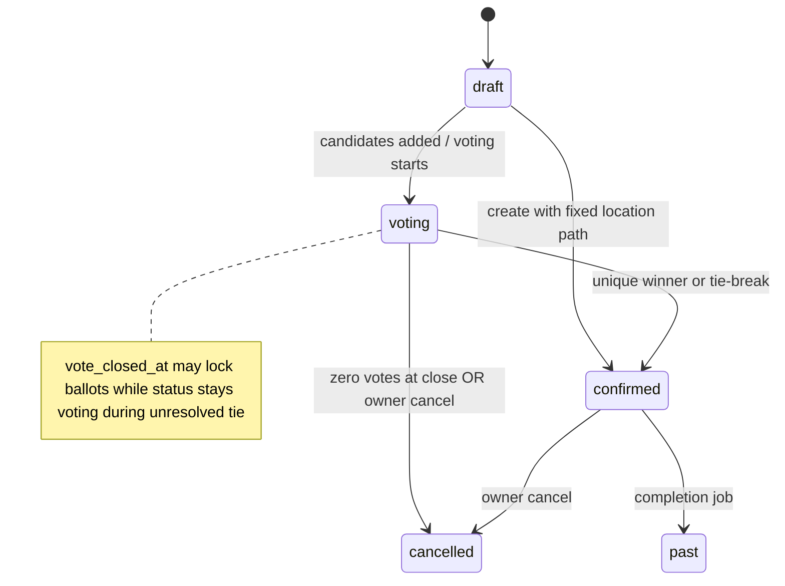

# Yalla 5roga — Business Logic

| Metadata | Value |
|----------|-------|
| Last verified | 2026-11-07 |
| Documentation version | 1.0.0 |
| Product authority | [`PRODUCT_SCENARIOS.md`](PRODUCT_SCENARIOS.md) |
| Implementation evidence | `docs/audit/FINAL_COMPLIANCE_REPORT.md`, voting use cases, lifecycle tests |

This document maps **approved rules** ↔ **current implementation**. It does not invent open decisions.

Legend: **Approved** · **Implemented** · **Partial** · **Missing** · **OPEN**

---

## Place voting vs attendance

| Domain | Purpose | Storage |
|--------|---------|---------|
| Place voting | Where the outing happens | `outing_vote_options`, `outing_votes`, winner fields on `outings` |
| Attendance | Going / Not Going / Maybe | `outing_attendance` |

**Invariant (Approved + Implemented):** Changing attendance never creates/updates/deletes place votes.

---

## Roles (outing-scoped)

| Role | Definition | Implemented |
|------|------------|-------------|
| Owner | `outings.created_by` | Yes |
| Member | Accepted membership (`outing_guests.status=accepted`) and/or group member of `outing.group_id` | Yes |
| Guest role | **Does not exist** | Table name `outing_guests` is historical naming only |

Pending invitation ≠ role. Owner auto Going; Owner cannot leave Going.

---

## Outing types

**Approved + Implemented:** `group` (requires `group_id`, occasion `none`) and `special_event` (no group; occasion birthday/wedding). Shared voting, attendance, chat, lifecycle.

---

## Outing lifecycle

| Transition | Authority | Status |
|------------|-----------|--------|
| Create → draft/confirmed | `CreateOutingUseCase` | Implemented (location → may start confirmed; else draft; voting via options) |
| draft → voting | Adding options | Implemented |
| Early close all voted | `tryCloseIfAllVoted` | Implemented |
| Deadline close | `close-voting-deadline.job` | Implemented |
| Unique winner → confirmed | `vote-resolution` | Implemented |
| Tie → lock votes, await Owner | `markVotingClosedPendingTie` | Implemented |
| Tie-break → confirmed | `POST …/tie-break` | Implemented |
| Zero votes → cancelled | resolution | Implemented |
| Owner cancel | `POST …/cancel` | Implemented |
| confirmed → past | `complete-outings.job` | Implemented |

Backend is source of truth. Flutter must not finalize winners.

---

## Voting rules

**Approved (all required):**

1. Both outing types support place voting.
2. Only Owner adds/modifies candidates before deadline.
3. Eligible: Owner + accepted Members (+ documented group members).
4. One active vote per user; change = upsert.
5. Locked after closure (`vote_closed_at` / confirmed / cancelled).
6. Unique highest wins automatically.
7. Tie → Owner-triggered backend RNG among **tied leaders only**; Flutter animates server result.
8. All eligible voted → close immediately.
9. Deadline → close; zero votes → cancel; open with zero votes → **do not** cancel.
10. Candidate set change → reset all votes, keep deadline, notify.

**Implemented:** Encoded in `voting.usecase.ts`, `vote-resolution.ts`, validators requiring deadline on create, participant helpers.

**Partial:** Flutter candidate replace UI / outing invite deep-link UX (see audit).

### OPEN decisions

None that contradict `PRODUCT_SCENARIOS.md` §22 Open decisions. Eligibility includes group members of `outing.group_id` (documented convenience, not a third role).

---

## Attendance

- Statuses: `going` | `not_going` | `maybe`.
- Owner forced Going on create and on upsert.
- Members update own status while outing not cancelled/past.
- Notifies Owner on member change (`attendance_changed`).

---

## Invitations / membership

**Approved:** Deep link → auth if needed → explicit accept → Member. Opening link alone must not auto-join.

| Flow | Status |
|------|--------|
| Group phone invite + deep link + claim | Implemented (Flutter `InviteDeepLinkProvider`) |
| Outing invite accept/decline APIs | Implemented (`…/invitations/accept|decline`) |
| Outing deep-link accept UI restore | **Partial** |

---

## Chat

Open in draft / voting / confirmed. Blocked for cancelled (unless product later adds read-only). HTTP only — no WebSocket verified.

---

## Saved outings / places

Neon-backed APIs. Flutter saved outings remote wired; saved places remote DS present, UI wiring thinner (**Partial**).

---

## Discover

Places from Neon via `/api/places`. Suggestions/vibe filters depend on query params + place fields. Client Nominatim for map picker only.

---

## Notifications

Approved event set in PRODUCT_SCENARIOS §14. Outbox + PushChannel + WhatsApp channel implemented; **device FCM delivery NOT RUN**.

---

## Owner vs Member matrix

See PRODUCT_SCENARIOS §13. Backend enforces; Flutter visibility is not authZ.

---

## Conflicts tracker

Use [`docs/audit/FINAL_COMPLIANCE_REPORT.md`](audit/FINAL_COMPLIANCE_REPORT.md) for live compliance. Historical pre-fix conflicts (multi-vote PK, client finalize, etc.) were resolved in schema rebuild — do not reintroduce.
