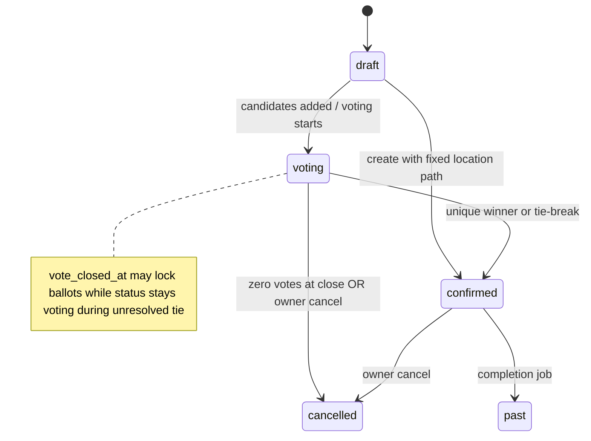

# Yalla 5roga — Business Logic

| Metadata | Value |
|----------|-------|
| Last verified | 2026-11-07 |
| Documentation version | 1.0.0 |
| Product authority | [`PRODUCT_SCENARIOS.md`](PRODUCT_SCENARIOS.md) |
| Implementation evidence | `docs/audit/FINAL_COMPLIANCE_REPORT.md`, voting use cases, lifecycle tests |

This document maps **approved rules** ↔ **current implementation**. It does not invent open decisions.

Legend: **Approved** · **Implemented** · **Partial** · **Missing** · **OPEN**

---

## Place voting vs attendance

| Domain | Purpose | Storage |
|--------|---------|---------|
| Place voting | Where the outing happens | `outing_vote_options`, `outing_votes`, winner fields on `outings` |
| Attendance | Going / Not Going / Maybe | `outing_attendance` |

**Invariant (Approved + Implemented):** Changing attendance never creates/updates/deletes place votes.

---

## Roles (outing-scoped)

| Role | Definition | Implemented |
|------|------------|-------------|
| Owner | `outings.created_by` | Yes |
| Member | Accepted membership (`outing_guests.status=accepted`) and/or group member of `outing.group_id` | Yes |
| Guest role | **Does not exist** | Table name `outing_guests` is historical naming only |

Pending invitation ≠ role. Owner auto Going; Owner cannot leave Going.

---

## Outing types

**Approved + Implemented:** `group` (requires `group_id`, occasion `none`) and `special_event` (no group; occasion birthday/wedding). Shared voting, attendance, chat, lifecycle.

---

## Outing lifecycle

| Transition | Authority | Status |
|------------|-----------|--------|
| Create → draft/confirmed/voting | `CreateOutingUseCase` | Implemented (single location → draft/confirmed path; **Add places** on shared create page → voting + options; former suggest sheet removed) |
| draft → voting | Adding options | Implemented |
| Early close all voted | `tryCloseIfAllVoted` | Implemented |
| Deadline close | `close-voting-deadline.job` | Implemented |
| Unique winner → confirmed | `vote-resolution` | Implemented |
| Tie → lock votes, await Owner | `markVotingClosedPendingTie` | Implemented |
| Tie-break → confirmed | `POST …/tie-break` | Implemented |
| Zero votes → cancelled | resolution | Implemented |
| Owner cancel | `POST …/cancel` | Implemented |
| confirmed → past | `complete-outings.job` | Implemented |

Flutter lists an outing in History once `scheduled_at` is at or before the current instant, or when the server reports `past` or `cancelled`. It excludes those outings from Upcoming and Active Votes. Unscheduled outings still follow their server status. The display cutoff leaves the server lifecycle and attendance rules in effect, so a started outing can still have status `confirmed` and allow eligible arrival check-in from its details.

Backend is source of truth. Flutter must not finalize winners.

---

## Voting rules

**Approved (all required):**

1. The voting endpoints serve the shared outing lifecycle. Create Outing exposes place voting for group outings and a fixed venue for special events. The atomic initial-options create payload follows the group flow.
2. Only Owner adds/modifies candidates before deadline.
3. Eligible: Owner + accepted Members (+ documented group members).
4. One active vote per user; change = upsert.
5. Locked after closure (`vote_closed_at` / confirmed / cancelled).
6. Unique highest wins automatically.
7. Tie → Owner-triggered backend RNG among **tied leaders only**; Flutter animates server result.
8. All eligible voted → close immediately.
9. Deadline → close; zero votes → cancel; open with zero votes → **do not** cancel.
10. Candidate set change → reset all votes, keep deadline, notify.

**Implemented:** Encoded in `voting.usecase.ts`, `vote-resolution.ts`, validators requiring deadline on create, participant helpers.

**Partial:** Flutter candidate replace UI / outing invite deep-link UX (see audit).

### OPEN decisions

None that contradict `PRODUCT_SCENARIOS.md` §22 Open decisions. Eligibility includes group members of `outing.group_id` (documented convenience, not a third role).

---

## Attendance

- Statuses: `going` | `not_going` | `maybe`.
- Owner forced Going on create and on upsert.
- Members update own status while outing not cancelled/past.
- Notifies Owner on member change (`attendance_changed`).
- Arrival is separate from RSVP and place voting. Only a confirmed, pinned venue opens a check-in window. It begins at the scheduled start and ends at the earlier of the outing end and the configured window (360 minutes by default).
- Actual Attendance uses automatic GPS for the authenticated participant. For group outings eligibility is current group membership, independent of RSVP and creator role. The backend checks that the sample is at most 30 seconds old and at most five seconds ahead of server time. Accuracy must meet the configured maximum (50 m by default), and Haversine distance must fit within the configured radius (100 m by default).
- The first successful fix stores the server timestamp, GPS method, distance and accuracy. Further requests preserve it. The backend sends a roster invalidation to current participants through authenticated Socket.IO user rooms. When a device cannot supply location, the viewer’s own row shows Location unavailable. Other participants without an arrival are shown as Not yet verified.

---

## Invitations / membership

**Approved (outing invitations):** Deep link → auth if needed → explicit accept → Member. Opening link alone must not auto-join. The separate group phone flow immediately adds verified registered users and claims pending invitations after verified-phone registration/login/sync.

| Flow | Status |
|------|--------|
| Create group → creator is first member | Implemented — the group and its first `group_members` owner commit atomically; `member_count` starts at 1; members list includes the creator card (`name`/`phone`/`image_url` from `users`) |
| Group phone invite + deep link + claim | Implemented — Flutter device/manual phone → `POST …/invitations`; Firebase-verified registered UID → immediate membership; otherwise one pending invitation per group and normalized phone. Pending phone associations remain eligible until linked or revoked. Verified signup, password login and `users/sync` link all matching pending rows atomically into memberships. Group owners can revoke pending associations. Recipients take no action to activate membership. Active group members can see the pending phone entries in Group Info. Pending rows are excluded from active counts and outing eligibility. Signup retains the OTP UID; legacy split identities require fresh Settings OTP proof before repair. Profile phone alone never grants membership. Group/outing cover photos remain optional http(s) |
| Non-user → `outing_guests` by phone | Outing membership requires a registered `user_id`. Special-event phone messages carry event details and links without creating a member. |
| Outing invite accept/decline APIs | Implemented (`…/invitations/accept|decline`) |
| Outing deep-link accept UI restore | **Partial** |

---

## Chat

Open in draft / voting / confirmed. Blocked for cancelled (unless product later adds read-only). REST persists; Socket.IO delivers to participants in `outing:{id}` after write (ADR-013).

---

## Saved outings / places

Neon-backed APIs. Flutter saved outings remote wired; saved places remote DS present, UI wiring thinner (**Partial**).

---

## Discover

Places from Neon via `/api/places`. Suggestions/vibe filters depend on query params + place fields. Both map screens use the same OpenStreetMap renderer. Outing search uses the cached catalog and optional backend geocoding. The app supports map pin selection with a manual name when external lookup is unavailable.

---

## Offline command policy (2026-11-11)

PostgreSQL remains authoritative. Snapshots are historical views and do not confer current membership, voting eligibility or chat access. Only chat sends support offline replay: immutable UUIDs deduplicate retries; backend authorization/state rules decide acceptance. Permanent rejection remains failed locally. Votes, RSVP, arrivals, invitations, membership, account/security, deletion and lifecycle actions are never queued. Offline revocation cannot be learned until authenticated synchronization; access denials evict local resource snapshots. See ADR-014 and `USER_SCENARIOS` SYNC-01.

## Notifications

Approved event set in PRODUCT_SCENARIOS §14. Outbox + PushChannel + WhatsApp channel implemented; **device FCM delivery NOT RUN**.

---

## Owner vs Member matrix

See PRODUCT_SCENARIOS §13. Backend enforces; Flutter visibility is not authZ.

---

## Conflicts tracker

Use [`docs/audit/FINAL_COMPLIANCE_REPORT.md`](audit/FINAL_COMPLIANCE_REPORT.md) for live compliance. Historical pre-fix conflicts (multi-vote PK, client finalize, etc.) were resolved in schema rebuild — do not reintroduce.

### Creator deletes an outing

The existing DELETE endpoint authorizes against `created_by` and permanently removes the outing. Flutter offers the action in outing details to the creator, requires confirmation, and removes the outing from in-memory lists and Saved after success. Cancellation retains a terminal outing record.

### Outing isolation and explicit venue choice

Group schedules may overlap. Each outing has an independent ID, RSVP rows, ordered options, place votes, arrival records, and chat. The creator may close a still-unconfirmed outing’s poll by selecting one of its proposed options. The resolved venue stays locked. Automatic resolution continues to apply if the existing close rules resolve the poll first.

## Chat mentions and refresh rules — 2026-11-11

Mention targets follow chat authorization, including pending outing guests where chat access already allows them; this does not grant voting or attendance rights. Display names come from Neon, IDs define mention identity, and duplicate mention tokens do not multiply notifications. A sender never receives their own chat/mention notification. Chat message/recipient event keys preserve idempotency across REST retry and offline recovery. General refresh does not synchronize accounts or show a global loading/connection banner.

## Synchronization authority — 2026-11-11

Realtime events mirror committed Neon state and never decide vote winners, closure, attendance eligibility or access. Complete attendance rows can update client state directly; incomplete events trigger authenticated resource reads. Historical replay does not restore revoked permissions. The central coordinator performs no write in response to an invalidation, preventing refresh/write feedback loops. Product rules and REST mutation semantics are unchanged. See [centralized synchronization report](audit/CENTRALIZED_REALTIME_SYNC.md).

## Password recovery — 2026-11-11

Forgot Password requires fresh Firebase OTP proof for the canonical UID and its current verified phone matching Neon. Unregistered, passwordless, disabled, or unbound/split identities cannot recover through a profile phone alone. No merge or provisioning occurs. A ten-minute request becomes a five-minute single-use reset authorization only after server verification. UID + phone + password version are rechecked; reset atomically consumes authorization and replaces the existing bcrypt hash. Replayed proofs/grants fail. Existing sessions/data remain intact. Password requirements match the established Flutter eight-character upper/lower/digit/symbol policy, with a 72-byte bcrypt limit. API limits and limitations are defined in [AUTHENTICATION_AND_AUTHORIZATION](AUTHENTICATION_AND_AUTHORIZATION.md); verification scope is in [PASSWORD_RECOVERY_REPORT](audit/PASSWORD_RECOVERY_REPORT.md).
