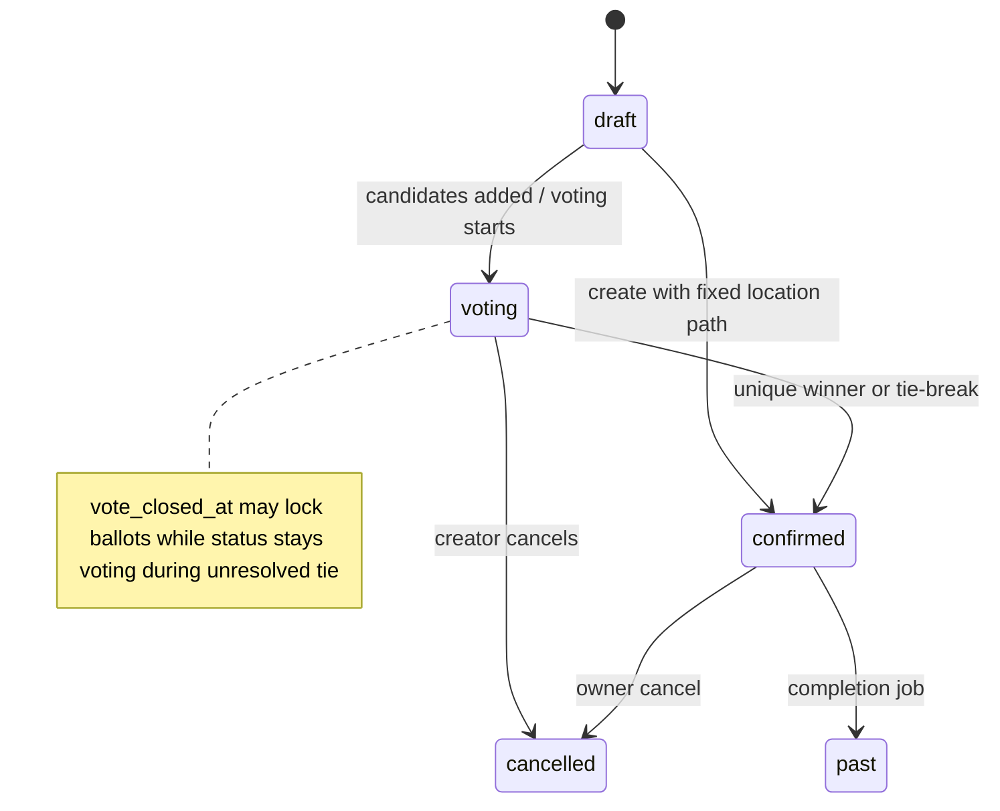

# Yalla 5roga — Business Logic

| Metadata | Value |
|----------|-------|
| Last verified | 2026-11-07 |
| Documentation version | 1.0.0 |
| Product authority | [`PRODUCT_SCENARIOS.md`](PRODUCT_SCENARIOS.md) |
| Implementation evidence | `docs/audit/FINAL_COMPLIANCE_REPORT.md`, voting use cases, lifecycle tests |

This document maps **approved rules** ↔ **current implementation**. It does not invent open decisions.

Legend: **Approved** · **Implemented** · **Partial** · **Missing** · **OPEN**

---

## Place voting vs attendance

| Domain | Purpose | Storage |
|--------|---------|---------|
| Place voting | Where the outing happens | `outing_vote_options`, `outing_votes`, winner fields on `outings` |
| Attendance | Going / Not Going / Maybe | `outing_attendance` |

**Invariant (Approved + Implemented):** Changing attendance never creates/updates/deletes place votes.

---

## Roles (outing-scoped)

| Role | Definition | Implemented |
|------|------------|-------------|
| Owner | `outings.created_by` | Yes |
| Member | Accepted membership (`outing_guests.status=accepted`) and/or group member of `outing.group_id` | Yes |
| Guest role | **Does not exist** | Table name `outing_guests` is historical naming only |

Pending invitation ≠ role. Owner auto Going; Owner cannot leave Going.

---

## Outing types

**Approved + Implemented:** `group` (requires `group_id`, occasion `none`) and `special_event` (optional group; occasion birthday/wedding/celebration/other; selected group requires accepted creator membership). Shared voting, attendance, chat, lifecycle.

---

## Outing lifecycle

| Transition | Authority | Status |
|------------|-----------|--------|
| Create → draft/confirmed/voting | `CreateOutingUseCase` | Implemented (single location → draft/confirmed path; **Add places** on shared create page → voting + options; former suggest sheet removed) |
| draft → voting | Adding options | Implemented |
| All members voted | Remain open until backend deadline | Implemented |
| Deadline close | `close-voting-deadline.job` | Implemented |
| Unique winner → confirmed | `vote-resolution` | Implemented |
| Tie → lock votes, await Owner | `markVotingClosedPendingTie` | Implemented |
| Tie-break → confirmed | `POST …/tie-break` | Implemented |
| Zero votes → tie_pending | creator random/revote | Implemented |
| Owner cancel | `POST …/cancel` | Implemented |
| confirmed → past | `complete-outings.job` | Implemented |

Flutter lists an outing in History once `scheduled_at` is at or before the current instant, or when the server reports `past` or `cancelled`. It excludes those outings from Upcoming and Active Votes. Unscheduled outings still follow their server status. The display cutoff leaves the server lifecycle and attendance rules in effect, so a started outing can still have status `confirmed` and allow eligible arrival check-in from its details.

Backend is source of truth. Flutter must not finalize winners.

---

## Voting rules

**Approved (all required):**

1. The voting endpoints serve the shared outing lifecycle. Create Outing exposes place voting for group outings and a fixed venue for special events. The atomic initial-options create payload follows the group flow.
2. Only Owner adds/modifies candidates before deadline.
3. Eligible: Owner + accepted Members (+ documented group members).
4. One active selection per user/outing/option. The owner-approved Phase 3 ballot may contain multiple distinct options; PUT replaces the complete selection atomically. Empty selection removes the caller’s ballot.
5. Locked after closure (`vote_closed_at` / confirmed / cancelled).
6. Unique highest wins automatically.
7. Tie → Owner-triggered backend RNG among **tied leaders only**; Flutter animates server result.
8. All distinct eligible voters have a nonempty ballot → close immediately after the entire submitted selection is persisted.
9. Deadline → close; zero votes → creator random/revote with all eligible places. Open voting never cancels because of zero votes.
10. Candidate set change → reset all votes, keep deadline, notify.

**Implemented:** Encoded in `voting.usecase.ts`, `vote-resolution.ts`, validators requiring deadline on create, participant helpers.

**Partial:** Flutter candidate replace UI / outing invite deep-link UX (see audit).

### OPEN decisions

None that contradict `PRODUCT_SCENARIOS.md` §22 Open decisions. Eligibility includes group members of `outing.group_id` (documented convenience, not a third role).

---

## Attendance

- Statuses: `going` | `not_going` | `maybe`.
- Owner forced Going on create and on upsert.
- Members update own status while outing not cancelled/past.
- Notifies Owner on member change (`attendance_changed`).
- Arrival is separate from RSVP and place voting. Only a confirmed, pinned venue opens a check-in window. It begins at the scheduled start and ends at the earlier of the outing end and the configured window (360 minutes by default).
- Actual Attendance uses automatic GPS for the authenticated participant. For group outings eligibility is current group membership, independent of RSVP and creator role. The backend checks that the sample is at most 30 seconds old and at most five seconds ahead of server time. Accuracy must meet the configured maximum (50 m by default), and Haversine distance must fit within the configured radius (100 m by default).
- The first successful fix stores the server timestamp, GPS method, distance and accuracy. Further requests preserve it. The backend sends a roster invalidation to current participants through authenticated Socket.IO user rooms. When a device cannot supply location, the viewer’s own row shows Location unavailable. Other participants without an arrival are shown as Not yet verified.

---

## Invitations / membership

**Approved (outing invitations):** Deep link → auth if needed → explicit accept → Member. Opening link alone must not auto-join. Group invitations also require explicit acceptance. Verified-phone registration/login/sync only links identity and preserves pending status.

Group invitation consent (owner-approved 2026-11-14): Create Group and Add people require one explicit confirmation covering WhatsApp invitations for recipients who do not already use the app. Both UI submit actions and the group provider reject unchecked consent; recipient edits clear confirmation. Consent is never inferred from registration status. The backend checks the verified app identity after persisting the pending invitation and queues WhatsApp only for a consented non-user. Registered users retain pending in-app invitations and must explicitly accept.

The Groups tab invitation banner selects from the account's accepted memberships before opening Add people. Owners and accepted members follow the same phone invitation and consent rules.

| Flow | Status |
|------|--------|
| Create group → creator is first member | Implemented — the group and its first `group_members` owner commit atomically; `member_count` starts at 1; members list includes the creator card (`name`/`phone`/`image_url` from `users`) |
| Group phone invite + deep link + claim | Invitation creation records pending for every invitee. Current Firebase-verified identity discovers/links pending rows; only explicit acceptance creates membership transactionally with duplicate protection. Decline preserves history without membership. Existing members remain active. Pending rows are excluded from counts and eligibility. |
| Non-user → `outing_guests` by phone | Outing membership requires a registered `user_id`. Special-event phone messages carry event details and links without creating a member. |
| Outing invite accept/decline APIs | Implemented (`…/invitations/accept|decline`) |
| Outing deep-link accept UI restore | **Partial** |

---

## Chat

Sending, own-message editing and deletion are open in draft / voting / confirmed until two hours after scheduled start. Past and cancelled outings retain participant-authorized, read-only chat history. REST persists; Socket.IO delivers to participants in `outing:{id}` after write (ADR-013).

---

## Media / images (2026-11-12)

PostgreSQL stores media metadata only (`media_assets`); binaries live in Cloudflare R2 (or the local mock adapter). Entity image fields keep accepting absolute http(s) URLs, so existing rows and default covers are unchanged. New uploads persist the stable reference `media://<asset-uuid>`.

Rules:

1. The uploader owns the asset (`owner_id` = Bearer UID). Confirm/delete by another user returns `404`.
2. An asset becomes usable only after `confirm` verifies the object in storage. The reference must match the entity purpose (`profile`/`group`/`outing`/`place`/`chat`) before it can be attached.
3. Group covers can be uploaded before group creation. The Flutter outing creation flow uses the selected venue image. Existing media attachment authorization continues to apply when create or update persists a reference.
4. Place uploads may use a separate public catalog bucket. Other uploads stay in the private bucket. Signed GET URLs require authorization and last at most five minutes. Linked avatars are viewable by authenticated users. Unattached images are owner-only and group/outing/chat images follow current participant access.
5. Abandoned pending intents and failed uploads are cleaned up (storage object + row). Presigned URL expiry does not create a ready asset.
6. Flutter uploads before create/update and never sends local paths. Image cache identity is the stable asset id (`media_private_<uid>_<id>` for private), not the rotating signed URL. Logout/account switch clears that account's private URL metadata and cached images.
7. When storage/CDN is unavailable or the object is missing, the UI falls back to the existing default avatar/cover artwork. Offline devices render previously cached images.

---

## Saved outings / places

Neon-backed APIs. Flutter saved outings remote wired; saved places remote DS present, UI wiring thinner (**Partial**).

---

## Discover

Places from Neon via `/api/places`. Suggestions/vibe filters depend on query params + place fields. Both map screens use the same OpenStreetMap renderer. Outing search uses the cached catalog and optional backend geocoding. The app supports map pin selection with a manual name when external lookup is unavailable.

---

## Offline command policy (2026-11-11)

PostgreSQL remains authoritative. Snapshots are historical views and do not confer current membership, voting eligibility or chat access. Chat sends and form-draft edits support separate bounded recovery paths. Chat sends use the existing outbox: immutable UUIDs deduplicate retries; backend authorization/state rules decide acceptance. Permanent rejection remains failed locally. Votes, RSVP, arrivals, invitations, membership, account/security, published-resource deletion and lifecycle actions are never queued. Form-draft deletion uses the versioned draft tombstone queue described below. Offline revocation cannot be learned until authenticated synchronization; access denials evict local resource snapshots. See ADR-014 and `USER_SCENARIOS` SYNC-01.

## Notifications

Approved event set in PRODUCT_SCENARIOS §14. Outbox + PushChannel + WhatsApp channel implemented; **device FCM delivery NOT RUN**.

---

## Owner vs Member matrix

See PRODUCT_SCENARIOS §13. Backend enforces; Flutter visibility is not authZ.

---

## Conflicts tracker

Use [`docs/audit/FINAL_COMPLIANCE_REPORT.md`](audit/FINAL_COMPLIANCE_REPORT.md) for live compliance. Historical client-finalization and eligibility issues were resolved in the schema rebuild. Phase 3 deliberately supersedes the earlier single-vote PK with the owner-approved multi-location ballot; other server-authority safeguards remain.

### Creator deletes an outing

The existing DELETE endpoint authorizes against `created_by` and permanently removes the outing. Flutter offers the action in outing details to the creator, requires confirmation, and removes the outing from in-memory lists and Saved after success. Cancellation retains a terminal outing record.

### Outing isolation and explicit venue choice

Group schedules may overlap. Each outing has an independent ID, RSVP rows, ordered options, place votes, arrival records, and chat. The creator may close a still-unconfirmed outing’s poll by selecting one of its proposed options. The resolved venue stays locked. Automatic resolution continues to apply if the existing close rules resolve the poll first.

## Chat mentions and refresh rules — 2026-11-11

Mention targets follow chat authorization, including pending outing guests where chat access already allows them; this does not grant voting or attendance rights. Display names come from Neon, IDs define mention identity, and duplicate mention tokens do not multiply notifications. A sender never receives their own chat/mention notification. Chat message/recipient event keys preserve idempotency across REST retry and offline recovery. General refresh does not synchronize accounts or show a global loading/connection banner.

## Synchronization authority — 2026-11-11

Realtime events mirror committed Neon state and never decide vote winners, closure, attendance eligibility or access. Complete attendance rows can update client state directly; incomplete events trigger authenticated resource reads. Historical replay does not restore revoked permissions. The central coordinator performs no write in response to an invalidation, preventing refresh/write feedback loops. Product rules and REST mutation semantics are unchanged. See [centralized synchronization report](audit/CENTRALIZED_REALTIME_SYNC.md).

## Password recovery — 2026-11-11

Forgot Password requires fresh Firebase OTP proof for the canonical UID and its current verified phone matching Neon. Unregistered, passwordless, disabled, or unbound/split identities cannot recover through a profile phone alone. No merge or provisioning occurs. A ten-minute request becomes a five-minute single-use reset authorization only after server verification. UID + phone + password version are rechecked; reset atomically consumes authorization and replaces the existing bcrypt hash. Replayed proofs/grants fail. Existing sessions/data remain intact. Password requirements match the established Flutter eight-character upper/lower/digit/symbol policy, with a 72-byte bcrypt limit. API limits and limitations are defined in [AUTHENTICATION_AND_AUTHORIZATION](AUTHENTICATION_AND_AUTHORIZATION.md); verification scope is in [PASSWORD_RECOVERY_REPORT](audit/PASSWORD_RECOVERY_REPORT.md).

## Confirmed audit rules — 2026-11-13

The server derives initial outing status from options/venue, never client status. The member-add use case refuses owner assignment even when called without HTTP validation. General outing reads are independent of chat-open state. Cancel notifications use the existing participant audience and stable dedupe keys. User directory access remains exact-ID/shared-group-phone lookup only, with phone-free summaries; authorized roster and identity matching retain phones. Notifications are bounded and database-filtered by authenticated user.

Authenticated drafts use PostgreSQL as canonical storage. Local pending edits/deletes are persisted in the existing draft cache, scoped by origin/account, and synchronized once per recovery pass. Server versions are checked before writes and under a row lock. Conflicts retain the local copy and stop automatic retries; transient failures retain pending state. Form drafts do not change outing lifecycle. Arrival time is authoritative server time; a mock flag is only a rejection signal, and genuine GPS cannot be proven from this client payload.

## Phase 2 membership display consistency — 2026-11-13

Verified identity linking is not acceptance. Group roster pending display now includes identity-linked pending invitations as well as phone-only pending rows; neither contributes to active member count. Group creation no longer constructs temporary member objects for invitees. All invitations still use the pending invitation API; only explicit acceptance creates membership. Group-scoped invitation history displays persisted decisions without changing them. Dashboard vote/upcoming/history sections reuse existing OutingsProvider classification and never infer attendance or vote eligibility from presentation state.

## Phase 3 ballots and presentation — 2026-11-14

The complete ballot uses the existing authenticated participant definition and an outing-row lock. It validates every option against the outing, replaces only the caller’s selections, and keeps the round open until its backend deadline. Duplicate options are rejected. POST idempotently adds one selection; DELETE can remove one or all caller selections. These writers also serialize on the outing and reject expired/closed voting. Unique winners confirm at deadline. Tied/zero-vote results await creator random selection or a tied-only revote. Single proposed venues retain explicit confirmation. RSVP and GPS arrival never add/remove votes. UI category, schedule and deadline values remain in the existing route-local create provider between wizard steps; draft deadlines also survive saving without multi-place mode.

## Create voting deadline policy — 2026-11-14

The selected duration is 1–168 hours and remains a duration throughout the wizard/draft lifecycle. The posted absolute deadline is calculated at the request boundary so time spent editing does not shorten it. Every create deadline must be future-dated and, when scheduled_at exists, strictly earlier than that start; equality is invalid. Creation validation and the use-case boundary both enforce this, including direct use-case callers. Legacy relative-only API requests are resolved using server time. Existing deadline jobs, winner/closure/tie-break and vote eligibility are unchanged. The optional integer duration field is metadata; vote_ends_at remains the authoritative closure instant. The API response is authoritative for confirmation, including idempotent retries.

## Default RSVP read model — 2026-11-14

Persisted attendance responses remain going/not_going/maybe. No saved response is authoritative no_response; reads project that default from current accepted membership without writing fake votes or attendance rows. GET attendance and PUT’s items include the complete phone-free participant roster. Each unanswered row has status=no_response and updated_at=null; the creator remains Going. Summary counts include no_response and my_response uses that explicit default. No response is read-only, not an additional user-selected RSVP write. This remains stable across sessions, membership acceptance and offline snapshots. Countdown display is local wall-clock arithmetic only and never closes or resolves a vote.

## Phase 5 chat mutation policy — 2026-11-14

Participant checks precede chat-closure checks. History and read cursors remain available after closure; send/edit/delete return 409 CHAT_CLOSED. Own-message checks reject other senders with 403; a message outside the outing is 404. Delete clears text while preserving the message UUID/client UUID, sender and timestamp as a tombstone, so retries cannot recreate content. Editing a tombstone is 409 MESSAGE_DELETED. Edit is allowed only before sent_at + 60 seconds; at or after that instant it returns 409 MESSAGE_EDIT_WINDOW_EXPIRED. The write predicate enforces the age again at persistence. Delete remains available to the sender while chat is open, independently of the edit window. Edit validates/canonicalizes mentions but does not create additional mention notifications. No group chat or attendance/voting rule changes.

## Android system push rules — 2026-11-14

Notification persistence is transactional with successful chat, group invitation/membership, outing, voting, RSVP and arrival writes. FCM delivery occurs asynchronously and cannot undo valid business operations. Send only to the current authorized audience; recheck access/content/preferences at delivery. Pending group invitations do not create membership, and sync only links verified phone identity. Acceptance alone produces membership activation/join notifications; decisions retain their history and serialize conflicting operations.

Individual votes do not notify. Voting start/close/winner/tie-break/owner-confirmation and candidate-reset transitions notify once under durable keys; confirmed venues remain immutable. One-hour reminders use actual configured vote_ends_at and scheduled_at, including day-based deadlines. No closed/expired/cancelled reminder is delivered. RSVP opening is independent of voting, and repeated identical RSVP writes do not produce duplicate notifications. No distinct RSVP-deadline configuration exists, so no separate deadline is invented.

Arrival reminders require the confirmed pinned venue and existing attendance window and exclude already-arrived users. Actual arrival still requires backend location verification; notification actions cannot write presence. Read actions affect only the caller's selected conversation, including its inbox rows. Edits/deletions preserve chat authorization/window, replace previews or tombstone them, and never regenerate deleted text. See [current notification behavior](NOTIFICATIONS.md) and [audit](audit/ANDROID_SYSTEM_PUSH.md).

## Place taxonomy and lifecycle — 2026-11-14

The owner-approved [places rules](PRODUCT_SCENARIOS.md#places-catalog-synchronization-and-filters--owner-approved-2026-11-14) replace the former catalog's fixed-vibe filtering model. Place category/vibes are independent database definitions; four-value outing vibes remain unchanged. One shared client filter object and one server query policy apply categories/vibes/search/distance to both list and map results. Active is the default status. Temporary/permanent/unverified records remain readable for history, with availability labels; new selection rejects permanent closure on the backend.

Absence is review evidence, never proof of permanent closure: only three complete successful covered cycles yield unverified. A limited/dry/failed run cannot advance absence. Positive current tags restore availability; explicit retirement/demolition/removal supports permanent closure and ambiguous disuse/hours supports temporary closure. Every change stores source evidence. Manually created or curator-managed source identities are protected. Only simple explicit weekday hours are projected when exactly representable by the existing place/day schema; other expressions stay raw. Absent source images preserve existing covers/fallbacks. Unknown prices remain null. Budget/work vibes require explicit supporting tags, and no romantic inference exists. There is no weekly schedule or due gate (owner update 2026-11-15). Manual source imports retain the lease, checkpoints and idempotency. Absence advances at most once per distinct complete source release; replaying a release cannot increase it.

## Saved place cards and filter — 2026-11-14

Saved place bookmarks are independent of outings and drafts. Confirmed backend success updates the bookmark; errors retain its state. The saved Places filter includes unavailable saved places with status labels and current detail navigation. Account changes clear bookmark state and in-flight results from the prior account.

## Sole-owner group leave — 2026-11-14

The confirmed sole owner's leave uses the existing group DELETE operation. Deletion revalidates that the caller is an owner and is the only active group member inside the existing group row lock/transaction. Other active members cause 409; groups with any outings retain the existing 409 history protection. Pending invitations do not count as active members. A failed deletion leaves group/membership intact. Ordinary member self-removal and the last-owner prohibition remain unchanged. There is no separate Delete Group UI action.

## Arrival work begins at scheduled start — 2026-11-14

Flutter defers arrival roster reads and device GPS/permission work until scheduledAt <= now. A local one-shot timer starts work only on the visible foreground outing route; schedule/visibility/lifecycle changes cancel and re-arm it as appropriate. The service also checks the server-supplied opensAt/closesAt window around location operations. The backend already rejects verification before scheduled_at or outside the confirmed outing window; no server rule or endpoint changes. This restriction does not postpone RSVP or place voting.

## Multi-branch places — 2026-11-15

Places remain physical branches with stable UUIDs and existing outing/vote, taxonomy, hours, image and price relations. Nullable place_brands association and bilingual aliases identify shared brands. Explicit brand evidence and conservative address/distance matching prevent name-only physical merges; ambiguous matches are logged. Independent places remain supported. Existing source/type/source_id fields provide namespaced external identity, with an additional SQL uniqueness index.

GET /api/places accepts brand_id; GET /api/place-brands/:id and /:id/branches expose metadata and paginated physical branches. Nearby and detail DTOs carry brand/branch metadata. Flutter reuses catalog Provider/repository/cache queries for explicit branch selection; map pins and outing payloads retain physical IDs and coordinates. No category/vibe defaults are inherited. Existing manual import operation is retained; no weekly scheduler is restored.

Verification: ten requested scenarios passed through served Swagger/HTTP against local PostgreSQL/WASM, migration applied twice, 15 catalog logic tests passed, TypeScript and Prisma validation passed. Targeted Dart analysis has no errors/warnings and three existing style infos. Flutter runtime, themes/locales/sizes/input states and device/realtime behavior were not exercised. See audit/PLACE_BRANCHES_OPENAPI_RESULTS.json and audit/PLACE_BRANCHES_MIGRATION_DEPLOYMENT.json for deployment status.

## Round-based location voting — 2026-11-15

`resolveClosedVoting` freezes valid current-participant votes into relational round-option results at the deadline. Historical ballots remain immutable when a revote starts. The outing row is locked for every ballot, closure, random resolution, revote and ordinary cancellation. `current_voting_round` selects the authoritative round; votes are unique per outing/user/option/round. The round table persists active/tie_pending/closed/confirmed/cancelled; API derives `revote_active` from an active round numbered above one. Group-owner status is irrelevant to creator authorization.

Random and revote serialize on the same row. Random retries in the same confirmed round return the same winner; duplicate/stale revote requests return 409. New clients send `round_number`; omitted round guards mean round 1 for compatibility and cannot mutate later rounds. Vote removal uses the same guard in its query. New-round options must reference that round; manual confirmation cannot bypass a revote. Notification outbox writes commit with transitions and durable per-round keys. GPS/RSVP and chat membership never change.

The deadline worker selects only rounds with at least two candidates, so older single-location outings awaiting manual confirmation leave room in each batch for competitive rounds. An elapsed outing end removes creator tie actions and prevents resolution.
