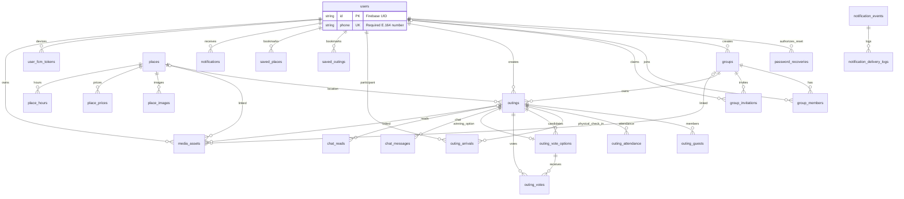

# Yalla 5roga — Database Architecture

| Metadata | Value |
|----------|-------|
| Last verified | 2026-11-13 |
| Documentation version | 1.1.0 |
| Source of truth | `backend/prisma/schema.prisma` → Neon PostgreSQL |
| Configured Neon schema | Thirteen migrations applied through `20261113180000_multi_location_ballots` on 2026-11-14 (Cairo). Recovery and media migration deployments are verified in [recovery report](audit/PASSWORD_RECOVERY_REPORT.md) and [media report](audit/MEDIA_STORAGE_REPORT.md). |
| Needs verification | Live production index usage stats |

Neon PostgreSQL is the **only** application data store. Firebase is not an app database.

## 1. Entity relationship overview

## 2. Tables

### `users`

The stable Firebase UID is the primary key. The unique E.164 phone is the lookup and invitation address. New registration requires verified phone proof. The approved cleanup removed legacy email and password-update timestamps and made the phone required.

| Column | Type | Notes |
|--------|------|-------|
| `id` | `VarChar(128)` PK | Firebase UID |
| `name` | `VarChar(30)` | required |
| `phone` | `VarChar(16)` unique, NOT NULL | E.164 format checked by PostgreSQL |
| `password_hash` | `VarChar(255)?` | bcrypt credential for phone/password login. A legacy row may have no hash. |
| `image_url` | `VarChar(2048)?` | |
| `created_at` / `updated_at` | timestamptz | defaults / `@updatedAt` |

### `groups`

UUID PK (`gen_random_uuid()`). Fields: `name`, `bio`, `image_url`, `created_by` → `users.id` (`NoAction`), timestamps. Cascades: members/invitations on group delete.

### `group_members`

Composite PK `(group_id, user_id)`. `role` enum `group_role` default `member`. Cascade delete from group/user. Index on `user_id`. Group creation and the initial owner membership are atomic. Owner removal locks the group while enforcing the last-owner rule.

### `group_invitations`

Phone association for group membership. PK UUID. `invited_phone`, `status` (`invitation_status` default `pending`), legacy `expires_at`, and optional `user_id`. The partial unique index permits one pending association per group and E.164 phone. Pending associations remain eligible until linked or revoked. The expiry timestamp is retained for schema compatibility and existing historical statuses retain their meaning.

Phone values use E.164 normalization (default region Egypt). Invitations begin pending for registered and unregistered recipients. Verified signup/login/sync locks the matching profile and unlinked pending rows and sets user_id only. Explicit accept/decline locks the invitation row before reading status. Accept inserts group_members with skipDuplicates and records accepted in the same transaction; decline links identity for history without membership. Existing active memberships and historical rows are preserved. Owner revocation changes only pending rows. Current-user group lists continue to use actual group_members.

### `places`

Catalog places. UUID PK. `vibe` (`outing_vibe`), `price_level`, optional lat/lng, `featured`, `is_active`. Child tables: `place_images`, `place_prices`, `place_hours` (unique `place_id+day`).

### `outings`

| Column | Notes |
|--------|-------|
| `id` | UUID PK |
| `title` | VarChar(20) |
| `group_id` | optional FK groups |
| `created_by` | Owner (users.id) |
| `status` | `outing_status` default `draft` |
| `type` | `outing_type` default `group` |
| `occasion` | `outing_occasion` default `none` |
| `scheduled_at` / `ends_at` | optional |
| location_* | place_id / name / area / lat / lng |
| `vote_deadline_hours` | optional smallint |
| `vote_ends_at` | **required by product / create validator** |
| `vote_closed_at` | set when ballots lock |
| `vote_close_reason` | enum, including `owner_confirmed` for explicit creator choice |
| `winning_option_id` | composite FK `(winning_option_id, id)` → `(outing_vote_options.id, outing_id)` |

Indexes: status, group, scheduled, created_by, vote_ends_at, (status, vote_ends_at).

### `outing_guests`

Outing membership and invitation state. Composite PK `(outing_id, user_id)`. The `invitation_status` default is `pending`. Acceptance remains explicit. Outing and user deletion cascade to their membership rows.

### `outing_attendance`

Composite PK `(outing_id, user_id)`. `status` `attendance_status` (`going|not_going|maybe`). Independent of votes.

### `outing_arrivals`

Composite PK `(outing_id, user_id)`, with an `arrived_at` timestamp and cascading foreign keys. The table records the first physical check-in and its `verification_method`. New arrivals use `gps`. The check constraint requires finite distance and positive finite accuracy for GPS methods, in meters. The migration preserves earlier rows, including former organizer records. Those organizer records are excluded from the verified roster and can be replaced by valid GPS verification. The presence of a verified row represents arrival, and raw device coordinates are discarded. `outings.create_request_key` is nullable and unique per creator so retrying the same submission can reuse the original outing. The group index is nonunique and no scheduling exclusion applies.

### `outing_vote_options`

UUID PK. FK outing (cascade). Optional `place_id`. Unique `(outing_id, place_id)`, unique `(id, outing_id)` for composite winner FK.

### `outing_votes`

**Multiple location selections per ballot.** PK `(outing_id, user_id, option_id)`. The option FK still uses `(option_id, outing_id)`, preventing cross-outing selections. `20261113180000_multi_location_ballots` expands the primary key without deleting rows, changing IDs or replacing foreign keys. Existing single selections remain valid. Distinct user IDs determine participation; option rows determine each candidate tally.

### `outing_drafts`

Server-side drafts are canonical for authenticated users; Flutter keeps the existing account/origin-scoped preferences cache and pending changes. PostgreSQL checks that `guest_ids` and `selected_places` are JSON arrays.

### `chat_messages` / `chat_reads`

Messages use an optional `client_message_id` unique per `(outing_id, sender_id, client_message_id)`. Reads use a composite key and a `last_read_at` timestamp. The update preserves the highest timestamp and group seen state is derived from it.

### `notifications`

In-app inbox. Unique nullable `event_key` for idempotency. Types: `notification_type`.

### `user_fcm_tokens`

Globally unique `token` with a separate `user_id` index for delivery. Re-registration can update the owning user in one write.

### `saved_outings` / `saved_places`

Composite PKs `(user_id, outing_id)` and `(user_id, place_id)`. Each table has a `(user_id, saved_at DESC)` index for the current-user saved list.

### `notification_events` / `notification_delivery_logs`

Outbox + delivery audit. Unique `event_key` on events. Claim index `(status, next_attempt_at)`.

### `media_assets`

Object-storage metadata only — image bytes never enter Neon. `object_key` is unique and immutable per stored version; replacing an image creates a new asset/key. `bucket`, `mime_type`, `file_size` (refreshed from storage on confirm), `visibility` (`public` | `private`), `status` (`pending` → `ready`, or `failed`), `purpose` (`profile` | `group` | `outing` | `place` | `chat`), `owner_id` (Firebase UID), optional `user_id`/`group_id`/`outing_id`/`place_id` links, `verified_at`, and `upload_expires_at` for orphan cleanup.

Entity image fields (`users.image_url`, `groups.image_url`, `outings.image_url`, `places.cover_image_url`, `place_images.image_url`) keep storing strings. A row may hold a legacy absolute http(s) URL or the stable reference `media://<media_assets.id>`. Public place assets resolve to the CDN URL; private assets resolve on demand through short-lived signed GET URLs after permission checks. Linking the asset to an entity is a separate column update, so covers may be uploaded before the group/outing row exists (`group_id`/`outing_id` null until attach).

Indexes: owner, cleanup `(status, upload_expires_at)`, and each optional entity link.

## 3. Enums (Prisma)

`attendance_status`, `group_role`, `notification_type`, `outing_occasion`, `outing_type`, `outing_status`, `vote_close_reason`, `outing_vibe`, `price_level`, `weekday`, `invitation_status`, `notification_event_type`, `notification_channel`, `notification_event_status`, `media_visibility`, `media_status`, `media_purpose`.

## 4. Important invariants

1. Firebase UID = `users.id`.
2. Outing Owner = `outings.created_by` (not a global role).
3. One selection per `(outing_id, user_id, option_id)`; multiple selections form one caller ballot.
4. Winner option must belong to same outing (composite FK).
5. Attendance changes must never mutate `outing_votes`.
6. Confirmed winning location must stay consistent with `winning_option_id`.
7. Notification outbox + in-app rows use `event_key` for idempotency.
8. Pending invitations are not eligible voters.
9. Database constraints enforce outing type/group consistency, an end after a start, vote-deadline range (1–72 hours), and draft clock fields (hour 0–23, minute 0–59). Existing historical rows must be audited before constraints are validated.
10. Chat seen state is derived from `chat_reads`; `chat_messages.delivery_status` was removed.
11. Media binaries are never stored in Neon; only `media_assets` metadata/object keys are persisted.
12. An entity image field holds either an absolute http(s) URL or a `media://<uuid>` reference — never a signed URL, local path, or binary.
13. `media_assets.status` must be `ready` and the reference must match the entity purpose before an asset can be attached.

## 5. Transaction requirements

| Operation | Requirement |
|-----------|-------------|
| Create outing | Create outing + owner attendance Going |
| Replace candidates | Delete votes + options + insert options; preserve `vote_ends_at` |
| Cast vote + early close | Upsert vote; if all eligible voted, resolve in transaction |
| Deadline close / tie-break | Lock outing row; resolve tallies; update status/winner |
| Zero votes at close | Cancel outing; set `vote_close_reason=zero_votes` |

## 6. Data ownership

| Data | Owner |
|------|-------|
| Profile | User (self) |
| Group | Group creator / group owner role |
| Outing lifecycle | Outing creator |
| Votes | Eligible member (own vote only) |
| Attendance | Participant (owner forced Going) |
| Chat | Participants |
| Saves | User |
| Media assets | Uploader (`owner_id`); group/outing/chat visibility follows participants |
| Places catalog | Backend content APIs (auth for mutations) |

## 7. Current vs future

Current schema matches product scenario rebuild (`draft/voting/confirmed/cancelled/past`, vote PK, saved_places, notification outbox). Do not document obsolete enums (`upcoming`, `not_voted`) as current.

Historical notes and audits: `docs/audit/`, `docs/system-design/`.

## Related

- [`BUSINESS_LOGIC.md`](BUSINESS_LOGIC.md)
- [`SYSTEM_DESIGN.md`](SYSTEM_DESIGN.md)

### Nearby place search

The service computes nearby results from active rows in `places` with coordinates. It uses indexed geographic bounds followed by a spherical distance filter and nearest-first ordering. Discover and Nearby do not have separate tables.

### Initial vote candidates and fixed locations

Initial group vote candidates reuse `outing_vote_options` and `sort_order`. The outing transaction stores them together with the outing and owner attendance. It uses the existing creator-scoped unique request key and PostgreSQL transaction advisory lock to replay a committed create safely. Fixed catalog selections use `outings.location_place_id`; latitude and longitude remain nullable, including for older catalog entries. No map-specific migration is required.

## Stable chat mention storage — 2026-11-11

Mentions are encoded inline in existing `chat_messages.text` as `<@URI-encoded-user-id|URI-encoded-display-name>`. IDs are stable Firebase UID/Neon user primary keys; labels are canonicalized from Neon at write time. Existing message/client UUID and notification/outbox uniqueness provide retry deduplication. No schema migration is introduced. The realtime invalidation buffer holds no durable application state and is intentionally lost on process restart.

## Password recovery security state — 2026-11-11

Additive migration `20261111180000_password_recovery` introduces two tables. It was applied to the configured application schema on 2026-11-11 with `prisma migrate deploy`, after confirming it was the only pending migration. The real recovery preflight subsequently succeeded without sending SMS or changing a password.

- `password_recoveries`: request digest PK, existing `user_id` FK with delete cascade, bound E.164 phone, SHA-256 version digest of existing bcrypt hash, creation/expiration timestamps, unique nullable phone-sign-in proof digest and reset-secret digest, nullable consumed timestamp. Expiry is indexed. Successful consumption and password CAS update are one transaction; competing grants are invalidated.
- `password_recovery_limits`: digest key PK, integer attempts, indexed expiry. Atomic upsert provides shared fixed-window limits, without storing raw IP addresses or opaque credentials.

No plaintext passwords, OTPs, Firebase ID tokens or raw recovery secrets are persisted. Only the existing `users.password_hash` is updated. Replay markers survive beyond accepted proof lifetime; rows expired more than a day ago and expired limit buckets are cleaned during recovery starts.

## Confirmed-fixes persistence notes — 2026-11-13

No schema or migration changed. Retry-safe draft creation reuses the existing UUID primary key via Idempotency-Key. Update/delete optional If-Match checks reuse updated_at inside a row lock. Updates advance the timestamp by at least one API millisecond to distinguish consecutive writes. No tables, roles, Redis store or location-verification provider were added. The existing draft schema has no guest-phone column; phone-contact selections stay in the local cache and are not cross-device canonical data. Legacy unscoped preferences are retained untouched and are not silently attributed to another signed-in account.

## Neon migration synchronization check — 2026-11-13

The owner requested deployment of any pending database changes before committing and pushing the local working tree. Live Prisma Migrate status on the configured Neon direct endpoint reported all 12 local migrations applied, through `20261112120000_media_assets`. A separate read of `_prisma_migrations` confirmed 12 completed/non-rolled-back migrations and matching SHA-256 checksums for every local migration.sql. There were no pending or mismatched migrations, so no migration deployment or application-data change was needed. The initial pooled connection failed; retry used the same direct-host/channel-binding normalization already present in backend database configuration. No schema diagram change was required.

## Phase 3 migration verification — 2026-11-14

A private logical snapshot and rollback-only recovery rehearsal are recorded in `audit/PHASE_3_DATABASE_BACKUP.json`. Every application table plus Prisma history was restored with matching row checksums and foreign keys before applying the exact vote-key migration to the restored schema. The migration was deployed with Prisma Migrate. `audit/PHASE_3_DATABASE_DEPLOYMENT.json` confirms the applied file checksum, primary key, valid constraints, preserved source vote checksum and absence of disposable schemas. No `db push`, reset or data deletion is used.
