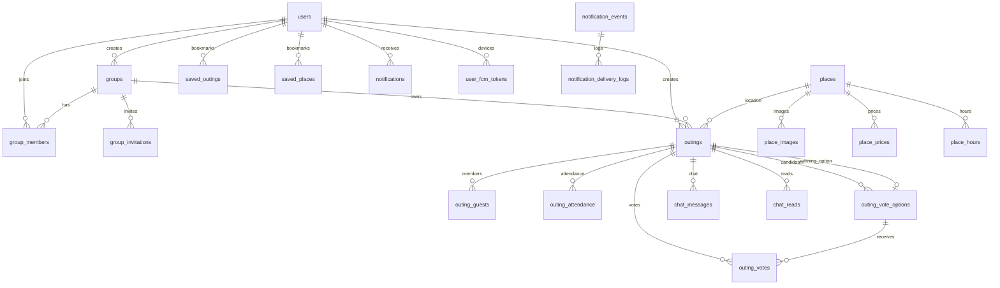

# Yalla 5roga — Database Architecture

| Metadata | Value |
|----------|-------|
| Last verified | 2026-11-07 |
| Documentation version | 1.0.0 |
| Source of truth | `backend/prisma/schema.prisma` → Neon PostgreSQL |
| Needs verification | Live production index usage stats |

Neon PostgreSQL is the **only** application data store. Firebase is not an app database.

## 1. Entity relationship overview

## 2. Tables

### `users`

| Column | Type | Notes |
|--------|------|-------|
| `id` | `VarChar(128)` PK | Firebase UID |
| `name` | `VarChar(30)` | required |
| `phone` | `VarChar(16)?` unique | |
| `email` | `VarChar(254)?` unique | |
| `password_hash` | `VarChar(255)?` | bcrypt for email/password; null for social/phone-only |
| `password_updated_at` | timestamptz? | |
| `image_url` | `VarChar(2048)?` | |
| `created_at` / `updated_at` | timestamptz | defaults / `@updatedAt` |

### `groups`

UUID PK (`gen_random_uuid()`). Fields: `name`, `bio`, `image_url`, `created_by` → `users.id` (`NoAction`), timestamps. Cascades: members/invitations on group delete.

### `group_members`

Composite PK `(group_id, user_id)`. `role` enum `group_role` default `member`. Cascade delete from group/user. Index on `user_id`.

### `group_invitations`

Phone invitation to a group. PK UUID. `invited_phone`, `status` (`invitation_status` default `pending`), `expires_at`, optional `user_id`. Indexes on group, phone, status, phone+status, user.

### `places`

Catalog places. UUID PK. `vibe` (`outing_vibe`), `price_level`, optional lat/lng, `featured`, `is_active`. Child tables: `place_images`, `place_prices`, `place_hours` (unique `place_id+day`).

### `outings`

| Column | Notes |
|--------|-------|
| `id` | UUID PK |
| `title` | VarChar(20) |
| `group_id` | optional FK groups |
| `created_by` | Owner (users.id) |
| `status` | `outing_status` default `draft` |
| `type` | `outing_type` default `group` |
| `occasion` | `outing_occasion` default `none` |
| `scheduled_at` / `ends_at` | optional |
| location_* | place_id / name / area / lat / lng |
| `vote_deadline_hours` | optional smallint |
| `vote_ends_at` | **required by product / create validator** |
| `vote_closed_at` | set when ballots lock |
| `vote_close_reason` | enum |
| `winning_option_id` | composite FK `(winning_option_id, id)` → `(outing_vote_options.id, outing_id)` |
| `suggested_by_user_id` | optional |

Indexes: status, group, scheduled, created_by, vote_ends_at, (status, vote_ends_at).

### `outing_guests`

Outing membership / invitation. Composite PK `(outing_id, user_id)`. `status` `invitation_status` default `accepted` (historical create path). Product roles remain Owner vs Member — this table is invitation/membership state, **not** a Guest role. Cascade on outing/user delete.

### `outing_attendance`

Composite PK `(outing_id, user_id)`. `status` `attendance_status` (`going|not_going|maybe`). Independent of votes.

### `outing_vote_options`

UUID PK. FK outing (cascade). Optional `place_id`. Unique `(outing_id, place_id)`, unique `(id, outing_id)` for composite winner FK.

### `outing_votes`

**One active vote per user per outing.** PK `(outing_id, user_id)`. FK option via composite `(option_id, outing_id)`. Change vote = update row.

### `outing_drafts`

Server-side drafts (Flutter may also keep local prefs drafts). JSON `guest_ids`, `selected_places`.

### `chat_messages` / `chat_reads`

Messages: text ≤ 2000, optional `client_message_id` unique per `(outing_id, sender_id, client_message_id)`. Reads: composite PK; `last_read_at`. `delivery_status` on message is deprecated for group seen-state.

### `notifications`

In-app inbox. Unique nullable `event_key` for idempotency. Types: `notification_type`.

### `user_fcm_tokens`

Unique `(user_id, token)` and unique `token`.

### `saved_outings` / `saved_places`

Composite PKs `(user_id, outing_id)` / `(user_id, place_id)`.

### `notification_events` / `notification_delivery_logs`

Outbox + delivery audit. Unique `event_key` on events. Claim index `(status, next_attempt_at)`.

## 3. Enums (Prisma)

`attendance_status`, `group_role`, `notification_type`, `outing_occasion`, `outing_type`, `outing_status`, `vote_close_reason`, `outing_vibe`, `price_level`, `weekday`, `message_delivery_status`, `invitation_status`, `notification_event_type`, `notification_channel`, `notification_event_status`.

## 4. Important invariants

1. Firebase UID = `users.id`.
2. Outing Owner = `outings.created_by` (not a global role).
3. One vote per `(outing_id, user_id)`.
4. Winner option must belong to same outing (composite FK).
5. Attendance changes must never mutate `outing_votes`.
6. Confirmed winning location must stay consistent with `winning_option_id`.
7. Notification outbox + in-app rows use `event_key` for idempotency.
8. Pending invitations are not eligible voters.

## 5. Transaction requirements

| Operation | Requirement |
|-----------|-------------|
| Create outing | Create outing + owner attendance Going |
| Replace candidates | Delete votes + options + insert options; preserve `vote_ends_at` |
| Cast vote + early close | Upsert vote; if all eligible voted, resolve in transaction |
| Deadline close / tie-break | Lock outing row; resolve tallies; update status/winner |
| Zero votes at close | Cancel outing; set `vote_close_reason=zero_votes` |

## 6. Data ownership

| Data | Owner |
|------|-------|
| Profile | User (self) |
| Group | Group creator / group owner role |
| Outing lifecycle | Outing creator |
| Votes | Eligible member (own vote only) |
| Attendance | Participant (owner forced Going) |
| Chat | Participants |
| Saves | User |
| Places catalog | Backend content APIs (auth for mutations) |

## 7. Current vs future

Current schema matches product scenario rebuild (`draft/voting/confirmed/cancelled/past`, vote PK, saved_places, notification outbox). Do not document obsolete enums (`upcoming`, `not_voted`) as current.

Historical notes and audits: `docs/audit/`, `docs/system-design/`.

## Related

- [`BUSINESS_LOGIC.md`](BUSINESS_LOGIC.md)
- [`SYSTEM_DESIGN.md`](SYSTEM_DESIGN.md)
