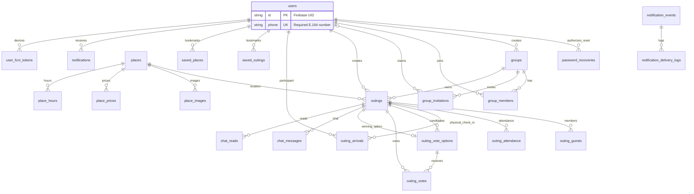

# Yalla 5roga — Database Architecture

| Metadata | Value |
|----------|-------|
| Last verified | 2026-11-10 |
| Documentation version | 1.0.0 |
| Source of truth | `backend/prisma/schema.prisma` → Neon PostgreSQL |
| Configured Neon schema | Eleven migrations applied through `20261111180000_password_recovery` on 2026-11-11. Recovery migration deployment and account preflight are verified in [recovery report](audit/PASSWORD_RECOVERY_REPORT.md). |
| Needs verification | Live production index usage stats |

Neon PostgreSQL is the **only** application data store. Firebase is not an app database.

## 1. Entity relationship overview

## 2. Tables

### `users`

The stable Firebase UID is the primary key. The unique E.164 phone is the lookup and invitation address. New registration requires verified phone proof. The approved cleanup removed legacy email and password-update timestamps and made the phone required.

| Column | Type | Notes |
|--------|------|-------|
| `id` | `VarChar(128)` PK | Firebase UID |
| `name` | `VarChar(30)` | required |
| `phone` | `VarChar(16)` unique, NOT NULL | E.164 format checked by PostgreSQL |
| `password_hash` | `VarChar(255)?` | bcrypt credential for phone/password login. A legacy row may have no hash. |
| `image_url` | `VarChar(2048)?` | |
| `created_at` / `updated_at` | timestamptz | defaults / `@updatedAt` |

### `groups`

UUID PK (`gen_random_uuid()`). Fields: `name`, `bio`, `image_url`, `created_by` → `users.id` (`NoAction`), timestamps. Cascades: members/invitations on group delete.

### `group_members`

Composite PK `(group_id, user_id)`. `role` enum `group_role` default `member`. Cascade delete from group/user. Index on `user_id`. Group creation and the initial owner membership are atomic. Owner removal locks the group while enforcing the last-owner rule.

### `group_invitations`

Phone association for group membership. PK UUID. `invited_phone`, `status` (`invitation_status` default `pending`), legacy `expires_at`, and optional `user_id`. The partial unique index permits one pending association per group and E.164 phone. Pending associations remain eligible until linked or revoked. The expiry timestamp is retained for schema compatibility and existing historical statuses retain their meaning.

Phone values use E.164 normalization (default region Egypt), shared by signup/login/invites/sync. A pending association has `user_id=null`. Verified signup, login or sync locks the matching profile and pending rows, inserts active memberships in bulk and records the links as `accepted` with the same UID in one transaction. Owner revocation changes a still-pending row to `revoked`. Removing a registered member also revokes any still-pending row for the same group and phone. The current-user groups query uses `group_members.some(user_id=Bearer UID)`, not creator-only filtering. The integrity migration enforces the phone format and pending uniqueness while preserving all existing primary keys. Its real PostgreSQL/HTTP regression test rolls back all fixture writes and verifies no fixture users persist.

### `places`

Catalog places. UUID PK. `vibe` (`outing_vibe`), `price_level`, optional lat/lng, `featured`, `is_active`. Child tables: `place_images`, `place_prices`, `place_hours` (unique `place_id+day`).

### `outings`

| Column | Notes |
|--------|-------|
| `id` | UUID PK |
| `title` | VarChar(20) |
| `group_id` | optional FK groups |
| `created_by` | Owner (users.id) |
| `status` | `outing_status` default `draft` |
| `type` | `outing_type` default `group` |
| `occasion` | `outing_occasion` default `none` |
| `scheduled_at` / `ends_at` | optional |
| location_* | place_id / name / area / lat / lng |
| `vote_deadline_hours` | optional smallint |
| `vote_ends_at` | **required by product / create validator** |
| `vote_closed_at` | set when ballots lock |
| `vote_close_reason` | enum, including `owner_confirmed` for explicit creator choice |
| `winning_option_id` | composite FK `(winning_option_id, id)` → `(outing_vote_options.id, outing_id)` |

Indexes: status, group, scheduled, created_by, vote_ends_at, (status, vote_ends_at).

### `outing_guests`

Outing membership and invitation state. Composite PK `(outing_id, user_id)`. The `invitation_status` default is `pending`. Acceptance remains explicit. Outing and user deletion cascade to their membership rows.

### `outing_attendance`

Composite PK `(outing_id, user_id)`. `status` `attendance_status` (`going|not_going|maybe`). Independent of votes.

### `outing_arrivals`

Composite PK `(outing_id, user_id)`, with an `arrived_at` timestamp and cascading foreign keys. The table records the first physical check-in and its `verification_method`. New arrivals use `gps`. The check constraint requires finite distance and positive finite accuracy for GPS methods, in meters. The migration preserves earlier rows, including former organizer records. Those organizer records are excluded from the verified roster and can be replaced by valid GPS verification. The presence of a verified row represents arrival, and raw device coordinates are discarded. `outings.create_request_key` is nullable and unique per creator so retrying the same submission can reuse the original outing. The group index is nonunique and no scheduling exclusion applies.

### `outing_vote_options`

UUID PK. FK outing (cascade). Optional `place_id`. Unique `(outing_id, place_id)`, unique `(id, outing_id)` for composite winner FK.

### `outing_votes`

**One active vote per user per outing.** PK `(outing_id, user_id)`. FK option via composite `(option_id, outing_id)`. Change vote = update row.

### `outing_drafts`

Server-side drafts (Flutter may also keep local prefs drafts). PostgreSQL checks that `guest_ids` and `selected_places` are JSON arrays.

### `chat_messages` / `chat_reads`

Messages use an optional `client_message_id` unique per `(outing_id, sender_id, client_message_id)`. Reads use a composite key and a `last_read_at` timestamp. The update preserves the highest timestamp and group seen state is derived from it.

### `notifications`

In-app inbox. Unique nullable `event_key` for idempotency. Types: `notification_type`.

### `user_fcm_tokens`

Globally unique `token` with a separate `user_id` index for delivery. Re-registration can update the owning user in one write.

### `saved_outings` / `saved_places`

Composite PKs `(user_id, outing_id)` and `(user_id, place_id)`. Each table has a `(user_id, saved_at DESC)` index for the current-user saved list.

### `notification_events` / `notification_delivery_logs`

Outbox + delivery audit. Unique `event_key` on events. Claim index `(status, next_attempt_at)`.

## 3. Enums (Prisma)

`attendance_status`, `group_role`, `notification_type`, `outing_occasion`, `outing_type`, `outing_status`, `vote_close_reason`, `outing_vibe`, `price_level`, `weekday`, `invitation_status`, `notification_event_type`, `notification_channel`, `notification_event_status`.

## 4. Important invariants

1. Firebase UID = `users.id`.
2. Outing Owner = `outings.created_by` (not a global role).
3. One vote per `(outing_id, user_id)`.
4. Winner option must belong to same outing (composite FK).
5. Attendance changes must never mutate `outing_votes`.
6. Confirmed winning location must stay consistent with `winning_option_id`.
7. Notification outbox + in-app rows use `event_key` for idempotency.
8. Pending invitations are not eligible voters.
9. Database constraints enforce outing type/group consistency, an end after a start, vote-deadline range (1–72 hours), and draft clock fields (hour 0–23, minute 0–59). Existing historical rows must be audited before constraints are validated.
10. Chat seen state is derived from `chat_reads`; `chat_messages.delivery_status` was removed.

## 5. Transaction requirements

| Operation | Requirement |
|-----------|-------------|
| Create outing | Create outing + owner attendance Going |
| Replace candidates | Delete votes + options + insert options; preserve `vote_ends_at` |
| Cast vote + early close | Upsert vote; if all eligible voted, resolve in transaction |
| Deadline close / tie-break | Lock outing row; resolve tallies; update status/winner |
| Zero votes at close | Cancel outing; set `vote_close_reason=zero_votes` |

## 6. Data ownership

| Data | Owner |
|------|-------|
| Profile | User (self) |
| Group | Group creator / group owner role |
| Outing lifecycle | Outing creator |
| Votes | Eligible member (own vote only) |
| Attendance | Participant (owner forced Going) |
| Chat | Participants |
| Saves | User |
| Places catalog | Backend content APIs (auth for mutations) |

## 7. Current vs future

Current schema matches product scenario rebuild (`draft/voting/confirmed/cancelled/past`, vote PK, saved_places, notification outbox). Do not document obsolete enums (`upcoming`, `not_voted`) as current.

Historical notes and audits: `docs/audit/`, `docs/system-design/`.

## Related

- [`BUSINESS_LOGIC.md`](BUSINESS_LOGIC.md)
- [`SYSTEM_DESIGN.md`](SYSTEM_DESIGN.md)

### Nearby place search

The service computes nearby results from active rows in `places` with coordinates. It uses indexed geographic bounds followed by a spherical distance filter and nearest-first ordering. Discover and Nearby do not have separate tables.

### Initial vote candidates and fixed locations

Initial group vote candidates reuse `outing_vote_options` and `sort_order`. The outing transaction stores them together with the outing and owner attendance. It uses the existing creator-scoped unique request key and PostgreSQL transaction advisory lock to replay a committed create safely. Fixed catalog selections use `outings.location_place_id`; latitude and longitude remain nullable, including for older catalog entries. No map-specific migration is required.

## Stable chat mention storage — 2026-11-11

Mentions are encoded inline in existing `chat_messages.text` as `<@URI-encoded-user-id|URI-encoded-display-name>`. IDs are stable Firebase UID/Neon user primary keys; labels are canonicalized from Neon at write time. Existing message/client UUID and notification/outbox uniqueness provide retry deduplication. No schema migration is introduced. The realtime invalidation buffer holds no durable application state and is intentionally lost on process restart.

## Password recovery security state — 2026-11-11

Additive migration `20261111180000_password_recovery` introduces two tables. It was applied to the configured application schema on 2026-11-11 with `prisma migrate deploy`, after confirming it was the only pending migration. The real recovery preflight subsequently succeeded without sending SMS or changing a password.

- `password_recoveries`: request digest PK, existing `user_id` FK with delete cascade, bound E.164 phone, SHA-256 version digest of existing bcrypt hash, creation/expiration timestamps, unique nullable phone-sign-in proof digest and reset-secret digest, nullable consumed timestamp. Expiry is indexed. Successful consumption and password CAS update are one transaction; competing grants are invalidated.
- `password_recovery_limits`: digest key PK, integer attempts, indexed expiry. Atomic upsert provides shared fixed-window limits, without storing raw IP addresses or opaque credentials.

No plaintext passwords, OTPs, Firebase ID tokens or raw recovery secrets are persisted. Only the existing `users.password_hash` is updated. Replay markers survive beyond accepted proof lifetime; rows expired more than a day ago and expired limit buckets are cleaned during recovery starts.
