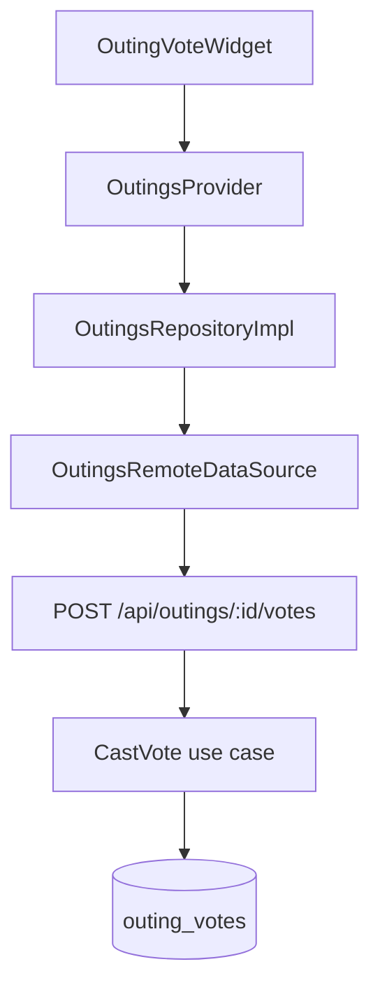

# Yalla 5roga — Flutter Architecture

| Metadata | Value |
|----------|-------|
| Last verified | 2026-11-08 (API request optimization: diagnostics, dedupe, selective outings hydrate) |
| Documentation version | 1.0.0 |
| Package | `yalla_5roga` (`flutter/pubspec.yaml`) |
| Needs verification | Full device E2E; outing invite accept UI completeness |

## 1. Architectural style

Feature-first Clean Architecture with **Provider / ChangeNotifier** for state. Manual DI in `AppDependencies` (no get_it). Navigation uses **GetX** helpers (`Get.to` / snackbars) inside a Provider-based app shell. Networking via **Dio** + `ApiClient`.

Data path for every feature:

```
UI → Provider → Repository (dartz Either) → RemoteDataSource → ApiClient/Dio → Backend
```

Outing chat additionally: `OutingChatProvider` ↔ `OutingChatSocketClient` (Socket.IO) for live `outing:message` / room join; sends remain REST. Presentation must not import Dio, `http`, Firebase, or `socket_io_client` directly.

## 2. Entry and boot

1. `lib/main.dart` — Firebase init, Crashlytics, FCM background handler, `AppDependencies.create()`, `runApp(App)`.
2. `lib/core/di/app_dependencies.dart` — SharedPreferences, Dio + interceptors, `RepositoryFactory`, providers, `AuthProvider.restoreSession()`.
3. `lib/app.dart` — `MultiProvider` + `GetMaterialApp`; authenticated → `MainShell`, else splash/auth.

FCM token registration is deferred until after first frame via `FcmProvider`.

## 3. Folder structure

```
flutter/lib/
  main.dart
  app.dart
  firebase_options.dart
  core/
    animations/
    config/          # AppConfig
    constants/       # ApiConstants, AppConstants
    di/              # AppDependencies, RepositoryFactory
    error/           # Failure, AppException
    localization/    # L10n, LocaleProvider
    media/           # media:// refs, direct upload, signed-URL resolver, account cache keys
    monitoring/      # Analytics, Crashlytics, Performance
    network/         # ApiClient, interceptors, NetworkInfo
    theme/           # AppTheme, ThemeProvider
    utils/
    widgets/
  features/
    auth/
    chat/
    discover/
    groups/
    home/
    invites/
    notifications/
    outings/
    setting/
    shell/
    splash/
```

Each full-stack feature typically has `data/`, `domain/`, `presentation/`.

## 4. Features (verified)

| Feature | Key types | Notes |
|---------|-----------|-------|
| `auth` | `AuthProvider`, `AuthRepositoryImpl`, `FirebaseAuthService`, `AuthRemoteDataSource` | Phone/password via `/api/auth/*`; Firebase OTP proof at signup and verified phone updates |
| `shell` | `MainShell`, `ShellProvider` | Home, Groups, Outings, Discover, Settings. Outing Details owns the foreground GPS verification lifecycle. |
| `groups` | `GroupsProvider`, `GroupsRemoteDataSource`, `GroupInviteResult`, `PickDeviceContactsPage` | Create-group: optional cover photo; members from device contacts (or manual phone); invites via `POST …/invitations` (WhatsApp for non-users); `…/members` is existing-user only. After create / on details+info, members reload so creator count starts at 1 and owner card shows. Group Info gives owners a name editor sheet and cover picker from the app bar menu, plus the inline About editor. The provider sends only edited profile fields in PATCH and merges them into the current group. Uses API `member_count` / `my_role` on list payloads. Group Info keeps `pending_members` separate from the active list in the entity, renders pending statuses in the full member sheet, and refreshes the roster after mutations. The preview contains accepted members. Pending removal uses the owner revocation endpoint. Local gallery paths are never sent as `image_url` |
| `outings` | `OutingsProvider`, `CreateOutingProvider`, vote/attendance widgets | Core product; create + multi-place suggest share `CreateOutingPage` (`letVote` / Add place) |
| `chat` | `OutingChatProvider`, `OutingChatRemoteDataSource`, `OutingChatSocketClient` | REST list/send/read + Socket.IO; page resume recovery; id/`local_*` upsert dedupe |
| `discover` | `DiscoverProvider`, places remote + saved places DS | Neon places |
| `notifications` | `NotificationsProvider`, `FcmProvider`, `PushMessagingRepositoryImpl` | Feed + FCM |
| `invitations` | `InvitationsProvider`, `InvitationsPage`, `GroupInvitation` | Invitation inbox and history opened from Settings / group-invite push / deep links. Card shows invitation, group name, invitee message; Accept/Decline buttons. Uses `GET /api/invitations`, `POST …/accept|decline`. Provider is app-wide registered in `app.dart` |
| `invites` | `InviteDeepLinkProvider`, `InviteLinkParser` | Group deep links primarily |
| `setting` | `SettingsProvider`, profile pages | Account tiles: member-since from Neon `created_at`; unverified phone status opens a Firebase OTP sheet. The profile avatar opens Edit Profile, which uses field sheets, a separate password route, and reduced-motion-aware save confirmation. Outing history opens a route backed by the current-user outings snapshot. Logout resets the shell index and replaces the full route stack with login. Theme/locale via core providers |

## 5. State management

App-wide providers registered in `AppDependencies` / `app.dart`:

- `ThemeProvider`, `LocaleProvider`
- `AuthProvider`, `ShellProvider`
- `GroupsProvider`, `OutingsProvider`, `SavedOutingsProvider`
- `DiscoverProvider`, `OutingChatProvider`
- `NotificationsProvider`, `FcmProvider`
- `InviteDeepLinkProvider`, `SettingsProvider`
- `InvitationsProvider` (pending invitations and decided history)

Page-scoped: `CreateOutingProvider` (and similar) constructed with repos from `context.read`.

Group membership freshness: registration forwards the OTP Firebase ID token as `phoneVerificationToken`; the backend retains that UID and links pending invitation identities without membership. `AuthProvider.restoreSession` exposes the matching cached profile immediately; deferred one-time account sync follows cached shell hydration before online group revalidation. Ordinary profile refresh uses GET /api/users/cuser; phone verification also syncs instead of PATCHing an unverified profile value and refreshes groups once on success. Legacy phone credential conflicts obtain proof in a temporary secondary Firebase Auth instance, preserving the canonical session; only an unused OTP identity may be rebound by the backend. Group list/detail cache and dedupe keys include caller UID and a generation changed on logout. `GroupsProvider.clear` empties visible groups, and list/detail loads ignore responses from an older epoch. No polling is added.

## 6. DI and repositories

`RepositoryFactory` (`lib/core/di/repository_factory.dart`) builds API-backed implementations only. No mock/demo repository layer.

`AppDependencies.create` also builds `MediaUrlResolver` (persistent URL metadata + batch signed-URL fetching + cache keys) and `MediaUploadService` (presigned direct upload). Both are exposed through Provider in `app.dart`; `MediaUrlResolver.active` is the process-wide fallback used by `AppNetworkImage` for leaf widgets without context.

## 7. Networking

- `ApiClient` wraps Dio.
- Interceptors: `AuthInterceptor` (Firebase ID token; retries one 401 with a forced refresh), `AppLogInterceptor`, debug-only `RequestDiagnosticsInterceptor`, `PerformanceInterceptor`, `ErrorInterceptor`. Firebase tokens are never persisted in preferences.
- Paths: `ApiConstants` — all include `/api` prefix.
- Payload helpers: `lib/core/network/api_payload.dart` (snake ↔ domain).
- Repository GET helpers use `cachedRemote` (`core/cache/`) with short TTLs (`CachePolicy`) plus in-flight `RequestDeduper` coalescing.
- Outings list hydrates **voting** outings only (parallel, concurrency-limited); Event/Chat/mutations call `refreshLifecycle(outingId: …)` / `reloadOutingDetails` instead of re-fan-out of the full feed.
- Debug summary: `RequestDiagnostics.instance.formatSummary()` (no tokens/bodies). See [`audit/FLUTTER_API_REQUEST_OPTIMIZATION_REPORT.md`](audit/FLUTTER_API_REQUEST_OPTIMIZATION_REPORT.md).

## 8. Models and DTOs

### Offline and reactive synchronization (2026-11-11)

`OfflineSnapshots` stores allowlisted group/list/member and outing/list/voting-state/attendance/option GET envelopes per Firebase UID and API origin. Retention is at most 200 entries per account/origin and 512 KiB per entry. `ApiClient` serves snapshots in the startup cache-only pass or on transient transport/server errors; access denial evicts the affected snapshot instead of serving stale data. Cache-only reads bypass TTL/in-flight caching so preview cannot suppress revalidation. Outing repository/datasource generations reject session-stale responses.

`AppSyncProvider` is registered in manual DI and `App`. It starts with cached groups/outings, then synchronizes profile, lists, inbox and open details/chats. Connectivity regain, socket connect and foreground resume trigger catch-up. IDs accumulate in sets and debounce for 250 ms; vote changes target one outing. Recovery retries use five delayed exponential attempts, then retain dirty state until resume, reconnection or a server invalidation. Pending chat sends use capped exponential delay. Transient allowlisted GET failures request catch-up even when a cached fallback was displayed. Providers react to data changes. Following the concurrent sync/chat task's explicit design direction, background synchronization is silent: no global loading or connection banner. Chat displays its room-aware connection indicator and pending/failed message state locally.

`ChatSendQueue` persists up to 100 pending sends before reporting success to the composer. One drain replays stable UUIDs over REST. Network/401/408/429/5xx errors retry; permanent rejections, including closed-chat conflicts, remain visibly failed (up to 30 retained failures). Only chat sends are queued. Profile restoration requires an existing Firebase session matching the cached UID. Credentials are not stored in snapshots. Member profiles are available through cached group details; arbitrary standalone profiles are not cached.

The socket client keeps an in-memory invalidation cursor and reconciles missed recipient-scoped changes; an unavailable/expired cursor falls back to list/open-detail recovery. Chat retains at most 100 messages for each of 20 outings. Recovery loads the latest page; server history remains paginated. Synchronization runs in the foreground, with no promise of OS background execution.

- Domain entities under `features/*/domain/entities/` (e.g. `Outing`, `PlaceVote`, enums in `outing_enums.dart`).
- Data models under `features/*/data/models/` where needed.
- Status enums aligned with backend: `draft|voting|confirmed|cancelled|past`; attendance `going|notGoing|maybe` (+ client-only `unset`).

## 9. Navigation

Imperative GetX — no named route table. The five-tab shell (Home, Groups, Outings, Discover, Settings) uses the existing lazy page cache and mounted tab slots to retain state. The floating gradient pill respects safe areas and has an opaque outlined high-contrast variant. The selected capsule contains the filled icon and selection indicator. Equal-width items share a single-line label baseline, with 11 or 12 logical pixel labels before system scaling. The bar scrolls horizontally when scaled labels require more space. AnimatedSwitcher crossfades icons, icon and label colors tween, and selection pulses the icon over 200ms. Reduced motion disables these animations. Incoming tabs move by the shared reveal offset; reduced motion disables the transition. Inactive tabs are excluded from pointer input, semantics, focus and tickers. Existing scroll padding reserves the bar height at the end of each tab. Deep links handled by `InviteDeepLinkProvider` + navigator helpers. Outing deep-link accept UX is **partial** (group invites more complete).

## 10. Error handling

```
Dio / Firebase / Socket
  → AppException (+ status/code/endpoint metadata)
  → guardRemote / auth boundary
      → Failure (Either)
      → debug ErrorBlueprintLogger (once)
      → Crashlytics (unexpected/server)
  → Provider → AppErrorFeedback / FailureMessageMapper → L10n SnackBar
```

| Piece | Path | Role |
|-------|------|------|
| `AuthInterceptor` | `core/network/dio_interceptors.dart` | Adds the in-memory Firebase token; refreshes and retries a 401 once |
| `ErrorInterceptor` | `core/network/dio_interceptors.dart` | Maps Dio → typed `AppException` with HTTP metadata |
| `ExceptionMapper` | `core/error/exception_mapper.dart` | Dio/AppException ↔ `Failure` |
| `guardRemote` | `core/network/remote_guard.dart` | Single remote catch site; blueprint + Crashlytics |
| `ErrorBlueprintLogger` | `core/error/error_blueprint_logger.dart` | Debug-only structured console dump (sanitized) |
| `FailureMessageMapper` | `core/error/failure_message_mapper.dart` | Failure → short EN/AR user copy |
| `AppErrorFeedback` | `core/error/app_error_feedback.dart` | SnackBar / network alert only (no duplicate logs) |

Rules:

- Presentation never shows raw `exception.toString()`, HTTP codes, or backend stack text.
- Meaningful product conflicts (e.g. vote locked) may map to existing L10n phrases.
- Secrets (tokens, passwords, Authorization) are redacted by `ErrorSanitizer` before logging.
- Auth (no `guardRemote`) logs blueprints once from `AuthProvider._reportFailure`.

## 11. Localization and theme

Create Group owns an initially false WhatsApp consent state passed to `GroupInviteePicker`; `AddMemberPhoneSheet` owns the same required checkbox. Localized copy covers WhatsApp invitations only if recipients are not app users. Both submit actions are disabled until checked. Recipient input, calling-code or contact-selection changes clear consent. `GroupsProvider.createGroup` accepts and forwards explicit `whatsappOptIn` rather than inferring it from `memberByPhone`; create/invite provider entry points reject unchecked consent before repository mutation.

Group invitation forms opt into `PhoneTextField`'s controlled calling-code selector (`callingCode`, `onCallingCodeChanged`), defaulting to `+20`. Route/sheet state owns that selection; `Validators.normalizeGroupPhone(..., callingCode: ...)` produces the E.164 payload. Other phone fields retain their existing behavior. `AddMemberPhoneSheet` reuses `PickDeviceContactsPage`, returns a deduplicated phone list plus explicit WhatsApp consent, and `GroupsProvider.promptAddMember` sends each invitation through `inviteMember`, stopping if the account epoch changes. No new dependency or API contract is introduced.

- Manual `L10n` (en/ar) + `LocaleProvider` (prefs).
- `ThemeProvider` + `AppColors` / `AppPalette` / `AppTheme`.
- `flutter: generate: false` — extend `l10n.dart`, do not add gen-l10n unless requested.

## 12. Firebase

- Auth: `FirebaseAuthService` (phone OTP proof and Firebase custom-token sessions).
- Messaging: `FcmMessagingService` + background handler in `fcm_background_handler.dart`.
- Monitoring: Crashlytics / Analytics / Performance services under `core/monitoring/`.

## 13. Notifications (client)

- Register/unregister token via `FcmTokenRemoteDataSource` → `POST|DELETE /api/users/cuser/fcm-token`.
- Foreground display uses the local notifications service. Both Firebase and local notification launch details can resume a cold-start tap.
- `FcmProvider` waits for the authenticated `MainShell`, deduplicates opens, and shares `PushNotificationNavigator` with the inbox. The navigator uses authenticated repository reads and pushes the appropriate GetX route or section onto the existing stack. Chat notification taps open the regular `OutingChatPage` without passing a message target or rendering a separate notification message card.
- In-app feed and per-item read state use `NotificationsRemoteDataSource` → `/api/notifications`.

## 14. Images / files

Entity image fields are strings: absolute http(s) URLs (legacy/external) or stable `media://<uuid>` references. `core/media/media_reference.dart` classifies values; pickers still return local paths and those are uploaded before the API call.

Upload flow (`MediaUploadService`):

1. Decode and optimize the picked image on a Dart isolate. Apply orientation, preserve aspect ratio and alpha, strip metadata and prefer WebP.
2. `POST /api/media/upload-url` with the optimized MIME and size, then `PUT` bytes directly to private R2 staging or the device mock.
3. `POST /api/media/:id/confirm` to validate and promote the object. The client sends the stable reference on create/update only after confirmation.
4. A failed transfer triggers best-effort pending asset cleanup. Compression, transfer and confirmation share a progress indicator.

The shared pipeline covers signup and profile photos, group create/replacement, and outing or draft images. Place media uses the curator backend pipeline. Entity payloads preserve legacy HTTP(S) and `media://` references. Image outputs stay in memory until upload.

Display and caching (`AppNetworkImage` + `MediaUrlResolver`):

- `media://` is resolved through `POST /api/media/signed-urls` (batched per microtask, max 50 ids) or `GET /api/media/:id/url`.
- Delivery URL metadata (URL, visibility, expiry) is persisted in SharedPreferences per Firebase UID; private URLs are refreshed in the background when near expiry while the cached image keeps rendering (stale-while-revalidate).
- Image-cache identities are stable: `media_public_<assetId>` / `media_private_<uid>_<assetId>`. Signed URLs are never used as cache keys, so rotation does not re-download and account switches cannot surface another account's private image.
- Offline: persisted URL metadata + `CachedNetworkImage` disk cache render previously seen images; a network failure falls back to the stored entry rather than a blank state.
- Invalidation: replacing/deleting an image evicts its entry; logout and account switch clear that account's URL metadata and private cache entries. Eviction is best effort/time-bounded and never blocks logout.
- Missing/unavailable media renders the existing default cover/avatar placeholders.

Cover uploads may happen before the group/outing row exists; the backend links the asset when the create/update persists the reference.

## 15. Typical feature flow (vote)



Flutter may animate tie-break / winner reveal only after server confirms (`breakTie` / voting-state refresh).

## 16. Testing

- Unit/widget tests under `flutter/test/` (when present).
- Analyzer is the primary static gate.
- Device E2E for product scenarios A–N: **NOT RUN** as of last audit.

## 17. Conventions

- Strings via `context.l10n` / `L10n`.
- Layout via responsive helpers (`.w` `.h` `.sp`).
- Wire new app-wide providers in **both** `AppDependencies` and `App`.
- Never reintroduce mock/demo seed layers.
- Prefer existing shared widgets under `core/widgets/`.

## Related

- [`PROJECT_STRUCTURE.md`](PROJECT_STRUCTURE.md)
- [`API_CONTRACTS.md`](API_CONTRACTS.md)
- [`USER_SCENARIOS.md`](USER_SCENARIOS.md)

### Home presentation

`HomePage` observes outings readiness; `FeaturedOutingCard` derives the next dated non-terminal outing from the existing `OutingsProvider` snapshot. Initial loading remains owned by `MainShell`; explicit Home refresh/retry calls the provider, with no network request in build. The shared Home section heading gives the title the width left by its compact action. Quick Actions stack at larger text scales, and the final recommendation rail clears the measured floating bar. The Home creation buttons use existing routes. The Discover tab uses the shared custom MapLibre view and route-scoped DiscoverMapProvider over the existing catalog repository. Backend-driven category/vibe filters and database search update pins and the horizontal carousel together. An explicit selected-card action routes to CreateOutingPage(suggestedPlace: …). See `audit/UI_UX_AUDIT_AND_HOME_REDESIGN.md` for selection and validation limitations.

### Planning covers and form layout

`PlanningCover` shows the supplied photo when available and uses themed SVG artwork from `flutter/assets/covers/` for missing or unreadable group, outing, birthday, and wedding covers. Fallbacks are rendered locally and are never written into `image_url`. Create Outing uses cached place photography and planning cover placeholders. Create Group retains its optional `PlanningCoverPicker`. The Saved list reads the outing occasion from its existing response envelope, with a generic outing fallback for older payloads.

The Outings tab shows bounded Active Votes and Upcoming previews. The counted See all actions open filtered sliver lists over the same `OutingsProvider` snapshot. Upcoming lists scheduled plans in chronological order, then unscheduled plans. `OutingHistoryPage`, opened from Outings or Settings, reuses the signed-in user’s snapshot and lists started, completed and cancelled outings by scheduled date. The visible Outings feed retains the shared realtime connection through `AppSyncProvider`. The provider notifies listeners at the next scheduled start or voting deadline and recalculates on app resume. A visible online feed requests targeted reconciliation once for an expired open round. The server owns round closure and resolution. Countdown badges use the cached deadline. Participation and Going avatars appear when the corresponding authorized data is available. Create Outing uses the shared MapLibre renderer in Location and combines the gallery, form and submission in Details. The account-scoped route provider owns the ordered selection. Its catalog provider keeps filters, search, cached results and the camera when the platform view is disposed between steps. Selecting two to five places enables the existing voting deadline control in Details. One place uses the fixed-venue contract. Venue images flow through the existing media resolver and cached cover widget. The special-event guest picker uses the existing device contact picker for WhatsApp recipients and the form confirms opt-in before publishing. Outing details shows manual sends when the API returns click-to-chat links. Outing Details gets the confirmed coordinates and arrival policy from the backend. During its active window the current foreground route starts verification with OS location permission, rechecks on resume and takes bounded fixes at most once per minute between lifecycle changes. It stops scheduling when the route is covered, backgrounded, outside the window or the viewer is verified. Socket.IO invalidations and reconnects refresh the roster. The viewer’s permission and GPS availability stay local. Outing Info reuses this service and the existing account-scoped RSVP roster. Realtime RSVP deltas update only users already in the current roster. A delta for an unknown participant triggers the existing targeted reconciliation, and the next authoritative roster drops removed participants. The venue card loads no map view until the user opens the map. Group invitations use inline consent and keep the user in the app.

### Shared maps and location selection

Discover and the outing picker both render through `core/widgets/yalla_map_view.dart` (`maplibre_gl` 0.27.1). `core/maps/YallaMap*` separates centralized style, camera/controller, category style images, individual-place GeoJSON, selection modes and explicit offline regions. OpenFreeMap provides free OpenMapTiles-compatible vector tiles by default; no account or API key is needed. `YallaMapStyle` accepts public compile-time TileJSON/glyph/attribution URLs or hosted light/dark style URLs, so self-hosting does not change Flutter screens. Raster rendering and `flutter_map` were removed; `app_map.dart` is only a compatibility export. Legacy AppConfig OSM fields remain constructor-compatible but do not control rendering.

Home, Discover and the outing picker share one DiscoverRepository. Home hydrates its eight recommendations from memory or one origin-scoped disk snapshot and refreshes through a deduplicated API call. Foreground location can select a second, region-scoped sample without delaying general recommendations. Discover uses a bounded in-memory viewport cache and falls back to explicitly downloaded location data. Startup does not request the complete catalog. Account-specific saves retain their existing cache.

The mounted tab retains its MapLibre controller and restores the settled camera and filters. Native idle debounces compact viewport queries. Zoom controls the page size and Discover holds at most 128 results. Dio cancels retired requests and the provider rejects stale generations. MapLibre clusters GeoJSON through zoom 13. A reusable transparent stacked-pin PNG and a separate text layer display the actual count. Taps use the engine's cluster expansion zoom and the cluster's coordinates. Category PNGs are keyed by stable category ID and registered once per style lifecycle. A fallback covers missing categories. A small foreground source draws the same PNG for each selected place and animates its scale and glow. Selection updates that source and the regular layer filters without replacing the clustered catalog source. Custom points and GPS use their own layers.

`PickLocationProvider` owns its candidate and immutable ordered selection until explicit confirmation. Discover puts the search and catalog filters above the full-width map and overlays a height-constrained, expandable cards panel. The carousel and map share the provider's selected place ID. A settled swipe selects the centered card, and marker-driven scrolling suppresses intermediate selection events. Discover can follow the app theme or use the existing day and night style variants. The shared location service supplies a single fix with its timestamp and accuracy. MapLibre draws its accuracy area when available and dims the dot for stale or approximate fixes. The outing picker retains its own search, filters, controls and confirmation.

Settings → Offline maps manages up to six Android/iOS regions. The centered square projects into map bounds and estimates coverage and tile size. Standard packs cover zooms 3–12 and Detailed packs cover 3–14. Both cap a pack at 2,500 estimated tiles and 45 MiB, with at most four simultaneous tile requests and an app User-Agent. Custom providers explicitly opt in via `MAP_OFFLINE_ALLOWED` and need compatible permissions. MapLibre manages ambient resources in its native cache and shares pack resources between maps. Downloaded public photos use the existing image cache before being pinned in application storage, with a 25 MiB per-area and 100 MiB shared limit. Pack deletion preserves photos still used by other areas. Android can resume a paused pack in the same process. After restart the plugin may require a replacement native region, which can use resources from the incomplete pack. Verify actual offline rendering and native storage behavior on each device.

The outing snapshot merges targeted details by outing ID. RSVP changes overlay the pending selection and use the PUT response to refresh counts. A failed write removes the overlay. Voting mutations refresh a single voting-state resource, including the viewer’s choice and final venue. Chat uses cursor pagination, server-supplied names, the authenticated profile UID, and client message UUIDs for idempotent sends.


## Silent recovery and chat mentions — 2026-11-11

`App` renders no global sync/connection layout. `AppSyncProvider` remains headless. Cached restoration finishes before network work; `AuthProvider.synchronizeRestoredAccount` defers one account sync until cache preview, before online group revalidation. General `refreshProfile` uses GET `/api/users/cuser`, with an in-flight guard. Explicit verified-phone/account synchronization uses POST `/api/users/sync`; identical concurrent operations share a request. Profile reads never force Firebase token refresh.

The shared socket client tracks transport, network availability and acknowledged outing rooms separately. `OutingChatProvider` subscribes to connection changes; only the chat route displays a localized, semantic, small status row. Room join retries use bounded exponential delays; authZ rejection is disconnected for that room. Mention selection tracks text ranges and stable IDs, drops edited tokens, and serializes selected mentions on send. Existing repository/queue/model text persistence retains tokens offline; bubble rendering decodes them. Sender projection remains canonical from Neon; no application data moved to Firebase.


Authentication uses the existing provider, Firebase adapter and Dio exception mapping. Network and timeout codes reach localized snackbar feedback; the default Dio connection, send and receive timeouts are 15 seconds.


## Centralized event application — 2026-11-11

`AppSyncProvider` remains the single session coordinator and reuses the DI-owned `OutingChatSocketClient`; chat, arrivals, group subscriptions and domain events share its one Socket.IO manager. `RealtimeChange` carries optional complete data and `RealtimeCursor` separates live deduplication from acknowledged catch-up. Logout clears rooms, cursor, dedupe memory, provider state and account caches; session generations guard late recovery, transport and send callbacks, including switching away and back to the same UID.

Complete attendance rows go through `OutingsProvider` → repository → datasource with no HTTP. The datasource merges row versions by `updated_at`, maintains its snapshot and the repository TTL snapshot, and persists the updated offline attendance envelope. Older REST rows and duplicate events do not overwrite a newer row or notify widgets again. Pending local RSVP selection remains the visible overlay until its write completes. Chat retains direct canonical message upserts.

Incomplete group changes fetch the affected group, including newly created groups. Detail reads update the group-list TTL cache, preventing a later cached list from undoing the update. Incomplete outing creation/update/vote/lifecycle changes fetch one outing, including IDs absent from the current list. Membership changes still revalidate group/outing lists and active chats because access may change across several resources. Dirty IDs are set-coalesced for 250 ms; no event publishes another event or performs a REST write. No page rebuild or periodic polling is introduced. See [verification and remaining limits](audit/CENTRALIZED_REALTIME_SYNC.md).

## Password recovery presentation — 2026-11-11

`AuthForm` opens `PasswordRecoveryPage` with GetX. The route creates/disposes `PasswordRecoveryProvider` from the existing `AuthProvider.repository`; no app-wide DI change is required. Domain repository methods route recovery bodies through `AuthRemoteDataSource` and existing Dio error mapping. `FirebaseAuthService` reuses SMS sending and verifies the recovery credential in a secondary Firebase app, preserving primary session/cache/listeners. Proof and reset secrets are transient route memory only. No sync/provisioning is called during recovery. All recovery endpoints bypass automatic 401 retry so single-use steps are not silently replayed.

The form uses `AppPageBar`, `PhoneTextField`, `OtpInput`, `CustomTextField`, `CustomButton`, `AppSnackBar`, theme palette, `Responsive.contentMaxWidth` and manual `L10n`. State includes an absolute-time 60-second resend cooldown, operation guards, loading, local password confirmation/UTF-8 limits and restart. Arabic phone/OTP normalization follows existing formatters. Recovery uses signup’s shared `OtpInput`, including automatic submission after six digits. A failed resend preserves the previous request/verification pair until a replacement SMS succeeds. The Firebase SMS flow has one 75-second callback deadline, allowing the SDK’s 60-second retrieval window and native app verification. Native invocation errors are observed immediately; late callbacks are ignored. Earlier recovery-task evidence recorded targeted analysis and 27 focused Flutter tests passing; these were not rerun in this task. Device SMS and live rendering remain for owner testing. See [PASSWORD_RECOVERY_REPORT](audit/PASSWORD_RECOVERY_REPORT.md).

## Shared snackbar feedback — 2026-11-11

All snackbar call sites use `AppSnackBar`, including location permission failures. The shared bubble shows the existing app SVG logo, directional wrapping message text and a live-region announcement. Optional localized actions preserve the map’s settings shortcuts with a 48dp touch target. Success and recovery/error copy stays short in English/Arabic; text is not truncated. Phone/wide, light/dark, English/Arabic and enlarged-text widget checks pass.

## Confirmed API integrations — 2026-11-13

The existing ApiConstants → remote data source → repository Either → Provider → reusable widget/page path now supports outing PATCH/cancel, creator guest removal, explicit outing invitation decisions, and owner group deletion. EditOutingPage composes EditOutingForm; OutingManagementActions owns creator/invitee controls. Existing text fields, cover picker, date/time dialogs, map picker, alert confirmation, palette, manual L10n and Responsive limits are reused. Confirmed/voting venues are not editable in this form. Successful mutations refresh only the affected outing snapshot; group deletion refreshes lists and returns to the root. Socket invalidations refresh open guest state alongside the affected outing, and guests use the existing account snapshot cache. No screen imports Dio or a new networking service. suggested_by_user_id remains response-only.

The existing SavedOutingsRemoteDataSource now implements the four existing draft operations, using the same SavedOutingsRepository/Provider and local datasource. The local draft entity carries remoteVersion/pending/deleted/conflict cache metadata only. Origin/account-scoped SharedPreferences stores pending edits/deletes before network work. A serialized repository queue plus Provider in-flight guard prevents recursive sync. AppSyncProvider invokes recovery on reconnect/resume; there is no polling. Stable UUID Idempotency-Key retries POST; If-Match uses the loaded server version for update/delete. Newer server data causes a preserved local conflict rather than overwrite. Local cover paths upload through the existing MediaUploadService and retain the returned reference for retries. Local guest-phone selections remain cached because the current backend draft shape has no guest-phone field; legacy unscoped draft preferences remain untouched for ownership safety.

The existing notification feed follows bounded cursor pages without changing the domain feed/unread contract. Group invitations filter the API's history to pending UI cards/counts. Notification navigation and explicit actions distinguish outing IDs from group invitation IDs; legacy invitation payloads with an outing ID route to Outing Details. Conflicting persisted group decisions never display false accept/decline success. All new copy uses L10n Arabic/English; existing widgets inherit RTL and light/dark themes. Static analysis is recorded in the implementation report. Flutter tests, launch, hot reload and visual/device verification were not performed under the owner's execution restriction.

Write requests bind the existing expected-user option at invocation so a token refresh/account switch cannot silently replay a mutation as another signed-in account.

Committed outing updates/cancellations merge the returned row into the existing provider and persisted current-user collection without an extra GET. Group deletion also removes the group resource snapshot and collection entry; outing decline removes its inaccessible cached resource.


## Phase 1 Modern Social foundation — 2026-11-13

`core/theme/app_tokens.dart` owns logical spacing, radii, touch sizes, typography sizes and shadow recipes. Existing `Responsive` getters consume the geometry tokens, preserving the phone/wide/foldable content limits. `AppMotion` remains the only motion scale. `AppColors` owns the violet primitive scale; `AppPalette` owns light/dark surfaces and semantic success/warning/danger/info pairs. `AppTheme` maps these into Material 3 color, type, field, button, chip, sheet, dialog, selection and progress themes. Cairo and Inter remain the Arabic and English fonts. LocaleProvider defaults new installs to Arabic; persisted English remains supported.

Shared presentation components live under `core/widgets/` and take text, widgets and callbacks, never feature Providers or entities. `GroupCard`, `OutingCard`, `PlaceCard` and `InvitationCard` are the reusable rendering layer. Existing feature card classes keep their public constructors, map domain/localized data, retain Hero tags and cover selection, and delegate to core. Invitation page card/states were extracted into its `presentation/widgets/` directory. Groups uses shared page header/search without changing query state or navigation.

Reuse `CustomButton` variants, `AppIconButton`, `CustomTextField` (also exposed as `AppTextField`), `AppSearchField`, `FilterChipRow`, `AppBadge`, `UserAvatar`, `AppPageHeader`, `SectionHeader` (also `AppSectionHeader`), `AppShimmer`, `AppEmptyState`, `AppErrorState`, `AppSnackBar`, `AppAlert`, `AppBottomSheet`, and `AppNetworkImage`. Buttons retain loading semantics and disabled styling; button/icon targets are at least 48 logical pixels. AppPressable supports Enter/Space and a visible focus outline. New shared components inherit locale direction, color theme and text scaling.

`AppOfflineIndicator` is an opt-in local status widget; it does not add a global sync banner, connectivity subscription or new network state. `AppBottomSheet` is a keyboard-aware scrollable sheet helper on the existing Navigator. Existing specialized sheets retain their contracts. `AppNetworkImage` retains account-scoped caching and media-reference resolution, with theme-aware placeholders.

This phase changes the foundation and adapters, not feature workflows or the existing Provider/repository/data-source split. No feature-screen-wide redesign or broad migration of legacy page styles is claimed. Runtime, visual, device and UI verification were prohibited for this phase; see `audit/PHASE_1_FOUNDATION.md` for static results and scope.

## Phase 2 feature composition — 2026-11-13

Home composes HomeHeader, FeaturedOutingCard (core OutingCard adapter), QuickActions and HomeNearbySection. Nearby uses MapLocation plus DiscoverProvider/repository, not a second location/network/cache service. Groups composes core header/search/filter/state components and domain GroupCard adapters. CreateGroupFields and GroupInviteePicker render the existing GroupsProvider form state; GroupNameEditor is route-local form state for the existing PATCH API.

HomeHeader sizes its profile photo from the available header width with LayoutBuilder: 24% of the inner width, bounded to 42–67.2dp. The maximum is 60% larger than the original 42dp photo; the circular crop and placeholder scale together, while the tap target remains at least 48dp. The greeting keeps flexible remaining space. Targeted analysis reports no issues; device, theme, RTL and enlarged-text rendering remain unverified. No diagrams or product flows changed.

Group Details and Group Info share the page background, app bar and painted hero. The bounded group outing previews use the existing OutingsProvider lifecycle projections. See all opens the existing group-scoped list with the matching lifecycle filter. GroupHistoryLinks opens GroupHistoryPage for invitation or outing history. The invitation history still comes from the account-scoped roster response. Group routes use existing realtime ownership and roster caching. Successful leave or deletion evicts that group’s saved detail and roster and schedules existing list reconciliation.

InvitationsList owns only its selected status filter. InvitationsProvider keeps all API records, exposes pendingCount independently, and records successful decisions without removing rows. A separate load generation prevents a Socket.IO-triggered read from changing the account epoch and stranding accept/decline loading. Shared InvitationCard hides decision controls for historical records. Settings, push and deep-link entry points remain unchanged. All Phase 1 design/theme, locale, media, DI and authentication conventions remain in force.


## Phase 3 outing presentation — 2026-11-14

The existing feature-first Provider/repository/Dio boundaries are retained. EventPage is a route coordinator for focused overview, RSVP, voting, GPS attendance, location and management widgets. RSVP owns its selected/count/roster presentation separately from location voting. The ballot widget holds only unsent checkbox edits; OutingsProvider.setBallotFor → repository.setBallot → datasource PUT persists a complete selection and merges canonical state. PlaceVote stores distinct votedCount independently of option totals. Existing Socket.IO invalidations/reconnects continue to hydrate open details and list snapshots.

CreateOutingProvider retains all three wizard steps and offers editStep for review links. AppStepProgress is a localized shared renderer. Information includes deadline controls; Review includes summary/edit links. Existing map selection, media upload, drafts, group preselection and canonical post-create navigation remain. New location/ballot rows reuse PlaceCard; list states reuse core feedback controls and Responsive content limits. No package, navigation framework or second provider/cache/transport is introduced.

## Phase 4 — shared maps and special events (2026-11-14)

`core/maps/location_repository.dart` owns the existing geocoding interface; the old outing path remains a compatibility export. Existing data implementations, DI, cancellation and picker caches are preserved. `LocationSearchProvider` debounces and cancels Discover geographic search through that same repository. `core/widgets/map_controls.dart` provides controlled search, current-location, selected/numbered marker, horizontal vibe filters, location cards and previews; `core/widgets/vibe_picker.dart` owns the shared category/occasion chip layout, with the old path re-exported.

Historically Discover composed `DiscoverMapPanel`; the current page composes `DiscoverMapView` and the shared YallaMapView/MapLibre renderer. Map/carousel selection drives the existing reduced-motion-aware camera; location search calls the existing paginated nearby repository at the selected area. The user-location marker remains separate from the search center. Permission denial retains the shared Cairo fallback and manual search. Local offline status reuses AppSyncProvider; no second connectivity or data cache is introduced. Nearby detail navigation passes the exact selected API entity to avoid substituting an unrelated catalog place.

`SpecialEventPage` is the dedicated Home entry; it composes the existing CreateOutingPage route-local Provider, venue cover, schedule fields, map selection, review, submit/loading/success and draft workflows. `SpecialEventFields` owns occasion and optional group/audience controls. All four occasions serialize by enum name, restore through existing draft/saved decoders, and render localized labels; Birthday/Wedding keep their artwork. Celebration/Other reuse the existing outing artwork. The API body retains existing fields; group_id is now forwarded for special events. No Flutter/UI execution was performed by owner instruction; targeted static analysis is recorded in the Phase 4 report.


## VotingDeadlineSelector — 2026-11-14

The feature-local selector renders a native Material 3 segmented control, ChoiceChips and localized summary/error text using existing theme/Responsive roles. It owns no clock, calculation or network operation. domain/entities/voting_deadline.dart defines elapsed-duration/instant validation. CreateOutingProvider holds the selected hours/unit and a cancellable 30-second preview clock; schedule changes revalidate immediately, and navigation retains selection. OutingsRemoteDataSource calculates/validates the absolute deadline after upload at the create request boundary. Outing.voteEndsAt parses the canonical server timestamp and survives copyWith; provider comparison notices deadline updates. The post-create EventPage confirmation receives that actual timestamp. No shared core widget, package or second state/cache/service is introduced for this single-feature control.


## RSVP roster and countdown rendering — 2026-11-14

The existing outing datasource now retains authenticated attendance profiles for membersForOuting instead of returning an empty list. Read-only no_response maps to AttendanceStatus.unset; raw account/origin snapshots preserve that wire default and profiles through realtime updates/offline reopen. The RSVP/Who’s going adapter localizes it as No response. No response cannot be posted as an attendance mutation. VoteCountdown is pure deadline arithmetic; VoteCountdownText owns a visible/foreground 1-second timer and lifecycle cleanup. Shared OutingCard has an optional presentation footer so active vote countdowns render inside the card. No Provider, transport or cache layer is added.


## Phase 5 chat and inbox components — 2026-11-14

Chat retains Provider/repository/remote datasource and the shared authenticated Socket.IO client. `MessageBubble`, `MessageComposer` (compatible OutingChatComposer alias), `MentionSuggestions` (compatible picker alias), `ChatDateSeparator` and the message-list scroll state are feature presentation. `core/widgets/connection_indicator.dart` and `notification_card.dart` accept presentation data/callbacks only; the old feature NotificationCard path re-exports the shared widget. UI does not register sockets, process notification payloads or call APIs.

Own-message mutations and retries run through OutingChatProvider and OutingChatRepository. MessageBubble long-press opens the shared AppBottomSheet action surface, with no persistent ellipsis. Edit selection/submission checks ChatMessage.canEditAt and a route-owned one-shot timer exits expired editing; backend checks remain authoritative. Sender labels sit above bubbles, avatars occupy outer directional edges, dates use localized Today/Yesterday pills, and the composer has an @ shortcut and circular Send button without attachments/recording. Retry retains the durable client UUID. Forced recovery refreshes a bounded authoritative message window (up to three existing 40-row pages), including tombstones/edits, resets its older cursor, and preserves live updates arriving during the refresh. Older history remains pageable. The page closes mutation controls at start + two hours and on completed/cancelled status, rescheduling when the outing schedule changes. Backend authorization remains authoritative.

The inbox uses existing NotificationsProvider filters/read state and PushNotificationNavigator. Group/member → Group Details; group invitations → Invitations; outing invitations → Invitations with an authorized outing entry; chat → regular outing chat; voting/RSVP → relevant outing section. `OutingInvitationTarget` is a presentation adapter over the shared card and existing EventPage. The local notification service/native iOS channel and InteractiveNotificationHandler own platform payload/action work outside widgets. Theme, Responsive width caps, manual L10n and reduced-motion AppMotion remain.


## Phase 6 settings, entry and authentication presentation — 2026-11-14

SettingsPage composes ProfileHeader/ProfileStats and focused SettingsAccountSection, SettingsPreferencesSection, SettingsSupportSection and SettingsAboutSection widgets. SettingsSection reuses SettingsList; StatCard is a core value/label component. Statistics use the signed-in providers: groups, all loaded outings and server `past` outings (Completed), with an unknown marker before lists load. Completion is not inferred from RSVP or GPS attendance. Account information reads existing profile fields; Change Photo opens the existing editor/picker and retains its password confirmation/save flow.

`AppConfig.contactEmail` is the source for the official contact address. `ContactUsPage` owns the localized topic and draft fields. The shared support email action encodes the draft as a `mailto` URI and asks `AppLauncher` to hand it to the operating system. The app keeps the form available and offers copying the address when handoff fails. The same action is used by About Developer. Delivery happens in the user's email app. Developer links are configured in `AppConfig` and the page omits empty destinations.

AuthScaffold constrains and scrolls auth forms; SignupPhotoPicker reuses UserAvatar and ImageSourceSheet. AuthProvider uploads an optional signup photo through MediaUploadService only after Firebase-verified registration, then syncs the stable reference through the existing profile API. Photo failure does not repeat registration. Confirmation is client validation; signup/login/OTP payloads are unchanged. PasswordRecoveryPage adds shared AppStepProgress over the existing route-local provider.

SplashPage is the branded three-step introduction. Route-local OnboardingProvider persists `onboarding_completed` through the already-injected SharedPreferences. Next advances; Skip/Get Started persist completion before replacing the stack with AuthPage. App still selects MainShell first for a restored authenticated account, otherwise AuthPage for completed onboarding or SplashPage for first run. No prior onboarding flag existed in the inspected source. Locale/theme/auth persistence, deferred user sync, pending deep links, logout cleanup and account caches retain their existing owners.

SavedOutingsPage reuses OutingListTile → core OutingCard, opens existing saved outings via authorized refresh and EventPage, and keeps drafts in CreateOutingPage. SavedOutingsProvider exposes loading/failure/retry while retaining account epochs and data on failed refresh. History keeps scheduled-start/past/cancelled classification, shared cards and completed-chat read-only policy. No new data source, routing framework or dependency was introduced. Static/OpenAPI verification only; visual and device validation were explicitly excluded.


## Android system notification extension — 2026-11-14

Existing Provider/Clean Architecture/Dio/GetX remains. AppDependencies connects LocalNotificationsService, FcmMessagingService and the existing interactive handler through NotificationActionDispatcher. The top-level FCM background handler and native action background callback bootstrap only Firebase session plus the existing ApiClient/interceptors; they do not construct screens/providers or call users/sync. Local native rendering is shared by foreground/background Android data events. iOS retains APNs categories/bridge.

NotificationActionDispatcher owns bounded account-specific draft/retry state in SharedPreferencesAsync so Flutter isolates do not use stale preference caches. Completed actions discard text. LocalNotificationsService owns persisted deduplication, stable native IDs, category channels, MessagingStyle, conversation summaries, active-display reconciliation and privacy. It validates fresh display metadata via the authenticated no-store system-payload endpoint, with redacted offline fallback. Only FCM creates new OS alerts; Socket.IO/API synchronization updates existing state.

The existing notification datasource/repository now carries server unread totals/preferences. A narrow NotificationPreferencesRepository interface is implemented by the existing repository. NotificationsProvider owns persisted push state; the existing Settings switch uses it. AppSyncProvider invokes bounded action recovery after shared session synchronization and always refreshes the inbox on resume/reconnect. No new global synchronization loop or socket subscription is introduced. AuthService's pre-signout callback unregisters/clears push state without coupling screens to transport logic.

OutingChatPage optionally accepts a referenced message ID, fetches it through the existing chat repository and focuses/highlights its normal bubble with theme tokens. Existing message editing and deletion controls remain unchanged. Flutter code was analyzed/formatted only; no tests, runtime, hot reload, preview, emulator, device or UI automation was run at the user's request.

Notification rollout compatibility: the existing token registration accepts notificationVersion=2 from updated clients; existing Android registrations default to 1 and retain OS-visible delivery. The additive migration includes this token capability field alongside inbox metadata and user preferences.


## Dynamic place taxonomy and shared filters — 2026-11-14

`discover/domain/entities/place_catalog.dart` defines backend-driven `CatalogDefinition` and the shared `PlaceFilters` policy. `SuggestedPlace` and canonical outing `Place` retain category/vibe IDs, availability and bilingual names; old outing enums remain compatible. Discover datasource/repository fetch taxonomy, paginated queries and revision metadata through the existing Dio ApiClient. TTL/in-flight caches and raw account-scoped OfflineSnapshots cover categories/vibes/pages/details; query keys are canonicalized and bounded by existing snapshot quotas. Known loaded places support offline filtering. Existing cached-image widgets and fallback images are reused.

`PlaceCatalogProvider` owns route filters, a shared search controller, paged results, stale-result generations, loading/errors and taxonomy. `core/widgets/place_catalog_filters.dart` supplies reusable grouped chips, dynamic icon pairs, distance/clear/retry/load-more controls. Discover uses one result collection for map and list. CreateOutingProvider owns an optional route catalog provider across wizard/map navigation and disposes it with the form; the existing picker retains custom pin/geocoder behavior. All copy is in manual L10n or backend bilingual labels; no routing/localization/state dependency changed.

AppSync invokes repository revision recovery at resume/reconnect; existing Socket.IO transport forwards `catalog:changed`. Repository change streams refresh mounted catalog providers, with one concurrent version request and deduplicated page/definition reads. No Flutter/emulator/device/widget test or visual runtime check was run for this task, per owner instruction; Dart static analysis is the Flutter verification boundary.


## Saved place cards and filter — 2026-11-14

DiscoverRepository/datasource now expose saved-place list and write operations. DiscoverProvider owns account-cleared bookmark/loading/mutation state with stale-account guards. SavePlaceButton is reused across cards and SavedPlacesList; SavedOutingsPage retains its existing views and adds a Places filter. Saved lists reuse account-scoped ApiClient snapshots. No new state/network dependency is introduced.

## Home reference refinement — 2026-11-14

Home composes its feature-specific full-cover upcoming card from AppCard, AppBadge, AppHero and PlanningCover, with a black readability scrim and white title/group/schedule text. Its minimum height and loading skeleton are 210 responsive units; content can grow for long or scaled text. Existing nearest-future selection, retry/empty handling and detail navigation remain unchanged. AppPalette supplies paired light/dark outing, group and event action colors. QuickActions displays three equal-height icon tiles in New Outing/New Group/Special Event order, stacking below 260 logical pixels of available width or above 1.3 text scale. AppTypography.navigationLabel sets bottom navigation labels to 10 logical pixels; system text scaling, shared measured label height and touch targets remain active. No provider, repository, API, dependency or routing contract changes.

Verification for this refinement: targeted Dart analysis passed; 25 existing home-selection, quick-action, cover and motion/navigation checks passed. A temporary rendering harness passed eight phone/wide × light/dark × English/Arabic combinations; representative renders were visually inspected using the existing bundled fallback artwork. The harness used a local test font rather than the app's Cairo/Inter fonts and was removed after review. Existing quick-action checks exercise 1.5 text scaling. Physical-device/fold-hinge, uploaded-photo, actual-font and interactive route checks remain unverified. Hot reload was attempted but unavailable because no debug app/DTD was running. No diagrams changed; no new architecture or product-rule inconsistencies identified.


## Discover map-first composition — 2026-11-14

The seven Discover widgets separate map rendering, floating search, backend filter chips, lazy carousel, card, location controls and explicit selected-place action. Mounted shell state retains filters, camera and carousel across tab/detail/creation navigation. Page controllers dispose with widgets; the route owns and disposes its catalog/map/search controllers. Search and viewport requests reuse existing cancellation/snapshots; global searches survive map panning. Clearing search uses recorded current bounds; deliberate map panning resumes viewport loading after selection. The existing grouped/distance filter widget remains used by the outing flow. No new routing, localization, state or network dependency was added. [Verification and limitations](audit/DISCOVER_MAP_FIRST.md).


## Home / startup / Settings / group-leave refinement — 2026-11-14

MainShell sequences launch permissions independently of shell data loading. AppPermissions guards each prompt per session and deduplicates explicit notification prompts. Home recommendations are scoped to their section and use its cache and background refresh. Discover retains foreground-location controls.

GroupsProvider refreshes the roster without stale fallback before deciding sole-owner DELETE group versus ordinary self-member leave. An account-specific epoch guards responses without treating an ordinary sync refresh as an account change. The existing confirmation explains deletion for a sole owner. GroupInfoActionsSection renders only Leave. Repository/cache invalidation and root Groups navigation remain.

NotificationsProvider optimistically merges preference writes, uses a separate saving flag/revision to reject stale feed values and rolls back failures. Settings holds a busy guard through permission/FCM/save, while the shared AppSwitch supports disabled callbacks, selected semantics, reduced motion and a 48dp hit area without replacing its visual track. LocalNotificationsService persists account-keyed push enablement using existing SharedPreferencesAsync, suppresses foreground/background/offline display when disabled, and removes that key at logout. SettingsAccountSection removes photo/information shortcuts; Edit Profile remains. Theme icons reflect current mode (moon dark / sun light). No dependency, route or state framework was added.


## Arrival start gate and quiet loading presentation — 2026-11-14

OutingArrivalsSection owns a separate one-shot scheduled-start timer. Before start it renders localized waiting text and suppresses REST refresh/arrival-driven connect/GPS callbacks. Start/resume/reschedule re-evaluate wall time and route generation; all timers and subscriptions dispose with the section. OutingArrivalService independently checks server open/opensAt/closesAt before native location operations and recording. Existing Provider/repository/Dio and shared socket ownership remain.

NotificationsPage passes a bounded native TextButton to AppPageBar.trailing. The optional trailingOnRight flag sets only Row layout direction for this page, leaving descendant Arabic text direction and other page bars unchanged. The action retains markAllRead and disables at zero unread or during mutation. App-wide indeterminate LinearProgressIndicator instances were removed from Discover/details, map picker/catalog, groups/history/bio and outing detail/RSVP/arrivals; the remaining two instances represent determinate vote/result data. Existing skeletons, circular button progress and loading text remain. No dependency or routing change.


## Imported catalog compatibility — 2026-11-15

Overture/Geofabrik imports populate the same canonical Neon place UUIDs and existing catalog endpoints. Discover and Create Outing retain the shared datasource/repository, Provider, dynamic bilingual categories/vibes, 350ms viewport debounce/cancellation, bounded page bursts, account/origin snapshots, MapLibre native category sprites and collision placement, selected-pin/card focus and explicit preselected outing creation. No renderer/style geometry/camera/navigation or cache/state dependency was replaced. Only attribution adds Overture to the existing map credit and shared wrapping source-credit controls; imported details show those credits for either source. Existing image caching and fallback rendering remain. Backend list/details can use a verified source image when the canonical cover is empty.

Targeted static analysis passes. Phone/wide/foldable, theme/RTL, large-text/keyboard, native pin/card behavior and offline runtime were not exercised: the owner prohibited Flutter application/emulator/device tests. No visual or runtime sign-off is claimed.


## Phase 7 static polish and widget cleanup — 2026-11-15

Shared SegmentedTabs keeps its existing API but now uses keyboard-operable InkWell targets of at least 48dp, selected semantics, wrapping label/badge content with equal-height segments, semantic theme pairs and reduced-motion durations. CustomTextField exposes its localized heading as the editable control's semantic label without replacing existing hint text. MarqueeText measures with the ambient TextScaler and remeasures when locale/direction/scaling dependencies or its gap change.

The existing group creation card, auth heading, chat mention picker, phone-verification status and settings/planning accents use existing AppPalette roles. Chat skeleton placement is directional; saved-item removal supplies its localized tooltip. CreateOutingBasicsStep composes the feature-local OutingScheduleField for date/time using the same values/callbacks; provider scheduling and mutations are unchanged. Unreferenced SplashPreview and ActiveVoteTile were deleted; current onboarding/GroupOutingsList and referenced compatibility exports remain.

OutingChatSocketClient caps transient room-join retries at five delays (1/2/4/8/16 seconds), retains desired-room intent for a later explicit recover/reconnect, reports exhausted attempts as offline, and cancels retries on leave/disconnect. The reference-counted provider's repeated unsubscribe is harmless; disposal advances its generation, clears active views, cancels stream listeners and suppresses late notifications. Closing a page releases that outing room, while the shared session socket still serves app-wide invalidations. No per-page socket or polling was added.

Unused legacy authentication helpers were removed after reference/analyzer checks. Register and password-cache completion now await their existing asynchronous results inside the original try/catch, preserving typed error handling. Auth routes, identity rules and recovery policy are unchanged. See `audit/PHASE_7_8_FINAL_REPORT.md` for static/API evidence and limits; no Flutter runtime or visual verification was performed.

## On-demand realtime implementation — 2026-11-15

OutingChatSocketClient now gates connection creation/retry on owner-or-room demand, network availability and foreground state. retain/release are idempotent per owner; chat viewer counts remain in OutingChatProvider. Suspension clears joined state and cancels timers/transport listeners while preserving desired rooms and the replay checkpoint; account disconnect clears both. Room-specific intent tokens reject stale acknowledgements after leave/reopen; transport/session generations reject old token and connection callbacks. Authentication and manager reconnection retries each stop after five attempts.

The shared core/widgets/realtime_route.dart mixin observes ModalRoute.isCurrentOf and delegates visible group/outing acquisition to the existing AppSyncProvider. Covered routes release too. Chat observes current-route state separately to pair subscribe/unsubscribe; socket listeners exist only with chat viewers. OutingArrivalsSection pairs its own service lease and subscriptions with visible/foreground/started state. AppSyncProvider supplies the app lifecycle/network gates, including inactive, and acquires no transport for startup or REST recovery. MainShell revalidates list tabs on selection/return without acquiring realtime. Existing bounded caches, durable send queue, account guards, DI, GetX and manual localization remain. No runtime/visual verification was performed; see [evidence](audit/SOCKET_LIFECYCLE.md).


Discover/map polish (2026-11-15): the carousel base height is reduced from 222dp to 182dp at default text scaling, retaining scrollable details and the fixed selected-place action. Distances below 1 km use rounded metres with localized units/digits; longer distances retain kilometres. Shared native GeoJSON renders individual pointed category pins with localized place names instead of numbered clusters. The duplicate full-width attribution banner is removed; the native attribution control retains source credits below the compass. Static verification only; no native visual sign-off. No API or database changes.


## Multi-branch places — 2026-11-15

Places remain physical branches with stable UUIDs and existing outing/vote, taxonomy, hours, image and price relations. Nullable place_brands association and bilingual aliases identify shared brands. Explicit brand evidence and conservative address/distance matching prevent name-only physical merges; ambiguous matches are logged. Independent places remain supported. Existing source/type/source_id fields provide namespaced external identity, with an additional SQL uniqueness index.

GET /api/places accepts brand_id; GET /api/place-brands/:id and /:id/branches expose metadata and paginated physical branches. Nearby and detail DTOs carry brand/branch metadata. Flutter reuses catalog Provider/repository/cache queries for explicit branch selection; map pins and outing payloads retain physical IDs and coordinates. No category/vibe defaults are inherited. Existing manual import operation is retained; no weekly scheduler is restored.

Verification: ten requested scenarios passed through served Swagger/HTTP against local PostgreSQL/WASM, migration applied twice, 15 catalog logic tests passed, TypeScript and Prisma validation passed. Targeted Dart analysis has no errors/warnings and three existing style infos. Flutter runtime, themes/locales/sizes/input states and device/realtime behavior were not exercised. See audit/PLACE_BRANCHES_OPENAPI_RESULTS.json and audit/PLACE_BRANCHES_MIGRATION_DEPLOYMENT.json for deployment status.


## Place details reference layout — 2026-11-15

DiscoverPlaceDetailsPage uses a collapsing paged cover gallery with its existing Hero mapping, rounded surface transition, compact thumbnail/title app bar, and pinned Overview/Branches/Reviews tabs. Overview retains description, address, available distance, hours, prices and source attribution. PlaceBranchList embeds the existing PlaceCatalogProvider query and paginated branch list; selection opens the physical branch details. SavePlaceButton optionally renders a label while retaining its existing backend mutation/loading/error path. Directions reuse AppLauncher; the existing outing wizard remains accessible with the physical suggested place. Manual L10n, AppPalette, AppMotion and Responsive content limits remain authoritative. Reviews are an explicit unavailable state: no review/rating data or amenities are invented. No API/schema/state architecture change.

Verification: source review and targeted static analysis only; runtime, hero/scroll/tab interaction, external maps, authenticated saving, branch paging, light/dark, Arabic/English, narrow/wide/foldable, keyboard and large-text rendering remain unexercised.


## Location voting round integration — 2026-11-15

`PlaceVote` carries `can_resolve_tie` from the API. `OutingsProvider` applies the revote response directly and blocks concurrent creator actions for the same outing. The shared voting deep-link anchor stays in place when the details screen switches from the tie or ballot to the confirmed location.

`OutingsProvider` remains the sole presentation state owner. Round metadata and frozen tied IDs travel in existing `PlaceVote`/`OutingSnapshot` through the repository and remote datasource. API writes carry the captured round; account epochs and read-revision guards reject old-account/old-round responses. Timeout recovery reloads canonical state. Existing AppSync targeted invalidations/reconnect recovery refresh the outing; no polling, socket or cache layer is added.

`OutingVoteWidget` composes `TieResultsSection`, `RevoteBottomSheet`, `OutingVoteOptions` (extracted to `voting_place_list.dart`) and `TieBreakRevealDialog` (extracted to `dice_roll_animation.dart`). Compatibility exports remain. The shared `PlaceCard.option` supports an optional leading existing image renderer. The existing `OutingLocationSection` shows the winning image/confirmation/map action. New copy uses manual L10n and existing theme/directional/responsive/motion tokens. No dependencies or architecture patterns change. Animation starts only after a persisted backend response and never determines the winner. Static verification only; no visual sign-off.


## Reference UI and outing wizard — 2026-11-20

AppPalette supplies reusable dark, light, action, selection and panel styles. IllustratedHeader paints decorative art while the surrounding widgets own text, callbacks and semantics. Shared AppCard provides Material for ink and focus. The shell keeps its existing Provider and visited tab state. Group routes reuse its labels and navigation.

PickLocationPage supports a standalone route and an embedded confirmation callback. Both use the existing MapLibre controller, route-local picker and catalog pagination, filters and cache. Details and Review render OutingPlaceGallery with selected venue art and no manual photo or vibe input. CreateOutingProvider retains the compatibility vibe from the selected place and the existing draft, validation, consent, timestamp and creation contracts. Group reads reuse the already returned created_at to sort recently created groups. The redesigned screens require no API or schema changes.

Verification used Flutter static analysis and headless tests with a mocked MapLibre platform. The focused map, wizard, deadline, navigation and motion suite passed all 35 tests. The additional arrival, roster, bio and history run passed five tests. Its four arrival and roster failures reproduced in the original checkout at 64998c5. Native MapLibre rendering, external directions, GPS on a device, live account flows and screen-by-screen pixel parity remain unverified.

## Groups tab reference layout

The mounted Groups tab uses a single sliver scroll view and reuses Home's notification button and the shell's floating navigation. Local SVGs supply the header figures and banner paper plane. GroupsProvider derives search and sort from the cached account list. Card selectors use accepted-member totals and the existing authorized outings snapshot. Most active falls back to outing count because the existing model has no group activity metric. Missing totals are hidden, and the friends total requires a complete accepted roster for every group. Roster IDs can come from the account-scoped offline snapshots when their counts match the group summaries.

The invitation banner adds a group picker before the existing phone invitation sheet. Tab selection reuses the mounted Groups state and normal session sync. The change adds no API, schema, dependencies, or realtime subscriptions.

## Request observability

The shared media resolver evicts private account image keys on logout and clears stale private images when an authenticated API response omits their IDs. Offline transport errors keep the account's cached image available. Shared public cache files remain reusable.

The shared Dio client records each attempt, including cancellation, timeout and the bounded credential retry. RequestScope propagates feature, origin and trigger across async repository work. A retry retains its correlation ID and gets a new request ID. Repository cache events are measured separately. Detail navigation uses repository TTL, and list patches retain the original expiration. Account-scoped cache invalidation prevents an older in-flight response from repopulating an evicted entry. Firebase Performance keeps one HTTP metric per attempt. Optional sampled metrics and device verification are documented in the [operator guide](development/OBSERVABILITY.md).
