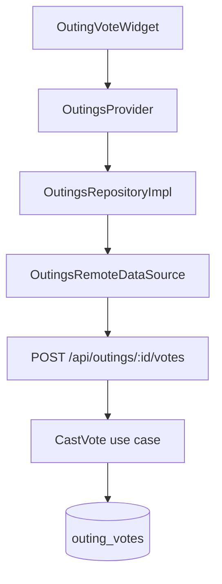

# Yalla 5roga — Flutter Architecture

| Metadata | Value |
|----------|-------|
| Last verified | 2026-11-07 |
| Documentation version | 1.0.0 |
| Package | `yalla_5roga` (`flutter/pubspec.yaml`) |
| Needs verification | Full device E2E; outing invite accept UI completeness |

## 1. Architectural style

Feature-first Clean Architecture with **Provider / ChangeNotifier** for state. Manual DI in `AppDependencies` (no get_it). Navigation uses **GetX** helpers (`Get.to` / snackbars) inside a Provider-based app shell. Networking via **Dio** + `ApiClient`.

Data path for every feature:

```
UI → Provider → Repository (dartz Either) → RemoteDataSource → ApiClient/Dio → Backend
```

Presentation must not import Dio, `http`, or Firebase packages directly.

## 2. Entry and boot

1. `lib/main.dart` — Firebase init, Crashlytics, FCM background handler, `AppDependencies.create()`, `runApp(App)`.
2. `lib/core/di/app_dependencies.dart` — SharedPreferences, Dio + interceptors, `RepositoryFactory`, providers, `AuthProvider.restoreSession()`.
3. `lib/app.dart` — `MultiProvider` + `GetMaterialApp`; authenticated → `MainShell`, else splash/auth.

FCM token registration is deferred until after first frame via `FcmProvider`.

## 3. Folder structure

```
flutter/lib/
  main.dart
  app.dart
  firebase_options.dart
  core/
    animations/
    config/          # AppConfig
    constants/       # ApiConstants, AppConstants
    di/              # AppDependencies, RepositoryFactory
    error/           # Failure, AppException
    localization/    # L10n, LocaleProvider
    monitoring/      # Analytics, Crashlytics, Performance
    network/         # ApiClient, interceptors, NetworkInfo
    theme/           # AppTheme, ThemeProvider
    utils/
    widgets/
  features/
    auth/
    chat/
    discover/
    groups/
    home/
    invites/
    notifications/
    outings/
    setting/
    shell/
    splash/
```

Each full-stack feature typically has `data/`, `domain/`, `presentation/`.

## 4. Features (verified)

| Feature | Key types | Notes |
|---------|-----------|-------|
| `auth` | `AuthProvider`, `AuthRepositoryImpl`, `FirebaseAuthService`, `AuthRemoteDataSource` | Email/password via `/api/auth/*`; social/OTP via Firebase then `/api/users/sync` |
| `shell` | `MainShell`, `ShellProvider` | Tab shell |
| `groups` | `GroupsProvider`, `GroupsRemoteDataSource` | Groups + phone invites |
| `outings` | `OutingsProvider`, `CreateOutingProvider`, vote/attendance widgets | Core product |
| `chat` | `OutingChatProvider`, `OutingChatRemoteDataSource` | HTTP list/send/read |
| `discover` | `DiscoverProvider`, places remote + saved places DS | Neon places |
| `notifications` | `NotificationsProvider`, `FcmProvider`, `PushMessagingRepositoryImpl` | Feed + FCM |
| `invites` | `InviteDeepLinkProvider`, `InviteLinkParser` | Group deep links primarily |
| `setting` | `SettingsProvider`, profile pages | Theme/locale via core providers |

## 5. State management

App-wide providers registered in `AppDependencies` / `app.dart`:

- `ThemeProvider`, `LocaleProvider`
- `AuthProvider`, `ShellProvider`
- `GroupsProvider`, `OutingsProvider`, `SavedOutingsProvider`
- `DiscoverProvider`, `OutingChatProvider`
- `NotificationsProvider`, `FcmProvider`
- `InviteDeepLinkProvider`, `SettingsProvider`

Page-scoped: `CreateOutingProvider` (and similar) constructed with repos from `context.read`.

## 6. DI and repositories

`RepositoryFactory` (`lib/core/di/repository_factory.dart`) builds API-backed implementations only. No mock/demo repository layer.

## 7. Networking

- `ApiClient` wraps Dio.
- Interceptors: `AuthInterceptor` (Firebase ID token), `AppLogInterceptor`, `PerformanceInterceptor`, `ErrorInterceptor`.
- Paths: `ApiConstants` — all include `/api` prefix.
- Payload helpers: `lib/core/network/api_payload.dart` (snake ↔ domain).

## 8. Models and DTOs

- Domain entities under `features/*/domain/entities/` (e.g. `Outing`, `PlaceVote`, enums in `outing_enums.dart`).
- Data models under `features/*/data/models/` where needed.
- Status enums aligned with backend: `draft|voting|confirmed|cancelled|past`; attendance `going|notGoing|maybe` (+ client-only `unset`).

## 9. Navigation

Imperative GetX — no named route table. Deep links handled by `InviteDeepLinkProvider` + navigator helpers. Outing deep-link accept UX is **partial** (group invites more complete).

## 10. Error handling

- Data layer throws / maps to `AppException`.
- Repositories return `Either<Failure, T>`.
- Providers fold failures into UI error/empty states.

## 11. Localization and theme

- Manual `L10n` (en/ar) + `LocaleProvider` (prefs).
- `ThemeProvider` + `AppColors` / `AppPalette` / `AppTheme`.
- `flutter: generate: false` — extend `l10n.dart`, do not add gen-l10n unless requested.

## 12. Firebase

- Auth: `FirebaseAuthService` (Google, Apple, phone OTP, custom token session).
- Messaging: `FcmMessagingService` + background handler in `fcm_background_handler.dart`.
- Monitoring: Crashlytics / Analytics / Performance services under `core/monitoring/`.

## 13. Notifications (client)

- Register/unregister token via `FcmTokenRemoteDataSource` → `POST|DELETE /api/user/fcm-token`.
- Foreground: local notifications service.
- In-app feed: `NotificationsRemoteDataSource` → `/api/notifications`.

## 14. Images / files

- Display via `AppNetworkImage` and URL fields.
- No verified binary upload pipeline; pickers may produce local paths but API expects URL strings.

## 15. Typical feature flow (vote)



Flutter may animate tie-break / winner reveal only after server confirms (`breakTie` / voting-state refresh).

## 16. Testing

- Unit/widget tests under `flutter/test/` (when present).
- Analyzer is the primary static gate.
- Device E2E for product scenarios A–N: **NOT RUN** as of last audit.

## 17. Conventions

- Strings via `context.l10n` / `L10n`.
- Layout via responsive helpers (`.w` `.h` `.sp`).
- Wire new app-wide providers in **both** `AppDependencies` and `App`.
- Never reintroduce mock/demo seed layers.
- Prefer existing shared widgets under `core/widgets/`.

## Related

- [`PROJECT_STRUCTURE.md`](PROJECT_STRUCTURE.md)
- [`API_CONTRACTS.md`](API_CONTRACTS.md)
- [`USER_SCENARIOS.md`](USER_SCENARIOS.md)
