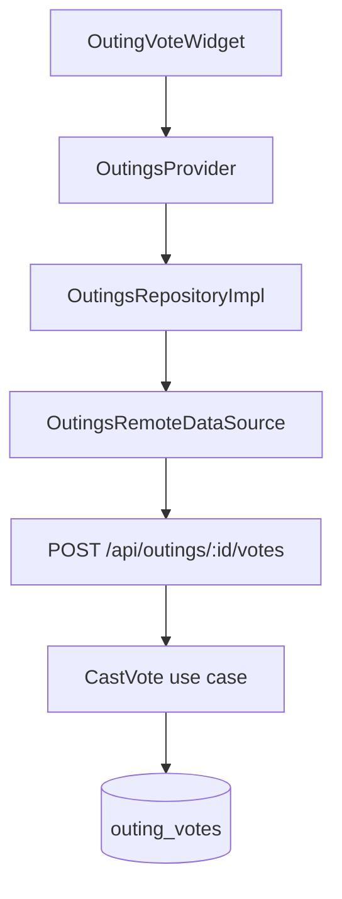

# Yalla 5roga — Flutter Architecture

| Metadata | Value |
|----------|-------|
| Last verified | 2026-11-08 (API request optimization: diagnostics, dedupe, selective outings hydrate) |
| Documentation version | 1.0.0 |
| Package | `yalla_5roga` (`flutter/pubspec.yaml`) |
| Needs verification | Full device E2E; outing invite accept UI completeness |

## 1. Architectural style

Feature-first Clean Architecture with **Provider / ChangeNotifier** for state. Manual DI in `AppDependencies` (no get_it). Navigation uses **GetX** helpers (`Get.to` / snackbars) inside a Provider-based app shell. Networking via **Dio** + `ApiClient`.

Data path for every feature:

```
UI → Provider → Repository (dartz Either) → RemoteDataSource → ApiClient/Dio → Backend
```

Outing chat additionally: `OutingChatProvider` ↔ `OutingChatSocketClient` (Socket.IO) for live `outing:message` / room join; sends remain REST. Presentation must not import Dio, `http`, Firebase, or `socket_io_client` directly.

## 2. Entry and boot

1. `lib/main.dart` — Firebase init, Crashlytics, FCM background handler, `AppDependencies.create()`, `runApp(App)`.
2. `lib/core/di/app_dependencies.dart` — SharedPreferences, Dio + interceptors, `RepositoryFactory`, providers, `AuthProvider.restoreSession()`.
3. `lib/app.dart` — `MultiProvider` + `GetMaterialApp`; authenticated → `MainShell`, else splash/auth.

FCM token registration is deferred until after first frame via `FcmProvider`.

## 3. Folder structure

```
flutter/lib/
  main.dart
  app.dart
  firebase_options.dart
  core/
    animations/
    config/          # AppConfig
    constants/       # ApiConstants, AppConstants
    di/              # AppDependencies, RepositoryFactory
    error/           # Failure, AppException
    localization/    # L10n, LocaleProvider
    media/           # media:// refs, direct upload, signed-URL resolver, account cache keys
    monitoring/      # Analytics, Crashlytics, Performance
    network/         # ApiClient, interceptors, NetworkInfo
    theme/           # AppTheme, ThemeProvider
    utils/
    widgets/
  features/
    auth/
    chat/
    discover/
    groups/
    home/
    invites/
    notifications/
    outings/
    setting/
    shell/
    splash/
```

Each full-stack feature typically has `data/`, `domain/`, `presentation/`.

## 4. Features (verified)

| Feature | Key types | Notes |
|---------|-----------|-------|
| `auth` | `AuthProvider`, `AuthRepositoryImpl`, `FirebaseAuthService`, `AuthRemoteDataSource` | Phone/password via `/api/auth/*`; Firebase OTP proof at signup and verified phone updates |
| `shell` | `MainShell`, `ShellProvider` | Home, Groups, Outings, Discover, Settings. Outing Details owns the foreground GPS verification lifecycle. |
| `groups` | `GroupsProvider`, `GroupsRemoteDataSource`, `GroupInviteResult`, `PickDeviceContactsPage` | Create-group: optional cover photo; members from device contacts (or manual phone); invites via `POST …/invitations` (WhatsApp for non-users); `…/members` is existing-user only. After create / on details+info, members reload so creator count starts at 1 and owner card shows. Group Info gives owners an inline bio editor. The provider sends only the bio in the PATCH and merges the returned bio into the current group. Uses API `member_count` / `my_role` on list payloads. Group Info keeps `pending_members` separate from the active list in the entity, renders the localized status alongside active profiles, and refreshes after an invite or on opening. Pending removal uses the owner revocation endpoint. Local gallery paths are never sent as `image_url` |
| `outings` | `OutingsProvider`, `CreateOutingProvider`, vote/attendance widgets | Core product; create + multi-place suggest share `CreateOutingPage` (`letVote` / Add place) |
| `chat` | `OutingChatProvider`, `OutingChatRemoteDataSource`, `OutingChatSocketClient` | REST list/send/read + Socket.IO; page resume recovery; id/`local_*` upsert dedupe |
| `discover` | `DiscoverProvider`, places remote + saved places DS | Neon places |
| `notifications` | `NotificationsProvider`, `FcmProvider`, `PushMessagingRepositoryImpl` | Feed + FCM |
| `invitations` | `InvitationsProvider`, `InvitationsPage`, `GroupInvitation` | Pending group invitations list opened from Settings / group-invite push / deep links. Card shows invitation, group name, invitee message; Accept/Decline buttons. Uses `GET /api/invitations`, `POST …/accept|decline`. Provider is app-wide registered in `app.dart` |
| `invites` | `InviteDeepLinkProvider`, `InviteLinkParser` | Group deep links primarily |
| `setting` | `SettingsProvider`, profile pages | Account tiles: member-since from Neon `created_at`; unverified phone status opens a Firebase OTP sheet. The profile avatar opens Edit Profile, which uses field sheets, a separate password route, and reduced-motion-aware save confirmation. Outing history opens a route backed by the current-user outings snapshot. Logout resets the shell index and replaces the full route stack with login. Theme/locale via core providers |

## 5. State management

App-wide providers registered in `AppDependencies` / `app.dart`:

- `ThemeProvider`, `LocaleProvider`
- `AuthProvider`, `ShellProvider`
- `GroupsProvider`, `OutingsProvider`, `SavedOutingsProvider`
- `DiscoverProvider`, `OutingChatProvider`
- `NotificationsProvider`, `FcmProvider`
- `InviteDeepLinkProvider`, `SettingsProvider`
- `InvitationsProvider` (pending group invitations list)

Page-scoped: `CreateOutingProvider` (and similar) constructed with repos from `context.read`.

Group membership freshness: registration forwards the OTP Firebase ID token as `phoneVerificationToken`; the backend retains that UID and links pending invitation identities without membership. `AuthProvider.restoreSession` exposes the matching cached profile immediately; deferred one-time account sync follows cached shell hydration before online group revalidation. Ordinary profile refresh uses GET /api/users/cuser; phone verification also syncs instead of PATCHing an unverified profile value and refreshes groups once on success. Legacy phone credential conflicts obtain proof in a temporary secondary Firebase Auth instance, preserving the canonical session; only an unused OTP identity may be rebound by the backend. Group list/detail cache and dedupe keys include caller UID and a generation changed on logout. `GroupsProvider.clear` empties visible groups, and list/detail loads ignore responses from an older epoch. No polling is added.

## 6. DI and repositories

`RepositoryFactory` (`lib/core/di/repository_factory.dart`) builds API-backed implementations only. No mock/demo repository layer.

`AppDependencies.create` also builds `MediaUrlResolver` (persistent URL metadata + batch signed-URL fetching + cache keys) and `MediaUploadService` (presigned direct upload). Both are exposed through Provider in `app.dart`; `MediaUrlResolver.active` is the process-wide fallback used by `AppNetworkImage` for leaf widgets without context.

## 7. Networking

- `ApiClient` wraps Dio.
- Interceptors: `AuthInterceptor` (Firebase ID token; retries one 401 with a forced refresh), `AppLogInterceptor`, debug-only `RequestDiagnosticsInterceptor`, `PerformanceInterceptor`, `ErrorInterceptor`. Firebase tokens are never persisted in preferences.
- Paths: `ApiConstants` — all include `/api` prefix.
- Payload helpers: `lib/core/network/api_payload.dart` (snake ↔ domain).
- Repository GET helpers use `cachedRemote` (`core/cache/`) with short TTLs (`CachePolicy`) plus in-flight `RequestDeduper` coalescing.
- Outings list hydrates **voting** outings only (parallel, concurrency-limited); Event/Chat/mutations call `refreshLifecycle(outingId: …)` / `reloadOutingDetails` instead of re-fan-out of the full feed.
- Debug summary: `RequestDiagnostics.instance.formatSummary()` (no tokens/bodies). See [`audit/FLUTTER_API_REQUEST_OPTIMIZATION_REPORT.md`](audit/FLUTTER_API_REQUEST_OPTIMIZATION_REPORT.md).

## 8. Models and DTOs

### Offline and reactive synchronization (2026-11-11)

`OfflineSnapshots` stores allowlisted group/list/member and outing/list/voting-state/attendance/option GET envelopes per Firebase UID and API origin. Retention is at most 200 entries per account/origin and 512 KiB per entry. `ApiClient` serves snapshots in the startup cache-only pass or on transient transport/server errors; access denial evicts the affected snapshot instead of serving stale data. Cache-only reads bypass TTL/in-flight caching so preview cannot suppress revalidation. Outing repository/datasource generations reject session-stale responses.

`AppSyncProvider` is registered in manual DI and `App`. It starts with cached groups/outings, then synchronizes profile, lists, inbox and open details/chats. Connectivity regain, socket connect and foreground resume trigger catch-up. IDs accumulate in sets and debounce for 250 ms; vote changes target one outing. Recovery retries use five delayed exponential attempts, then retain dirty state until resume, reconnection or a server invalidation. Pending chat sends use capped exponential delay. Transient allowlisted GET failures request catch-up even when a cached fallback was displayed. Providers react to data changes. Following the concurrent sync/chat task's explicit design direction, background synchronization is silent: no global loading or connection banner. Chat displays its room-aware connection indicator and pending/failed message state locally.

`ChatSendQueue` persists up to 100 pending sends before reporting success to the composer. One drain replays stable UUIDs over REST. Network/401/408/429/5xx errors retry; permanent rejections, including closed-chat conflicts, remain visibly failed (up to 30 retained failures). Only chat sends are queued. Profile restoration requires an existing Firebase session matching the cached UID. Credentials are not stored in snapshots. Member profiles are available through cached group details; arbitrary standalone profiles are not cached.

The socket client keeps an in-memory invalidation cursor and reconciles missed recipient-scoped changes; an unavailable/expired cursor falls back to list/open-detail recovery. Chat retains at most 100 messages for each of 20 outings. Recovery loads the latest page; server history remains paginated. Synchronization runs in the foreground, with no promise of OS background execution.

- Domain entities under `features/*/domain/entities/` (e.g. `Outing`, `PlaceVote`, enums in `outing_enums.dart`).
- Data models under `features/*/data/models/` where needed.
- Status enums aligned with backend: `draft|voting|confirmed|cancelled|past`; attendance `going|notGoing|maybe` (+ client-only `unset`).

## 9. Navigation

Imperative GetX — no named route table. The shell extends tab content beneath a floating capsule-shaped pill navigation bar with a StadiumBorder, theme-tinted backdrop blur, and animated pill selection indicator. Scroll padding reserves the bar height at the end of each tab, and high contrast uses an opaque bar with high-contrast outlines. Deep links handled by `InviteDeepLinkProvider` + navigator helpers. Outing deep-link accept UX is **partial** (group invites more complete).

## 10. Error handling

```
Dio / Firebase / Socket
  → AppException (+ status/code/endpoint metadata)
  → guardRemote / auth boundary
      → Failure (Either)
      → debug ErrorBlueprintLogger (once)
      → Crashlytics (unexpected/server)
  → Provider → AppErrorFeedback / FailureMessageMapper → L10n SnackBar
```

| Piece | Path | Role |
|-------|------|------|
| `AuthInterceptor` | `core/network/dio_interceptors.dart` | Adds the in-memory Firebase token; refreshes and retries a 401 once |
| `ErrorInterceptor` | `core/network/dio_interceptors.dart` | Maps Dio → typed `AppException` with HTTP metadata |
| `ExceptionMapper` | `core/error/exception_mapper.dart` | Dio/AppException ↔ `Failure` |
| `guardRemote` | `core/network/remote_guard.dart` | Single remote catch site; blueprint + Crashlytics |
| `ErrorBlueprintLogger` | `core/error/error_blueprint_logger.dart` | Debug-only structured console dump (sanitized) |
| `FailureMessageMapper` | `core/error/failure_message_mapper.dart` | Failure → short EN/AR user copy |
| `AppErrorFeedback` | `core/error/app_error_feedback.dart` | SnackBar / network alert only (no duplicate logs) |

Rules:

- Presentation never shows raw `exception.toString()`, HTTP codes, or backend stack text.
- Meaningful product conflicts (e.g. vote locked) may map to existing L10n phrases.
- Secrets (tokens, passwords, Authorization) are redacted by `ErrorSanitizer` before logging.
- Auth (no `guardRemote`) logs blueprints once from `AuthProvider._reportFailure`.

## 11. Localization and theme

- Manual `L10n` (en/ar) + `LocaleProvider` (prefs).
- `ThemeProvider` + `AppColors` / `AppPalette` / `AppTheme`.
- `flutter: generate: false` — extend `l10n.dart`, do not add gen-l10n unless requested.

## 12. Firebase

- Auth: `FirebaseAuthService` (phone OTP proof and Firebase custom-token sessions).
- Messaging: `FcmMessagingService` + background handler in `fcm_background_handler.dart`.
- Monitoring: Crashlytics / Analytics / Performance services under `core/monitoring/`.

## 13. Notifications (client)

- Register/unregister token via `FcmTokenRemoteDataSource` → `POST|DELETE /api/users/cuser/fcm-token`.
- Foreground display uses the local notifications service. Both Firebase and local notification launch details can resume a cold-start tap.
- `FcmProvider` waits for the authenticated `MainShell`, deduplicates opens, and shares `PushNotificationNavigator` with the inbox. The navigator uses authenticated repository reads and pushes the appropriate GetX route or section onto the existing stack. Chat notification taps open the regular `OutingChatPage` without passing a message target or rendering a separate notification message card.
- In-app feed and per-item read state use `NotificationsRemoteDataSource` → `/api/notifications`.

## 14. Images / files

Entity image fields are strings: absolute http(s) URLs (legacy/external) or stable `media://<uuid>` references. `core/media/media_reference.dart` classifies values; pickers still return local paths and those are uploaded before the API call.

Upload flow (`MediaUploadService`):

1. `POST /api/media/upload-url` (purpose + MIME + size, optional entity id).
2. `PUT` bytes directly to R2/mock storage — bypasses the API and Neon.
3. `POST /api/media/:id/confirm`; only then is the reference sent on create/update.
4. A failed upload triggers a best-effort `DELETE` for the pending asset.

MIME (`jpeg/png/webp/gif`) and size limits are checked client-side before networking. `remote_image_url.dart` accepts http(s) or `media://`, so local paths are never sent. Profile (settings), group create/cover change, outing create/suggest are wired; place media remains backend/admin-managed.

Display and caching (`AppNetworkImage` + `MediaUrlResolver`):

- `media://` is resolved through `POST /api/media/signed-urls` (batched per microtask, max 50 ids) or `GET /api/media/:id/url`.
- Delivery URL metadata (URL, visibility, expiry) is persisted in SharedPreferences per Firebase UID; private URLs are refreshed in the background when near expiry while the cached image keeps rendering (stale-while-revalidate).
- Image-cache identities are stable: `media_public_<assetId>` / `media_private_<uid>_<assetId>`. Signed URLs are never used as cache keys, so rotation does not re-download and account switches cannot surface another account's private image.
- Offline: persisted URL metadata + `CachedNetworkImage` disk cache render previously seen images; a network failure falls back to the stored entry rather than a blank state.
- Invalidation: replacing/deleting an image evicts its entry; logout and account switch clear that account's URL metadata and private cache entries. Eviction is best effort/time-bounded and never blocks logout.
- Missing/unavailable media renders the existing default cover/avatar placeholders.

Cover uploads may happen before the group/outing row exists; the backend links the asset when the create/update persists the reference.

## 15. Typical feature flow (vote)



Flutter may animate tie-break / winner reveal only after server confirms (`breakTie` / voting-state refresh).

## 16. Testing

- Unit/widget tests under `flutter/test/` (when present).
- Analyzer is the primary static gate.
- Device E2E for product scenarios A–N: **NOT RUN** as of last audit.

## 17. Conventions

- Strings via `context.l10n` / `L10n`.
- Layout via responsive helpers (`.w` `.h` `.sp`).
- Wire new app-wide providers in **both** `AppDependencies` and `App`.
- Never reintroduce mock/demo seed layers.
- Prefer existing shared widgets under `core/widgets/`.

## Related

- [`PROJECT_STRUCTURE.md`](PROJECT_STRUCTURE.md)
- [`API_CONTRACTS.md`](API_CONTRACTS.md)
- [`USER_SCENARIOS.md`](USER_SCENARIOS.md)

### Home presentation

`HomePage` observes outings readiness; `FeaturedOutingCard` derives the next dated non-terminal outing from the existing `OutingsProvider` snapshot. Initial loading remains owned by `MainShell`; explicit Home refresh/retry calls the provider, with no network request in build. The Home creation buttons use existing routes. The Discover tab uses `DiscoverProvider`, the existing FlutterMap tile configuration and the paginated nearby places endpoint. It loads nearby places with existing location permission or on request and applies the shared `VibePicker` filters locally. Pins route to `CreateOutingPage(suggestedPlace: …)`. See `UI_UX_AUDIT_AND_HOME_REDESIGN.md` for selection and validation limitations.

### Planning covers and form layout

`PlanningCover` shows the supplied photo when available and uses themed SVG artwork from `flutter/assets/covers/` for missing or unreadable group, outing, birthday, and wedding covers. Fallbacks are rendered locally and are never written into `image_url`. Create Group and Create Outing share the full-width, optional `PlanningCoverPicker` with their own placeholder artwork. The Saved list reads the outing occasion from its existing response envelope, with a generic outing fallback for older payloads.

The Outings tab shows Active Votes and plans whose scheduled start has yet to arrive, plus unscheduled plans. `OutingHistoryPage`, opened from Settings, reuses the signed-in user’s `OutingsProvider` snapshot and lists started, completed and cancelled outings by scheduled date. `OutingsProvider` notifies listeners at the next scheduled start and recalculates on app resume. Create Outing uses a full-width optional cover, shared vibe choices, and a review footer. Group outings can opt in to voting in step 2, where the same place list switches to multi-select and the map edits the whole ordered selection. The deadline control appears on Review. The special-event guest picker uses the existing device contact picker for WhatsApp recipients and the form confirms opt-in before publishing. Outing details shows manual sends when the API returns click-to-chat links. Outing Details gets the confirmed coordinates and arrival policy from the backend. During its active window the current foreground route starts verification with OS location permission, rechecks on resume and takes bounded fixes at most once per minute between lifecycle changes. It stops scheduling when the route is covered, backgrounded, outside the window or the viewer is verified. Socket.IO invalidations and reconnects refresh the roster. The viewer’s permission and GPS availability stay local. Group invitations use inline consent and keep the user in the app.

### Shared maps and location selection

Discover and the outing picker both render through `core/widgets/app_map.dart`. It owns a route-local map controller, tile provider, camera animation, attribution and gesture-idle detection. `MapLocation` shares the bounded foreground GPS request and permission states. Discover owns filtering and preview. `PickLocationProvider` owns the candidate and an immutable ordered selection until confirmation. Search combines the Discover catalog with the authenticated `LocationRepository` when enabled. Search debounce is 350 ms and map idle settles after the pointer is released and camera activity pauses for 325 ms. Cancellation and request identity guard both async paths. External results are cached only for the configured TTL in a bounded in-memory picker cache. Search and manual pin naming continue with the catalog and loaded tiles when external lookup is unavailable.

Set `OSM_DARK_TILE_URL` and `OSM_DARK_TILE_ATTRIBUTION` together to use a dark OSM-derived raster style. Otherwise both themes use the standard basemap with themed controls. Use only a tile endpoint whose usage terms cover the app. Treat Dart defines as public. If a tile operator requires a public app token, restrict it to the intended apps and APIs where supported. Keep private tokens on the backend. [OSM tile usage policy](https://operations.osmfoundation.org/policies/tiles/)

The outing snapshot merges targeted details by outing ID. RSVP changes overlay the pending selection and use the PUT response to refresh counts. A failed write removes the overlay. Voting mutations refresh a single voting-state resource, including the viewer’s choice and final venue. Chat uses cursor pagination, server-supplied names, the authenticated profile UID, and client message UUIDs for idempotent sends.


## Silent recovery and chat mentions — 2026-11-11

`App` renders no global sync/connection layout. `AppSyncProvider` remains headless. Cached restoration finishes before network work; `AuthProvider.synchronizeRestoredAccount` defers one account sync until cache preview, before online group revalidation. General `refreshProfile` uses GET `/api/users/cuser`, with an in-flight guard. Explicit verified-phone/account synchronization uses POST `/api/users/sync`; identical concurrent operations share a request. Profile reads never force Firebase token refresh.

The shared socket client tracks transport, network availability and acknowledged outing rooms separately. `OutingChatProvider` subscribes to connection changes; only the chat route displays a localized, semantic, small status row. Room join retries use bounded exponential delays; authZ rejection is disconnected for that room. Mention selection tracks text ranges and stable IDs, drops edited tokens, and serializes selected mentions on send. Existing repository/queue/model text persistence retains tokens offline; bubble rendering decodes them. Sender projection remains canonical from Neon; no application data moved to Firebase.


Authentication uses the existing provider, Firebase adapter and Dio exception mapping. Network and timeout codes reach localized snackbar feedback; the default Dio connection, send and receive timeouts are 15 seconds.


## Centralized event application — 2026-11-11

`AppSyncProvider` remains the single session coordinator and reuses the DI-owned `OutingChatSocketClient`; chat, arrivals, group subscriptions and domain events share its one Socket.IO manager. `RealtimeChange` carries optional complete data and `RealtimeCursor` separates live deduplication from acknowledged catch-up. Logout clears rooms, cursor, dedupe memory, provider state and account caches; session generations guard late recovery, transport and send callbacks, including switching away and back to the same UID.

Complete attendance rows go through `OutingsProvider` → repository → datasource with no HTTP. The datasource merges row versions by `updated_at`, maintains its snapshot and the repository TTL snapshot, and persists the updated offline attendance envelope. Older REST rows and duplicate events do not overwrite a newer row or notify widgets again. Pending local RSVP selection remains the visible overlay until its write completes. Chat retains direct canonical message upserts.

Incomplete group changes fetch the affected group, including newly created groups. Detail reads update the group-list TTL cache, preventing a later cached list from undoing the update. Incomplete outing creation/update/vote/lifecycle changes fetch one outing, including IDs absent from the current list. Membership changes still revalidate group/outing lists and active chats because access may change across several resources. Dirty IDs are set-coalesced for 250 ms; no event publishes another event or performs a REST write. No page rebuild or periodic polling is introduced. See [verification and remaining limits](audit/CENTRALIZED_REALTIME_SYNC.md).

## Password recovery presentation — 2026-11-11

`AuthForm` opens `PasswordRecoveryPage` with GetX. The route creates/disposes `PasswordRecoveryProvider` from the existing `AuthProvider.repository`; no app-wide DI change is required. Domain repository methods route recovery bodies through `AuthRemoteDataSource` and existing Dio error mapping. `FirebaseAuthService` reuses SMS sending and verifies the recovery credential in a secondary Firebase app, preserving primary session/cache/listeners. Proof and reset secrets are transient route memory only. No sync/provisioning is called during recovery. All recovery endpoints bypass automatic 401 retry so single-use steps are not silently replayed.

The form uses `AppPageBar`, `PhoneTextField`, `OtpInput`, `CustomTextField`, `CustomButton`, `AppSnackBar`, theme palette, `Responsive.contentMaxWidth` and manual `L10n`. State includes an absolute-time 60-second resend cooldown, operation guards, loading, local password confirmation/UTF-8 limits and restart. Arabic phone/OTP normalization follows existing formatters. Recovery uses signup’s shared `OtpInput`, including automatic submission after six digits. A failed resend preserves the previous request/verification pair until a replacement SMS succeeds. The Firebase SMS flow has one 75-second callback deadline, allowing the SDK’s 60-second retrieval window and native app verification. Native invocation errors are observed immediately; late callbacks are ignored. Earlier recovery-task evidence recorded targeted analysis and 27 focused Flutter tests passing; these were not rerun in this task. Device SMS and live rendering remain for owner testing. See [PASSWORD_RECOVERY_REPORT](audit/PASSWORD_RECOVERY_REPORT.md).

## Shared snackbar feedback — 2026-11-11

All snackbar call sites use `AppSnackBar`, including location permission failures. The shared bubble shows the existing app SVG logo, directional wrapping message text and a live-region announcement. Optional localized actions preserve the map’s settings shortcuts with a 48dp touch target. Success and recovery/error copy stays short in English/Arabic; text is not truncated. Phone/wide, light/dark, English/Arabic and enlarged-text widget checks pass.

## Confirmed API integrations — 2026-11-13

The existing ApiConstants → remote data source → repository Either → Provider → reusable widget/page path now supports outing PATCH/cancel, creator guest removal, explicit outing invitation decisions, and owner group deletion. EditOutingPage composes EditOutingForm; OutingManagementActions owns creator/invitee controls. Existing text fields, cover picker, date/time dialogs, map picker, alert confirmation, palette, manual L10n and Responsive limits are reused. Confirmed/voting venues are not editable in this form. Successful mutations refresh only the affected outing snapshot; group deletion refreshes lists and returns to the root. Socket invalidations refresh open guest state alongside the affected outing, and guests use the existing account snapshot cache. No screen imports Dio or a new networking service. suggested_by_user_id remains response-only.

The existing SavedOutingsRemoteDataSource now implements the four existing draft operations, using the same SavedOutingsRepository/Provider and local datasource. The local draft entity carries remoteVersion/pending/deleted/conflict cache metadata only. Origin/account-scoped SharedPreferences stores pending edits/deletes before network work. A serialized repository queue plus Provider in-flight guard prevents recursive sync. AppSyncProvider invokes recovery on reconnect/resume; there is no polling. Stable UUID Idempotency-Key retries POST; If-Match uses the loaded server version for update/delete. Newer server data causes a preserved local conflict rather than overwrite. Local cover paths upload through the existing MediaUploadService and retain the returned reference for retries. Local guest-phone selections remain cached because the current backend draft shape has no guest-phone field; legacy unscoped draft preferences remain untouched for ownership safety.

The existing notification feed follows bounded cursor pages without changing the domain feed/unread contract. Group invitations filter the API's history to pending UI cards/counts. Notification navigation and explicit actions distinguish outing IDs from group invitation IDs; legacy invitation payloads with an outing ID route to Outing Details. Conflicting persisted group decisions never display false accept/decline success. All new copy uses L10n Arabic/English; existing widgets inherit RTL and light/dark themes. Static analysis is recorded in the implementation report. Flutter tests, launch, hot reload and visual/device verification were not performed under the owner's execution restriction.

Write requests bind the existing expected-user option at invocation so a token refresh/account switch cannot silently replay a mutation as another signed-in account.

Committed outing updates/cancellations merge the returned row into the existing provider and persisted current-user collection without an extra GET. Group deletion also removes the group resource snapshot and collection entry; outing decline removes its inaccessible cached resource.
