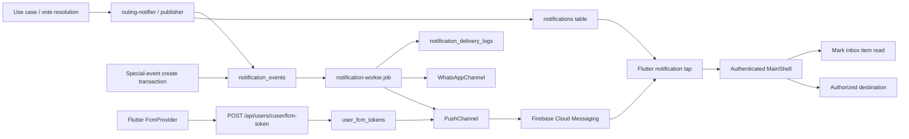

# Yalla 5roga — Notifications

FCM registration upserts on the globally unique token. The same device token can move between accounts in one write. The user lookup index supports push delivery. Inbox history and delivery attempts persist separately in Neon.

| Metadata | Value |
|----------|-------|
| Last verified | 2026-11-10 |
| Documentation version | 1.0.0 |
| Implementation status | Outbox + channels implemented; **real device FCM delivery NOT RUN** |
| Needs verification | End-to-end push on iOS/Android; WhatsApp provider in each environment |

## Architecture

## Device token registration

| Step | Component |
|------|-----------|
| Request permission / getToken | `FcmMessagingService` |
| Register with API | `FcmTokenRemoteDataSource` → `POST /api/users/cuser/fcm-token` |
| Unregister | `DELETE /api/users/cuser/fcm-token` |
| Persist | `user_fcm_tokens` unique per user+token and per token |

Invalid tokens should be deleted on FCM errors (Push channel behavior).

## Delivery mechanism

1. Domain code calls `notifyOutingParticipants` / publisher with `eventType` + `eventKey`.
2. Writes in-app `notifications` row (idempotent on `event_key`).
3. Enqueues `notification_events` (status `pending`, channel `push` or `whatsapp`).
4. Worker claims due rows → channel send → `sent` / retry / `dead`.
5. Delivery attempts logged in `notification_delivery_logs`.

In-process interval worker (`startNotificationWorker`) — not a separate Redis queue.

## Implemented event types (schema enum)

From Prisma `notification_event_type`:

| Event | Typical trigger | Status |
|-------|-----------------|--------|
| `group_invite` | Group invitation (non-user phone) | Automatic outbox after confirmed recipient opt-in with Meta configured. Pending membership is persisted separately. |
| `outing_invite` | Registered guest invite or special-event phone invitation | Push for registered guests. WhatsApp outbox or click-to-chat for opted-in special-event phone guests. |
| `outing_updated` | Candidate changes / outing updates | Implemented (vote reset messages) |
| `attendance_changed` | Member attendance upsert | Implemented (owner notified) |
| `chat_message` | Send chat | Implemented fan-out path |
| `voting_closed_early` | All voted close | Via resolution notifications |
| `voting_deadline_reached` | Deadline job | Via resolution notifications |
| `winner_selected` | Unique winner | Via resolution |
| `tie_break_selected` | Tie-break | Via resolution |
| `outing_confirmed` | Confirm path | Via resolution / notifier |
| `outing_cancelled` | Zero votes / owner cancel | Via resolution / cancel |

Exact recipient sets are coded in `outing-notifier.ts` / resolution helpers — verify there when changing fan-out.

## In-app notification types

`notification_type`: `outing | group | chat | vote | invitation | system`.

## Push and inbox destinations

FCM sends a visible notification plus string data. The data carries `type`, `pushId`, `recipientUserId`, and the related `groupId`, `outingId`, and `messageId` when applicable. `notificationId` identifies the matching inbox row for mark-read. The worker derives routing metadata from outbox columns and the durable inbox event key, including for queued events written before this contract. The inbox API exposes the specific `eventType` and optional chat `messageId` alongside its existing display category.

| Event | Destination |
|-------|-------------|
| `group_created`, `group_updated` | Group Details, subject to membership |
| `group_invite`, generic group invitation | Invitations |
| `outing_invite`, generic outing invitation | Invitations with specific authorized outing card → existing Outing Details decisions |
| `member_joined`, `member_left` | Group Details |
| `outing_created`, `outing_updated`, `outing_reminder`, `outing_confirmed`, `outing_cancelled` | Outing Details |
| `chat_message` | Outing Chat with its regular history and message styling |
| `place_vote`, candidate changes and vote resolution | Place Voting section in Outing Details |
| `attendance_vote`, `attendance_changed` | Attendance section in Outing Details |
| General notification without a related resource | Notifications inbox |

Group create/update, membership changes, individual place votes, and scheduled outing reminders have destination support but no push producer. Group outing creation currently emits a notification when initial voting options are added. Group phone invitations use WhatsApp. Already delivered legacy pushes can open a related resource from their IDs but may lack the inbox or exact message ID.

## Flutter handling

| Mode | Tap source |
|------|------------|
| Foreground | Local notification response |
| Background | Firebase open stream or local notification response |
| Terminated | Firebase initial message or local notification launch details |
| In-app inbox | Selected notification row |

The client holds taps until the authenticated shell is mounted. It checks the intended recipient when present, deduplicates push opens, and pushes onto the existing route stack. It marks the selected inbox item read and validates the destination through the authenticated API. Deleted and inaccessible content shows localized feedback on the current screen. Chat and mention notifications open the regular chat without fetching, repositioning, or specially labeling the notification message, even when the payload includes a message ID.

## Idempotency

- `notifications.event_key` unique
- `notification_events.event_key` unique
- Retries reuse event keys. Outing fan-out batches inbox and push outbox writes in one transaction so both records are persisted together.

## WhatsApp configuration

Set `WHATSAPP_PROVIDER=meta`, `WHATSAPP_ACCESS_TOKEN`, and `WHATSAPP_PHONE_NUMBER_ID` for automatic delivery. Configure approved templates with `WHATSAPP_INVITE_TEMPLATE` and `WHATSAPP_SPECIAL_EVENT_TEMPLATE` and set `WHATSAPP_INVITE_TEMPLATE_LANG` to the approved language. The special-event template must have five body parameters in order: event title, Cairo date/time, venue, Google Calendar URL, and optional try-the-app URL. The fixed template copy must say guests can attend without the app. Set `APP_DOWNLOAD_URL` to the public try-the-app page. Meta requires recipient opt-in before outbound messages. The app records the organizer’s confirmation before queueing. [WhatsApp Business Messaging Policy](https://business.whatsapp.com/policy)

Without a configured Meta sender, group associations remain pending and the group API does not queue a send. The disabled sender never reports a successful WhatsApp submission. Group events deduplicate on `group_invite:<invitationId>`. A Meta success needs a provider message ID. The outbox’s sent status represents provider acceptance. Rate limits and service failures retry with bounded backoff. A rejected template or missing consent is terminal. Special-event invites retain their separate click-to-chat flow. Live delivery needs a Meta business account, API token, sending number ID, an approved group template and recipient consent.

## Failure handling

- `attempts` / `max_attempts` / `next_attempt_at` / `last_error`
- Status progression: pending → processing → sent | failed → dead
- Zero FCM tokens: treat as skip/sent to avoid infinite retry (per compliance notes)

## Preferences

No verified per-event user preference matrix in Neon as of last verification. Do not document preference UI as implemented without code proof.

## Planned vs implemented

| Concern | State |
|---------|-------|
| Outbox schema + worker | Implemented |
| PushChannel using Admin FCM | Implemented in code |
| WhatsApp invitation channel | Implemented when config present |
| Device E2E push proof | **NOT RUN** |
| Development backend notification audit | Real Firebase identity and Neon data verified for older-message lookup, ownership, deletion, and push payload construction with the FCM send intercepted. |
| Invitation-accepted dedicated UX event | Partial / policy-dependent |

## Related

- [`PRODUCT_SCENARIOS.md`](PRODUCT_SCENARIOS.md) §14
- [`SYSTEM_DESIGN.md`](SYSTEM_DESIGN.md)
- [`API_CONTRACTS.md`](API_CONTRACTS.md)

## Mention notification handling — 2026-11-11

Stable-ID mentions reuse `chat_message`, type `chat`, and the regular outing-chat destination. The mentioned recipient sees a “mentioned you” body using the canonical sender name; other chat recipients retain the ordinary new-message body. Repeated tokens and concurrent REST retries share the existing durable message/recipient event key and unique outbox key. The sender is excluded from both recipient sets. A retry after chat closure can acknowledge an already committed message and repair notification enqueue without creating another row. Delivery workers and real device push were not exercised in this task. Inbox producers and mark-read endpoints publish targeted Socket.IO invalidations after persistence.

## Cancellation and inbox corrections — 2026-11-13

Creator cancellation uses `notifyOutingParticipants` with the supported `outing_cancelled` event. Inbox rows include outing/group IDs and the body identifies the outing title; the outbox payload contains title, type and both navigation identifiers. The stable `outing_cancelled:<outingId>:owner:<recipientUid>` key (and corresponding outbox key) deduplicates repeated/mixed cancellation paths. The existing controller publishes the scoped outing invalidation; inbox invalidations refresh affected recipients. Physical FCM/Socket.IO delivery was not exercised in this task.

The inbox always pages newest-first by created_at and unique ID, default 20/max 100. Opaque cursors are ownership checked and database-native cursor traversal preserves database timestamp precision. The data array stays compatible, next_cursor remains an alias, and pagination.nextCursor is canonical metadata. Flutter follows pages for its existing complete feed and unread count. eventType documentation uses supported Prisma notification events plus existing inbox routing aliases; no new event enum or chat media endpoint was added.

Outing invitations and group invitations are routed separately, including legacy generic invitation payloads carrying an outing ID. Explicit notification actions use the appropriate existing endpoints and check the returned persisted decision before reporting success; opening a notification never accepts it.

## Phase 4 special-event occasions — 2026-11-14

Birthday, Wedding, Celebration and Other share the existing special-event invitation payload (title/time/venue/calendar/app links). Optional group association does not disable opted-in phone invitations or app-member invitations. Existing notification participant resolution includes current group members and invited app members without adding a new transport or wire event. Phone normalization/deduplication, creator-scoped request-key retries and transactional WhatsApp outbox/manual-link fallback remain. Verification runs without delivery workers; physical WhatsApp/FCM delivery is not claimed.

## Phase 5 inbox and native actions — 2026-11-14

The inbox uses All/Unread choice chips, unread count, shared NotificationCard with localized event-category title, body, avatar/event icon, relative timestamp and unread surface/dot. Provider errors have explicit retry; cached items can remain visible. Existing producers and event aliases are preserved; destination support does not create missing producers.

Android local foreground chat notifications use RemoteInput Reply and Mark as read with `showsUserInterface: true` and the existing authenticated handler. The action receiver is declared. **Android OS-rendered background/terminated FCM notifications retain ordinary delivery and taps but do not include these local action buttons.** No data-only delivery replacement was introduced. iOS registers `outing_chat` text-input/read actions with foreground/authentication-required options; local responses use the plugin, remote APNs responses use the AppDelegate channel and cold-start pending-action handoff. APNs chat pushes include the matching category. These actions open the app to use the current Firebase session; silent background API execution is not promised.

Recipient checks run before interactive actions; chat requests pin the expected user. Reply reuses the outbox push UUID as clientMessageId; a failed/404 response is not reported as success. Successful native actions update the inbox read row. Native labels use saved English/Arabic locale; iOS categories register at initialization. Platform setup follows the installed flutter_local_notifications 22.3.1 APIs: https://pub.dev/packages/flutter_local_notifications and https://pub.dev/documentation/flutter_local_notifications/latest/flutter_local_notifications/AndroidNotificationAction-class.html . No Android/iOS action, native iOS compilation or physical FCM delivery was exercised in this task.
