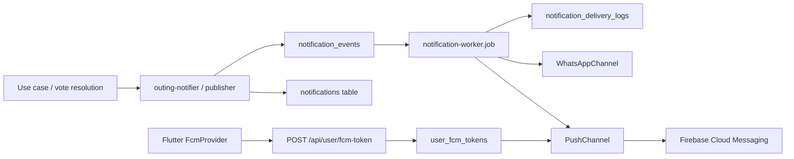

# Yalla 5roga — Notifications

| Metadata | Value |
|----------|-------|
| Last verified | 2026-11-07 |
| Documentation version | 1.0.0 |
| Implementation status | Outbox + channels implemented; **real device FCM delivery NOT RUN** |
| Needs verification | End-to-end push on iOS/Android; WhatsApp provider in each environment |

## Architecture

## Device token registration

| Step | Component |
|------|-----------|
| Request permission / getToken | `FcmMessagingService` |
| Register with API | `FcmTokenRemoteDataSource` → `POST /api/user/fcm-token` |
| Unregister | `DELETE /api/user/fcm-token` |
| Persist | `user_fcm_tokens` unique per user+token and per token |

Invalid tokens should be deleted on FCM errors (Push channel behavior).

## Delivery mechanism

1. Domain code calls `notifyOutingParticipants` / publisher with `eventType` + `eventKey`.
2. Writes in-app `notifications` row (idempotent on `event_key`).
3. Enqueues `notification_events` (status `pending`, channel `push` or `whatsapp`).
4. Worker claims due rows → channel send → `sent` / retry / `dead`.
5. Delivery attempts logged in `notification_delivery_logs`.

In-process interval worker (`startNotificationWorker`) — not a separate Redis queue.

## Implemented event types (schema enum)

From Prisma `notification_event_type`:

| Event | Typical trigger | Status |
|-------|-----------------|--------|
| `group_invite` | Group invitation | Implemented (WhatsApp path) |
| `outing_invite` | Outing guest invite | Implemented path |
| `outing_updated` | Candidate changes / outing updates | Implemented (vote reset messages) |
| `attendance_changed` | Member attendance upsert | Implemented (owner notified) |
| `chat_message` | Send chat | Implemented fan-out path |
| `voting_closed_early` | All voted close | Via resolution notifications |
| `voting_deadline_reached` | Deadline job | Via resolution notifications |
| `winner_selected` | Unique winner | Via resolution |
| `tie_break_selected` | Tie-break | Via resolution |
| `outing_confirmed` | Confirm path | Via resolution / notifier |
| `outing_cancelled` | Zero votes / owner cancel | Via resolution / cancel |

Exact recipient sets are coded in `outing-notifier.ts` / resolution helpers — verify there when changing fan-out.

## In-app notification types

`notification_type`: `outing | group | chat | vote | invitation | system`.

## Flutter handling

| Mode | Behavior |
|------|----------|
| Background | `firebaseMessagingBackgroundHandler` |
| Foreground | Local notifications service + provider refresh |
| Tap | Navigate via payload / invite/outing ids when present |

## Idempotency

- `notifications.event_key` unique
- `notification_events.event_key` unique
- Retries must reuse keys so duplicates are not created

## Failure handling

- `attempts` / `max_attempts` / `next_attempt_at` / `last_error`
- Status progression: pending → processing → sent | failed → dead
- Zero FCM tokens: treat as skip/sent to avoid infinite retry (per compliance notes)

## Preferences

No verified per-event user preference matrix in Neon as of last verification. Do not document preference UI as implemented without code proof.

## Planned vs implemented

| Concern | State |
|---------|-------|
| Outbox schema + worker | Implemented |
| PushChannel using Admin FCM | Implemented in code |
| WhatsApp invitation channel | Implemented when config present |
| Device E2E push proof | **NOT RUN** |
| Invitation-accepted dedicated UX event | Partial / policy-dependent |

## Related

- [`PRODUCT_SCENARIOS.md`](PRODUCT_SCENARIOS.md) §14
- [`SYSTEM_DESIGN.md`](SYSTEM_DESIGN.md)
- [`API_CONTRACTS.md`](API_CONTRACTS.md)
