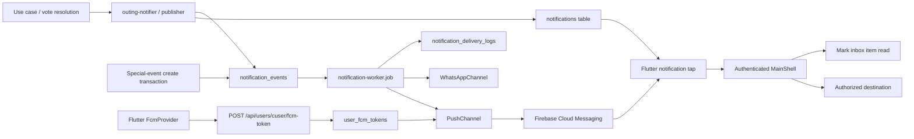

# Yalla 5roga — Notifications

FCM registration upserts on the globally unique token. The same device token can move between accounts in one write. The user lookup index supports push delivery. Inbox history and delivery attempts persist separately in Neon.

| Metadata | Value |
|----------|-------|
| Last verified | 2026-11-10 |
| Documentation version | 1.0.0 |
| Implementation status | Transactional inbox/outbox + Android background actions implemented; **device FCM delivery NOT RUN** |
| Needs verification | End-to-end push on iOS/Android; WhatsApp provider in each environment |

## Architecture

## Device token registration

| Step | Component |
|------|-----------|
| Request permission / getToken | `FcmMessagingService` |
| Register with API | `FcmTokenRemoteDataSource` → `POST /api/users/cuser/fcm-token` |
| Unregister | `DELETE /api/users/cuser/fcm-token` |
| Persist | `user_fcm_tokens` unique per user+token and per token |

Invalid tokens should be deleted on FCM errors (Push channel behavior).

## Delivery mechanism

1. Domain code calls `notifyOutingParticipants` / publisher with `eventType` + `eventKey`.
2. Writes in-app `notifications` row (idempotent on `event_key`).
3. Enqueues `notification_events` (status `pending`, channel `push` or `whatsapp`).
4. Worker claims due rows → channel send → `sent` / retry / `dead`.
5. Delivery attempts logged in `notification_delivery_logs`.

In-process interval worker (`startNotificationWorker`) — not a separate Redis queue.

## Implemented event types (schema enum)

From Prisma `notification_event_type`:

| Event | Typical trigger | Status |
|-------|-----------------|--------|
| `group_invite` | Group invitation (non-user phone) | Automatic outbox after confirmed recipient opt-in with Meta configured. Pending membership is persisted separately. |
| `outing_invite` | Registered guest invite or special-event phone invitation | Push for registered guests. WhatsApp outbox or click-to-chat for opted-in special-event phone guests. |
| `outing_updated` | Candidate changes / outing updates | Implemented (vote reset messages) |
| `attendance_changed` | Member attendance upsert | Implemented (owner notified) |
| `chat_message` | Send chat | Implemented fan-out path |
| `voting_closed_early` | All voted close | Via resolution notifications |
| `voting_deadline_reached` | Deadline job | Via resolution notifications |
| `winner_selected` | Unique winner | Via resolution |
| `tie_break_selected` | Tie-break | Via resolution |
| `outing_confirmed` | Confirm path | Via resolution / notifier |
| `outing_cancelled` | Zero votes / owner cancel | Via resolution / cancel |

Exact recipient sets are coded in `outing-notifier.ts` / resolution helpers — verify there when changing fan-out.

## In-app notification types

`notification_type`: `outing | group | chat | vote | invitation | system`.

## Push and inbox destinations

FCM sends data-only Android messages to notificationVersion=2 registrations, while legacy Android registrations retain redacted OS-visible delivery; APNs keeps visible alerts for ordinary iOS pushes. The data carries `type`, `pushId`, `recipientUserId`, and the related `groupId`, `outingId`, and `messageId` when applicable. `notificationId` identifies the matching inbox row for mark-read. The worker derives routing metadata from outbox columns and the durable inbox event key, including for queued events written before this contract. The inbox API exposes the specific `eventType` and optional chat `messageId` alongside its existing display category.

| Event | Destination |
|-------|-------------|
| `group_created`, `group_updated` | Group Details, subject to membership |
| `group_invite`, generic group invitation | Invitations |
| `outing_invite`, generic outing invitation | Invitations with specific authorized outing card → existing Outing Details decisions |
| `member_joined`, `member_left` | Group Details |
| `outing_created`, `outing_updated`, `outing_reminder`, `outing_confirmed`, `outing_cancelled` | Outing Details |
| `chat_message` | Outing Chat with its regular history and message styling |
| `place_vote`, candidate changes and vote resolution | Place Voting section in Outing Details |
| `attendance_vote`, `attendance_changed` | Attendance section in Outing Details |
| General notification without a related resource | Notifications inbox |

Group creation, accepted membership, joins/departures, outing creation/transitions, voting transitions and scheduled reminders now have durable push producers. Individual votes intentionally do not notify. Group updates retain navigation support. Registered verified group invitees receive pending-invitation pushes; the existing nonregistered-user WhatsApp service is unchanged. Already delivered legacy pushes can open a related resource from their IDs but may lack the inbox or exact message ID.

## Flutter handling

| Mode | Tap source |
|------|------------|
| Foreground | Local notification response |
| Background | Firebase open stream or local notification response |
| Terminated | Firebase initial message or local notification launch details |
| In-app inbox | Selected notification row |

The client holds taps until the authenticated shell is mounted. It checks the intended recipient when present, deduplicates push opens, and pushes onto the existing route stack. It marks the selected inbox item read and validates the destination through the authenticated API. Deleted and inaccessible content shows localized feedback on the current screen. Chat and mention notifications open the existing chat and fetch/focus/highlight the referenced authorized nondeleted message; inaccessible messages show localized feedback. This supersedes the earlier ordinary-chat-only tap policy.

## Idempotency

- `notifications.event_key` unique
- `notification_events.event_key` unique
- Retries reuse event keys. Outing fan-out batches inbox and push outbox writes in one transaction so both records are persisted together.

## WhatsApp configuration

Group Create/Add people require one unchecked-by-default checkbox confirming recipient consent to a WhatsApp invitation if they are not already app users. Recipient edits clear confirmation, and Create Group forwards the explicit consent instead of assuming consent for unknown phones. `InviteToGroupUseCase` skips WhatsApp for existing verified app accounts; pending in-app invitations and explicit acceptance remain unchanged. The API still allows consent-free pending invitation creation for other callers, but it never queues WhatsApp without opt-in.

Set `WHATSAPP_PROVIDER=meta`, `WHATSAPP_ACCESS_TOKEN`, and `WHATSAPP_PHONE_NUMBER_ID` for automatic delivery. Configure approved templates with `WHATSAPP_INVITE_TEMPLATE` and `WHATSAPP_SPECIAL_EVENT_TEMPLATE` and set `WHATSAPP_INVITE_TEMPLATE_LANG` to the approved language. The special-event template must have five body parameters in order: event title, Cairo date/time, venue, Google Calendar URL, and optional try-the-app URL. The fixed template copy must say guests can attend without the app. Set `APP_DOWNLOAD_URL` to the public try-the-app page. Meta requires recipient opt-in before outbound messages. The app records the organizer’s confirmation before queueing. [WhatsApp Business Messaging Policy](https://business.whatsapp.com/policy)

Without a configured Meta sender, group associations remain pending and the group API does not queue a send. The disabled sender never reports a successful WhatsApp submission. Group events deduplicate on `group_invite:<invitationId>`. A Meta success needs a provider message ID. The outbox’s sent status represents provider acceptance. Rate limits and service failures retry with bounded backoff. A rejected template or missing consent is terminal. Special-event invites retain their separate click-to-chat flow. Live delivery needs a Meta business account, API token, sending number ID, an approved group template and recipient consent.

## Failure handling

- `attempts` / `max_attempts` / `next_attempt_at` / `last_error`
- Status progression: pending → processing → sent | failed → dead
- Zero FCM tokens: treat as skip/sent to avoid infinite retry (per compliance notes)

## Preferences

No verified per-event user preference matrix in Neon as of last verification. Do not document preference UI as implemented without code proof.

## Planned vs implemented

| Concern | State |
|---------|-------|
| Outbox schema + worker | Implemented |
| PushChannel using Admin FCM | Implemented in code |
| WhatsApp invitation channel | Implemented when config present |
| Device E2E push proof | **NOT RUN** |
| Development backend notification audit | Real Firebase identity and Neon data verified for older-message lookup, ownership, deletion, and push payload construction with the FCM send intercepted. |
| Invitation-accepted dedicated UX event | Partial / policy-dependent |

## Related

- [`PRODUCT_SCENARIOS.md`](PRODUCT_SCENARIOS.md) §14
- [`SYSTEM_DESIGN.md`](SYSTEM_DESIGN.md)
- [`API_CONTRACTS.md`](API_CONTRACTS.md)

## Mention notification handling — 2026-11-11

Stable-ID mentions reuse `chat_message`, type `chat`, and the regular outing-chat destination. Current system pushes show sender/outing context and canonical message text, with a higher-priority direct-mention channel when preferences allow. Repeated tokens and concurrent REST retries share the existing durable message/recipient event key and unique outbox key. The sender is excluded from both recipient sets. A retry after chat closure can acknowledge an already committed message; the message and notification rows already committed together. Delivery workers and real device push were not exercised in this task. Inbox producers and mark-read endpoints publish targeted Socket.IO invalidations after persistence.

## Cancellation and inbox corrections — 2026-11-13

Creator cancellation uses `notifyOutingParticipants` with the supported `outing_cancelled` event. Inbox rows include outing/group IDs and the body identifies the outing title; the outbox payload contains title, type and both navigation identifiers. The stable `outing_cancelled:<outingId>:owner:<recipientUid>` key (and corresponding outbox key) deduplicates repeated/mixed cancellation paths. The existing controller publishes the scoped outing invalidation; inbox invalidations refresh affected recipients. Physical FCM/Socket.IO delivery was not exercised in this task.

The inbox always pages newest-first by created_at and unique ID, default 20/max 100. Opaque cursors are ownership checked and database-native cursor traversal preserves database timestamp precision. The data array stays compatible, next_cursor remains an alias, and pagination.nextCursor is canonical metadata. Flutter follows pages for its existing complete feed and unread count. eventType documentation uses supported Prisma notification events plus existing inbox routing aliases; no new event enum or chat media endpoint was added.

Outing invitations and group invitations are routed separately, including legacy generic invitation payloads carrying an outing ID. Explicit notification actions use the appropriate existing endpoints and check the returned persisted decision before reporting success; opening a notification never accepts it.

## Phase 4 special-event occasions — 2026-11-14

Birthday, Wedding, Celebration and Other share the existing special-event invitation payload (title/time/venue/calendar/app links). Optional group association does not disable opted-in phone invitations or app-member invitations. Existing notification participant resolution includes current group members and invited app members without adding a new transport or wire event. Phone normalization/deduplication, creator-scoped request-key retries and transactional WhatsApp outbox/manual-link fallback remain. Verification runs without delivery workers; physical WhatsApp/FCM delivery is not claimed.

## Phase 5 inbox and native actions — 2026-11-14

The inbox uses All/Unread choice chips, unread count, shared NotificationCard with localized event-category title, body, avatar/event icon, relative timestamp and unread surface/dot. Provider errors have explicit retry; cached items can remain visible. Existing producers and event aliases are preserved; destination support does not create missing producers.

The Android push implementation below supersedes the original Phase 5 foreground-only actions and push-UUID reply behavior. iOS retains its existing APNs category and AppDelegate bridge; device verification is still outstanding.

## Android system notification delivery — 2026-11-14

- PostgreSQL remains the sole notification/history/read-state authority. `notifications.data` stores structured routing/display metadata. `users.notification_preferences` stores push/category/mention/privacy preferences. `user_fcm_tokens.notification_version` defaults to 1; updated clients register notificationVersion=2 so older installations retain ordinary visible delivery during rollout. Firebase stores no application notification records.
- `persistNotifications(tx, ...)` writes deterministic inbox/outbox IDs and unique event keys inside the business transaction. Chat insert, invitation link/decision, group create/removal, outing create/update/confirmation/cancellation, candidate reset, RSVP changes and verified arrivals enqueue atomically. FCM failures happen later and cannot roll back these writes.
- Existing Socket.IO inbox invalidations refresh the existing Provider. Only FCM renders OS alerts; socket/API delivery never independently posts a new system notification. Stable account-scoped notification IDs and bounded persisted event deduplication suppress FCM retries. API reconciliation updates or removes active OS notifications without recreating dismissed ones.
- `PushChannel` validates current access, current message text, invitation state, preferences and reminder relevance. Action-capable Android v2 registrations have no top-level FCM notification, allowing the background Dart handler to render actions. Version 1 registrations retain ordinary OS-visible pushes (redacted when lock-screen previews are disabled) until the client refreshes its capability. iOS retains APNs alert/category. Transport priority wakes Android for visible rendering; ordinary channels remain default importance and only opted-in direct mentions use high importance.
- The outbox worker claims with SKIP LOCKED, counts attempts on claim, recovers processing leases after five minutes, dead-letters exhausted attempts and applies 10s/30s/90s exponential retry capped at 15 minutes. Delivery logs keep successful token-row IDs, so partial multicast retries skip successful devices; multicast batches stay within 500 tokens. Only definitive invalid/unregistered token errors delete tokens, scoped to the still-owning account. Generic invalid-argument errors do not erase registrations. Shutdown drains in-flight work.

### Native display and actions

`LocalNotificationsService` creates chat, mentions, invitations, groups, outings, voting and reminder channels, uses the existing launcher branding, timestamps, MessagingStyle, per-outing grouping/summaries and launcher-supported unread numbers. Android POST_NOTIFICATIONS is requested by existing FCM permission handling; denied display is skipped. Private lock-screen previews default to secret visibility. The installed native plugin uses explicit receiver/activity PendingIntents, immutable for ordinary actions and mutable only for RemoteInput; the action receiver is nonexported. Channel labels/actions follow saved Arabic/English preferences.

`NotificationActionDispatcher` is shared by foreground responses, cold-start handoff and the background response entry point. It stores drafts before HTTP, derives a stable UUID per submitted reply, binds every request to its recipient Firebase UID through existing Dio interceptors and only completes after backend acknowledgement. Up to five automatic recovery attempts use backoff; explicit Retry remains available, with seven-day/100-record bounds. Completed action records drop reply text. Logout/account changes clear account-specific actions, display metadata and existing caches; explicit logout best-effort unregisters/deletes the device token before signing out. Offline logout can leave a server registration until a later cleanup/reassignment, but stale account pushes/actions are rejected locally.

Reply uses POST `/api/outings/{outingId}/messages`; Mark as Read uses PATCH `/api/outings/{outingId}/chat/read`. Invitation decisions reuse POST `/api/invitations/{invitationId}/accept|decline`. Successful read updates both chat_reads and conversation inbox rows transactionally and sends a silent dismissal to the user's other devices. Edits/deletions update or tombstone the inbox, send silent control events and revalidate content before any new display. Silent controls are best effort; resume restores authoritative state.

### Events and reminders

Produced categories: group_created, group_invite, membership_activated, member_joined, member_left; outing_created, outing_updated, outing_cancelled, outing_confirmed, outing_invite; chat_message; voting_started, voting_closed, winner_selected, tie_break_selected; rsvp_opened, attendance_changed, arrival_changed; voting_deadline_approaching, outing_reminder, venue_reminder and arrival_reminder. Candidate changes retain outing_updated with a voting-section hint. Existing legacy event aliases still route.

The reminder scan is paged and row-locked. Stable keys include the actual deadline or schedule, preventing duplicate sends on worker restarts. One-hour windows are phrased “within 1 hour”; no expired deadline reminder, cancelled/past reminder or already-verified arrival reminder is delivered. Arrival uses a confirmed pinned venue and the existing attendance time window, and routes to GPS verification rather than marking presence. No separate RSVP deadline exists in this product/schema, so its conditional reminder is not scheduled. Confirmed venues remain immutable.

Every visible payload contains notificationId, eventId, notificationType, actionType, createdAt and applicable group/outing/invitation/message IDs. The authenticated no-store GET `/api/notifications/{id}/system-payload` resolves current authorized display content. Failed online validation produces no private offline preview. Taps wait for authenticated shell/restore synchronization; repeated tap IDs are deduplicated and every destination revalidates access.

Evidence: [OpenAPI results](audit/ANDROID_PUSH_OPENAPI_RESULTS.json), [changed files and manual checks](audit/ANDROID_SYSTEM_PUSH.md). No Android/iOS app, emulator, device or UI automation was run. Platform background delivery, force-stop restrictions and action execution remain manual verification items. Platform references: [Firebase Flutter background delivery](https://firebase.google.com/docs/cloud-messaging/flutter/receive-messages), [Android grouped notifications](https://developer.android.com/develop/ui/views/notifications/group), [RemoteInput](https://developer.android.com/reference/android/app/RemoteInput).
