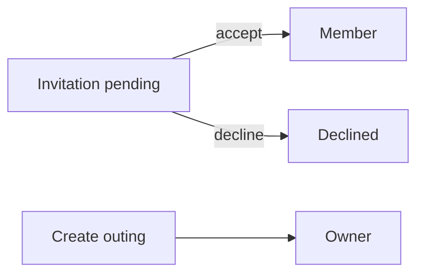
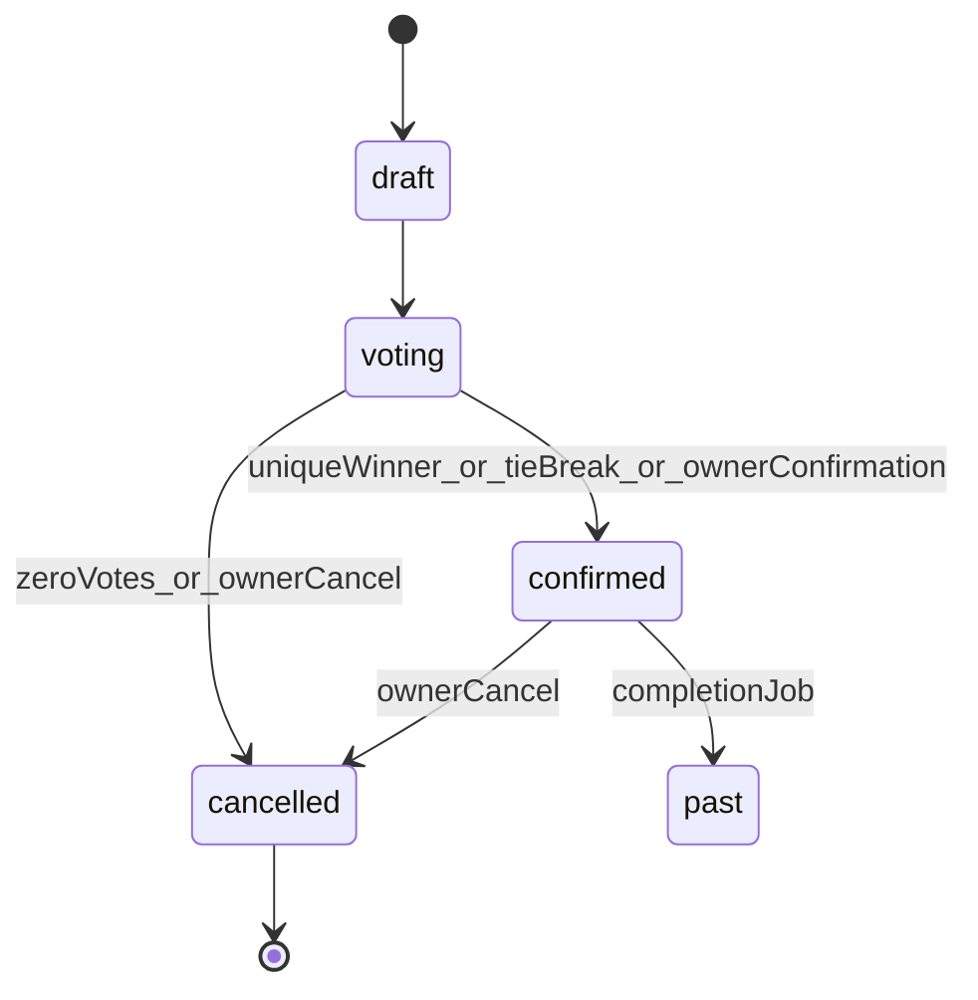

# Yalla 5roga — Product Scenarios (Source of Truth)

**Status:** Approved product behavior. Any conflicting implementation is a compliance issue until the product owner updates this document.

This file distinguishes:

- **Approved** — required product behavior (authoritative).
- **Current implementation** — what the codebase does today (update when code changes).
- **Known limitations** — verified gaps or unverified paths.
- **Open decisions** — only where approved text is silent.

---

## 1. Product overview

**Approved:** Yalla 5roga is an outing planning and coordination app for Egypt. Users create Group Outings or Special Events, invite members, vote on places, track attendance, chat, save outings/places, and receive push notifications.

**Stack:** Flutter (Provider, feature-first Clean Architecture, Dio) · Node.js/Express/Prisma · Neon PostgreSQL · Firebase Authentication · FCM.

**Rules:** Firebase is for authentication only. Neon is the source of truth for application data. No Flutter mock/demo data layers.

---

## 2. User roles and permissions

**Approved:** Outing-level roles are only **Owner** and **Member**. There is no Guest role.

| Role | Meaning |
|------|---------|
| Owner | Creator of that outing. Owns lifecycle and management for that outing only. |
| Member | Registered user who joined (accepted invitation or equivalent membership). |

Outing invitation statuses (`pending` / `accepted` / `declined`) track the outing guest workflow. An accepted outing guest becomes a member. Group invitations follow the explicit decision flow in section 3.

Owner auto **Going**. Owner cannot set attendance to Not Going / Maybe. Members cannot leave / remove themselves. Members cannot perform Owner-only ops.

**Current implementation:** Group roles are `owner|member`. Outing participation historically used `outing_guests` (Guest wording). Compliance work migrates Guest semantics to Member/invitation states. Group members of `outing.group_id` remain eligible participants for group outings (documented membership path).

---

## 3. Membership and invitation lifecycle

**Approved:**

1. Owner invites a user to an outing.
2. App generates a deep link for that invitation.
3. If app not installed → supported install flow when configured.
4. If unauthenticated → Login/Register, then restore deep-link destination.
5. Open outing; show accept/decline.
6. Accept → Member with normal permissions.

Must support: cold/warm start, auth/unauth, expired/invalid links, duplicate accept, already joined, auth cancel, post-login restore.

Group invitation creation always records `pending`, including invitations to registered accounts. A verified phone may link the invitation to its PostgreSQL account during signup/login/sync; linking does not accept it and creates no membership. The recipient explicitly accepts to create membership, or declines to preserve invitation history without membership. Pending unlinked invitations are discoverable only through the current Firebase-verified phone. No typed profile phone grants access. Existing active memberships are preserved. The owner-only direct member-add endpoint remains a distinct operation and cannot assign `owner`.

Group share links (`yalla5roga://invite` or HTTPS) restore the invitation destination after authentication. With recipient consent and a configured WhatsApp Business provider, the backend queues the existing invitation template. Delivery availability does not decide membership.

---

## 4. Outing types

**Approved:** `group` outing and `special_event` share members, voting, attendance, chat, notifications, lifecycle, saved outings where applicable. No separate voting/attendance systems per type unless explicitly required later.

Special-event organizers may send a WhatsApp invitation to phone contacts who agreed to receive it. The invitation gives the event name, local date and time, venue, a Google Calendar link and an optional link to try Yalla 5roga. These guests can attend without an app account. Phone invitations do not grant outing membership.

---

## 5. Outing lifecycle

Groups may contain any number of outings, including overlapping schedules and multiple outings in the same lifecycle state. Group membership grants access to each group outing. Attendance, place options and votes, arrivals, and chat are scoped to the individual outing.

**Approved core states:** `draft` → `voting` → `confirmed` | `cancelled`. Optional `past` / archived must not reopen voting.

| State | Rules |
|-------|-------|
| Draft | Prepare outing; chat OK; owner manages info |
| Voting | Vote/change votes; owner manages candidates before deadline; chat OK; attendance independent |
| Confirmed | Voting closed; winning place locked; chat OK |
| Cancelled | Owner-only cancel; voting locked; notifications |

**Integrity:** Confirmed never returns to Voting. Cancelled never reopens voting. Backend enforces transitions.

At its scheduled start, an outing moves from the Outings tab to **Settings → Outing history**. Cancelled and completed outings also appear in history. Outing details remain accessible from history for features such as arrival check-in when eligible.

---

## 6. Voting deadline

**Approved:** Every outing that uses voting **must** have a voting deadline set by the Owner at creation. Deadline is mandatory.

When deadline expires (server authority):

- Close voting; count submitted votes only.
- Zero votes → cancel outing (+ reason + notify).
- Unique highest → confirm with winner.
- Tie → stay unresolved until Owner tie-break.

Early close: if **all eligible** members voted before deadline → close immediately and resolve. Do **not** close merely because there are currently zero votes while open.

Use server time; do not trust device clocks for closure.

**Current implementation:** Deadline job + early-close exist; create validators historically allowed null deadline — compliance requires non-null `vote_ends_at`.

---

## 7. Eligible voters

**Approved:** Owner + accepted Members. Pending invitations and non-members are not eligible. Attendance does not control eligibility.

Same definition for vote APIs, early close, deadline resolution, Flutter UI, and relevant notification recipients.

**Current implementation:** Owner + outing participants + group members of `outing.group_id`. Pending invitations excluded.

---

## 8. Voting rules

**Approved:**

- One active vote per user per outing — DB uniqueness `(outing_id, user_id)`.
- Before close: change vote via upsert (no duplicate actives).
- After close / confirmed: reject votes and changes.
- The creator can confirm a proposed option while the outing is still awaiting a venue. The backend closes voting and locks the chosen place. When the vote resolves first, the approved unique-winner, tie-break and zero-vote rules apply.
- Tie → Owner triggers backend crypto RNG among tied leaders only; idempotent; Flutter animates only.
- Zero votes at close → cancel.

---

## 9. Candidate place changes before deadline

**Approved:** Owner may modify candidates before deadline. Any approved candidate-set change **resets all votes** in one transaction, keeps original deadline, notifies members that options changed / voting restarted. Description-only edits must not reset votes. Concurrent vote + modify must not corrupt results.

---

## 10. Place after confirmation

**Approved:** Winning place is locked. No API or Flutter action may change confirmed place / leave `winning_option_id` inconsistent with location.

---

## 11. Attendance

**Approved statuses:** `going` | `not_going` | `maybe`.

Owner auto Going; Owner cannot change away. Members update own status. Independent of vote counts and eligibility. Notifications per recipient policy.

**Physical arrival:** A scheduled outing needs a confirmed, pinned venue. Opening the outing during its arrival window triggers foreground GPS verification subject to device permission. Current group members follow the same rules, including the creator. RSVP choices have no effect on arrival eligibility. A recent, sufficiently accurate GPS fix within the allowed radius verifies the participant’s own arrival. The roster displays verified and unverified participants separately from RSVP and place voting. Location problems are visible on the affected device.

---

## 12. Chat

**Approved:** Available in draft, voting, confirmed. Not available for cancelled (unless product later adds read-only history). Owner and Members may send when open. Membership + authZ on backend.

---

## 13. Owner permissions matrix

| Operation | Owner | Member |
|-----------|-------|--------|
| Create outing | Yes | Yes |
| Edit permitted outing details | Yes | No |
| Add / modify candidates before deadline | Yes | No |
| Tie-breaker | Yes | No |
| Cancel outing | Yes | No |
| Permanently delete outing | Yes, with confirmation | No |
| Own attendance | Remains Going | Yes |
| Vote (if eligible) | Yes | Yes |
| Send chat | Yes | Yes |
| Remove another member | Per approved membership rules | No |
| Leave outing | N/A | No |
| Change confirmed winning place | No | No |

Backend enforces all rows; Flutter visibility is not authorization.

---

## 14. Notifications and FCM

**Approved events:** new invitation; invitation accepted (where applicable); outing details updated; candidate places changed; voting reset; attendance changed (policy); new chat (preferences); voting closed early; deadline reached; unique winner; tie-break winner; confirmed; cancelled.

**Tap destinations:** Group creation and updates open Group Details. Outing creation, updates, and reminders open Outing Details. Chat opens the related outing chat with normal history and message styling. Place votes open Place Voting. Attendance votes open Attendance. Member joins and departures open Group Members. Opening a notification marks its inbox item read, and Back returns to the previous screen. Access follows the destination's existing authorization rules.

**Infrastructure:** FCM token register/refresh; multi-device; invalid token handling; outbox → worker → real Push sender (Firebase Admin); retries; idempotency; delivery failure logging. Persisted notification rows alone do not prove push delivery.

---

## 15. Saved outings and places

**Approved:** Backend APIs + Neon. Survive restart, logout/login, device change, reinstall. SharedPreferences must not be the only source of truth. Duplicate prevention + authZ.

---

## 16. Authentication and deep links

**Approved:** Login and registration use phone number and password. Registration requires Firebase phone OTP proof verified by the backend. Login requires the application password and proceeds without OTP. Google, Apple, and email login are removed. Firebase ID tokens are verified by the backend. Deep-link destinations must survive auth.

**Current implementation:** Signup verifies the client's Firebase phone OTP ID token on the backend, matches the normalized number and retains the verified UID. Pending group invitations link to that account after verification. Previously split signup identities can be repaired through Settings phone verification while keeping their PostgreSQL IDs and data.

---

## 17. Database expectations

Critical constraints: one vote / membership / saved outing / saved place per user-resource; winner belongs to same outing; valid lifecycle / attendance / invitation enums; notification event idempotency (`event_key`).

---

## 18. Backend API expectations

REST under `/api`, snake_case bodies, Firebase Bearer auth, use-case authZ, transactional vote/candidate/lifecycle mutations, consistent errors. Prefer improving existing endpoints over duplicates.

---

## 19. Flutter user journeys

UI → Provider → Repository → Remote DataSource → API → Backend → Neon. No mock repositories. Loading / empty / error / success states for each journey. Refresh after mutations. Deep-link restore after login.

---

## 20. Error and edge cases

Invalid/expired invites; duplicate accept; already member; vote after close; unauthorized owner ops; deadline boundary requests; concurrent votes/close/tie-break/candidate replace; invalid FCM tokens; inaccessible saved resources.

---

## 21. Acceptance criteria

Compliant only when schema, constraints, APIs, authZ, invites/deep links, voting/deadline, candidate reset, confirmed lock, attendance independence, chat states, FCM E2E, saved Neon persistence, Flutter wiring, concurrency tests, device E2E (or honest NOT RUN), and docs are synchronized. Critical missing/unverified → **PARTIALLY COMPLIANT**.

---

## 22. Scenario test matrix

| ID | Scenario | Focus |
|----|----------|-------|
| A | Create Group Outing | Owner, deadline, Going, lifecycle, chat |
| B | Create Special Event | Same features as A |
| C | Invitation + deep link | Auth restore, accept → Member |
| D | Voting | Upsert, eligibility, counts |
| E | Candidate modification | Reset votes, notify, deadline preserved |
| F | Early voting closure | All voted → confirm |
| G | Deadline closure | Winner / tie / zero cancel |
| H | Tie-breaker | Owner RNG, idempotent |
| I | Attendance | Independence from votes |
| J | Chat | Draft/voting/confirmed/cancelled |
| K | Owner permissions | Backend rejection of unauthorized |
| L | Saved outings/places | Neon persistence |
| M | Notifications | Outbox → FCM |
| N | Deep-link edge cases | Cold/warm, invalid, duplicate |

---

## Known limitations

**Current implementation (2026-11-11, requested offline-first support):** Previously loaded account-scoped groups, outings, member profiles, votes and chat can be viewed from bounded local caches. Cached startup is followed by foreground REST synchronization. Only chat sends have durable offline replay with backend UUID deduplication and permanent conflict rejection. Scoped socket invalidations refresh affected Providers. Offline snapshots cannot prove current access; authenticated backend responses remain authoritative. See ADR-014 and `audit/OFFLINE_REALTIME_REPORT.md` for test evidence and limits.

Track live status in [`docs/audit/`](audit/). Device E2E and real FCM delivery may remain NOT RUN until a device/Firebase test environment is available.

## Open decisions

None that conflict with approved text above. Group-outing eligibility includes members of `outing.group_id` as accepted Members for that outing’s group context (implementation convenience documented here; not a third role).

## Approved chat and background refresh behavior — 2026-11-11

The owner requests silent background synchronization with no global loading or connection banner. Socket.IO invalidations update affected providers; reconnect/resume reconciles missed changes without polling. Cached content remains visible offline. Chat alone shows Connected after authenticated transport and room-join acknowledgement, Reconnecting during recovery, or Disconnected when unavailable. Every bubble shows the Neon sender name, with localized “(You)” for the current user. Selecting an @mention identifies a current chat participant by stable user ID, highlights the name, and notifies that member once per message; self-mentions never notify the sender. Notification navigation opens the regular outing chat. Message and mention notification taps use normal history and bubble styling, without a separate highlighted or labeled notification message.

## Password recovery — owner-approved 2026-11-11

Login offers Forgot Password → registered phone → Firebase SMS OTP → new password and confirmation → Login. The backend alone authorizes recovery from fresh verified phone proof, bound to the existing Firebase UID and matching Neon phone. A five-minute, single-use authorization is required to change the existing bcrypt credential. No new password store, Firebase UID, or Neon account is introduced by the backend. Existing sessions and account data retain their behavior.

Recovery requires an existing Neon password and an enabled Firebase identity with the same verified phone. Legacy unbound/split identities and Firebase-only password accounts require support or the existing authenticated Settings repair path. Recovery must not silently merge them. Unregistered/unavailable numbers share a clear error. OTP requests have a 60-second UI/server preflight cooldown, with shared server attempt limits and Firebase SMS abuse controls. Actual SMS sending remains Firebase-owned.

## Confirmed audit corrections — 2026-11-13

The owner requested explicit group invitation acceptance in this implementation task; this supersedes the former automatic membership linking rule. Chat remains text-only. Initial outing status is derived by the server: `voting` with initial options, `confirmed` with a fixed venue, otherwise `draft`. Saving a form draft uses `outing_drafts` and does not publish an outing.
