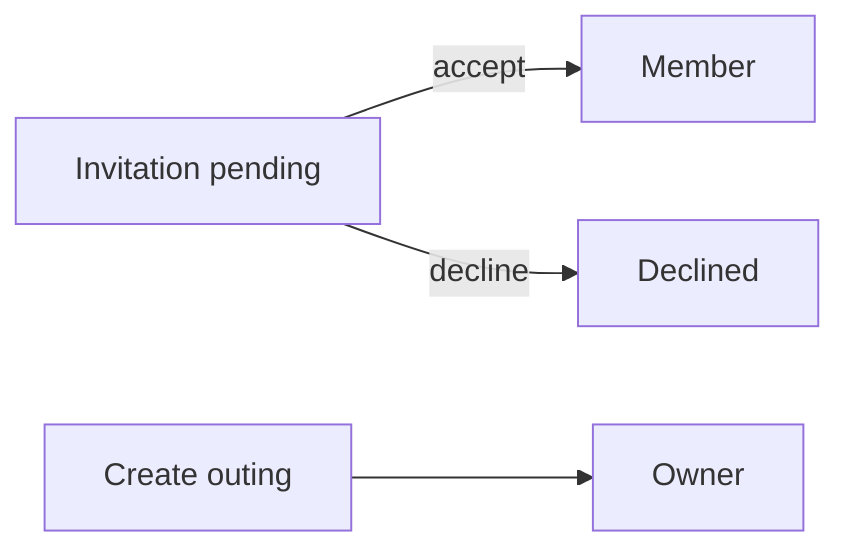
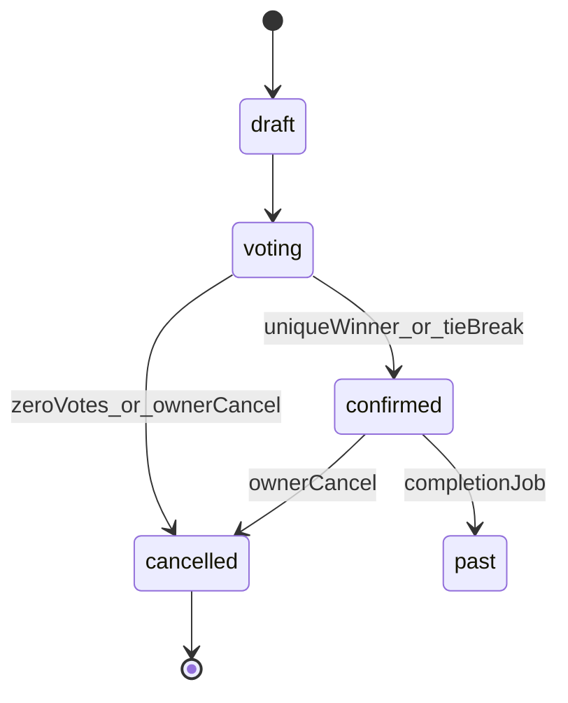

# Yalla 5roga — Product Scenarios (Source of Truth)

**Status:** Approved product behavior. Any conflicting implementation is a compliance issue until the product owner updates this document.

This file distinguishes:

- **Approved** — required product behavior (authoritative).
- **Current implementation** — what the codebase does today (update when code changes).
- **Known limitations** — verified gaps or unverified paths.
- **Open decisions** — only where approved text is silent.

---

## 1. Product overview

**Approved:** Yalla 5roga is an outing planning and coordination app for Egypt. Users create Group Outings or Special Events, invite members, vote on places, track attendance, chat, save outings/places, and receive push notifications.

**Stack:** Flutter (Provider, feature-first Clean Architecture, Dio) · Node.js/Express/Prisma · Neon PostgreSQL · Firebase Authentication · FCM.

**Rules:** Firebase is for authentication only. Neon is the source of truth for application data. No Flutter mock/demo data layers.

---

## 2. User roles and permissions

**Approved:** Outing-level roles are only **Owner** and **Member**. There is no Guest role.

| Role | Meaning |
|------|---------|
| Owner | Creator of that outing. Owns lifecycle and management for that outing only. |
| Member | Registered user who joined (accepted invitation or equivalent membership). |

Invitation statuses (`pending` / `accepted` / `declined`) are **not** roles. After accept → Member.

Owner auto **Going**. Owner cannot set attendance to Not Going / Maybe. Members cannot leave / remove themselves. Members cannot perform Owner-only ops.

**Current implementation:** Group roles are `owner|member`. Outing participation historically used `outing_guests` (Guest wording). Compliance work migrates Guest semantics to Member/invitation states. Group members of `outing.group_id` remain eligible participants for group outings (documented membership path).

---

## 3. Membership and invitation lifecycle

**Approved:**

1. Owner invites a user to an outing.
2. App generates a deep link for that invitation.
3. If app not installed → supported install flow when configured.
4. If unauthenticated → Login/Register, then restore deep-link destination.
5. Open outing; show accept/decline.
6. Accept → Member with normal permissions.

Must support: cold/warm start, auth/unauth, expired/invalid links, duplicate accept, already joined, auth cancel, post-login restore.

Group invitations (phone → group membership) remain a separate group-membership flow with their own deep links.

**Current implementation:** Group invite deep links (`yalla5roga://invite` / HTTPS) + claim on user sync. Outing-level invite accept/decline UI is being aligned to this document.

---

## 4. Outing types

**Approved:** `group` outing and `special_event` share members, voting, attendance, chat, notifications, lifecycle, saved outings where applicable. No separate voting/attendance systems per type unless explicitly required later.

---

## 5. Outing lifecycle

**Approved core states:** `draft` → `voting` → `confirmed` | `cancelled`. Optional `past` / archived must not reopen voting.

| State | Rules |
|-------|-------|
| Draft | Prepare outing; chat OK; owner manages info |
| Voting | Vote/change votes; owner manages candidates before deadline; chat OK; attendance independent |
| Confirmed | Voting closed; winning place locked; chat OK |
| Cancelled | Owner-only cancel; voting locked; notifications |

**Integrity:** Confirmed never returns to Voting. Cancelled never reopens voting. Backend enforces transitions.

---

## 6. Voting deadline

**Approved:** Every outing that uses voting **must** have a voting deadline set by the Owner at creation. Deadline is mandatory.

When deadline expires (server authority):

- Close voting; count submitted votes only.
- Zero votes → cancel outing (+ reason + notify).
- Unique highest → confirm with winner.
- Tie → stay unresolved until Owner tie-break.

Early close: if **all eligible** members voted before deadline → close immediately and resolve. Do **not** close merely because there are currently zero votes while open.

Use server time; do not trust device clocks for closure.

**Current implementation:** Deadline job + early-close exist; create validators historically allowed null deadline — compliance requires non-null `vote_ends_at`.

---

## 7. Eligible voters

**Approved:** Owner + accepted Members. Pending invitations and non-members are not eligible. Attendance does not control eligibility.

Same definition for vote APIs, early close, deadline resolution, Flutter UI, and relevant notification recipients.

**Current implementation:** Owner + outing participants + group members of `outing.group_id`. Pending invitations excluded.

---

## 8. Voting rules

**Approved:**

- One active vote per user per outing — DB uniqueness `(outing_id, user_id)`.
- Before close: change vote via upsert (no duplicate actives).
- After close / confirmed: reject votes and changes.
- Unique winner → backend selects → Confirmed → permanently locked.
- Tie → Owner triggers backend crypto RNG among tied leaders only; idempotent; Flutter animates only.
- Zero votes at close → cancel.

---

## 9. Candidate place changes before deadline

**Approved:** Owner may modify candidates before deadline. Any approved candidate-set change **resets all votes** in one transaction, keeps original deadline, notifies members that options changed / voting restarted. Description-only edits must not reset votes. Concurrent vote + modify must not corrupt results.

---

## 10. Place after confirmation

**Approved:** Winning place is locked. No API or Flutter action may change confirmed place / leave `winning_option_id` inconsistent with location.

---

## 11. Attendance

**Approved statuses:** `going` | `not_going` | `maybe`.

Owner auto Going; Owner cannot change away. Members update own status. Independent of vote counts and eligibility. Notifications per recipient policy.

---

## 12. Chat

**Approved:** Available in draft, voting, confirmed. Not available for cancelled (unless product later adds read-only history). Owner and Members may send when open. Membership + authZ on backend.

---

## 13. Owner permissions matrix

| Operation | Owner | Member |
|-----------|-------|--------|
| Create outing | Yes | Yes |
| Edit permitted outing details | Yes | No |
| Add / modify candidates before deadline | Yes | No |
| Tie-breaker | Yes | No |
| Cancel outing | Yes | No |
| Permanently delete outing | Yes, with confirmation | No |
| Own attendance | Remains Going | Yes |
| Vote (if eligible) | Yes | Yes |
| Send chat | Yes | Yes |
| Remove another member | Per approved membership rules | No |
| Leave outing | N/A | No |
| Change confirmed winning place | No | No |

Backend enforces all rows; Flutter visibility is not authorization.

---

## 14. Notifications and FCM

**Approved events:** new invitation; invitation accepted (where applicable); outing details updated; candidate places changed; voting reset; attendance changed (policy); new chat (preferences); voting closed early; deadline reached; unique winner; tie-break winner; confirmed; cancelled.

**Infrastructure:** FCM token register/refresh; multi-device; invalid token handling; outbox → worker → real Push sender (Firebase Admin); retries; idempotency; delivery failure logging. Persisted notification rows alone do not prove push delivery.

---

## 15. Saved outings and places

**Approved:** Backend APIs + Neon. Survive restart, logout/login, device change, reinstall. SharedPreferences must not be the only source of truth. Duplicate prevention + authZ.

---

## 16. Authentication and deep links

**Approved:** Login and registration use phone number and password. Registration includes phone OTP in the client. Google, Apple, and email login are removed. Firebase ID tokens are verified by the backend. Deep-link destinations must survive auth. The backend does not yet verify signup OTP independently.

---

## 17. Database expectations

Critical constraints: one vote / membership / saved outing / saved place per user-resource; winner belongs to same outing; valid lifecycle / attendance / invitation enums; notification event idempotency (`event_key`).

---

## 18. Backend API expectations

REST under `/api`, snake_case bodies, Firebase Bearer auth, use-case authZ, transactional vote/candidate/lifecycle mutations, consistent errors. Prefer improving existing endpoints over duplicates.

---

## 19. Flutter user journeys

UI → Provider → Repository → Remote DataSource → API → Backend → Neon. No mock repositories. Loading / empty / error / success states for each journey. Refresh after mutations. Deep-link restore after login.

---

## 20. Error and edge cases

Invalid/expired invites; duplicate accept; already member; vote after close; unauthorized owner ops; deadline boundary requests; concurrent votes/close/tie-break/candidate replace; invalid FCM tokens; inaccessible saved resources.

---

## 21. Acceptance criteria

Compliant only when schema, constraints, APIs, authZ, invites/deep links, voting/deadline, candidate reset, confirmed lock, attendance independence, chat states, FCM E2E, saved Neon persistence, Flutter wiring, concurrency tests, device E2E (or honest NOT RUN), and docs are synchronized. Critical missing/unverified → **PARTIALLY COMPLIANT**.

---

## 22. Scenario test matrix

| ID | Scenario | Focus |
|----|----------|-------|
| A | Create Group Outing | Owner, deadline, Going, lifecycle, chat |
| B | Create Special Event | Same features as A |
| C | Invitation + deep link | Auth restore, accept → Member |
| D | Voting | Upsert, eligibility, counts |
| E | Candidate modification | Reset votes, notify, deadline preserved |
| F | Early voting closure | All voted → confirm |
| G | Deadline closure | Winner / tie / zero cancel |
| H | Tie-breaker | Owner RNG, idempotent |
| I | Attendance | Independence from votes |
| J | Chat | Draft/voting/confirmed/cancelled |
| K | Owner permissions | Backend rejection of unauthorized |
| L | Saved outings/places | Neon persistence |
| M | Notifications | Outbox → FCM |
| N | Deep-link edge cases | Cold/warm, invalid, duplicate |

---

## Known limitations

Track live status in [`docs/audit/`](audit/). Device E2E and real FCM delivery may remain NOT RUN until a device/Firebase test environment is available.

## Open decisions

None that conflict with approved text above. Group-outing eligibility includes members of `outing.group_id` as accepted Members for that outing’s group context (implementation convenience documented here; not a third role).
