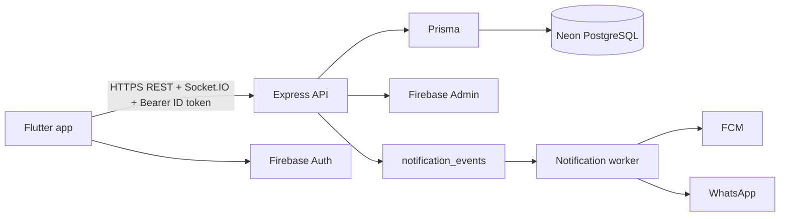

# Yalla 5roga — Project Overview

| Metadata | Value |
|----------|-------|
| Last verified | 2026-11-07 |
| Documentation version | 1.0.0 |
| Implementation status | Partially compliant with `PRODUCT_SCENARIOS.md` (see `docs/audit/`) |
| Areas needing verification | Device E2E journeys; real FCM delivery to a physical/emulator device |

## What it is

**Yalla 5roga** is an outing planning and coordination mobile app for Egypt. Friends create Group Outings or Special Events, invite members, vote on candidate places, track attendance, chat about the plan, save places/outings, and receive push notifications.

Canonical product behavior lives in [`PRODUCT_SCENARIOS.md`](PRODUCT_SCENARIOS.md). Do not invent product rules outside that document.

## Main purpose

Reduce the friction of “where should we go?” by giving a group:

1. A shared outing with a clear Owner.
2. Candidate place voting with a mandatory deadline.
3. Independent attendance (Going / Not Going / Maybe).
4. Chat while the outing is active.
5. Push / WhatsApp delivery for invitations and lifecycle events.

## Main features

| Feature | Summary |
|---------|---------|
| Auth | Phone/password backed by a Neon hash. Firebase supplies signup OTP proof, UID and refreshable API sessions. |
| Groups | Persistent friend groups; phone invitations with deep links |
| Outings | Group outings and special events (birthday / wedding) |
| Place voting | Owner-managed candidates; one active vote per member; server closure / winner / tie-break |
| Attendance | Separate from voting |
| Chat | Hybrid REST persistence + Socket.IO live delivery (ADR-013) |
| Discover | Places catalog from Neon (`places`) |
| Saved items | Saved outings + saved places in Neon |
| Notifications | In-app rows + outbox worker → FCM / WhatsApp |

## Target experience

A user opens the app, lands on a tabbed shell (home / groups / discover / settings), creates or joins an outing, votes before the deadline, updates attendance, and chats. Backend decisions (winner, cancel, authorization) always win over UI animation or optimistic state.

## Technologies

| Layer | Stack |
|-------|-------|
| Mobile | Flutter + Dart, Provider / `ChangeNotifier`, Dio, GetX navigation helpers, Firebase Auth / FCM |
| API | Node.js + TypeScript + Express |
| ORM / DB | Prisma → Neon PostgreSQL |
| Auth | Firebase Authentication (ID tokens verified by backend Admin SDK) |
| Push | FCM via notification outbox worker |
| Optional channel | WhatsApp invitation messages |

## High-level responsibilities

| Component | Owns |
|-----------|------|
| **Flutter** | UI, local prefs (theme/locale/session cache), Firebase client auth, Dio calls, display of server state |
| **Backend** | Business rules, authZ, voting closure, winner / tie-break / cancel, notification triggers |
| **Neon PostgreSQL** | Source of truth for users, groups, outings, votes, attendance, chat, saves, notifications |
| **Firebase** | Authentication identities + FCM delivery — **not** the application database |

## System boundaries

- Flutter must not invent winners, close voting, or authorize Owner-only actions locally.
- Firebase must not store outing/vote/chat domain data.
- Image/file uploads: URLs are stored as strings; there is no verified binary upload service in-repo.
- Geocoding for map pickers uses client-side Nominatim; place catalog lives in Neon.

## Related docs

- [`SYSTEM_ARCHITECTURE.md`](SYSTEM_ARCHITECTURE.md) — components and flows
- [`SYSTEM_DESIGN.md`](SYSTEM_DESIGN.md) — technical execution of workflows
- [`USER_SCENARIOS.md`](USER_SCENARIOS.md) — user journeys
- [`PROJECT_STRUCTURE.md`](PROJECT_STRUCTURE.md) — where code lives
