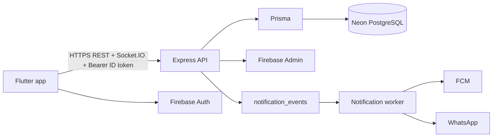

# Yalla 5roga — Project Overview

| Metadata | Value |
|----------|-------|
| Last verified | 2026-11-07 |
| Documentation version | 1.0.0 |
| Implementation status | Partially compliant with `PRODUCT_SCENARIOS.md` (see `docs/audit/`) |
| Areas needing verification | Device E2E journeys; real FCM delivery to a physical/emulator device |

## What it is

**Yalla 5roga** is an outing planning and coordination mobile app for Egypt. Friends create Group Outings or Special Events, invite members, vote on candidate places, track attendance, chat about the plan, save places/outings, and receive push notifications.

Canonical product behavior lives in [`PRODUCT_SCENARIOS.md`](PRODUCT_SCENARIOS.md). Do not invent product rules outside that document.

## Main purpose

Reduce the friction of “where should we go?” by giving a group:

1. A shared outing with a clear Owner.
2. Candidate place voting with a mandatory deadline.
3. Independent attendance (Going / Not Going / Maybe).
4. Chat while the outing is active.
5. Push / WhatsApp delivery for invitations and lifecycle events.

## Main features

| Feature | Summary |
|---------|---------|
| Auth | Phone/password backed by a Neon hash. Firebase supplies signup OTP proof, UID and refreshable API sessions. |
| Groups | Persistent friend groups; phone invitations with deep links |
| Outings | Group outings and special events (birthday / wedding / celebration / other, optional group) |
| Place voting | Owner-managed candidates; one active vote per member; server closure / winner / tie-break |
| Attendance | Separate from voting |
| Chat | Hybrid REST persistence + Socket.IO live delivery (ADR-013) |
| Discover | Places catalog from Neon (`places`) |
| Saved items | Saved outings + saved places in Neon |
| Notifications | In-app rows + outbox worker → FCM / WhatsApp |

## Target experience

A user opens the app, lands on a tabbed shell (home / groups / outings / discover / settings), creates or joins an outing, votes before the deadline, updates attendance, and chats. Backend decisions (winner, cancel, authorization) always win over UI animation or optimistic state.

## Technologies

| Layer | Stack |
|-------|-------|
| Mobile | Flutter + Dart, Provider / `ChangeNotifier`, Dio, GetX navigation helpers, Firebase Auth / FCM |
| API | Node.js + TypeScript + Express |
| ORM / DB | Prisma → Neon PostgreSQL |
| Auth | Firebase Authentication (ID tokens verified by backend Admin SDK) |
| Push | FCM via notification outbox worker |
| Optional channel | WhatsApp invitation messages |

## High-level responsibilities

| Component | Owns |
|-----------|------|
| **Flutter** | UI, local prefs (theme/locale/session cache), Firebase client auth, Dio calls, display of server state |
| **Backend** | Business rules, authZ, voting closure, winner / tie-break / cancel, notification triggers |
| **Neon PostgreSQL** | Source of truth for users, groups, outings, votes, attendance, chat, saves, notifications |
| **Firebase** | Authentication identities + FCM delivery — **not** the application database |

## System boundaries

- Flutter must not invent winners, close voting, or authorize Owner-only actions locally.
- Firebase must not store outing/vote/chat domain data.
- Image/file uploads: URLs are stored as strings; there is no verified binary upload service in-repo.
- Geocoding for map pickers uses client-side Nominatim; place catalog lives in Neon.

## Related docs

- [`SYSTEM_ARCHITECTURE.md`](SYSTEM_ARCHITECTURE.md) — components and flows
- [`SYSTEM_DESIGN.md`](SYSTEM_DESIGN.md) — technical execution of workflows
- [`USER_SCENARIOS.md`](USER_SCENARIOS.md) — user journeys
- [`PROJECT_STRUCTURE.md`](PROJECT_STRUCTURE.md) — where code lives

## Phase 4 scope — 2026-11-14

Discover now shares map controls with outing location selection: searchable OSM map, location action, horizontal categories, image previews and card exploration. Special Events support Birthday, Wedding, Celebration and Other through the established wizard, with optional accepted-member group association or the independent guest flow. The backend/Prisma contract extension and migration are included; application-schema deployment is separate. Provider, Dio, existing caching, flutter_map and the design system are retained.

## OSM catalog management — 2026-11-14

Places discovery now uses an extensible bilingual taxonomy (44 categories, 23 place vibes) on the existing Neon catalog, with administrative-boundary Overture/Geofabrik imports for Cairo/Giza, source-evidenced lifecycle history and explicit manual synchronization; automatic weekly execution was removed on 2026-11-15. Discover and Create Outing share server filters/pagination, map results and offline snapshots; the existing outing/voting/authentication architecture is retained. See [Places Management](audit/PLACES_MANAGEMENT.md) for verified data counts, operating commands and remaining deployment activation.

## Personal locations

Settings includes **My Locations**, which keeps named personal points synchronized across authenticated devices. An account can select one private default from a personal location or an existing Saved Place. The default is independent of the outing venue.

Users can store a default transportation mode and choose a different preference per personal location or starting bookmark. The capability API reports that route calculations are unavailable.

**Location Privacy** adds optional district sharing controls and explicit Smart Meetup calculation consent. Accepted groups can be excluded from automatic use. The backend supplies the authorization boundary for starting-point access and subsequent result consumption.

## Group Smart Meetup

**Group Smart Meetup** provides one-tap group planning with automatic roster and privacy-safe location readiness. It supports separate planning sessions for individual outings and reports routing availability independently.

**Quick Meetup** gives a signed-in planner a private map for their starting point and temporary guest points. It uses the same meetup planning inputs and routing status with no group or guest account required.

The session creator can narrow either meetup by category, relative budget and minimum rating, choose a travel objective and cap, and add ranking priorities. The preferences are optional and scoped to the current session.

## Temporary starting locations

Group Smart Meetup, Quick Meetup and active Outing Details support a starting point and transportation choice for the current plan. The user can reset to their authorized defaults. Travel estimates remain unavailable until routing is configured.

## Place ratings and reviews

Catalog branches support 1–5 ratings, optional written reviews, review reporting, reader controls and moderation. Home, Discover, Saved Places and current outing cards display server-derived compact ratings. See [API contracts](API_CONTRACTS.md#place-ratings-and-reviews) and [database architecture](DATABASE_ARCHITECTURE.md#branch-ratings-and-reviews).
