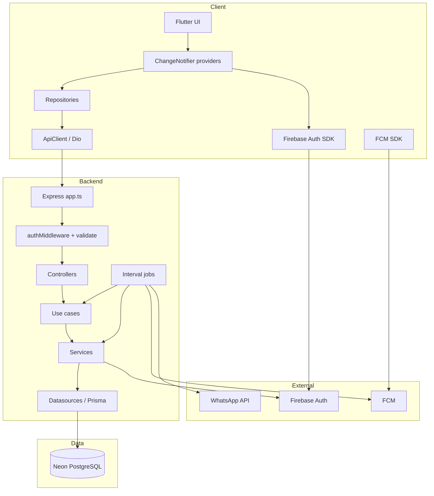
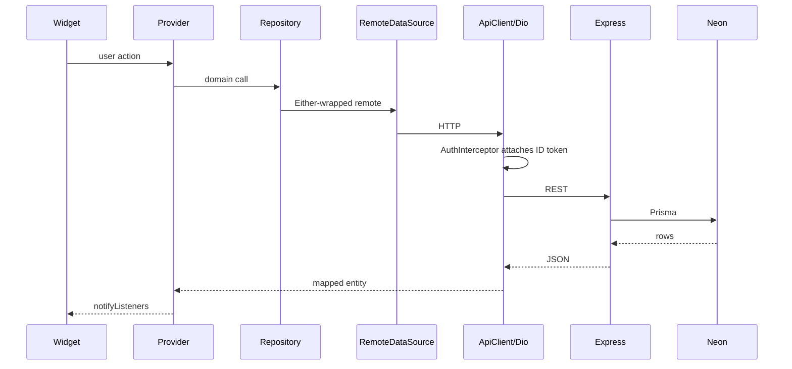
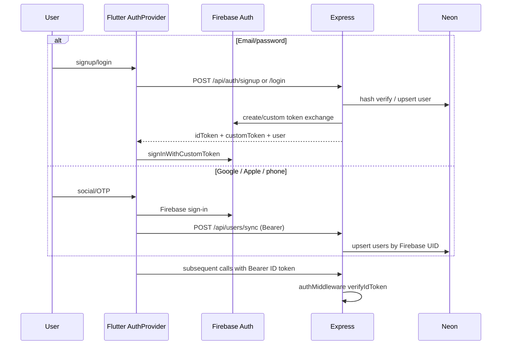
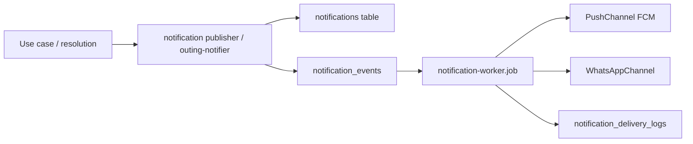

# Yalla 5roga — System Architecture

| Metadata | Value |
|----------|-------|
| Last verified | 2026-11-07 |
| Documentation version | 1.0.0 |
| Needs verification | Production deployment topology; rate limiting; CDN/image hosting |

## 1. Major components

| Component | Location | Role |
|-----------|----------|------|
| Flutter app | `flutter/` | Mobile client |
| Express API | `backend/src/` | HTTP API + jobs |
| Prisma | `backend/prisma/schema.prisma` | Schema + client |
| Neon PostgreSQL | External | Application data |
| Firebase Auth | External | Identity |
| Firebase Admin | `backend/src/config/firebase.ts` | Token verify + FCM admin |
| Notification worker | `backend/src/jobs/notification-worker.job.ts` | Outbox consumer |
| Voting deadline job | `backend/src/jobs/close-voting-deadline.job.ts` | Closes overdue voting |
| Outing completion job | `backend/src/jobs/complete-outings.job.ts` | Marks confirmed → past |

## 2. Overall system architecture

## 3. Flutter ↔ backend communication

- Protocol: HTTPS JSON REST under `/api/*`.
- Auth header: `Authorization: Bearer <Firebase ID token>` via Flutter `AuthInterceptor`.
- Envelope convention (backend): `{ success: boolean, data?: T, message?: string }` (errors via `errorMiddleware`).
- Flutter paths are defined in `flutter/lib/core/constants/api_constants.dart` and include the `/api` prefix; `API_BASE_URL` is host-only.

## 4. Authentication flow

## 5. Main data flow (outing + vote)

1. Owner creates outing → `POST /api/outings` → `CreateOutingUseCase` → `outings` + owner `outing_attendance=going`.
2. Owner adds candidates → `POST|PUT /api/outings/:id/vote-options` → clears votes; may move `draft` → `voting`.
3. Members vote → `POST /api/outings/:id/votes` → upsert `outing_votes`; `tryCloseIfAllVoted`.
4. Deadline job or early close → `vote-resolution.ts` → confirmed / tie lock / cancelled.
5. Tie → Owner `POST /api/outings/:id/tie-break` → crypto RNG among tied leaders only.

## 6. Notification flow

## 7. Layer responsibilities

### Flutter

- Presentation: pages/widgets + Provider
- Domain: entities + repository interfaces (`Either` failures)
- Data: remote datasources + repository impls
- Core: Dio, theme, localization, DI (`AppDependencies`)

### Backend

- Routes → Controllers → Use cases → Repositories/Datasources → Prisma
- Cross-cutting: `authMiddleware`, Zod `validate`, `errorMiddleware`
- Domain services: `vote-resolution`, `outing-participants`, `outing-access`, `outing-notifier`

### Database

Neon holds all durable application state. See [`DATABASE_ARCHITECTURE.md`](DATABASE_ARCHITECTURE.md).

## 8. External services

| Service | Used for | Not used for |
|---------|----------|--------------|
| Firebase Auth | Sign-in, ID tokens | App domain data |
| FCM | Push delivery | Business decisions |
| WhatsApp | Group invite messages (when configured) | Chat |
| Nominatim | Flutter map reverse geocode | Place catalog |

## 9. Dependencies Flutter ↔ Backend

Flutter depends on backend contracts listed in [`API_CONTRACTS.md`](API_CONTRACTS.md). Backend does not depend on Flutter. Shared concepts: Firebase UID as `users.id`, outing UUIDs, snake_case API bodies (Flutter maps via `api_payload` helpers).

## Related

- [`SYSTEM_DESIGN.md`](SYSTEM_DESIGN.md) — workflow-level design
- [`FLUTTER_ARCHITECTURE.md`](FLUTTER_ARCHITECTURE.md)
- [`BACKEND_ARCHITECTURE.md`](BACKEND_ARCHITECTURE.md)
