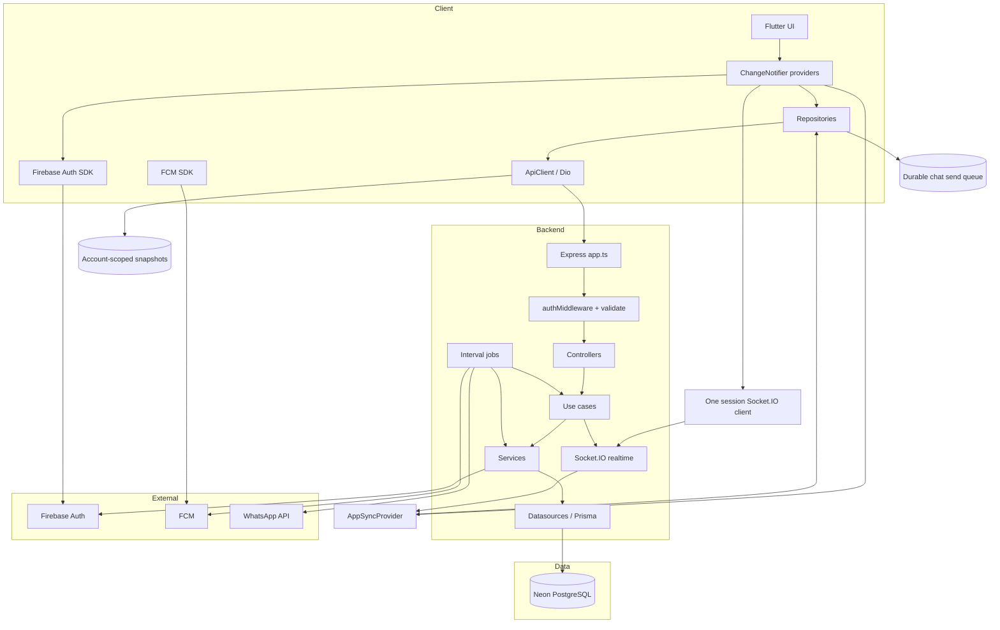
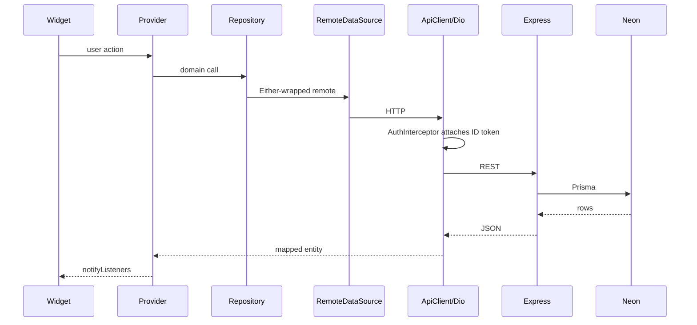
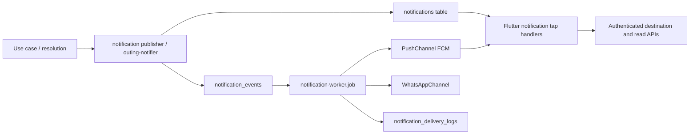

# Yalla 5roga — System Architecture

| Metadata | Value |
|----------|-------|
| Last verified | 2026-11-07 |
| Documentation version | 1.0.0 |
| Needs verification | Production deployment topology; rate limiting; CDN/image hosting |

## 1. Major components

| Component | Location | Role |
|-----------|----------|------|
| Flutter app | `flutter/` | Mobile client |
| Express API | `backend/src/` | HTTP API + jobs |
| Prisma | `backend/prisma/schema.prisma` | Schema + client |
| Neon PostgreSQL | External | Application data |
| Firebase Auth | External | Identity |
| Firebase Admin | `backend/src/config/firebase.ts` | Token verify + FCM admin |
| Notification worker | `backend/src/jobs/notification-worker.job.ts` | Outbox consumer |
| Voting deadline job | `backend/src/jobs/close-voting-deadline.job.ts` | Closes overdue voting |
| Outing completion job | `backend/src/jobs/complete-outings.job.ts` | Marks confirmed → past |

## 2. Overall system architecture



## 3. Flutter ↔ backend communication

- Protocol: HTTPS JSON REST under `/api/*`, plus Socket.IO on the same host/port (`/socket.io`) for chat delivery and scoped invalidations. Cached views hydrate before REST revalidation; only idempotent chat sends support offline replay (ADR-014).
- Auth header: `Authorization: Bearer <Firebase ID token>` via Flutter `AuthInterceptor`; sockets use handshake `auth.token` (same ID token).
- Envelope convention (backend): `{ success: boolean, data?: T, message?: string }` (errors via `errorMiddleware`).
- Flutter paths are defined in `flutter/lib/core/constants/api_constants.dart` and include the `/api` prefix; `API_BASE_URL` is host-only (also the Socket.IO base URL).



## 4. Authentication flow

```mermaid
sequenceDiagram
  participant U as User
  participant F as Flutter AuthProvider
  participant FB as Firebase Auth
  participant API as Express
  participant Neon as Neon

  alt Phone/password signup
    U->>F: name, phone, password, OTP
    F->>FB: phone OTP sign-in
    FB-->>F: verified UID and ID token
    F->>API: POST /api/auth/signup with phoneVerificationToken
    API->>FB: verify recent phone proof
    API->>Neon: create or enroll user under OTP UID and link pending groups
    API->>FB: custom token exchange
  else Phone/password login
    U->>F: phone and password
    F->>API: POST /api/auth/login
    API->>Neon: verify password hash
    API->>FB: custom token exchange
    API->>FB: read canonical identity phone
    API->>Neon: link pending groups for the verified phone
  end
  API-->>F: idToken + customToken + user
  F->>FB: signInWithCustomToken
  Note over F,API: Cached shell renders first; deferred users/sync precedes online group revalidation
  F->>API: subsequent calls with Bearer ID token
  API->>API: verify a Firebase phone or custom-session ID token
  opt First OTP profile sync
    API->>FB: check the current phone against the token claim
    API->>Neon: provision profile and link pending groups
  end
```

## 5. Main data flow (outing + vote)

1. Owner creates outing → `POST /api/outings` → `CreateOutingUseCase` → `outings` + owner `outing_attendance=going`.
2. Owner adds candidates → `POST|PUT /api/outings/:id/vote-options` → clears votes; may move `draft` → `voting`.
3. Members vote → `POST /api/outings/:id/votes` → upsert `outing_votes`; `tryCloseIfAllVoted`.
4. Deadline job or early close → `vote-resolution.ts` → confirmed / tie lock / cancelled.
5. Tie → Owner `POST /api/outings/:id/tie-break` → crypto RNG among tied leaders only.

## 6. Notification flow



## 7. Layer responsibilities

### Flutter

- Presentation: pages/widgets + Provider
- Domain: entities + repository interfaces (`Either` failures)
- Data: remote datasources + repository impls
- Core: Dio, theme, localization, DI (`AppDependencies`)

### Backend

- Routes → Controllers → Use cases → Repositories/Datasources → Prisma
- Cross-cutting: `authMiddleware`, Zod `validate`, `errorMiddleware`
- Domain services: `vote-resolution`, `outing-participants`, `outing-access`, `outing-notifier`

### Database

Neon holds all durable application state. See [`DATABASE_ARCHITECTURE.md`](DATABASE_ARCHITECTURE.md).

## 8. External services

| Service | Used for | Not used for |
|---------|----------|--------------|
| Firebase Auth | Sign-in, ID tokens | App domain data |
| FCM | Push delivery | Business decisions |
| WhatsApp | Group invite messages (when configured) | Chat |
| OSM tiles and optional geocoder | Shared Flutter map loads OSM tiles. The backend brokers configured autocomplete and reverse lookup. | Cached catalog search and manual pins remain available |

## 9. Dependencies Flutter ↔ Backend

Flutter depends on backend contracts listed in [`API_CONTRACTS.md`](API_CONTRACTS.md). Backend does not depend on Flutter. Shared concepts: Firebase UID as `users.id`, outing UUIDs, snake_case API bodies (Flutter maps via `api_payload` helpers).

## Related

- [`SYSTEM_DESIGN.md`](SYSTEM_DESIGN.md) — workflow-level design
- [`FLUTTER_ARCHITECTURE.md`](FLUTTER_ARCHITECTURE.md)
- [`BACKEND_ARCHITECTURE.md`](BACKEND_ARCHITECTURE.md)

The visible outing route requests bounded foreground GPS fixes and submits nearby samples to the authenticated API. The backend validates membership and the confirmed venue, persists the first verified arrival in Neon and sends a roster invalidation over the participant’s authenticated Socket.IO user room. Group phone invitations use the existing pending membership and notification outbox. The Meta channel is separate from Firebase authentication and membership claim.


## Scoped realtime recovery — 2026-11-11

The same authenticated Socket.IO connection now delivers domain invalidations as well as chat. A bounded in-process journal lets reconnect/resume recover missed invalidations for that UID; an unavailable cursor falls back to stale list caches and mounted details/active chats. No periodic polling, global banner, new transport or database is introduced. API notification writes publish inbox invalidations. Account synchronization is separated from ordinary profile reads.

## Session synchronization refinement — 2026-11-11

The diagram now explicitly shows one shared client transport. `AppSyncProvider`, chat and arrivals reuse it; authorized user/group/outing rooms do not create feature-specific connections. Complete attendance rows update Provider/repository caches directly, while incomplete domain events use targeted REST reads. Replay acknowledgement, live deduplication and session generations prevent skipped gaps and stale account callbacks. See [contracts and validation](audit/CENTRALIZED_REALTIME_SYNC.md). No database topology or schema change is required.

## Recovery communication — 2026-11-11

Password recovery uses the existing Flutter → auth repository → Dio → Express controller/use case → Prisma/Neon path. Firebase Phone Authentication supplies OTP proof in a secondary client Auth instance; Admin SDK validation binds it to the canonical existing UID. Neon retains the existing bcrypt authority plus hashed short-lived recovery state and shared limits. No new service, identity provider or password store is introduced. See [workflow](SYSTEM_DESIGN.md#password-recovery-workflow--2026-11-11) and [verification report](audit/PASSWORD_RECOVERY_REPORT.md).
