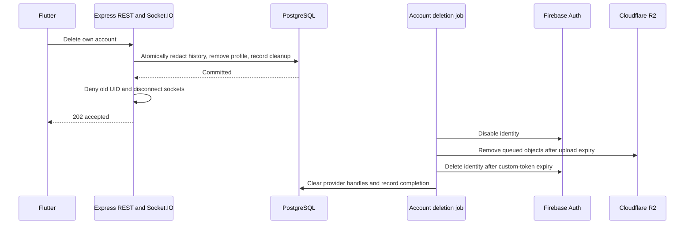
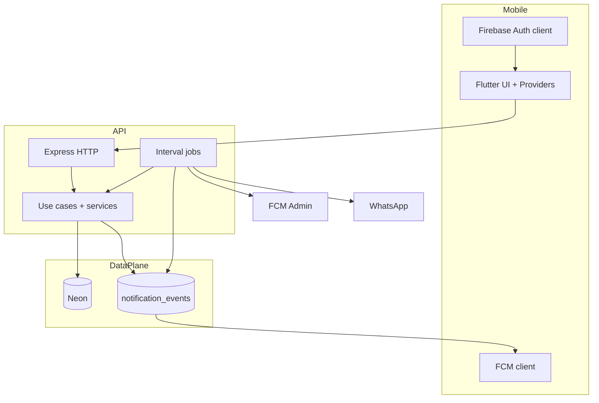
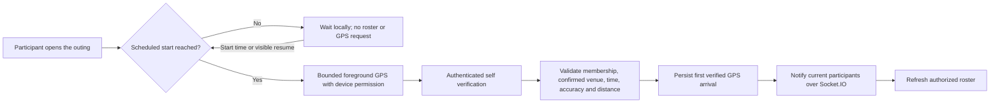
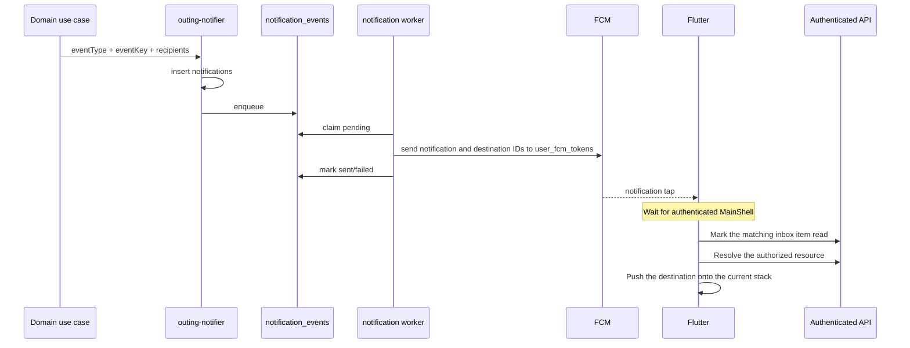
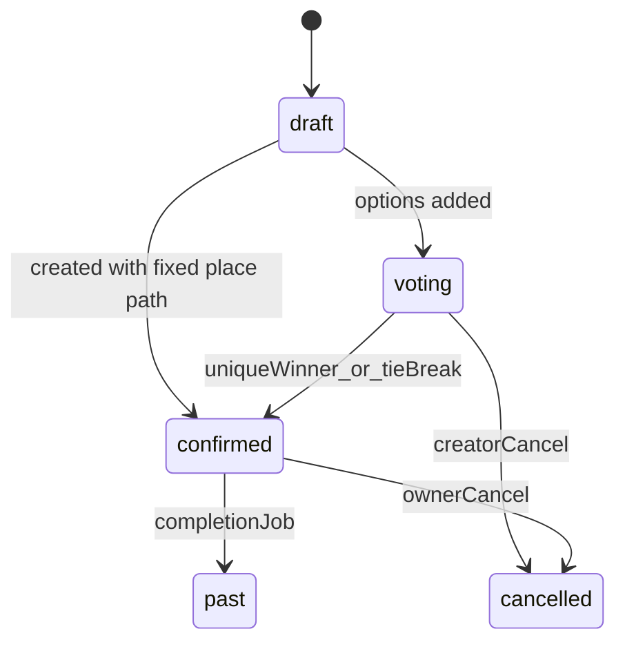
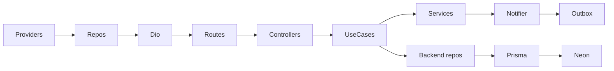
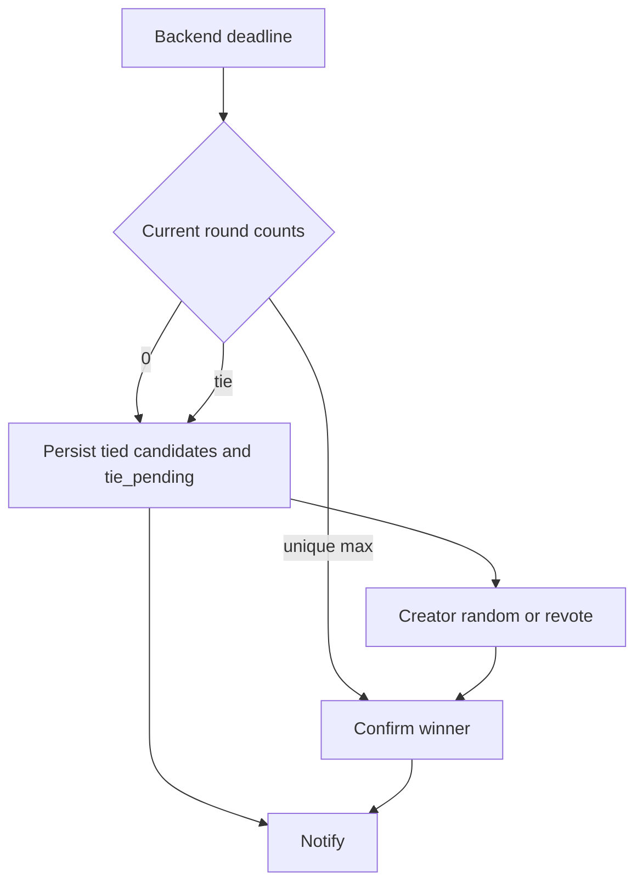
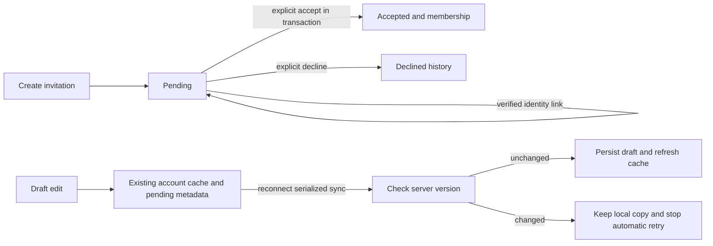
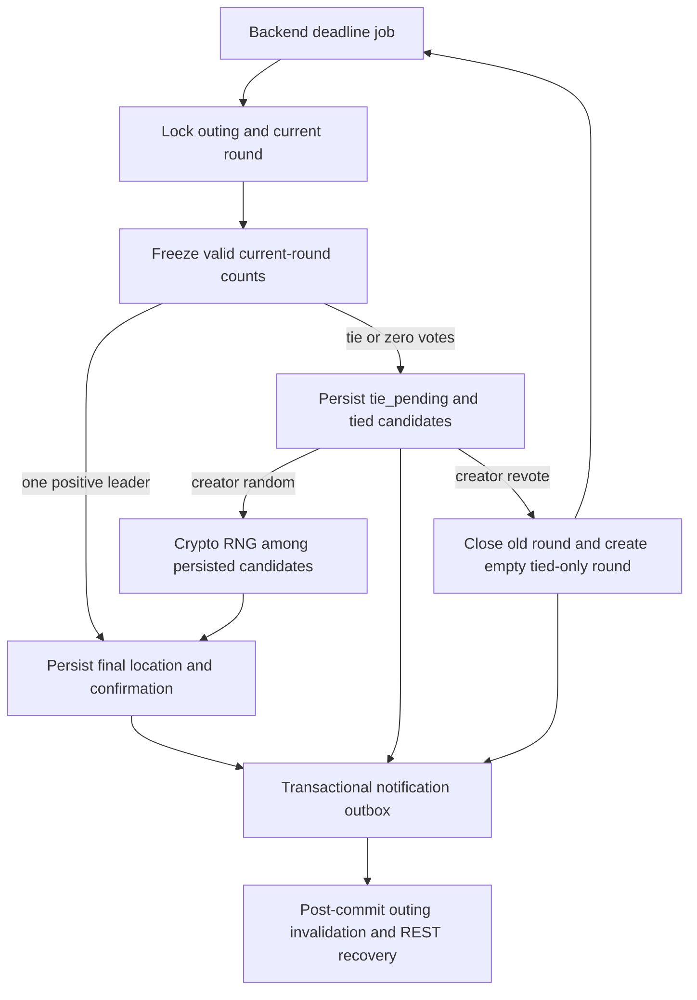
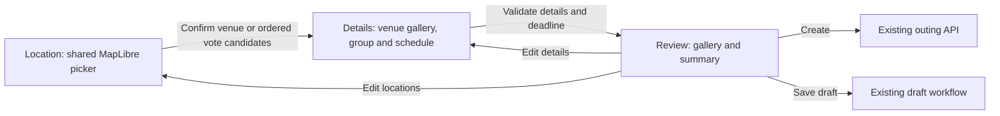

# Yalla 5roga — System Design

## Coordinated account deletion



Shared groups pass to the oldest remaining active member. A sole-owner group with outings is retained under a credential-free historical identity. A sole-owner group with no outings is removed. Active outings created by the account are cancelled. Historical outings, message IDs, timestamps and other members' content remain readable under their existing authorization rules. The departing user's message text and copied inbox previews are removed. Incoming invitations and pending invitations sent by the account are removed. Other invitees' decided history remains under the historical identity. Published place assets linked to the catalog remain.

Private object deletion waits for upload capabilities to expire. Firebase is disabled first and deleted after a 65-minute hold for outstanding custom tokens. A transient provider failure leaves that step pending with a five-minute retry delay. After both providers finish, the journal retains the UID digest and timestamps to prevent replay. Provider messages already delivered, third-party URLs, backups and participants' independent copies follow their own retention. [Staging verification](development/PRODUCTION_DEPLOYMENT.md#firebase-deletion-and-media-sign-off)

| Metadata | Value |
|----------|-------|
| Last verified | 2026-11-07 |
| Documentation version | 1.0.0 |
| Companion docs | [`SYSTEM_ARCHITECTURE.md`](SYSTEM_ARCHITECTURE.md), [`USER_SCENARIOS.md`](USER_SCENARIOS.md), [`PRODUCT_SCENARIOS.md`](PRODUCT_SCENARIOS.md) |
| Needs verification | Device E2E; production FCM; concurrent race suite beyond existing tests |

## 13.1 System design overview

### Architectural approach

Client-server mobile system: Flutter issues authenticated REST calls; Express use cases enforce product rules; Neon is the durable store; Firebase provides identity + push transport; in-process jobs close voting deadlines and drain the notification outbox.

### Sources of truth

| Concern | Source of truth |
|---------|-----------------|
| Identity session | Firebase Auth |
| Profile / domain data | Neon via Prisma |
| Outing status / winner | Backend (`outings` row) |
| Vote tallies | `outing_votes` aggregated server-side |
| Attendance | `outing_attendance` |
| Push delivery attempt | `notification_events` + delivery logs |

**Backend authority:** Voting closure, winner, tie-break RNG, cancel, authZ, notification triggers are server decisions. Flutter may animate only after confirmation.

### Sync vs async

| Sync (request/response) | Async (jobs / outbox) |
|-------------------------|------------------------|
| CRUD, vote cast, attendance, chat send, tie-break API | Deadline close job, outing → past job, notification worker |

### High-level design diagram



### Critical execution paths

1. Auth → sync/login → Bearer on all domain APIs  
2. Create outing → owner Going → candidates → voting  
3. Current-round vote upsert → targeted realtime invalidation  
4. Deadline/tie-break/cancel → status transition → notify  
5. Chat / attendance / saves as independent side paths  

---

## 13.2 Detailed component design (features)

### User authentication and synchronization

| Layer | Components |
|-------|------------|
| Flutter | `AuthProvider`, `AuthRepositoryImpl`, `FirebaseAuthService`, `AuthRemoteDataSource` |
| API | `POST /api/auth/signup|login`, `POST /api/users/sync`, `authMiddleware` |
| DB | `users` |

Errors: 401 invalid token/credentials; 409 duplicate email/phone. After auth, deep-link provider may resume invite.

### Outing creation and management

| Layer | Components |
|-------|------------|
| Flutter | `CreateOutingProvider`, `OutingsProvider`, outings remote DS |
| API | `CreateOutingUseCase`, `UpdateOutingUseCase`, `POST/PATCH/DELETE /api/outings` |
| DB | `outings`, `outing_attendance` (owner Going) |

Type is derived from occasion: `none` requires a group and produces `group`; birthday/wedding/celebration/other produce `special_event` with an optional group. A supplied group requires accepted creator membership. Deadline mandatory (`vote_ends_at` or `vote_deadline_hours`). Confirmed location edits rejected when winner locked.

### Invitations and membership

| Path | Components | Status |
|------|------------|--------|
| Group phone invite | Create/Add UI requires explicit WhatsApp consent for non-users → `InviteToGroupUseCase` → pending `group_invitations` + configured WhatsApp only for consented non-users. Verified signup/login/sync links account identity only; explicit acceptance creates `group_members`; deep-link restore via `InviteDeepLinkProvider` | Implemented |
| Outing invite | `guests.usecase` + accept/decline for registered members. Special-event phone invitations use the notification outbox or click-to-chat and do not create members. | Implemented; Flutter member deep-link UI **Partial** |

Pending ≠ Member. Outing guest responses transition a pending row once. The same response is idempotent and a competing response returns 409. Reissuing an invite preserves an existing pending or accepted row. Group phone associations use verified-phone linking. PostgreSQL permits one pending row per group and E.164 phone. Matching rows are locked while bulk membership insertion and link recording share a transaction. Owners can revoke a pending association and registered member removal prevents a pending row from restoring access. The add flow rechecks the account after persisting a pending row to close the race with signup. Roster reads use a single snapshot for active and pending rows so they reflect one side of a concurrent account link. Signup verifies OTP proof and keeps its UID; password login checks the canonical Firebase phone before claiming. Session restore displays cached state first; the coordinator defers one-time users/sync until after cache hydration and before online group revalidation. Settings verification uses sync (not a profile PATCH), then refreshes groups once. Legacy unused OTP identities can supply recent proof to bind their phone to the signed-in UID; no registered accounts are merged.

### Place discovery

`DiscoverProvider` → places APIs → `places` (+ images/prices/hours). Saved places: `saved_places` APIs. Nominatim is client-side geocoding only.

### Candidate places / voting / closure / tie-break

See §13.5. Core services: `voting.usecase.ts`, `vote-resolution.ts`, `outing-participants.ts`.

### Attendance

`UpsertAttendanceUseCase` — independent domain (§13.6).

### Outing chat

`SendMessageUseCase`, list/read routes under `/api/outings/:outingId/messages` and `/read`. Access via `chat-access.ts`.

**Hybrid realtime (ADR-013):** REST persists; after success, Socket.IO emits `outing:message` to room `outing:{outingId}`. Mark-read updates a monotonic PostgreSQL watermark and emits `outing:read`. Clients authenticate sockets with Firebase ID tokens and must pass `assertChatParticipant` on `outing:join`. Flutter recovers missed messages with REST after reconnect.

**Offline recovery (ADR-014):** Launch hydrates account-scoped snapshots, then revalidates profile, groups/outings, inbox and open details/chats. `data:changed` hints collect IDs for a 250 ms debounce. Membership changes also revalidate active chats; votes refresh the affected outing. Background events remain dirty until foreground recovery. Transient snapshot fallback schedules capped exponential retry and never writes to PostgreSQL. Durable chat sends reuse their UUID until acknowledged; permanent authorization/state conflicts mark that send failed while subsequent sends can proceed. Form draft edits/deletes use the existing draft cache with version-checked recovery; other writes are not replayed. See `audit/OFFLINE_REALTIME_REPORT.md` for cache bounds and verification limits.

### Saved outings / places

Saved outing use cases + place bookmark endpoints; Neon composite PKs.

### Media / images

Flutter compresses the source image in an isolate and requests an authorized PUT for a private staging key. It sends optimized bytes to R2 or development mock storage. Confirmation reads a bounded copy from staging, checks the actual format, dimensions and byte count, strips metadata when encoding and writes a new delivery key. Only curator place images can enter the public catalog bucket after verification. The client persists the stable `media://<asset-id>` reference and the entity flow links ready media. PostgreSQL stores metadata.

Display: `AppNetworkImage` resolves `media://` in batches through `/api/media/signed-urls`. Public place media returns the CDN URL when `R2_PUBLIC_BASE_URL` is configured; private media returns a short-lived signed URL after ownership/participant checks. URL metadata is persisted per account and image-cache keys use the stable asset id, so expiry rotation does not re-download and account switches cannot render another account's private image. Failed uploads are deleted best effort; `media-cleanup.job.ts` reaps expired pending intents and failed assets.

### Push notifications

§13.9 sequence + [`NOTIFICATIONS.md`](NOTIFICATIONS.md).

---

## 13.3 Critical workflow design

### Create outing (Group)

1. Trigger: Owner submits create form (`CreateOutingPage`), with a fixed venue or multi-place voting based on how many places were added in Location. Details collects the conditional deadline and submits the form.
2. Flutter: `CreateOutingProvider` → repository → `POST /api/outings` (with optional ordered `initial_vote_options` for group voting). The outing, initial candidates, and owner attendance commit together.
3. Controller: `OutingController.create`.  
4. Use case: `CreateOutingUseCase` validates type/deadline/window.  
5. DB txn: insert `outings` + owner `outing_attendance=going`.  
6. Response: outing JSON.  
7. Flutter: refresh lists.  
8. Notifications: typically none until invites/options (unless create path emits).  

### Cast / change vote

```mermaid
sequenceDiagram
  participant UI as OutingVoteWidget
  participant P as OutingsProvider
  participant API as PUT /votes
  participant UC as ReplaceBallot use case
  participant VR as Backend deadline job
  participant DB as Neon

  UI->>P: submit complete selection
  P->>API: { option_ids, round_number }
  API->>UC: lock outing; assert eligible + open
  UC->>DB: replace caller selections atomically
  UC-->>API: current-round votes, resolution null
  Note over VR,DB: At deadline, independently lock outing and freeze results
  API-->>P: vote + state
  P-->>UI: refresh tallies / winner UI
```

Transaction: full ballot replacement locks the outing; backend deadline closure uses the same lock. Option tallies count selected rows; participation counts distinct eligible users. Notifications and realtime publication follow commit. Legacy single-selection POST remains additive and idempotent.

### Tie-break

```mermaid
sequenceDiagram
  participant Owner as Owner UI
  participant API as POST /tie-break
  participant BR as breakTieRandomly
  participant DB as Neon

  Owner->>API: request
  API->>BR: assert owner + tied leaders
  BR->>DB: crypto random among leaders; set winner confirmed
  API-->>Owner: winning_option_id
  Note over Owner: Flutter animates server winner only
```

### Invitation accept (outing API)

Trigger: authenticated user accepts. `POST /api/outings/:id/invitations/accept` → guests use case → `outing_guests.status=accepted`. Deep-link auto-join **must not** happen without this (or equivalent explicit join).

### Attendance update

`PUT /api/outings/:id/attendance` `{ status }` → upsert row; notify owner if member changed; never touch votes.



The backend serves the check-in radius and closing time. The default radius is 100 m and the default window is 360 minutes, capped by the outing end. Before scheduled start the visible outing route shows a waiting message and uses one local start timer; it performs no arrival roster read, arrival-driven connection request or GPS/permission check. At start, or on visible resume after start, it loads the roster and schedules eligible verification, then no more than once a minute while foregrounded. It stops when the window closes, the viewer arrives or the route loses visibility. Socket invalidations refresh the roster without triggering extra GPS samples.

### Notification delivery



---

## 13.4 Outing lifecycle system design

| State | Meaning | Chat | Voting |
|-------|---------|------|--------|
| `draft` | Preparing | Open | Not closed; options may start voting |
| `voting` | Collecting place votes | Open | Open until `vote_closed_at` or terminal status |
| `confirmed` | Winner locked | Open | Locked |
| `cancelled` | Terminal cancel | Closed | Locked |
| `past` | Completed after the outing ends | — | Locked |

Flutter reads all plans through the same authenticated `GET /api/outings/cuser` snapshot. The client compares `scheduled_at` to the current instant and moves an outing to Settings → Outing history at its scheduled start, along with rows whose server status is `past` or `cancelled`. The provider schedules a local update at the next start and recalculates when the app resumes. The completion job determines when a confirmed outing’s database status becomes `past`.

**Tie nuance (implemented):** Main status stays `voting` while the round is `tie_pending` and ballots lock, until creator random confirmation or revote.

Enforcement: use cases + `vote-resolution` + jobs. Flutter must refresh server state, not invent transitions.



**Conflicts / gaps:** Flutter outing-invite deep link UX partial; device E2E NOT RUN. Pre-fix client finalize removed.

---

## 13.5 Place voting system design

### Approved rules (enforce)

- Owner-only candidates before deadline; both outing types.  
- Eligible: Owner + accepted Members (+ group members of `group_id`).  
- Mandatory Owner-defined deadline.  
- Multiple unique selections per caller ballot; atomically replace the full selection; lock after close.
- All voted → remain active; backend deadline → close.  
- Unique max → confirm; tie → Owner RNG among tied only.  
- Zero at close → tie_pending with every current-round candidate; zero while open → stay open.  
- Candidate set change → clear votes, keep deadline, notify.  
- After confirm, place locked.

### Persistence / concurrency

- PK `(outing_id, user_id, option_id, round_number)` prevents duplicate selections; count distinct users for participation.
- Replace options deletes votes+options in transaction.  
- Resolution uses transactional updates; concurrency tests exist (`voting-concurrency.test.ts`).  
- Deadline job idempotent via status/`vote_closed_at` checks.

### Implementation conflicts

Track in audit. Core backend rules Implemented; Flutter candidate-replace UI and some invite UX Partial.

---

## 13.6 Attendance system design

Statuses: `going` | `not_going` | `maybe`. Flutter may show client-only `unset` before first row.

- Created: owner Going on outing create; members via PUT.  
- Who: participants; owner coerced to Going.  
- Notifications: owner on member change.  
- **Never** affects `outing_votes` or eligibility.

---

## 13.7 Invitation and membership system design

**Approved:** Account required; deep link preserves destination; auth redirect; explicit accept; Member afterwards; no Guest role; pending is invitation state.

| Topic | Implemented | Planned / Partial |
|-------|-------------|-------------------|
| Group invite + WhatsApp + deep link | Yes | — |
| Outing accept/decline API | Yes | — |
| Outing deep-link restore UI | Partial | Complete parity with group flow |
| Expiration/revocation | Schema statuses exist | Full product UX varies |

Unauthorized access: 403/404 from access helpers. Duplicate accept should be idempotent toward accepted membership (verify use case on change).

---

## 13.8 Reliability and scalability

| Area | Implemented | Limitation | Future |
|------|-------------|------------|--------|
| DB connections | Prisma singleton | Neon pooler env-dependent | Tune pool |
| Indexes | Status/deadline/vote indexes in schema | Untested prod plans | EXPLAIN under load |
| Transactions | Voting/candidates/create | — | Keep FOR UPDATE patterns |
| Concurrency | Tests for vote/tie | Not exhaustive chaos | Expand harness |
| Jobs | setInterval in API process | Single-node assumption | External worker/queue if multi-instance |
| Idempotency | event_key, vote PK, tie-break guards | — | Keep |
| Notifications | Outbox retries | Device delivery unverified | Prove FCM E2E |
| Rate limiting | Auth endpoints mention 429 | Not global API limiter | Add gateway limits |
| Caching | None verified | — | Cache place catalog carefully |
| Images | URL strings | No upload service | Object storage ADR |
| Logging | console | No centralized APM verified | Structured logs |
| API timeouts | Flutter Dio timeouts in AppConfig | — | Align with server |

**Do not claim Redis/queues exist** — they are not verified in this repo.

---

## 13.9 Additional diagrams

### Component interaction



### Voting closure



---

## Related

- [`USER_SCENARIOS.md`](USER_SCENARIOS.md) — journey-level expectations  
- [`BUSINESS_LOGIC.md`](BUSINESS_LOGIC.md) — approved vs implemented  
- [`DATABASE_ARCHITECTURE.md`](DATABASE_ARCHITECTURE.md)  

### Creator deletion

Outing details → confirm permanent deletion → `DELETE /api/outings/:id` → backend checks the authenticated creator → database deletes the outing → Flutter updates local lists and closes the details route. The cancellation state machine is independent of this route.

The creator’s explicit venue confirmation and automatic place-vote resolution use the same row lock and venue persistence path. RSVP upserts return the fresh roster and summary for that outing in one response. Chat history uses a stable ordering by send timestamp and ID, and the sender profile projection is shared by REST and Socket.IO.


## Silent targeted refresh and mention flow — 2026-11-11

Committed domain changes emit scoped invalidations to authenticated user rooms. The coordinator coalesces them over 250 ms, refreshes affected lists or mounted detail IDs, and retains offline snapshots. Resume/reconnect replays missed invalidations from a ten-minute/512-entry buffer; reset checks stale list caches plus mounted details. Active chats recover REST history because message delivery itself is not journaled. Background reads are silent. Five delayed recovery retries retain dirty state on exhaustion; foreground/network recovery or a fresh server event can restart recovery. No polling timer is added.

Chat mention selection → stable ID token in existing REST text → backend validates chat access/member IDs and canonicalizes Neon names → message commit → canonical Socket.IO echo → idempotent inbox/outbox notification for each other participant. Mentioned users receive the mention body with the existing exact-message deep link. Chat participation remains distinct from vote eligibility.


## Centralized realtime flow — 2026-11-11

Committed write → server-resolved recipients → existing Socket.IO user rooms → one `AppSyncProvider` listener → direct attendance/chat merge or set-coalesced group/outing REST reads. Reconnect uses the last reconciliation checkpoint; live delivery only deduplicates and cannot skip older missed changes. An expired/restarted journal triggers list and mounted-detail recovery. Membership invalidations recover active chats as well as groups/outings. Read receipts also check current membership at fan-out. Online REST remains required for non-chat writes; voting, attendance and lifecycle authority are unchanged. [Contracts](API_CONTRACTS.md#centralized-synchronization-contract--2026-11-11) and [verification](audit/CENTRALIZED_REALTIME_SYNC.md).

## Password recovery workflow — 2026-11-11

```mermaid
sequenceDiagram
  participant UI as Recovery form
  participant API as Auth API
  participant FA as Firebase Auth
  participant DB as Neon
  UI->>API: Start with registered phone
  API->>FA: Check current canonical UID phone
  API->>DB: Shared limits + request digest (10 minutes)
  API-->>UI: Request secret + cooldown
  UI->>FA: Send SMS and verify OTP (secondary Auth)
  FA-->>UI: Phone ID token
  UI->>API: Request secret + phone ID token
  API->>FA: Verify token/revocation + current phone
  API->>DB: Consume proof once + reset digest (5 minutes)
  API-->>UI: Reset secret
  UI->>API: Reset secret + new password/confirmation
  API->>FA: Recheck UID phone
  API->>DB: Transaction: consume grant + conditional bcrypt update
  API-->>UI: Updated; return to Login
```

Phone/password login continues to verify the same Neon hash and issue a Firebase session under the same UID. Recovery does not create/merge identities or revoke established sessions. PostgreSQL owns grant concurrency, proof replay and shared limits. Secrets remain in memory on the client; database stores only digests. External Firebase SMS quotas and abuse protection remain necessary because a modified client can bypass app/preflight sending controls. See authentication docs and [verification report](audit/PASSWORD_RECOVERY_REPORT.md).

### Recovery SMS reliability follow-up — 2026-11-11

The existing sequence is unchanged: backend preflight → Firebase SMS → isolated Firebase proof → backend authorization/reset. The configured Neon schema now includes the recovery migration; missing security tables had blocked start before Firebase could be invoked. Flutter observes native invocation errors and callbacks together under a single 75-second deadline. Failed resends preserve the previous request/verification pair, committing replacement state only after Firebase dispatch succeeds. No password authority, proof-validation or session policy changed.

## Confirmed backend/mobile implementation — 2026-11-13

Group invitation decisions serialize on the invitation row. Accept creates membership and records accepted status in the same transaction; decline records history without membership. A conflicting/repeated decision returns stored status. Verified identity linking does not accept invitations. Initial outing status is derived from options and venue. Creator cancel uses the existing notification fan-out, stable event keys and scoped realtime publication.

The Groups tab banner opens a picker based on the cached current-user group list and hands the selected group ID to the existing consented phone invitation flow. The API checks active membership at submission.

Draft recovery uses the existing Saved Outings repository/provider/cache. A client UUID in Idempotency-Key makes POST retries safe; If-Match carries the loaded updated_at for row-locked updates/deletes. Online writes update the server and cache; offline writes persist pending metadata. The existing AppSyncProvider runs one serialized recovery pass on reconnect/resume, preserves conflicts, and does not poll. Legacy clients omitting version headers retain their prior API behavior. No database schema change was made.



## Phase 2 group and invitation read flow — 2026-11-13

Group Info/history → existing GroupsProvider/repository → GET group + members → active profiles, pending invitations and group invitation history → existing Group snapshot. Active group membership gates the read. Pending identity linking remains visible until a decision; it creates no membership. Existing group/membership Socket.IO invalidations revalidate open group routes. Inbox → existing InvitationsProvider/repository → GET invitations preserves all statuses; explicit POST accept/decline updates the local history record after backend success. UI load generations are independent of the account epoch so concurrent realtime reads cannot strand decision loading. There are no lifecycle, voting, attendance or messaging protocol changes.


## Phase 3 Flutter composition — 2026-11-14

CreateOutingPage retains its route-local ChangeNotifier across Information → Locations → Review and back/edit navigation. Shared AppStepProgress renders localized progress; the existing map picker returns ordered Place values without replacing the form provider. Details composes OutingOverview, OutingAttendanceWidget (RSVP), OutingVoteWidget, OutingArrivalsSection, OutingLocationSection and OutingManagementActions. Widgets call existing providers/services; repositories and Dio remain the only HTTP path. Shared OutingCard and PlaceCard render presentation values. Single venue rendering omits ballot competition controls. AppSyncProvider remains the single Socket.IO/recovery coordinator; terminal history/chat policy and backend arrival authorization do not change.

## Phase 4 workflow extension — 2026-11-14

Discover and the outing picker render the existing AppMap with shared controlled chrome. Discover's area search is cancellable/debounced and uses existing geocoding/nearby repositories; screen-specific discovery and selection mutations remain separate. Permission failure leaves manual search and the shared fallback available. Provider, API caching and backend place bounds remain authoritative.

Special Event -> Information (image/title/occasion/optional group/guests/schedule) -> Location (fixed venue) -> Review -> existing create API. The server derives type from occasion and checks accepted membership whenever a group is supplied. Existing independent guest, outbox, RSVP, chat and realtime flows remain. Migration changes enum/constraint only, without rewriting rows. The existing lifecycle diagram is unchanged; event creation does not move lifecycle authority to Flutter.


## Voting deadline selection/submission — 2026-11-14

Details duration selection → provider/domain policy computes local preview and checks against schedule → Review retains duration and venue cover reference → datasource captures fresh now, computes UTC absolute deadline and validates → existing POST /outings → shared backend helper revalidates explicit/relative deadline → existing persistence stores vote_ends_at and duration metadata → canonical response timestamp is parsed and shown on the existing confirmation route. No communication/topology change; the existing create/voting diagrams remain applicable. Preview clock refreshes and schedule edits disable invalid Continue/Create actions; REST validation still owns acceptance.


## Unanswered RSVP and deadline display — 2026-11-14

Accepted membership + persisted RSVP rows → existing authorized attendance read → complete roster/default no_response → existing Provider and raw offline snapshots → RSVP/Who’s going. A membership invalidation rehydrates new accepted members; default construction does not send a mutation or notification. Deadline/server-closed state → visible route-local timer → local days/hours/minutes/seconds; no polling, closure request or winner calculation is introduced. Existing sequence diagrams retain their topology.


## Phase 5 chat window and action flow — 2026-11-14

Chat history authorization is independent of mutation availability. Sending, editing and deletion close at scheduled_at + two hours (independent of the existing six-hour default outing completion job), or immediately on past/cancelled status. The frontend timer reflects that boundary; the backend shared guard enforces it, including native replies and replayed sends. Own-message edit additionally requires now < sent_at + one minute, checked both by the client and backend write predicate. Delete is not age-limited within open chat. REST mutation → authorized persistence → existing outing:message delivery updates bubbles/tombstones. Reconnect replaces a bounded authoritative window, preserving queue/live updates and cursor access to earlier history.

Native Reply/Mark as read → recipient/current-session validation → existing authenticated message/read API → inbox read update. Android local notifications supply text input; iOS local/APNs categories supply it through the plugin/native bridge. The Android extension below supersedes the initial OS-rendered background path with data-only delivery and the shared native action renderer. No new room, transport, database or notification worker exists.


## Phase 6 entry presentation — 2026-11-14

After existing dependency creation and session restoration, App chooses authenticated MainShell first. Signed-out users see AuthPage when `onboarding_completed` is true, otherwise the branded three-step SplashPage introduction. The route-local OnboardingProvider writes completion only on Skip/Get Started; a persistence failure leaves the introduction with retry feedback. Authentication/deep-link synchronization and logout/account caches keep their existing lifecycle. Signup photo upload follows verified registration and never replaces phone proof. Account deletion uses existing self-profile DELETE before the established cleanup/navigation path. No API/backend workflow or schema was changed.


## Android system push workflow — 2026-11-14

Business transaction → canonical entity write + inbox metadata + outbox event → commit → existing scoped Socket.IO invalidation → notification Provider refresh. Independent worker delivery revalidates current access/state/preferences/content → Firebase Admin data-only Android push → shared local native renderer. Stable event/inbox IDs deduplicate transport retries. APNs normal alerts are preserved.

Native action → account-bound persisted draft/idempotency UUID → restored Firebase session + existing Dio authentication → existing message/read/invitation endpoint → business transaction → existing Socket.IO publication → acknowledged success and OS dismissal/update. Failed requests retain draft/retry state without claiming success. Resume retries eligible records after shared restore sync, refreshes unread state and reconciles active notifications; it never runs users/sync per push. Background silent controls dismiss/update other devices on read/edit/delete/decision; missed controls are repaired on resume.

Reminder job → paged due outings → locked current state → idempotent keys containing deadline/schedule → existing inbox/outbox. Closed voting, cancelled/past outings, stale schedules, inaccessible recipients and completed arrivals are suppressed again at send. Arrival actions only navigate to existing GPS verification. No separate RSVP deadline exists and confirmed venue rules remain unchanged.

```mermaid
sequenceDiagram
  participant API
  participant Neon
  participant Worker
  participant FCM
  participant Android
  API->>Neon: Business write + inbox + outbox (one transaction)
  Worker->>Neon: Claim lease; validate current state
  Worker->>FCM: Android data event
  FCM->>Android: Stable event + navigation IDs
  Android->>Android: Deduplicate; native message/actions
  Android->>API: Authenticated action + clientMessageId
  API->>Neon: Authorize and commit
  API-->>Android: Canonical acknowledgement
  Android->>Android: Complete action; dismiss/update
```


## Manual places ingestion workflow — 2026-11-15

The owner removed weekly synchronization. There is no cron, systemd timer, GitHub scheduled workflow, scheduler worker endpoint, or seven-day due gate. The explicit CLI/curator action checks the exact Neon target, takes the existing fenced lease and acquires official source artifacts. Overture uses current basic_category and taxonomy.primary/hierarchy/alternates; no legacy categories dependency exists. Geofabrik's full Egypt extract is streamed through pyosmium with a disk-backed node index. Cairo/Giza polygons from administrative relations restrict both sources; a bbox is only an acquisition optimization.

An immutable checksummed NDJSON artifact and manifest feed bounded batches. Each validates identities, coordinates, bilingual names, contacts, category, source licenses and vibes before transactional upserts. Exact source IDs win. Conservative cross-source matches require names, compatible category, distance and independent phone/site/address evidence. Source evidence stays separate; matching another source never overwrites canonical or manual metadata. Checkpoints commit with each chunk; retry/resume is idempotent. Interruptions/failures retain completed chunks, disable absence processing and record diagnostics. Only distinct complete releases advance repeated absence; the default threshold of three marks unverified for review, never permanent closure. Manual rows and existing outings/votes/saved-place identities remain protected.

Simple weekday schedules are parsed only when exactly representable by the existing place/day schema; split/overnight/holiday expressions and 24/7 remain raw rather than being distorted. Prices require an explicit source amount/free-admission tag; missing price_level is null. Images require verified reusable Commons rights and attribution. Existing covers/manual ancillary data and fallback behavior are preserved. Committed batches retain existing PostgreSQL NOTIFY → Socket.IO catalog invalidation and client revision recovery. [Operating guide and evidence](audit/PLACES_INGESTION.md).


## Vector map viewport and selection workflow — 2026-11-14

YallaMapView renders the existing OpenMapTiles style through MapLibre. A 350 ms native gesture settle triggers compact viewport pages. Text search is debounced separately. The provider retires superseded Dio requests, rejects stale responses, and caps the viewport at 128 results. At low zoom MapLibre clusters native GeoJSON and at higher zoom individual pins use the existing category styling and selection layer. User-visible cards reuse the existing image cache.

Pin or card focus updates presentation selection and camera only. Create Outing's existing picker owns explicit single/multiple confirmation and custom geographic candidates. Catalog providers retain camera state across picker navigation. Explicit offline region downloads use the configured vector style and the native offline database with bounded area/tile/concurrency limits; ordinary tile viewing does not guarantee offline coverage. No backend lifecycle or notification workflow changed.


## Discover viewport/search/selection refinement — 2026-11-14

DiscoverMapProvider extends the shared catalog provider without a second API/cache path. Global database search drops bbox/location restrictions while retaining taxonomy; current bounds are recorded without querying during search or selection-camera focus. Clearing search restores those current bounds. Panning resumes viewport queries; panning does not cancel global search. Debounced updates expose subtle loading, cancel superseded requests and retain matching cached records. Loaded viewport places sort by current-user distance; new pages append through existing raw offsets and deduplication. Selection survives paging by ID, while changed search/filters clear it. Programmatic carousel scrolling suppresses intermediate callbacks; a centered-card swipe updates selection/camera once and retains native snapping. Create Outing receives the existing SuggestedPlace and performs no immediate mutation. No voting, invitation, attendance or lifecycle rule changed.


## Startup permissions and sole-owner leave — 2026-11-14

The shell's first-frame permission sequence completes notification handling before requesting foreground location, independently of API hydration. FCM permission/token follow-up runs only when notification access is actually granted. Launch permission guards are process-scoped; explicit Settings notification enabling can retry after a skip. A location grant lets mounted Home try a deduplicated nearby recommendation request. General recommendations remain available immediately and when location is unavailable.

Confirmed Leave → fresh authorized group/roster GET without stale fallback → sole owner: existing DELETE /groups/:id; otherwise existing self-member DELETE. DELETE locks the group, rechecks caller ownership and active membership count, then preserves the no-outings guard before removal. A concurrent membership addition cannot turn a stale sole-owner selection into deletion of a populated group. Existing committed invalidation/cache/root navigation paths apply. Notification preference saves use optimistic UI with failure rollback and revision protection, then reconcile account-scoped system display; disabled push does not stop inbox synchronization.


## Arrival startup and loading presentation — 2026-11-14

Arrival refresh callbacks and returned data both require scheduled start to have arrived and the current route/lifecycle generation to match. A reschedule cancels the old start/verification/refresh timers and clears stale arrival state; hidden/background routes cancel timers and re-evaluate wall time on return. The GPS service separately requires server open=true and opens_at <= now < closes_at before permissions/acquisition/recording, preserving backend authority. Notification mark-all remains the existing authenticated mutation; only its UI placement changes. Indeterminate linear indicators are removed, while actual vote ratios and existing skeleton/button loading states remain.


## Phase 7 realtime lifecycle hardening — 2026-11-15

The shared session socket and REST recovery workflow are retained. Transient outing-room joins now stop after five delayed retries (1/2/4/8/16 seconds); desired room intent survives exhaustion for a later explicit recovery/reconnect, and success clears the attempt budget. Leaving the room/disconnecting cancels timers and clears attempts. Definitive authorization rejection still drops room intent. The chat provider reference-counts viewers, ignores repeated zero-count unsubscribe and advances its generation before disposal to reject pending asynchronous completions. Closing a chat page leaves the outing room; it does not disconnect the transport used by other app-wide invalidations. REST remains canonical and closed-chat history remains read-only. Verification is source/static only for sockets; no live Socket.IO exercise occurred in this phase.

## On-demand socket lifecycle — 2026-11-15

This supersedes the Phase 7 note that transport always stays available for app-wide invalidations. AppSyncProvider coordinates foreground/network state and idempotent visible-route leases; the existing socket service combines them with reference-counted chat demand. Closing one consumer only disconnects when no other consumer remains. Background/inactive/offline suspension retains intent and the reconciliation cursor, invalidates pending callbacks, cancels join/auth retries and disposes the manager. Auth and transport retries are bounded at five attempts each. Returning to the foreground reconnects only for active demand. Opening/reopening chat renders its existing cache before forced REST revalidation, joins the room and retains canonical REST sends, mentions, edits, tombstones and read operations. Closing/covering chat cancels its last-viewer listeners and leaves the room without clearing cached messages.

Socket-only reconnect reconciliation avoids repeating account, catalog, native notification and draft recovery. Startup/resume/network recovery retain those existing workflows. Group/outing details revalidate on acquisition; Home/Groups/Outings tabs revalidate on visits/return without owning a socket or polling. A missing/expired replay checkpoint still requests bounded REST fallback. Backend join intent is invalidated by leave/disconnect before asynchronous authorization returns, and Socket.IO performs automatic room cleanup. See [lifecycle diagram](SYSTEM_ARCHITECTURE.md#on-demand-realtime-ownership--2026-11-15) and [verification limits](audit/SOCKET_LIFECYCLE.md). Outing lifecycle, voting, RSVP and GPS authority are unchanged.


## Multi-branch places — 2026-11-15

Places remain physical branches with stable UUIDs and existing outing/vote, taxonomy, hours, image and price relations. Nullable place_brands association and bilingual aliases identify shared brands. Explicit brand evidence and conservative address/distance matching prevent name-only physical merges; ambiguous matches are logged. Independent places remain supported. Existing source/type/source_id fields provide namespaced external identity, with an additional SQL uniqueness index.

GET /api/places accepts brand_id; GET /api/place-brands/:id and /:id/branches expose metadata and paginated physical branches. Nearby and detail DTOs carry brand/branch metadata. Flutter reuses catalog Provider/repository/cache queries for explicit branch selection; map pins and outing payloads retain physical IDs and coordinates. No category/vibe defaults are inherited. Existing manual import operation is retained; no weekly scheduler is restored.

Verification: ten requested scenarios passed through served Swagger/HTTP against local PostgreSQL/WASM, migration applied twice, 15 catalog logic tests passed, TypeScript and Prisma validation passed. Targeted Dart analysis has no errors/warnings and three existing style infos. Flutter runtime, themes/locales/sizes/input states and device/realtime behavior were not exercised. See audit/PLACE_BRANCHES_OPENAPI_RESULTS.json and audit/PLACE_BRANCHES_MIGRATION_DEPLOYMENT.json for deployment status.


## Location voting rounds — 2026-11-15

The worker checks candidate count before taking its next batch. Socket.IO publishes named voting events with eligible and tied option IDs, the round ID, and the outing revision from one database snapshot. Outing invalidations continue through the existing reconnect journal. Flutter reads authoritative results on invalidation or reconnect.

The existing 30-second deadline worker closes the current round even with no clients connected. One outing-row lock orders ballots, deadline closure, random selection and revote; frozen results determine tied candidates. A revote closes the pending round, inserts the next active round and its relational eligible options, then switches the outing pointer/deadline in the same transaction. It never deletes old votes or changes RSVP. Final confirmation retains the existing canonical location fields and transactional notification side effects.




### Outing creation presentation — 2026-11-20



The server retains voting deadlines, winner resolution and attendance authority. GPS verification remains tied to the existing eligible foreground route, venue and scheduled window.

## Operational measurements

HTTP, Prisma, job and Socket.IO observations share the server process. Prometheus scrapes the protected in-memory aggregates and Grafana reads that history. Flutter can attach request scope and upload sampled timing batches through a protected API. The [operator guide](development/OBSERVABILITY.md) defines timing boundaries, retention and dependency states.
