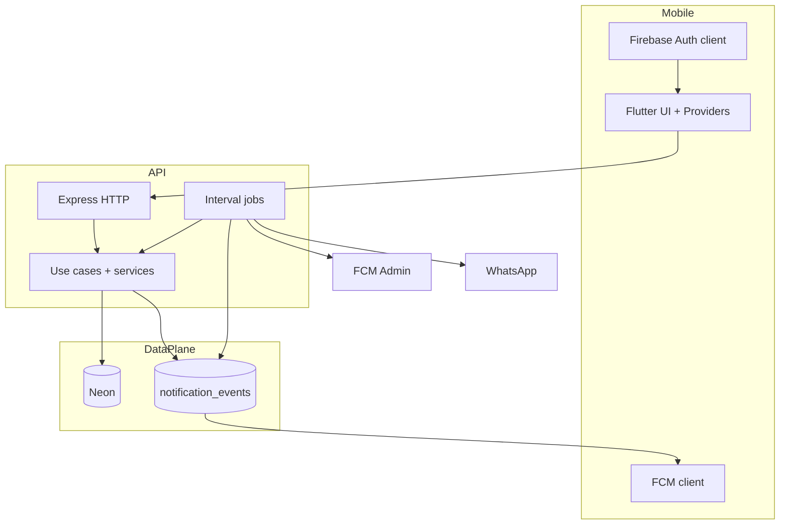
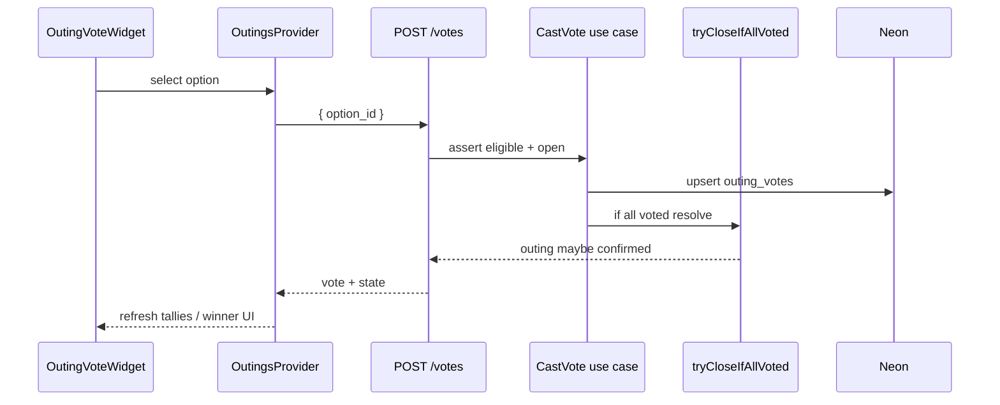
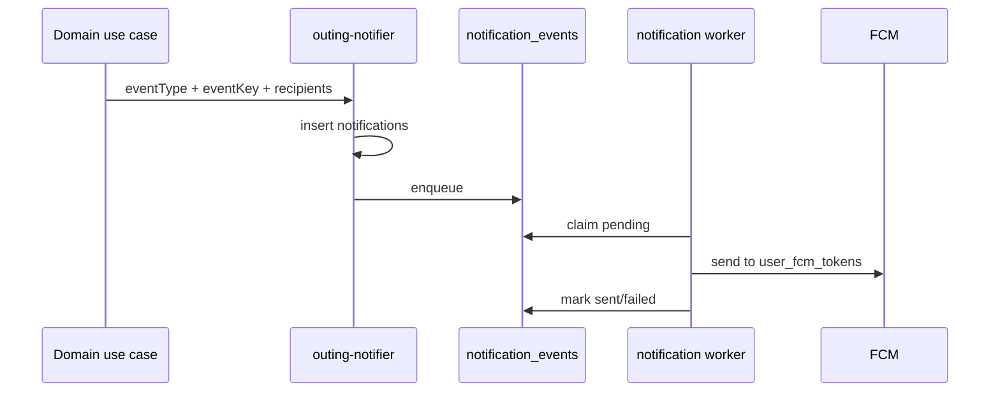
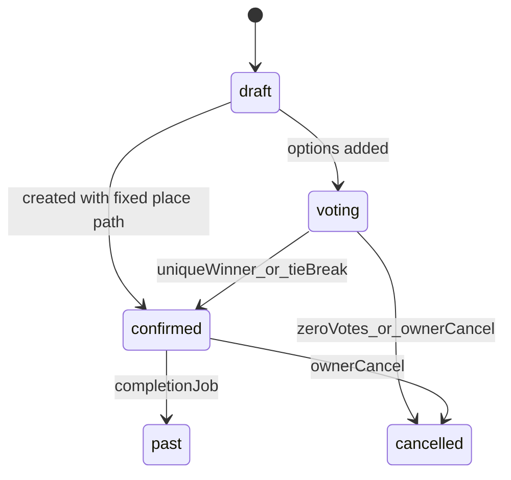
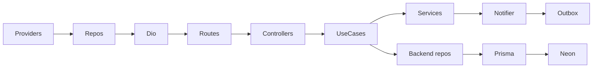
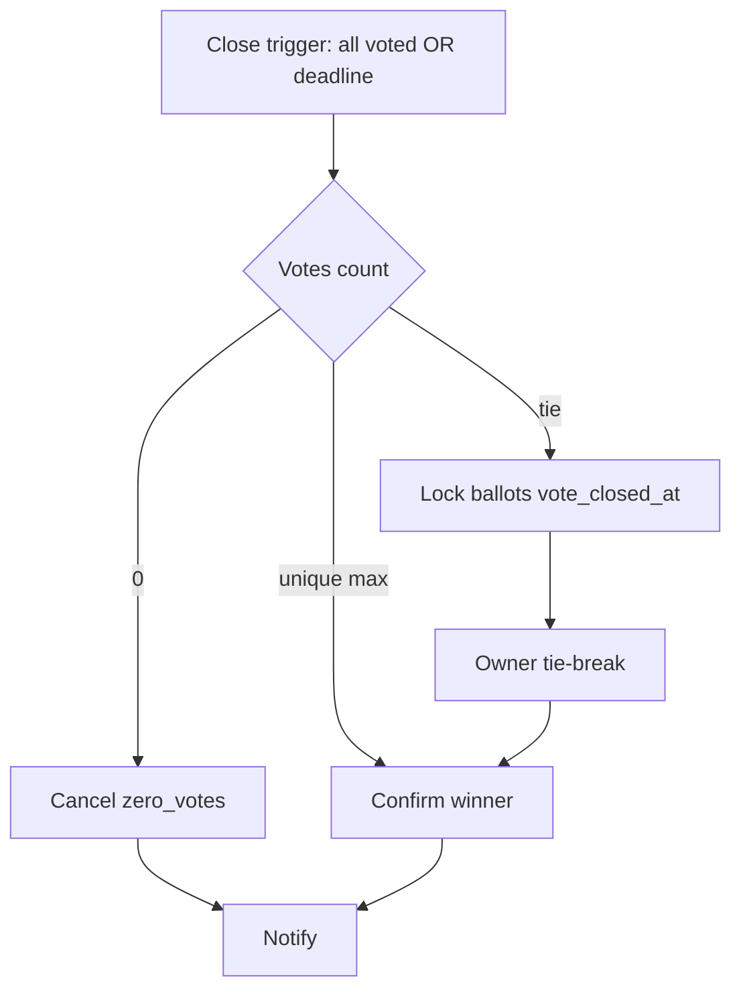

# Yalla 5roga — System Design

| Metadata | Value |
|----------|-------|
| Last verified | 2026-11-07 |
| Documentation version | 1.0.0 |
| Companion docs | [`SYSTEM_ARCHITECTURE.md`](SYSTEM_ARCHITECTURE.md), [`USER_SCENARIOS.md`](USER_SCENARIOS.md), [`PRODUCT_SCENARIOS.md`](PRODUCT_SCENARIOS.md) |
| Needs verification | Device E2E; production FCM; concurrent race suite beyond existing tests |

## 13.1 System design overview

### Architectural approach

Client-server mobile system: Flutter issues authenticated REST calls; Express use cases enforce product rules; Neon is the durable store; Firebase provides identity + push transport; in-process jobs close voting deadlines and drain the notification outbox.

### Sources of truth

| Concern | Source of truth |
|---------|-----------------|
| Identity session | Firebase Auth |
| Profile / domain data | Neon via Prisma |
| Outing status / winner | Backend (`outings` row) |
| Vote tallies | `outing_votes` aggregated server-side |
| Attendance | `outing_attendance` |
| Push delivery attempt | `notification_events` + delivery logs |

**Backend authority:** Voting closure, winner, tie-break RNG, cancel, authZ, notification triggers are server decisions. Flutter may animate only after confirmation.

### Sync vs async

| Sync (request/response) | Async (jobs / outbox) |
|-------------------------|------------------------|
| CRUD, vote cast, attendance, chat send, tie-break API | Deadline close job, outing → past job, notification worker |

### High-level design diagram



### Critical execution paths

1. Auth → sync/login → Bearer on all domain APIs  
2. Create outing → owner Going → candidates → voting  
3. Vote upsert → maybe early close → notify  
4. Deadline/tie-break/cancel → status transition → notify  
5. Chat / attendance / saves as independent side paths  

---

## 13.2 Detailed component design (features)

### User authentication and synchronization

| Layer | Components |
|-------|------------|
| Flutter | `AuthProvider`, `AuthRepositoryImpl`, `FirebaseAuthService`, `AuthRemoteDataSource` |
| API | `POST /api/auth/signup|login`, `POST /api/users/sync`, `authMiddleware` |
| DB | `users` |

Errors: 401 invalid token/credentials; 409 duplicate email/phone. After auth, deep-link provider may resume invite.

### Outing creation and management

| Layer | Components |
|-------|------------|
| Flutter | `CreateOutingProvider`, `OutingsProvider`, outings remote DS |
| API | `CreateOutingUseCase`, `UpdateOutingUseCase`, `POST/PATCH/DELETE /api/outings` |
| DB | `outings`, `outing_attendance` (owner Going) |

Group vs special event discriminated by `group_id` / `occasion` / `type`. Deadline mandatory (`vote_ends_at` or `vote_deadline_hours`). Confirmed location edits rejected when winner locked.

### Invitations and membership

| Path | Components | Status |
|------|------------|--------|
| Group phone invite | `InviteToGroupUseCase` → `group_invitations` + WhatsApp outbox/`whatsapp_url`; Flutter `GroupsProvider.inviteMember` / create-group phones; claim on verified-phone `users/sync`; deep-link restore via `InviteDeepLinkProvider` | Implemented |
| Outing invite | `guests.usecase` + accept/decline routes (registered `user_id` only — no phone/`outing_guests` for non-users) | API Implemented; Flutter deep-link UI **Partial** |

Pending ≠ Member. Accept creates/updates accepted membership.

### Place discovery

`DiscoverProvider` → places APIs → `places` (+ images/prices/hours). Saved places: `saved_places` APIs. Nominatim is client-side geocoding only.

### Candidate places / voting / closure / tie-break

See §13.5. Core services: `voting.usecase.ts`, `vote-resolution.ts`, `outing-participants.ts`.

### Attendance

`UpsertAttendanceUseCase` — independent domain (§13.6).

### Outing chat

`SendMessageUseCase`, list/read routes under `/api/outings/:outingId/messages` and `/read`. Access via `chat-access.ts`.

**Hybrid realtime (ADR-013):** REST persists; after success, Socket.IO emits `outing:message` to room `outing:{outingId}`. Mark-read emits `outing:read`. Clients authenticate sockets with Firebase ID tokens and must pass `assertChatParticipant` on `outing:join`. Flutter recovers missed messages with REST after reconnect.

### Saved outings / places

Saved outing use cases + place bookmark endpoints; Neon composite PKs.

### Push notifications

§13.9 sequence + [`NOTIFICATIONS.md`](NOTIFICATIONS.md).

---

## 13.3 Critical workflow design

### Create outing (Group)

1. Trigger: Owner submits create form (`CreateOutingPage`), optionally with multi-place voting via **Add places for voting** / Add place (same page as former suggest-places sheet).  
2. Flutter: `CreateOutingProvider` → repository → `POST /api/outings` (+ vote-option posts when `votePlaces` set).  
3. Controller: `OutingController.create`.  
4. Use case: `CreateOutingUseCase` validates type/deadline/window.  
5. DB txn: insert `outings` + owner `outing_attendance=going`.  
6. Response: outing JSON.  
7. Flutter: refresh lists.  
8. Notifications: typically none until invites/options (unless create path emits).  

### Cast / change vote



Transaction: vote upsert; early close resolves inside locked transaction when applicable. Notifications on closure outcomes.

### Tie-break

```mermaid
sequenceDiagram
  participant Owner as Owner UI
  participant API as POST /tie-break
  participant BR as breakTieRandomly
  participant DB as Neon

  Owner->>API: request
  API->>BR: assert owner + tied leaders
  BR->>DB: crypto random among leaders; set winner confirmed
  API-->>Owner: winning_option_id
  Note over Owner: Flutter animates server winner only
```

### Invitation accept (outing API)

Trigger: authenticated user accepts. `POST /api/outings/:id/invitations/accept` → guests use case → `outing_guests.status=accepted`. Deep-link auto-join **must not** happen without this (or equivalent explicit join).

### Attendance update

`PUT /api/outings/:id/attendance` `{ status }` → upsert row; notify owner if member changed; never touch votes.

### Notification delivery



---

## 13.4 Outing lifecycle system design

| State | Meaning | Chat | Voting |
|-------|---------|------|--------|
| `draft` | Preparing | Open | Not closed; options may start voting |
| `voting` | Collecting place votes | Open | Open until `vote_closed_at` or terminal status |
| `confirmed` | Winner locked | Open | Locked |
| `cancelled` | Terminal cancel | Closed | Locked |
| `past` | Completed after schedule | — | Locked |

**Tie nuance (implemented):** Status may remain `voting` while `vote_closed_at` is set (ballots locked) until Owner tie-break confirms.

Enforcement: use cases + `vote-resolution` + jobs. Flutter must refresh server state, not invent transitions.



**Conflicts / gaps:** Flutter outing-invite deep link UX partial; device E2E NOT RUN. Pre-fix client finalize removed.

---

## 13.5 Place voting system design

### Approved rules (enforce)

- Owner-only candidates before deadline; both outing types.  
- Eligible: Owner + accepted Members (+ group members of `group_id`).  
- Mandatory Owner-defined deadline.  
- One active vote; upsert on change; lock after close.  
- All voted → immediate close; deadline → close.  
- Unique max → confirm; tie → Owner RNG among tied only.  
- Zero at close → cancel; zero while open → stay open.  
- Candidate set change → clear votes, keep deadline, notify.  
- After confirm, place locked.

### Persistence / concurrency

- PK `(outing_id, user_id)` prevents double active votes.  
- Replace options deletes votes+options in transaction.  
- Resolution uses transactional updates; concurrency tests exist (`voting-concurrency.test.ts`).  
- Deadline job idempotent via status/`vote_closed_at` checks.

### Implementation conflicts

Track in audit. Core backend rules Implemented; Flutter candidate-replace UI and some invite UX Partial.

---

## 13.6 Attendance system design

Statuses: `going` | `not_going` | `maybe`. Flutter may show client-only `unset` before first row.

- Created: owner Going on outing create; members via PUT.  
- Who: participants; owner coerced to Going.  
- Notifications: owner on member change.  
- **Never** affects `outing_votes` or eligibility.

---

## 13.7 Invitation and membership system design

**Approved:** Account required; deep link preserves destination; auth redirect; explicit accept; Member afterwards; no Guest role; pending is invitation state.

| Topic | Implemented | Planned / Partial |
|-------|-------------|-------------------|
| Group invite + WhatsApp + deep link | Yes | — |
| Outing accept/decline API | Yes | — |
| Outing deep-link restore UI | Partial | Complete parity with group flow |
| Expiration/revocation | Schema statuses exist | Full product UX varies |

Unauthorized access: 403/404 from access helpers. Duplicate accept should be idempotent toward accepted membership (verify use case on change).

---

## 13.8 Reliability and scalability

| Area | Implemented | Limitation | Future |
|------|-------------|------------|--------|
| DB connections | Prisma singleton | Neon pooler env-dependent | Tune pool |
| Indexes | Status/deadline/vote indexes in schema | Untested prod plans | EXPLAIN under load |
| Transactions | Voting/candidates/create | — | Keep FOR UPDATE patterns |
| Concurrency | Tests for vote/tie | Not exhaustive chaos | Expand harness |
| Jobs | setInterval in API process | Single-node assumption | External worker/queue if multi-instance |
| Idempotency | event_key, vote PK, tie-break guards | — | Keep |
| Notifications | Outbox retries | Device delivery unverified | Prove FCM E2E |
| Rate limiting | Auth endpoints mention 429 | Not global API limiter | Add gateway limits |
| Caching | None verified | — | Cache place catalog carefully |
| Images | URL strings | No upload service | Object storage ADR |
| Logging | console | No centralized APM verified | Structured logs |
| API timeouts | Flutter Dio timeouts in AppConfig | — | Align with server |

**Do not claim Redis/queues exist** — they are not verified in this repo.

---

## 13.9 Additional diagrams

### Component interaction



### Voting closure



---

## Related

- [`USER_SCENARIOS.md`](USER_SCENARIOS.md) — journey-level expectations  
- [`BUSINESS_LOGIC.md`](BUSINESS_LOGIC.md) — approved vs implemented  
- [`DATABASE_ARCHITECTURE.md`](DATABASE_ARCHITECTURE.md)  

### Creator deletion

Outing details → confirm permanent deletion → `DELETE /api/outings/:id` → backend checks the authenticated creator → database deletes the outing → Flutter updates local lists and closes the details route. The cancellation state machine is independent of this route.
