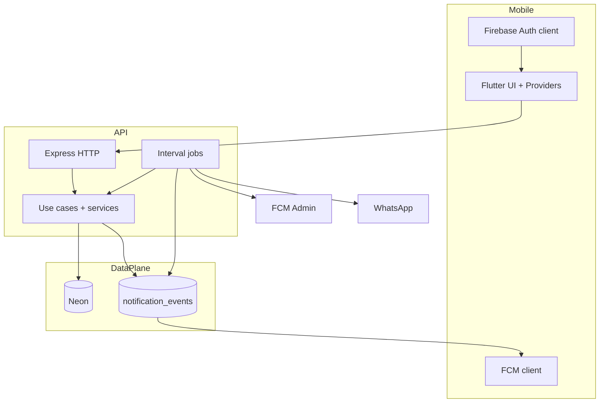
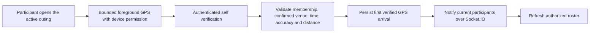
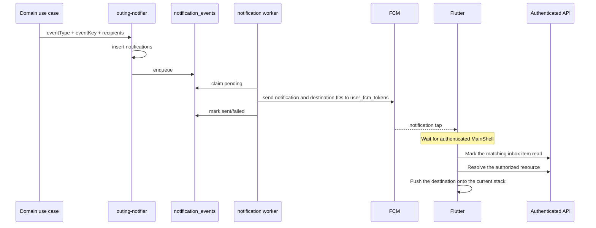
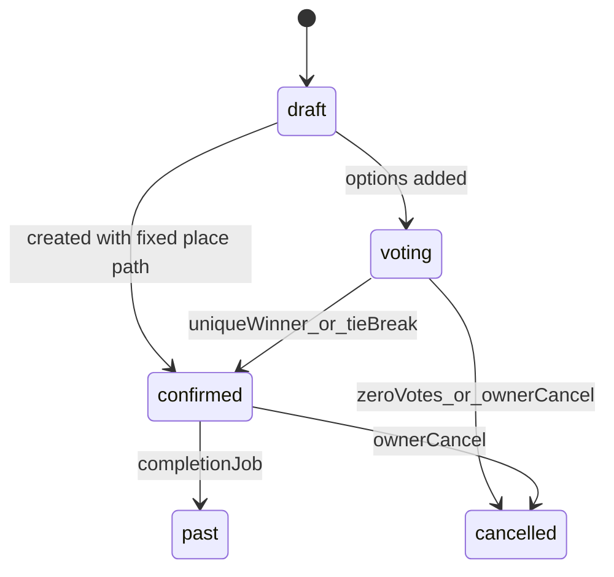
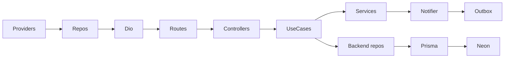
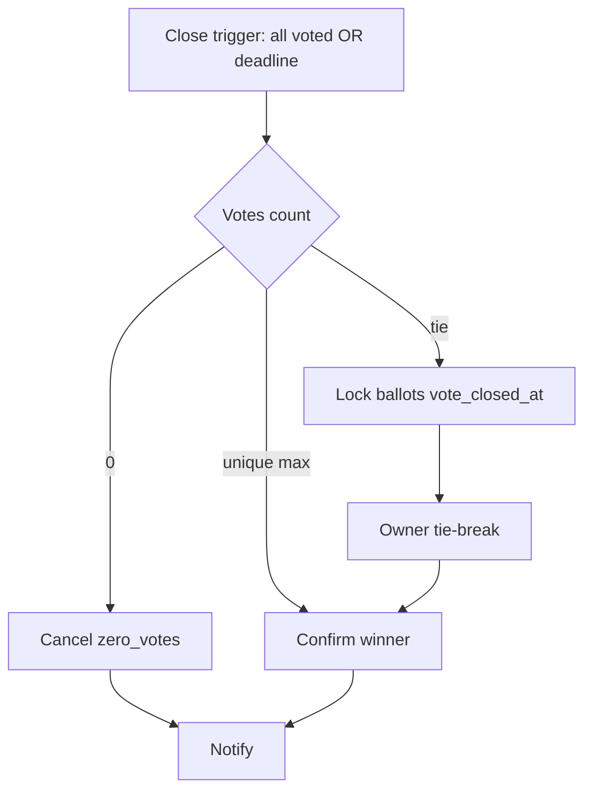
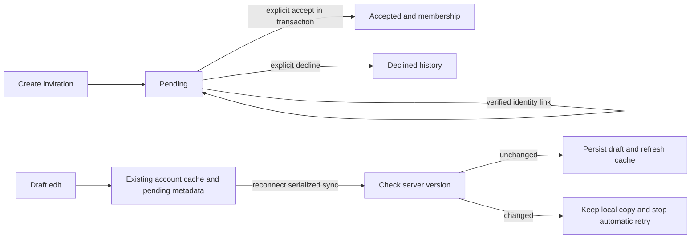

# Yalla 5roga — System Design

| Metadata | Value |
|----------|-------|
| Last verified | 2026-11-07 |
| Documentation version | 1.0.0 |
| Companion docs | [`SYSTEM_ARCHITECTURE.md`](SYSTEM_ARCHITECTURE.md), [`USER_SCENARIOS.md`](USER_SCENARIOS.md), [`PRODUCT_SCENARIOS.md`](PRODUCT_SCENARIOS.md) |
| Needs verification | Device E2E; production FCM; concurrent race suite beyond existing tests |

## 13.1 System design overview

### Architectural approach

Client-server mobile system: Flutter issues authenticated REST calls; Express use cases enforce product rules; Neon is the durable store; Firebase provides identity + push transport; in-process jobs close voting deadlines and drain the notification outbox.

### Sources of truth

| Concern | Source of truth |
|---------|-----------------|
| Identity session | Firebase Auth |
| Profile / domain data | Neon via Prisma |
| Outing status / winner | Backend (`outings` row) |
| Vote tallies | `outing_votes` aggregated server-side |
| Attendance | `outing_attendance` |
| Push delivery attempt | `notification_events` + delivery logs |

**Backend authority:** Voting closure, winner, tie-break RNG, cancel, authZ, notification triggers are server decisions. Flutter may animate only after confirmation.

### Sync vs async

| Sync (request/response) | Async (jobs / outbox) |
|-------------------------|------------------------|
| CRUD, vote cast, attendance, chat send, tie-break API | Deadline close job, outing → past job, notification worker |

### High-level design diagram



### Critical execution paths

1. Auth → sync/login → Bearer on all domain APIs  
2. Create outing → owner Going → candidates → voting  
3. Vote upsert → maybe early close → notify  
4. Deadline/tie-break/cancel → status transition → notify  
5. Chat / attendance / saves as independent side paths  

---

## 13.2 Detailed component design (features)

### User authentication and synchronization

| Layer | Components |
|-------|------------|
| Flutter | `AuthProvider`, `AuthRepositoryImpl`, `FirebaseAuthService`, `AuthRemoteDataSource` |
| API | `POST /api/auth/signup|login`, `POST /api/users/sync`, `authMiddleware` |
| DB | `users` |

Errors: 401 invalid token/credentials; 409 duplicate email/phone. After auth, deep-link provider may resume invite.

### Outing creation and management

| Layer | Components |
|-------|------------|
| Flutter | `CreateOutingProvider`, `OutingsProvider`, outings remote DS |
| API | `CreateOutingUseCase`, `UpdateOutingUseCase`, `POST/PATCH/DELETE /api/outings` |
| DB | `outings`, `outing_attendance` (owner Going) |

Type is derived from occasion: `none` requires a group and produces `group`; birthday/wedding/celebration/other produce `special_event` with an optional group. A supplied group requires accepted creator membership. Deadline mandatory (`vote_ends_at` or `vote_deadline_hours`). Confirmed location edits rejected when winner locked.

### Invitations and membership

| Path | Components | Status |
|------|------------|--------|
| Group phone invite | `InviteToGroupUseCase` → pending `group_invitations` + optional WhatsApp for all recipients. Verified signup/login/sync links account identity only; explicit acceptance creates `group_members`; deep-link restore via `InviteDeepLinkProvider` | Implemented |
| Outing invite | `guests.usecase` + accept/decline for registered members. Special-event phone invitations use the notification outbox or click-to-chat and do not create members. | Implemented; Flutter member deep-link UI **Partial** |

Pending ≠ Member. Outing guest responses transition a pending row once. The same response is idempotent and a competing response returns 409. Reissuing an invite preserves an existing pending or accepted row. Group phone associations use verified-phone linking. PostgreSQL permits one pending row per group and E.164 phone. Matching rows are locked while bulk membership insertion and link recording share a transaction. Owners can revoke a pending association and registered member removal prevents a pending row from restoring access. The add flow rechecks the account after persisting a pending row to close the race with signup. Roster reads use a single snapshot for active and pending rows so they reflect one side of a concurrent account link. Signup verifies OTP proof and keeps its UID; password login checks the canonical Firebase phone before claiming. Session restore displays cached state first; the coordinator defers one-time users/sync until after cache hydration and before online group revalidation. Settings verification uses sync (not a profile PATCH), then refreshes groups once. Legacy unused OTP identities can supply recent proof to bind their phone to the signed-in UID; no registered accounts are merged.

### Place discovery

`DiscoverProvider` → places APIs → `places` (+ images/prices/hours). Saved places: `saved_places` APIs. Nominatim is client-side geocoding only.

### Candidate places / voting / closure / tie-break

See §13.5. Core services: `voting.usecase.ts`, `vote-resolution.ts`, `outing-participants.ts`.

### Attendance

`UpsertAttendanceUseCase` — independent domain (§13.6).

### Outing chat

`SendMessageUseCase`, list/read routes under `/api/outings/:outingId/messages` and `/read`. Access via `chat-access.ts`.

**Hybrid realtime (ADR-013):** REST persists; after success, Socket.IO emits `outing:message` to room `outing:{outingId}`. Mark-read updates a monotonic PostgreSQL watermark and emits `outing:read`. Clients authenticate sockets with Firebase ID tokens and must pass `assertChatParticipant` on `outing:join`. Flutter recovers missed messages with REST after reconnect.

**Offline recovery (ADR-014):** Launch hydrates account-scoped snapshots, then revalidates profile, groups/outings, inbox and open details/chats. `data:changed` hints collect IDs for a 250 ms debounce. Membership changes also revalidate active chats; votes refresh the affected outing. Background events remain dirty until foreground recovery. Transient snapshot fallback schedules capped exponential retry and never writes to PostgreSQL. Durable chat sends reuse their UUID until acknowledged; permanent authorization/state conflicts mark that send failed while subsequent sends can proceed. Form draft edits/deletes use the existing draft cache with version-checked recovery; other writes are not replayed. See `audit/OFFLINE_REALTIME_REPORT.md` for cache bounds and verification limits.

### Saved outings / places

Saved outing use cases + place bookmark endpoints; Neon composite PKs.

### Media / images

Flutter picks a local image → `POST /api/media/upload-url` (backend creates a `pending` `media_assets` row and returns a presigned PUT) → client `PUT`s bytes directly to R2/mock storage → `POST /api/media/:id/confirm` performs a HEAD check and marks the asset `ready` → the create/update payload persists `media://<asset-id>` (or the asset is linked after row creation). The API and Neon never receive bytes.

Display: `AppNetworkImage` resolves `media://` in batches through `/api/media/signed-urls`. Public place media returns the CDN URL when `R2_PUBLIC_BASE_URL` is configured; private media returns a short-lived signed URL after ownership/participant checks. URL metadata is persisted per account and image-cache keys use the stable asset id, so expiry rotation does not re-download and account switches cannot render another account's private image. Failed uploads are deleted best effort; `media-cleanup.job.ts` reaps expired pending intents and failed assets.

### Push notifications

§13.9 sequence + [`NOTIFICATIONS.md`](NOTIFICATIONS.md).

---

## 13.3 Critical workflow design

### Create outing (Group)

1. Trigger: Owner submits create form (`CreateOutingPage`), optionally with multi-place voting via **Add places for voting** / Add place (same page as former suggest-places sheet).  
2. Flutter: `CreateOutingProvider` → repository → `POST /api/outings` (with optional ordered `initial_vote_options` for group voting). The outing, initial candidates, and owner attendance commit together.
3. Controller: `OutingController.create`.  
4. Use case: `CreateOutingUseCase` validates type/deadline/window.  
5. DB txn: insert `outings` + owner `outing_attendance=going`.  
6. Response: outing JSON.  
7. Flutter: refresh lists.  
8. Notifications: typically none until invites/options (unless create path emits).  

### Cast / change vote

```mermaid
sequenceDiagram
  participant UI as OutingVoteWidget
  participant P as OutingsProvider
  participant API as PUT /votes
  participant UC as ReplaceBallot use case
  participant VR as tryCloseIfAllVoted
  participant DB as Neon

  UI->>P: submit complete selection
  P->>API: { option_ids }
  API->>UC: lock outing; assert eligible + open
  UC->>DB: replace caller selections atomically
  UC->>VR: if all distinct eligible voters submitted, resolve
  VR-->>API: outing maybe confirmed
  API-->>P: vote + state
  P-->>UI: refresh tallies / winner UI
```

Transaction: full ballot replacement and existing early-close resolution share the outing row lock and transaction. Option tallies count selected rows; participation counts distinct eligible users. Notifications and realtime publication follow commit. Legacy single-selection POST remains additive and idempotent.

### Tie-break

```mermaid
sequenceDiagram
  participant Owner as Owner UI
  participant API as POST /tie-break
  participant BR as breakTieRandomly
  participant DB as Neon

  Owner->>API: request
  API->>BR: assert owner + tied leaders
  BR->>DB: crypto random among leaders; set winner confirmed
  API-->>Owner: winning_option_id
  Note over Owner: Flutter animates server winner only
```

### Invitation accept (outing API)

Trigger: authenticated user accepts. `POST /api/outings/:id/invitations/accept` → guests use case → `outing_guests.status=accepted`. Deep-link auto-join **must not** happen without this (or equivalent explicit join).

### Attendance update

`PUT /api/outings/:id/attendance` `{ status }` → upsert row; notify owner if member changed; never touch votes.



The backend serves the check-in radius and closing time. The default radius is 100 m and the default window is 360 minutes, capped by the outing end. The visible outing route schedules a fix on open and resume, then no more than once a minute while foregrounded. It stops when the window closes, the viewer arrives or the route loses visibility. Socket invalidations refresh the roster without triggering extra GPS samples.

### Notification delivery



---

## 13.4 Outing lifecycle system design

| State | Meaning | Chat | Voting |
|-------|---------|------|--------|
| `draft` | Preparing | Open | Not closed; options may start voting |
| `voting` | Collecting place votes | Open | Open until `vote_closed_at` or terminal status |
| `confirmed` | Winner locked | Open | Locked |
| `cancelled` | Terminal cancel | Closed | Locked |
| `past` | Completed after the outing ends | — | Locked |

Flutter reads all plans through the same authenticated `GET /api/outings/cuser` snapshot. The client compares `scheduled_at` to the current instant and moves an outing to Settings → Outing history at its scheduled start, along with rows whose server status is `past` or `cancelled`. The provider schedules a local update at the next start and recalculates when the app resumes. The completion job determines when a confirmed outing’s database status becomes `past`.

**Tie nuance (implemented):** Status may remain `voting` while `vote_closed_at` is set (ballots locked) until Owner tie-break confirms.

Enforcement: use cases + `vote-resolution` + jobs. Flutter must refresh server state, not invent transitions.



**Conflicts / gaps:** Flutter outing-invite deep link UX partial; device E2E NOT RUN. Pre-fix client finalize removed.

---

## 13.5 Place voting system design

### Approved rules (enforce)

- Owner-only candidates before deadline; both outing types.  
- Eligible: Owner + accepted Members (+ group members of `group_id`).  
- Mandatory Owner-defined deadline.  
- Multiple unique selections per caller ballot; atomically replace the full selection; lock after close.
- All voted → immediate close; deadline → close.  
- Unique max → confirm; tie → Owner RNG among tied only.  
- Zero at close → cancel; zero while open → stay open.  
- Candidate set change → clear votes, keep deadline, notify.  
- After confirm, place locked.

### Persistence / concurrency

- PK `(outing_id, user_id, option_id)` prevents duplicate selections; count distinct users for participation.
- Replace options deletes votes+options in transaction.  
- Resolution uses transactional updates; concurrency tests exist (`voting-concurrency.test.ts`).  
- Deadline job idempotent via status/`vote_closed_at` checks.

### Implementation conflicts

Track in audit. Core backend rules Implemented; Flutter candidate-replace UI and some invite UX Partial.

---

## 13.6 Attendance system design

Statuses: `going` | `not_going` | `maybe`. Flutter may show client-only `unset` before first row.

- Created: owner Going on outing create; members via PUT.  
- Who: participants; owner coerced to Going.  
- Notifications: owner on member change.  
- **Never** affects `outing_votes` or eligibility.

---

## 13.7 Invitation and membership system design

**Approved:** Account required; deep link preserves destination; auth redirect; explicit accept; Member afterwards; no Guest role; pending is invitation state.

| Topic | Implemented | Planned / Partial |
|-------|-------------|-------------------|
| Group invite + WhatsApp + deep link | Yes | — |
| Outing accept/decline API | Yes | — |
| Outing deep-link restore UI | Partial | Complete parity with group flow |
| Expiration/revocation | Schema statuses exist | Full product UX varies |

Unauthorized access: 403/404 from access helpers. Duplicate accept should be idempotent toward accepted membership (verify use case on change).

---

## 13.8 Reliability and scalability

| Area | Implemented | Limitation | Future |
|------|-------------|------------|--------|
| DB connections | Prisma singleton | Neon pooler env-dependent | Tune pool |
| Indexes | Status/deadline/vote indexes in schema | Untested prod plans | EXPLAIN under load |
| Transactions | Voting/candidates/create | — | Keep FOR UPDATE patterns |
| Concurrency | Tests for vote/tie | Not exhaustive chaos | Expand harness |
| Jobs | setInterval in API process | Single-node assumption | External worker/queue if multi-instance |
| Idempotency | event_key, vote PK, tie-break guards | — | Keep |
| Notifications | Outbox retries | Device delivery unverified | Prove FCM E2E |
| Rate limiting | Auth endpoints mention 429 | Not global API limiter | Add gateway limits |
| Caching | None verified | — | Cache place catalog carefully |
| Images | URL strings | No upload service | Object storage ADR |
| Logging | console | No centralized APM verified | Structured logs |
| API timeouts | Flutter Dio timeouts in AppConfig | — | Align with server |

**Do not claim Redis/queues exist** — they are not verified in this repo.

---

## 13.9 Additional diagrams

### Component interaction



### Voting closure



---

## Related

- [`USER_SCENARIOS.md`](USER_SCENARIOS.md) — journey-level expectations  
- [`BUSINESS_LOGIC.md`](BUSINESS_LOGIC.md) — approved vs implemented  
- [`DATABASE_ARCHITECTURE.md`](DATABASE_ARCHITECTURE.md)  

### Creator deletion

Outing details → confirm permanent deletion → `DELETE /api/outings/:id` → backend checks the authenticated creator → database deletes the outing → Flutter updates local lists and closes the details route. The cancellation state machine is independent of this route.

The creator’s explicit venue confirmation and automatic place-vote resolution use the same row lock and venue persistence path. RSVP upserts return the fresh roster and summary for that outing in one response. Chat history uses a stable ordering by send timestamp and ID, and the sender profile projection is shared by REST and Socket.IO.


## Silent targeted refresh and mention flow — 2026-11-11

Committed domain changes emit scoped invalidations to authenticated user rooms. The coordinator coalesces them over 250 ms, refreshes affected lists or mounted detail IDs, and retains offline snapshots. Resume/reconnect replays missed invalidations from a ten-minute/512-entry buffer; reset checks stale list caches plus mounted details. Active chats recover REST history because message delivery itself is not journaled. Background reads are silent. Five delayed recovery retries retain dirty state on exhaustion; foreground/network recovery or a fresh server event can restart recovery. No polling timer is added.

Chat mention selection → stable ID token in existing REST text → backend validates chat access/member IDs and canonicalizes Neon names → message commit → canonical Socket.IO echo → idempotent inbox/outbox notification for each other participant. Mentioned users receive the mention body with the existing exact-message deep link. Chat participation remains distinct from vote eligibility.


## Centralized realtime flow — 2026-11-11

Committed write → server-resolved recipients → existing Socket.IO user rooms → one `AppSyncProvider` listener → direct attendance/chat merge or set-coalesced group/outing REST reads. Reconnect uses the last reconciliation checkpoint; live delivery only deduplicates and cannot skip older missed changes. An expired/restarted journal triggers list and mounted-detail recovery. Membership invalidations recover active chats as well as groups/outings. Read receipts also check current membership at fan-out. Online REST remains required for non-chat writes; voting, attendance and lifecycle authority are unchanged. [Contracts](API_CONTRACTS.md#centralized-synchronization-contract--2026-11-11) and [verification](audit/CENTRALIZED_REALTIME_SYNC.md).

## Password recovery workflow — 2026-11-11

```mermaid
sequenceDiagram
  participant UI as Recovery form
  participant API as Auth API
  participant FA as Firebase Auth
  participant DB as Neon
  UI->>API: Start with registered phone
  API->>FA: Check current canonical UID phone
  API->>DB: Shared limits + request digest (10 minutes)
  API-->>UI: Request secret + cooldown
  UI->>FA: Send SMS and verify OTP (secondary Auth)
  FA-->>UI: Phone ID token
  UI->>API: Request secret + phone ID token
  API->>FA: Verify token/revocation + current phone
  API->>DB: Consume proof once + reset digest (5 minutes)
  API-->>UI: Reset secret
  UI->>API: Reset secret + new password/confirmation
  API->>FA: Recheck UID phone
  API->>DB: Transaction: consume grant + conditional bcrypt update
  API-->>UI: Updated; return to Login
```

Phone/password login continues to verify the same Neon hash and issue a Firebase session under the same UID. Recovery does not create/merge identities or revoke established sessions. PostgreSQL owns grant concurrency, proof replay and shared limits. Secrets remain in memory on the client; database stores only digests. External Firebase SMS quotas and abuse protection remain necessary because a modified client can bypass app/preflight sending controls. See authentication docs and [verification report](audit/PASSWORD_RECOVERY_REPORT.md).

### Recovery SMS reliability follow-up — 2026-11-11

The existing sequence is unchanged: backend preflight → Firebase SMS → isolated Firebase proof → backend authorization/reset. The configured Neon schema now includes the recovery migration; missing security tables had blocked start before Firebase could be invoked. Flutter observes native invocation errors and callbacks together under a single 75-second deadline. Failed resends preserve the previous request/verification pair, committing replacement state only after Firebase dispatch succeeds. No password authority, proof-validation or session policy changed.

## Confirmed backend/mobile implementation — 2026-11-13

Group invitation decisions serialize on the invitation row. Accept creates membership and records accepted status in the same transaction; decline records history without membership. A conflicting/repeated decision returns stored status. Verified identity linking does not accept invitations. Initial outing status is derived from options and venue. Creator cancel uses the existing notification fan-out, stable event keys and scoped realtime publication.

Draft recovery uses the existing Saved Outings repository/provider/cache. A client UUID in Idempotency-Key makes POST retries safe; If-Match carries the loaded updated_at for row-locked updates/deletes. Online writes update the server and cache; offline writes persist pending metadata. The existing AppSyncProvider runs one serialized recovery pass on reconnect/resume, preserves conflicts, and does not poll. Legacy clients omitting version headers retain their prior API behavior. No database schema change was made.



## Phase 2 group and invitation read flow — 2026-11-13

Group Info/history → existing GroupsProvider/repository → GET group + members → active profiles, pending invitations and group invitation history → existing Group snapshot. Active group membership gates the read. Pending identity linking remains visible until a decision; it creates no membership. Existing group/membership Socket.IO invalidations revalidate open group routes. Inbox → existing InvitationsProvider/repository → GET invitations preserves all statuses; explicit POST accept/decline updates the local history record after backend success. UI load generations are independent of the account epoch so concurrent realtime reads cannot strand decision loading. There are no lifecycle, voting, attendance or messaging protocol changes.


## Phase 3 Flutter composition — 2026-11-14

CreateOutingPage retains its route-local ChangeNotifier across Information → Locations → Review and back/edit navigation. Shared AppStepProgress renders localized progress; the existing map picker returns ordered Place values without replacing the form provider. Details composes OutingOverview, OutingAttendanceWidget (RSVP), OutingVoteWidget, OutingArrivalsSection, OutingLocationSection and OutingManagementActions. Widgets call existing providers/services; repositories and Dio remain the only HTTP path. Shared OutingCard and PlaceCard render presentation values. Single venue rendering omits ballot competition controls. AppSyncProvider remains the single Socket.IO/recovery coordinator; terminal history/chat policy and backend arrival authorization do not change.

## Phase 4 workflow extension — 2026-11-14

Discover and the outing picker render the existing AppMap with shared controlled chrome. Discover's area search is cancellable/debounced and uses existing geocoding/nearby repositories; screen-specific discovery and selection mutations remain separate. Permission failure leaves manual search and the shared fallback available. Provider, API caching and backend place bounds remain authoritative.

Special Event -> Information (image/title/occasion/optional group/guests/schedule) -> Location (fixed venue) -> Review -> existing create API. The server derives type from occasion and checks accepted membership whenever a group is supplied. Existing independent guest, outbox, RSVP, chat and realtime flows remain. Migration changes enum/constraint only, without rewriting rows. The existing lifecycle diagram is unchanged; event creation does not move lifecycle authority to Flutter.


## Voting deadline selection/submission — 2026-11-14

Information duration selection → provider/domain policy computes local preview and checks against schedule → Review retains duration → existing media upload finishes → datasource captures fresh now, computes UTC absolute deadline and validates → existing POST /outings → shared backend helper revalidates explicit/relative deadline → existing persistence stores vote_ends_at and duration metadata → canonical response timestamp is parsed and shown on the existing confirmation route. No communication/topology change; the existing create/voting diagrams remain applicable. Preview clock refreshes and schedule edits disable invalid Continue/Create actions; REST validation still owns acceptance.


## Unanswered RSVP and deadline display — 2026-11-14

Accepted membership + persisted RSVP rows → existing authorized attendance read → complete roster/default no_response → existing Provider and raw offline snapshots → RSVP/Who’s going. A membership invalidation rehydrates new accepted members; default construction does not send a mutation or notification. Deadline/server-closed state → visible route-local timer → local days/hours/minutes/seconds; no polling, closure request or winner calculation is introduced. Existing sequence diagrams retain their topology.


## Phase 5 chat window and action flow — 2026-11-14

Chat history authorization is independent of mutation availability. Sending, editing and deletion close at scheduled_at + two hours (independent of the existing six-hour default outing completion job), or immediately on past/cancelled status. The frontend timer reflects that boundary; the backend shared guard enforces it, including native replies and replayed sends. Own-message edit additionally requires now < sent_at + one minute, checked both by the client and backend write predicate. Delete is not age-limited within open chat. REST mutation → authorized persistence → existing outing:message delivery updates bubbles/tombstones. Reconnect replaces a bounded authoritative window, preserving queue/live updates and cursor access to earlier history.

Native Reply/Mark as read → recipient/current-session validation → existing authenticated message/read API → inbox read update. Android local notifications supply text input; iOS local/APNs categories supply it through the plugin/native bridge. Android background FCM remains OS-rendered without chat actions. No new room, transport, database or notification worker exists.
