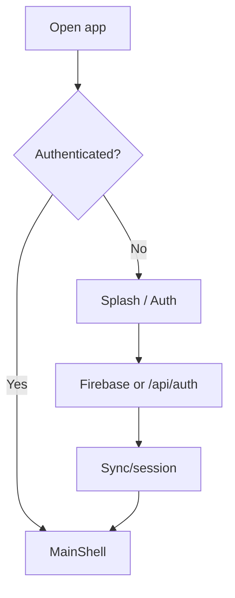
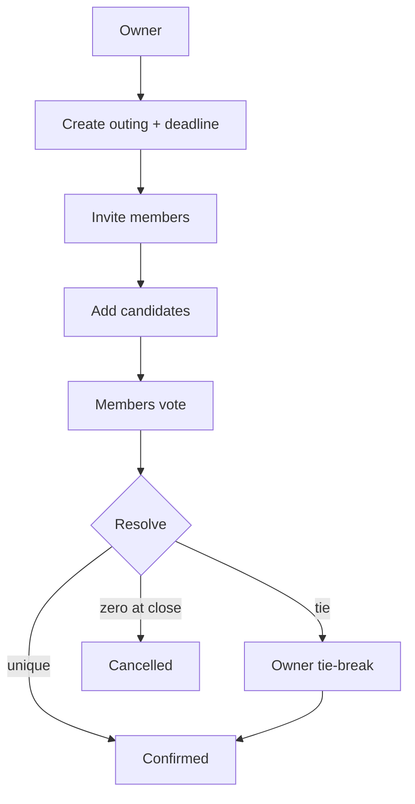
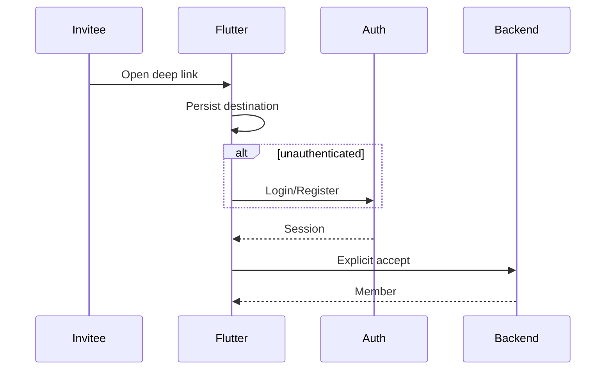

# Yalla 5roga — User Scenarios

| Metadata | Value |
|----------|-------|
| Last verified | 2026-11-08 (AUTH-07 settings profile / password) |
| Documentation version | 1.0.0 |
| Product authority | [`PRODUCT_SCENARIOS.md`](PRODUCT_SCENARIOS.md) |
| Technical companion | [`SYSTEM_DESIGN.md`](SYSTEM_DESIGN.md) |
| Needs verification | Device E2E for journeys marked Partial / NOT RUN |

Scenarios describe **approved expected behavior**. Implementation Status reflects audit + code verification as of the metadata date.

---

## 14.1 Format

Each scenario uses: Actor, Preconditions, Starting State, User Actions, Expected Flutter / Backend / DB / Notifications, Final State, Alternatives, Failures, Authorization, Implementation Status.

---

## 14.2 Account and authentication

### AUTH-01 New registration (phone/password with OTP)

- Enter name, phone and password, then verify the phone with Firebase OTP.
- Flutter sends the Firebase phone ID token to `POST /api/auth/signup`. The backend validates the proof, provisions the Neon profile with the same UID, claims matching invitations and returns a Firebase session.
- Invalid proof returns 401. An already-bound phone or UID returns 409.

### AUTH-02 Existing login (phone/password)

- Submit the phone and password to `POST /api/auth/login`. The backend verifies the Neon hash and returns a Firebase session without an OTP prompt.

### AUTH-03 Verify a phone change

- From the authenticated settings flow, complete Firebase phone verification and sync the verified number under the existing UID. A successful sync refreshes claimed group memberships.

### AUTH-04 Session restore / logout

- **Actions:** `AuthProvider.restoreSession()`; logout clears the Firebase session and account-scoped UI state, then opens the original login form as the only route.
- **Status:** Implemented  

### AUTH-05 Invalid/expired token

- **Backend:** `authMiddleware` → 401.  
- **Flutter:** Error interceptor / re-auth UX.  
- **Status:** Implemented  

### AUTH-06 Unauthenticated deep link

- **Actions:** Open invite → splash/auth → after success restore pending destination (`InviteDeepLinkProvider`).  
- **Must not:** auto-create membership before accept.  
- **Status:** Partial (group flow stronger than outing)  

### AUTH-07 Settings profile / change password

- **Actions:** Settings shows the Neon member-since date and phone verification status. Tap Verify phone on an unverified number to send and enter an SMS code in a bottom sheet. Edit Profile shows name and phone as text buttons that open bottom sheets. Save name/photo changes after password confirmation for password accounts. Edit password opens its own page with current password, new password and confirmation. Successful saves show a checkmark dialog.
- **Backend:** `GET /api/users/cuser`; `POST /api/auth/change-password` / `verify-password`.  
- **Status:** Implemented  

---

## 14.3 Outing creation

### OUT-01 Create Group Outing

- **Preconditions:** Authenticated; group exists; user allowed.  
- **Actions:** Enter title, schedule and an optional cover photo. In step 2, pick a single location or tap **Add places for voting** to select 2–5 places from the list, the map, or both. Set the deadline on Review, then submit.
- **Backend:** `CreateOutingUseCase` — `type=group`, require deadline; owner attendance Going; `image_url` optional http(s) only; vote options posted when multi-place.  
- **DB:** `outings`, `outing_attendance`, optional `outing_vote_options`.  
- **Flutter:** Shared `CreateOutingPage` for create + suggest; always sends `vote_deadline_hours`; omits local file paths from `image_url` (no upload pipeline yet).  
- **Status:** Implemented (API/tests); Flutter sends deadline fields  

**Create Outing UI:** The form starts with a full-width optional photo cover, followed by the outing name and rounded category choices. The progress header and footer guide users through location and review. Group and outing screens use a local illustration when the cover photo is absent. Birthday and wedding events have distinct default covers.

### OUT-01b Suggest / multi-place vote (same page)

- **Actions:** In step 2 of Create Outing, choose **Add places for voting**, select 2–5 catalog places and map pins. The full-screen picker opens with the current selection. Add and name pins, use the numbered list to remove or move places, then confirm the order. Back discards changes made in the picker. The Review step shows the selected places and lets the creator adjust the deadline before publishing.
- **Status:** Implemented (merged into create outing; no separate suggest sheet)  

### OUT-02 Create Special Event

- Same as OUT-01 without `group_id`; occasion birthday/wedding; `type=special_event`.  
- **Status:** Implemented  

### OUT-03 Validation failures

- Missing deadline, invalid occasion/group combo, bad time window → 400.  
- **Status:** Implemented  

---

## 14.4 Invitation and membership

Group Details puts the group name, role, and Create outing action together. Group Outings links to individual outing details. The **Active Votes** section appears on the Outings tab. Start a new place vote from step 2 of Create Outing.

### GRP-01 Create group — creator is first member

- **API:** `POST /api/groups` → creator row in `group_members` with `role=owner`; response `member_count` starts at **1**
- **Flutter:** The form opens with the same optional, full-width cover picker as Create Outing, with group artwork as the placeholder. After create, members are reloaded; Group Info / Details call `ensureGroupLoaded` so the creator card appears in the members list
- **Status:** Implemented

### GRP-02 Edit group bio

The group owner can open Group Info and use **Edit bio** in the About card. Save replaces the description, and saving an empty field clears it. Members can read the bio. The description has a 160-character limit.

### INV-01 Owner invites existing user (outing)

- **API:** `POST /api/outings/:id/guests`  
- **DB:** `outing_guests` pending/accepted per use case  
- **Notify:** outing invite event  
- **Status:** Implemented API; Flutter share UX varies  

### INV-02 Add a group member by phone

- **API:** `POST /api/groups/:id/invitations` adds by phone. A group owner can revoke a still-pending association with `DELETE /api/groups/:id/pending-memberships/:invitationId`.
- **Flutter:** Create-group member picker loads device contacts (`PickDeviceContactsPage` + `READ_CONTACTS`); manual phone still supported. Create/add flows use the invitation endpoint. The inline checkbox records recipient agreement. The backend queues the consented message when configured; after invitee installs + verifies that phone, `POST /api/users/sync` claims pending `group_invitations` into `group_members`. Group cover `image_url` is optional.
- **Special events:** Choose device contacts in the guest picker. Confirm recipient opt-in before creating the event. Phone guests receive the title, time, venue, Google Calendar link and optional app link. When automatic delivery is unavailable, send the prefilled invitations from the new outing’s details. Phone invitees do not become app members.
- **Status:** Implemented  

The verified registered user joins immediately. For an unregistered number, Neon stores the normalized phone and no user ID. Verified signup or sync links all pending groups automatically and the member can open the group and its outings. Group Info shows pending contacts alongside active members with a localized “Pending registration” label. The roster reloads after an add and when Group Info opens. The owner can remove a pending association before signup or remove an active member afterward. A revoked association stays revoked after login. Signup uses the same Firebase UID that completed OTP. Existing accounts from the former split-UID signup must verify once in Settings; repair preserves all account/group IDs, then refreshes the group list. Session restoration displays matching cached state immediately, then defers invitation/account sync before online group revalidation. Logout clears the visible list and account-scoped caches; late responses from the previous session are ignored.

### INV-03 Explicit accept outing invite

- **API:** `POST …/invitations/accept` → Member  
- **Status:** Implemented API; deep-link UI Partial  

### INV-04 Decline / invalid / duplicate

- Decline API; expired/revoked → error; duplicate accept → safe accepted state  
- **Status:** Partial verification on all edge paths  

### INV-05 Access without membership

- **Expected:** 403/404 on restricted ops; not eligible to vote  
- **Status:** Implemented backend checks  

---

## 14.5 Place voting

| ID | Scenario | Backend decision | Status |
|----|----------|------------------|--------|
| VOT-01 | Owner creates outing | draft/voting path | Implemented |
| VOT-02 | Owner adds candidates | options created; votes cleared; maybe → voting | Implemented |
| VOT-03 | Accepted members eligible | assertEligibleVoter | Implemented |
| VOT-04 | Owner can vote | eligible includes created_by | Implemented |
| VOT-05 | Member votes | upsert `outing_votes` | Implemented |
| VOT-06 | Change vote before close | update same PK row | Implemented |
| VOT-07 | Multi vote attempt | still one row | Implemented |
| VOT-08 | Pending invitee votes | 403 | Implemented |
| VOT-09 | Owner changes candidates | reset votes; keep deadline; notify | Implemented |
| VOT-10 | Vote after close | 409 Conflict | Implemented |
| VOT-11 | All eligible voted | early close + resolve | Implemented |
| VOT-12 | Deadline reached | job closes | Implemented |
| VOT-13 | Unique winner | confirmed + winner | Implemented |
| VOT-14 | Tie | lock ballots; await Owner | Implemented |
| VOT-15 | Owner tie-break | RNG tied leaders; confirm | Implemented |
| VOT-16 | Member tie-break | 403 | Implemented |
| VOT-17 | Flutter animation | display server winner only | Implemented UI; device NOT RUN |
| VOT-18 | Close with zero votes | cancel | Implemented |
| VOT-19 | Open with zero votes | stay open | Implemented |

---

## 14.6 Attendance

### ATT-01 Owner auto Going — Implemented  
### ATT-02 Member sets going/not_going/maybe — Implemented  
### ATT-03 Multiple changes — upsert — Implemented  
### ATT-04 During voting / after confirm — allowed until cancelled/past — Implemented

### ATT-05 Who’s arrived — Enable automatic check-in on the outing and grant foreground location. The list opens at the scheduled start. A participant is added when their device reports a sufficiently accurate position within 150 m while the app is open. RSVP stays separate.
### ATT-05 Must not alter votes — Implemented invariant
### ATT-06 Owner cannot leave Going — coerced — Implemented  

---

## 14.7 Outing lifecycle

| ID | Transition / action | Allowed | Status |
|----|---------------------|---------|--------|
| LIFE-01 | draft → voting | Yes via options | Implemented |
| LIFE-02 | voting → confirmed | Winner paths | Implemented |
| LIFE-03 | voting → cancelled | Zero votes / owner cancel | Implemented |
| LIFE-04 | Early / deadline close | Server | Implemented |
| LIFE-05 | Owner cancel | Yes | Implemented |
| LIFE-06 | Member cancel | No | Implemented |
| LIFE-07 | Owner edit before confirm | Yes (rules) | Implemented |
| LIFE-08 | Owner edit confirmed place | No | Implemented lock |
| LIFE-09 | Member edit outing | No | Implemented |
| LIFE-10 | confirmed → past | Job | Implemented |

**Outing history:** At the scheduled start date and time, an outing leaves the Outings tab and appears under **Settings → Outing history**, alongside completed and cancelled outings. Outings earlier today are included. Open an outing from history to view its details or check in if eligible. The Outings tab shows Active Votes and plans whose scheduled start has yet to arrive, plus unscheduled plans. Settings keeps profile editing available through the profile avatar.

---

## 14.8 Outing chat

### CHAT-01 Open chat as member — list messages — Implemented  
### CHAT-02 Send message — `POST …/messages` — Implemented  
### CHAT-03 Ordering by `sent_at` — Implemented  
### CHAT-04 Mark read — `PATCH …/read` — Implemented  
### CHAT-05 Offline history and queued sends — Implemented; automated cache/queue tests, device verification pending

Previously loaded chat remains visible offline. Sending shows pending after durable local save; foreground reconnection retries the same UUID. Closed-chat or membership rejection produces a failed message. Canonical REST/socket delivery replaces the pending item without duplicates. Availability is bounded by cache retention.
### CHAT-06 Unauthorized / cancelled — 403 — Implemented  
### CHAT-07 Realtime Socket.IO — Implemented (REST write + socket delivery; probe verified)  
### CHAT-08 New message push — fan-out path Implemented; device delivery NOT RUN  

### SYNC-01 Cached startup and automatic refresh

With a matching Firebase session, cached profile, groups/outings, previously opened members and outing vote/detail state are available locally. Background synchronization remains silent; chat shows a local room-aware connection indicator and pending/failed sends. Invitations/linking, membership, outings, votes and messages update affected Providers. Resume and reconnect repair missed events through REST lists and open details/chats. Other writes require online success. Logout clears retained data and pending sends for the previous account. See the offline audit for startup timing and validation limits.

---

## 14.9 Saved outings and places

### SAVE-01/02 Save/unsave outing — Neon APIs — Implemented (Flutter remote wired)  
### SAVE-03 View saved outings — Implemented  
### SAVE-04/05 Save/unsave place — APIs Implemented; UI Partial  
### SAVE-06 Duplicate save — PK prevents duplicates — Implemented  
### SAVE-07 Survive re-login — Neon — Implemented when using API (not prefs-only)  

---

## 14.10 Discover and suggestions

### DIS-01 Browse places — `GET /api/places` — Implemented  
### DIS-02 Filter by vibe — shared Create Outing chips filter map pins and the accompanying list — Implemented
### DIS-03 Place details — Implemented  
### DIS-04 Find nearby places — Open **Discover** from bottom navigation. With foreground location already granted, the app loads nearby catalog pins. **Find places near me** requests location access or refreshes the search. The map and nearest-first list include all pages within the nearby search radius. General catalog browsing is available before a successful location search. — Implemented
### DIS-05 Empty results / location denied — UI empty/error — Requires Verification  
### DIS-06 Plan at a discovered place — tap a map pin to show its preview, then choose **Create outing at …** to open Create Outing with that place preselected. Search filters the visible catalog and pins by name or area. The place details page also links to Create Outing. — Implemented

---

## 14.11 Notification scenarios

| ID | Event | Trigger | Recipients (typical) | Status |
|----|-------|---------|----------------------|--------|
| NOT-01 | Invitation | invite APIs | invitee | Implemented path |
| NOT-02 | Member joins / accept | accept | owner/participants policy | Partial |
| NOT-03 | Candidates changed | option mutate | participants excl actor | Implemented |
| NOT-04 | Voting closed / winner / tie / cancel | resolution | participants | Implemented path |
| NOT-05 | Attendance changed | upsert | owner | Implemented |
| NOT-06 | Chat message | send | participants | Implemented path |
| NOT-07 | Open a push or inbox item | foreground, background, cold start, inbox | recipient | Destination routing implemented. Full live device matrix not verified. |

Tapping a notification opens its group, outing, regular outing chat, or relevant members, place voting, or attendance section after sign-in. The item is marked read. Back returns to the preceding page. If the destination was deleted or access changed, the app explains the issue on the current page. See [the destination and producer matrix](NOTIFICATIONS.md#push-and-inbox-destinations).

Failure: outbox retry → dead; invalid tokens deleted.

---

## 14.12 User journey diagrams

Additional journey diagrams for vote change, candidate reset, attendance, chat, saves, discover mirror §14.5–14.10 (user action → API → DB). Backend validation always gates success.

---

## 14.13 Coverage matrix

| Scenario ID | Feature | User Action | Backend Endpoint | Database Entities | Expected Result | Implementation Status |
|-------------|---------|-------------|------------------|-------------------|-----------------|----------------------|
| AUTH-01 | Auth | Signup | `POST /api/auth/signup` | users | Session | Implemented |
| AUTH-02 | Auth | Login | `POST /api/auth/login` | users | Session | Implemented |
| AUTH-03 | Auth | Verified phone change | `POST /api/users/sync` | users, group_invitations, group_members | Same UID and verified phone | Implemented |
| AUTH-06 | Invites | Open link unauth | deep link + auth | — | Restore then accept | Partial |
| AUTH-07 | Settings | Profile / password | `GET /api/users/cuser`, `POST /api/auth/change-password` | users | Profile UI | Implemented |
| OUT-01 | Outings | Create group | `POST /api/outings` | outings, outing_attendance | Owner Going | Implemented |
| OUT-02 | Outings | Create special | `POST /api/outings` | outings, outing_attendance | Created | Implemented |
| GRP-01 | Groups | Create group | `POST /api/groups` | groups, group_members | Creator owner; count 1 | Implemented |
| INV-02 | Groups | Add by phone | `POST /api/groups/:id/invitations` | group_invitations, group_members | Immediate membership or automatic linking after verified registration | Implemented |
| INV-03 | Outings | Accept invite | `POST /api/outings/:id/invitations/accept` | outing_guests | Member | Partial UI |
| VOT-05 | Voting | Cast vote | `POST /api/outings/:id/votes` | outing_votes | Upsert | Implemented |
| VOT-09 | Voting | Replace options | `PUT /api/outings/:id/vote-options` | options, votes | Reset votes | Implemented |
| VOT-11 | Voting | All voted | (server) | outings | Close early | Implemented |
| VOT-12 | Voting | Deadline | job | outings | Close | Implemented |
| VOT-15 | Voting | Tie-break | `POST /api/outings/:id/tie-break` | outings | Confirmed | Implemented |
| VOT-18 | Voting | Zero close | resolution | outings | Cancelled | Implemented |
| ATT-02 | Attendance | Set status | `PUT /api/outings/:id/attendance` | outing_attendance | Updated | Implemented |
| LIFE-11 | Lifecycle | Creator confirms permanent delete | `DELETE /api/outings/:id` | outings and dependents | Removed from outing lists and Saved | Implemented |
| LIFE-05 | Lifecycle | Cancel | `POST /api/outings/:id/cancel` | outings | Cancelled | Implemented |
| CHAT-02 | Chat | Send | `POST /api/outings/:outingId/messages` | chat_messages | Stored | Implemented |
| SAVE-01 | Saved | Save outing | `POST /api/outings/:id/save` | saved_outings | Row | Implemented |
| SAVE-04 | Saved | Save place | `POST /api/places/:id/save` | saved_places | Row | Partial UI |
| DIS-01 | Discover | Browse | `GET /api/places` | places | List | Implemented |
| NOT-03 | Notify | Options changed | outbox | notifications, notification_events | Fan-out | Implemented path |
| NOT-07 | Notify | Receive push | FCM worker | user_fcm_tokens | Device alert | NOT RUN |

---

## 14.14 Consistency

Keep this file aligned with BUSINESS_LOGIC, SYSTEM_DESIGN, SYSTEM_ARCHITECTURE, API_CONTRACTS, DATABASE_ARCHITECTURE, AUTH, NOTIFICATIONS whenever journeys or rules change in the same task.

### Home entry journey

After shell data loads, Home presents the earliest future dated outing that is neither past nor cancelled, with a link to the outings tab. Undated outings remain available in the full list. Create outing is the primary action. Special event and New group use secondary tonal buttons. The Discover preview opens the Discover tab. The bottom bar uses a theme-tinted blur over scrolling content, with an opaque high-contrast mode. Pull-to-refresh reloads outings; an initial failure offers retry. The Home status does not infer outstanding attendance or voting actions from partially hydrated data. See `UI_UX_AUDIT_AND_HOME_REDESIGN.md` for validation limits.

### Group outing feature updates

Group Details lists all outings for the group, including overlapping plans. Opening an outing shows the current RSVP and three counts. The selection updates immediately and reverts if the save fails. Place choices, counts and the member’s selection are independent of RSVP. The outing creator can choose and confirm a proposed venue while voting is still unresolved.

Actual Attendance shows Arrived and Not yet verified for current participants. Opening an eligible outing automatically verifies the viewer’s GPS location when permitted. Location unavailable appears on the affected device. The roster updates when connected participants arrive. Chat displays each sender’s name and appends the localized “You” marker to the signed-in sender. Older history loads on request.

## CHAT-09 Mentions and connection status — 2026-11-11

Typing `@` opens the existing searchable member picker, including multiword names. Selection inserts a name in the composer and records its stable ID/range. Editing the token drops its mention identity. Sending stores canonical stable-ID mention tokens; history, pagination, socket delivery, and queued offline sends use the same text. Bubbles highlight mentions and show sender names above every message, including “Name (You)”. Mention notifications open the regular outing chat without a separate notification message card and never notify the sender or duplicate per recipient.

Only the chat screen displays connection status, derived from network/Socket.IO state and an acknowledged room join. Background domain refresh is automatic and silent; cache content survives outages. Cached shell startup precedes one-time account synchronization and online group revalidation. Runtime English/Arabic, light/dark, narrow/wide, Socket.IO delivery, offline recovery, and push navigation remain unverified here because Flutter launch/UI/widget/integration testing was prohibited.

Authentication request failures use localized snackbar feedback, and submission loading is cleared after the request completes or times out so the user can retry.

## Realtime synchronization behavior — 2026-11-11

While signed in, group and outing changes from another session update the existing Provider-backed screens without a page reload. Complete chat and attendance rows apply directly; voting and other incomplete outing changes reload just the affected outing. A newly created outing/group can enter the current lists through a targeted read. Membership changes revalidate access-dependent lists and active chat history. Offline snapshots remain visible, and reconnect/resume repairs missed changes. This changes synchronization only; membership, place voting, RSVP and verified arrival remain distinct product workflows. Device checks and server restart/delivery guarantees are listed in [the verification report](audit/CENTRALIZED_REALTIME_SYNC.md).

### AUTH-08 Forgot password — 2026-11-11

Login → Forgot Password → registered phone → Send code → enter Firebase SMS OTP → enter and confirm new password → Reset password → Login with that phone/new password. A dedicated route-local ChangeNotifier owns progress and loading; it does not authenticate the app. English and Arabic use the existing shared phone/OTP/password controls, theme and responsive content width. Snackbars explain unavailable accounts, OTP errors/expiry, rate limits, validation, network failures and timeouts. Resend waits at least 60 seconds; users can restart with another number. A timed-out reset may have succeeded: try Login before restarting recovery.

Backend proof binds the phone to its existing UID; no new profile is synced. Password/reset-authorization writes are atomic. Data and existing sessions remain intact. Unknown or unbound legacy numbers fail safely rather than merge accounts. API success, rejection, expiry, replay, limits and concurrency were exercised with an isolated Neon schema and controlled Firebase boundary; real SMS, Flutter visual/interaction, emulator and device tests were not run per scope. See [verification report](audit/PASSWORD_RECOVERY_REPORT.md).

### AUTH-08 recovery and feedback follow-up — 2026-11-11

Recovery reuses signup’s six-digit OTP widget and submits the completed code automatically. Failed resends retain the previous verification screen and proof pair. Firebase owns SMS sending and verification; the backend account preflight now has its required deployed tables. Shared snackbars include the app logo and concise localized feedback, including map errors with settings actions. Focused Flutter tests cover delayed callbacks, invocation errors, late callbacks after timeout, failed resend preservation and snackbar locale/size/theme handling. Physical-device SMS and visual checks are left to the owner.
