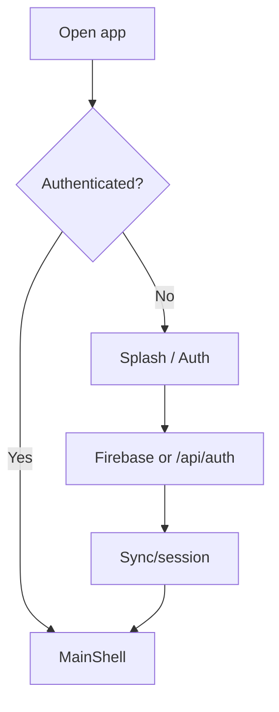
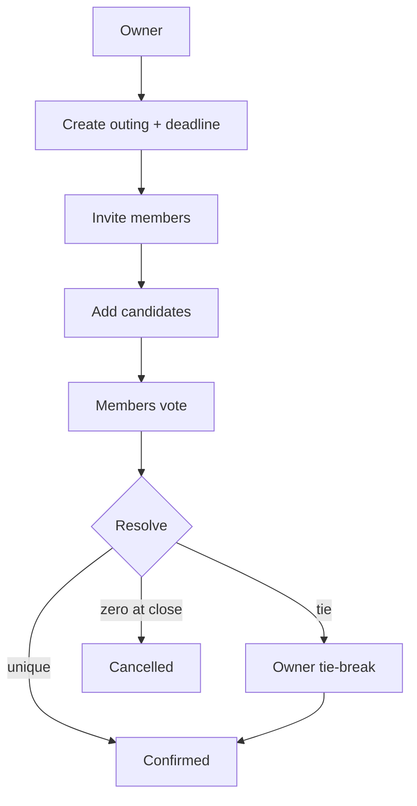
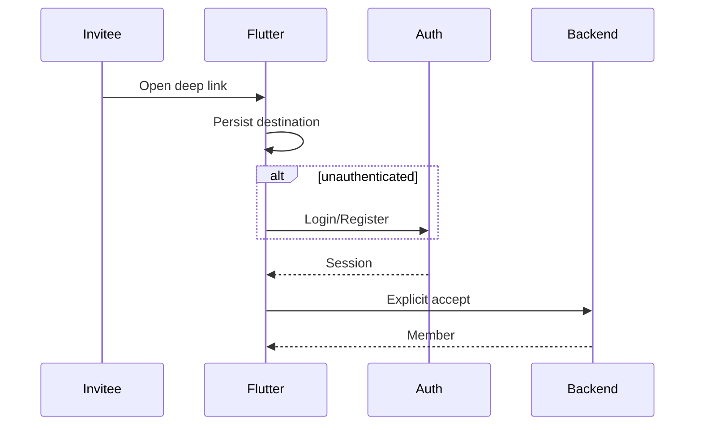

# Yalla 5roga — User Scenarios

| Metadata | Value |
|----------|-------|
| Last verified | 2026-11-07 |
| Documentation version | 1.0.0 |
| Product authority | [`PRODUCT_SCENARIOS.md`](PRODUCT_SCENARIOS.md) |
| Technical companion | [`SYSTEM_DESIGN.md`](SYSTEM_DESIGN.md) |
| Needs verification | Device E2E for journeys marked Partial / NOT RUN |

Scenarios describe **approved expected behavior**. Implementation Status reflects audit + code verification as of the metadata date.

---

## 14.1 Format

Each scenario uses: Actor, Preconditions, Starting State, User Actions, Expected Flutter / Backend / DB / Notifications, Final State, Alternatives, Failures, Authorization, Implementation Status.

---

## 14.2 Account and authentication

### AUTH-01 New registration (email/password)

- **Actor:** New user  
- **Actions:** Complete signup form → Flutter calls `POST /api/auth/signup` → `signInWithCustomToken`.  
- **Backend:** Hash password in Neon; create Firebase identity; return tokens.  
- **DB:** `users` row.  
- **Failures:** 409 email/phone taken; validation 400.  
- **Status:** Implemented  

### AUTH-02 Existing login (email/password)

- **Actions:** `POST /api/auth/login` → Firebase custom session.  
- **Status:** Implemented  

### AUTH-03 Google / Apple / phone

- **Actions:** Firebase client sign-in → `POST /api/users/sync`.  
- **Status:** Implemented (platform config dependent)  

### AUTH-04 Session restore / logout

- **Actions:** `AuthProvider.restoreSession()`; logout clears Firebase session + UI shell.  
- **Status:** Implemented  

### AUTH-05 Invalid/expired token

- **Backend:** `authMiddleware` → 401.  
- **Flutter:** Error interceptor / re-auth UX.  
- **Status:** Implemented  

### AUTH-06 Unauthenticated deep link

- **Actions:** Open invite → splash/auth → after success restore pending destination (`InviteDeepLinkProvider`).  
- **Must not:** auto-create membership before accept.  
- **Status:** Partial (group flow stronger than outing)  

---

## 14.3 Outing creation

### OUT-01 Create Group Outing

- **Preconditions:** Authenticated; group exists; user allowed.  
- **Actions:** Enter title, schedule, **voting deadline**, candidates (optional at create), submit.  
- **Backend:** `CreateOutingUseCase` — `type=group`, require deadline; owner attendance Going.  
- **DB:** `outings`, `outing_attendance`.  
- **Status:** Implemented (API/tests); Flutter must send deadline fields  

### OUT-02 Create Special Event

- Same as OUT-01 without `group_id`; occasion birthday/wedding; `type=special_event`.  
- **Status:** Implemented  

### OUT-03 Validation failures

- Missing deadline, invalid occasion/group combo, bad time window → 400.  
- **Status:** Implemented  

---

## 14.4 Invitation and membership

### INV-01 Owner invites existing user (outing)

- **API:** `POST /api/outings/:id/guests`  
- **DB:** `outing_guests` pending/accepted per use case  
- **Notify:** outing invite event  
- **Status:** Implemented API; Flutter share UX varies  

### INV-02 Group invite via WhatsApp / deep link

- **API:** `POST /api/groups/:id/invitations`  
- **Flutter:** parse link → auth if needed → claim/join flow  
- **Status:** Implemented  

### INV-03 Explicit accept outing invite

- **API:** `POST …/invitations/accept` → Member  
- **Status:** Implemented API; deep-link UI Partial  

### INV-04 Decline / invalid / duplicate

- Decline API; expired/revoked → error; duplicate accept → safe accepted state  
- **Status:** Partial verification on all edge paths  

### INV-05 Access without membership

- **Expected:** 403/404 on restricted ops; not eligible to vote  
- **Status:** Implemented backend checks  

---

## 14.5 Place voting

| ID | Scenario | Backend decision | Status |
|----|----------|------------------|--------|
| VOT-01 | Owner creates outing | draft/voting path | Implemented |
| VOT-02 | Owner adds candidates | options created; votes cleared; maybe → voting | Implemented |
| VOT-03 | Accepted members eligible | assertEligibleVoter | Implemented |
| VOT-04 | Owner can vote | eligible includes created_by | Implemented |
| VOT-05 | Member votes | upsert `outing_votes` | Implemented |
| VOT-06 | Change vote before close | update same PK row | Implemented |
| VOT-07 | Multi vote attempt | still one row | Implemented |
| VOT-08 | Pending invitee votes | 403 | Implemented |
| VOT-09 | Owner changes candidates | reset votes; keep deadline; notify | Implemented |
| VOT-10 | Vote after close | 409 Conflict | Implemented |
| VOT-11 | All eligible voted | early close + resolve | Implemented |
| VOT-12 | Deadline reached | job closes | Implemented |
| VOT-13 | Unique winner | confirmed + winner | Implemented |
| VOT-14 | Tie | lock ballots; await Owner | Implemented |
| VOT-15 | Owner tie-break | RNG tied leaders; confirm | Implemented |
| VOT-16 | Member tie-break | 403 | Implemented |
| VOT-17 | Flutter animation | display server winner only | Implemented UI; device NOT RUN |
| VOT-18 | Close with zero votes | cancel | Implemented |
| VOT-19 | Open with zero votes | stay open | Implemented |

---

## 14.6 Attendance

### ATT-01 Owner auto Going — Implemented  
### ATT-02 Member sets going/not_going/maybe — Implemented  
### ATT-03 Multiple changes — upsert — Implemented  
### ATT-04 During voting / after confirm — allowed until cancelled/past — Implemented  
### ATT-05 Must not alter votes — Implemented invariant  
### ATT-06 Owner cannot leave Going — coerced — Implemented  

---

## 14.7 Outing lifecycle

| ID | Transition / action | Allowed | Status |
|----|---------------------|---------|--------|
| LIFE-01 | draft → voting | Yes via options | Implemented |
| LIFE-02 | voting → confirmed | Winner paths | Implemented |
| LIFE-03 | voting → cancelled | Zero votes / owner cancel | Implemented |
| LIFE-04 | Early / deadline close | Server | Implemented |
| LIFE-05 | Owner cancel | Yes | Implemented |
| LIFE-06 | Member cancel | No | Implemented |
| LIFE-07 | Owner edit before confirm | Yes (rules) | Implemented |
| LIFE-08 | Owner edit confirmed place | No | Implemented lock |
| LIFE-09 | Member edit outing | No | Implemented |
| LIFE-10 | confirmed → past | Job | Implemented |

---

## 14.8 Outing chat

### CHAT-01 Open chat as member — list messages — Implemented  
### CHAT-02 Send message — `POST …/messages` — Implemented  
### CHAT-03 Ordering by `sent_at` — Implemented  
### CHAT-04 Mark read — `PATCH …/read` — Implemented  
### CHAT-05 Offline failure — Flutter error state — Requires Verification  
### CHAT-06 Unauthorized / cancelled — 403 — Implemented  
### CHAT-07 Realtime WebSocket — **Not Implemented** (HTTP only)  
### CHAT-08 New message push — fan-out path Implemented; device delivery NOT RUN  

---

## 14.9 Saved outings and places

### SAVE-01/02 Save/unsave outing — Neon APIs — Implemented (Flutter remote wired)  
### SAVE-03 View saved outings — Implemented  
### SAVE-04/05 Save/unsave place — APIs Implemented; UI Partial  
### SAVE-06 Duplicate save — PK prevents duplicates — Implemented  
### SAVE-07 Survive re-login — Neon — Implemented when using API (not prefs-only)  

---

## 14.10 Discover and suggestions

### DIS-01 Browse places — `GET /api/places` — Implemented  
### DIS-02 Search/filter vibe — query params — Implemented/Partial UX  
### DIS-03 Place details — Implemented  
### DIS-04 Nearby backend — API exists; Flutter may use Nominatim for picker — Partial coupling  
### DIS-05 Empty results / location denied — UI empty/error — Requires Verification  
### DIS-06 Add discovered place to outing — via owner candidate flows — Partial UX  

---

## 14.11 Notification scenarios

| ID | Event | Trigger | Recipients (typical) | Status |
|----|-------|---------|----------------------|--------|
| NOT-01 | Invitation | invite APIs | invitee | Implemented path |
| NOT-02 | Member joins / accept | accept | owner/participants policy | Partial |
| NOT-03 | Candidates changed | option mutate | participants excl actor | Implemented |
| NOT-04 | Voting closed / winner / tie / cancel | resolution | participants | Implemented path |
| NOT-05 | Attendance changed | upsert | owner | Implemented |
| NOT-06 | Chat message | send | participants | Implemented path |
| NOT-07 | FCM foreground/background/tap | client handlers | device | Partial / NOT RUN E2E |

Failure: outbox retry → dead; invalid tokens deleted.

---

## 14.12 User journey diagrams

Additional journey diagrams for vote change, candidate reset, attendance, chat, saves, discover mirror §14.5–14.10 (user action → API → DB). Backend validation always gates success.

---

## 14.13 Coverage matrix

| Scenario ID | Feature | User Action | Backend Endpoint | Database Entities | Expected Result | Implementation Status |
|-------------|---------|-------------|------------------|-------------------|-----------------|----------------------|
| AUTH-01 | Auth | Signup | `POST /api/auth/signup` | users | Session | Implemented |
| AUTH-02 | Auth | Login | `POST /api/auth/login` | users | Session | Implemented |
| AUTH-03 | Auth | Social/OTP | `POST /api/users/sync` | users | Upsert | Implemented |
| AUTH-06 | Invites | Open link unauth | deep link + auth | — | Restore then accept | Partial |
| OUT-01 | Outings | Create group | `POST /api/outings` | outings, outing_attendance | Owner Going | Implemented |
| OUT-02 | Outings | Create special | `POST /api/outings` | outings, outing_attendance | Created | Implemented |
| INV-02 | Groups | Phone invite | `POST /api/groups/:id/invitations` | group_invitations | Pending invite | Implemented |
| INV-03 | Outings | Accept invite | `POST /api/outings/:id/invitations/accept` | outing_guests | Member | Partial UI |
| VOT-05 | Voting | Cast vote | `POST /api/outings/:id/votes` | outing_votes | Upsert | Implemented |
| VOT-09 | Voting | Replace options | `PUT /api/outings/:id/vote-options` | options, votes | Reset votes | Implemented |
| VOT-11 | Voting | All voted | (server) | outings | Close early | Implemented |
| VOT-12 | Voting | Deadline | job | outings | Close | Implemented |
| VOT-15 | Voting | Tie-break | `POST /api/outings/:id/tie-break` | outings | Confirmed | Implemented |
| VOT-18 | Voting | Zero close | resolution | outings | Cancelled | Implemented |
| ATT-02 | Attendance | Set status | `PUT /api/outings/:id/attendance` | outing_attendance | Updated | Implemented |
| LIFE-05 | Lifecycle | Cancel | `POST /api/outings/:id/cancel` | outings | Cancelled | Implemented |
| CHAT-02 | Chat | Send | `POST /api/chat/outings/:id/messages` | chat_messages | Stored | Implemented |
| SAVE-01 | Saved | Save outing | `POST /api/outings/:id/save` | saved_outings | Row | Implemented |
| SAVE-04 | Saved | Save place | `POST /api/places/:id/save` | saved_places | Row | Partial UI |
| DIS-01 | Discover | Browse | `GET /api/places` | places | List | Implemented |
| NOT-03 | Notify | Options changed | outbox | notifications, notification_events | Fan-out | Implemented path |
| NOT-07 | Notify | Receive push | FCM worker | user_fcm_tokens | Device alert | NOT RUN |

---

## 14.14 Consistency

Keep this file aligned with BUSINESS_LOGIC, SYSTEM_DESIGN, SYSTEM_ARCHITECTURE, API_CONTRACTS, DATABASE_ARCHITECTURE, AUTH, NOTIFICATIONS whenever journeys or rules change in the same task.
