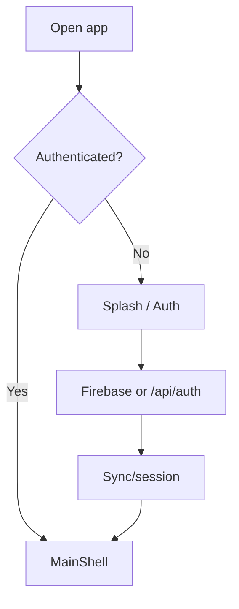
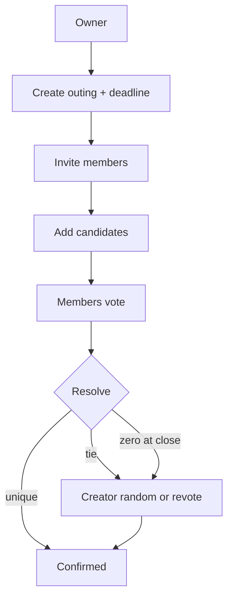
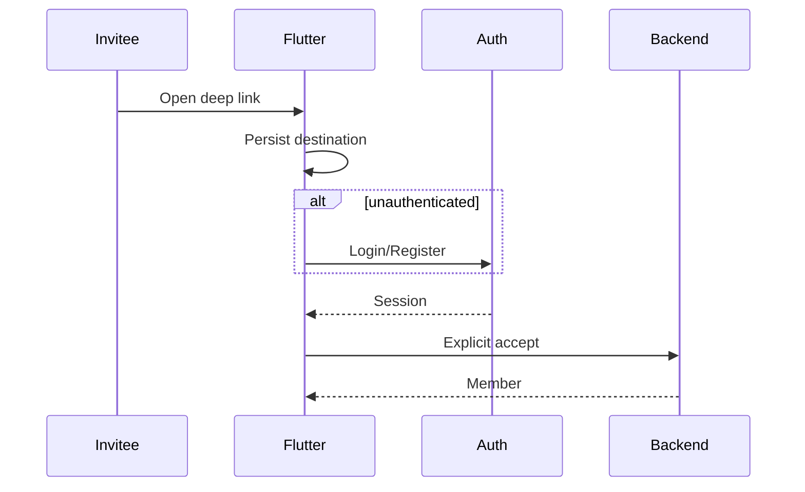
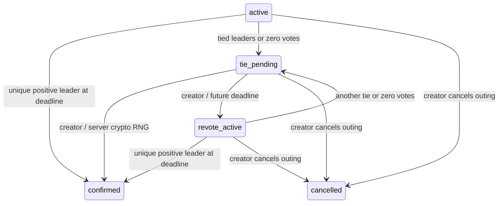

# Yalla 5roga — User Scenarios

In Settings → Edit Profile → Delete account, a signed-in user confirms permanent removal. The app signs out once deletion is accepted. The backend cancels that user's active outings, transfers shared group ownership, and retains shared history with redacted attribution. [Account deletion behavior](SYSTEM_DESIGN.md#coordinated-account-deletion)

| Metadata | Value |
|----------|-------|
| Last verified | 2026-11-08 (AUTH-07 settings profile / password) |
| Documentation version | 1.0.0 |
| Product authority | [`PRODUCT_SCENARIOS.md`](PRODUCT_SCENARIOS.md) |
| Technical companion | [`SYSTEM_DESIGN.md`](SYSTEM_DESIGN.md) |
| Needs verification | Device E2E for journeys marked Partial / NOT RUN |

Scenarios describe **approved expected behavior**. Implementation Status reflects audit + code verification as of the metadata date.

---

## 14.1 Format

Each scenario uses: Actor, Preconditions, Starting State, User Actions, Expected Flutter / Backend / DB / Notifications, Final State, Alternatives, Failures, Authorization, Implementation Status.

---

## 14.2 Account and authentication

### AUTH-01 New registration (phone/password with OTP)

- Enter name, phone and password, then verify the phone with Firebase OTP.
- Flutter sends the Firebase phone ID token to `POST /api/auth/signup`. The backend validates the proof, provisions the Neon profile with the same UID, claims matching invitations and returns a Firebase session.
- Invalid proof returns 401. An already-bound phone or UID returns 409.

### AUTH-02 Existing login (phone/password)

- Submit the phone and password to `POST /api/auth/login`. The backend verifies the Neon hash and returns a Firebase session without an OTP prompt.

### AUTH-03 Verify a phone change

- From the authenticated settings flow, complete Firebase phone verification and sync the verified number under the existing UID. A successful sync refreshes claimed group memberships.

### AUTH-04 Session restore / logout

- **Actions:** `AuthProvider.restoreSession()`; logout clears the Firebase session and account-scoped UI state, then opens the original login form as the only route.
- **Status:** Implemented  

### AUTH-05 Invalid/expired token

- **Backend:** `authMiddleware` → 401.  
- **Flutter:** Error interceptor / re-auth UX.  
- **Status:** Implemented  

### AUTH-06 Unauthenticated deep link

- **Actions:** Open invite → splash/auth → after success restore pending destination (`InviteDeepLinkProvider`).  
- **Must not:** auto-create membership before accept.  
- **Status:** Partial (group flow stronger than outing)  

### AUTH-07 Settings profile / change password

- **Actions:** Settings shows the Neon member-since date and phone verification status. Tap Verify phone on an unverified number to send and enter an SMS code in a bottom sheet. Edit Profile shows name and phone as text buttons that open bottom sheets. Save name/photo changes after password confirmation for password accounts. Edit password opens its own page with current password, new password and confirmation. Successful saves show a checkmark dialog.
- **Backend:** `GET /api/users/cuser`; `POST /api/auth/change-password` / `verify-password`.  
- **Status:** Implemented  

### MEDIA-01 Upload and display images (profile, group, outing)

- **Preconditions:** Authenticated; camera/gallery permission when taking or choosing a photo.
- **Actions:** Pick a local image in Edit Profile, Create Group, or Group cover change. The app uploads it directly to storage, then saves the returned `media://` reference with the profile/group/outing. Images render from the persistent cache; previously viewed images remain visible offline.
- **Backend:** `POST /api/media/upload-url` → direct storage `PUT` → `POST /api/media/:id/confirm`; display via `POST /api/media/signed-urls` or `GET /api/media/:id/url`. Local paths and unsupported/oversized files are rejected.
- **DB:** `media_assets` metadata only; entity `image_url` keeps the stable reference.
- **Flutter:** `MediaUploadService`, `MediaUrlResolver`, `AppNetworkImage`; cache keys are stable per asset and account-scoped for private media. Logout/account switch clears private URL metadata and cached images. Missing media falls back to the existing default avatar/cover.
- **Status:** Implemented (mock storage locally; real R2/CDN activation pending credentials)

---

## 14.3 Outing creation

### OUT-01 Create Group Outing

- **Preconditions:** Authenticated; group exists; user allowed.  
- **Actions:** Use Location to add one fixed venue or up to five voting candidates. In Details, review the photos and enter the title, group and schedule. Choose a deadline for a vote with two or more venues, then create the outing or save the draft.
- **Backend:** `CreateOutingUseCase` — `type=group`, require deadline; owner attendance Going; `image_url` optional http(s) or `media://<uuid>`; vote options posted when multi-place.
- **DB:** `outings`, `outing_attendance`, optional `outing_vote_options`.  
- **Flutter:** Shared `CreateOutingPage` for create and suggest. Multi-place creation sends the selected duration and an absolute deadline calculated immediately before POST. Fixed-location creation sends the deadline metadata required by the current API, using the shortest supported group duration and the existing three-hour special-event default. The form uses the selected venue image URL or `media://` reference when available.
- **Status:** Implemented (API/tests); Flutter sends deadline fields  

**Create Outing UI:** Location embeds the shared MapLibre view. Details shows the selected venue image or a swipeable gallery with one page per candidate. Missing photos use the existing cover artwork, including the occasion fallbacks.

### OUT-01b Suggest / multi-place vote (same page)

- **Actions:** Add 2–5 catalog places or custom map pins in Location. Place previews let users add, remove and reorder candidates. Opening Location from Details preserves the selection, search, map camera and entered values.
- **Status:** Implemented (merged into create outing; no separate suggest sheet)  

### OUT-02 Create Special Event

- The Special Event entry reuses Location and Details. Choose one fixed venue, then set the occasion, optional group, title, future schedule and guests in Details. Selected groups require accepted creator membership; independent events keep the existing guest invitation flow. `type=special_event` for every occasion, with or without a group.
- **Status:** Implemented  

### OUT-03 Validation failures

- Missing deadline, invalid occasion/group combo, bad time window → 400.  
- **Status:** Implemented  

---

## 14.4 Invitation and membership

Group Details puts the group name, role, and Create outing action together. Group Outings links to individual outing details. The **Active Votes** section appears on the Outings tab. Start a new place vote in the Location step of Create Outing.

The Groups tab keeps search and the selected sort when switching tabs. Search matches names and descriptions. The default order follows the account's group list, Most active uses the available outing totals, and Recently created uses the stored creation dates.

### GRP-01 Create group — creator is first member

- **API:** `POST /api/groups` → creator row in `group_members` with `role=owner`; response `member_count` starts at **1**
- **Flutter:** The group form includes its optional cover picker, with group artwork as the placeholder. A picked cover is uploaded before create and sent as a `media://` reference. After create, members are reloaded; Group Info / Details call `ensureGroupLoaded` so the creator card appears in the members list
- **Status:** Implemented

### GRP-02 Edit group bio

The group owner can open Group Info and use **Edit bio** in the About card. Save replaces the description, and saving an empty field clears it. Members can read the bio. The description has a 160-character limit.

### INV-01 Owner invites existing user (outing)

- **API:** `POST /api/outings/:id/guests`  
- **DB:** `outing_guests` pending/accepted per use case  
- **Notify:** outing invite event  
- **Status:** Implemented API; Flutter share UX varies  

### INV-02 Add a group member by phone

- **Groups tab:** Tap **Start a new circle**, then choose a group you belong to. The app opens the same phone and contacts invitation sheet used by Group Info, with the same WhatsApp consent requirement.

- **Required consent:** Create Group and Group Info → Add people each require one unchecked-by-default checkbox confirming recipients agreed to WhatsApp invitations if they do not already use the app. Submission is disabled until checked; editing recipient numbers, calling code or contact selections clears it. The explicit value reaches the invitation API; no lookup infers consent. Existing verified users receive pending in-app invitations, while consented non-users can receive WhatsApp invitations when the sender is configured.

- **Group phone entry (2026-11-14):** Create Group and Group Info → Add people show a country calling-code selector beside the national number, initially Egypt (`+20`). Manual numbers are normalized with the selected code; pasted `+`/`00` international numbers retain their explicit prefix. Arabic-Indic input is accepted. Group Info also opens the same multi-select device contacts page as Create Group, retains selected phones for review/removal, and submits deduplicated invitations through the existing provider. Changing recipients or the manual calling code clears WhatsApp consent so it can be reconfirmed. The add-people sheet scrolls above the keyboard.

- **API:** `POST /api/groups/:id/invitations` adds by phone. A group owner can revoke a still-pending association with `DELETE /api/groups/:id/pending-memberships/:invitationId`.
- **Flutter:** Create-group member picker loads device contacts (`PickDeviceContactsPage` + `READ_CONTACTS`); manual phone still supported. Create/add flows use the invitation endpoint. The inline checkbox records recipient agreement. The backend queues the consented message when configured; after invitee installs + verifies that phone, `POST /api/users/sync` links pending `group_invitations` to the verified account without membership. Group cover `image_url` is optional.
- **Special events:** Choose device contacts in the guest picker. Confirm recipient opt-in before creating the event. Phone guests receive the title, time, venue, Google Calendar link and optional app link. When automatic delivery is unavailable, send the prefilled invitations from the new outing’s details. Phone invitees do not become app members.
- **Status:** Implemented  

Inviting a registered or unregistered phone creates a pending invitation. Verified signup/login/sync links identity only. The invitee opens Invitations and explicitly accepts or declines. Acceptance creates membership and refreshes groups; decline preserves history without membership. Before identity linking, pending unlinked rows are discoverable through the current Firebase-verified phone. Group Info shows “Pending invitation” in the full member sheet and permits owner revocation there. The avatar preview shows accepted members.

### INV-03 Explicit accept outing invite

- **API:** `POST …/invitations/accept` → Member  
- **Status:** Implemented API; deep-link UI Partial  

### INV-04 Decline / invalid / duplicate

- Decline API; expired/revoked → error; duplicate accept → safe accepted state  
- **Status:** Partial verification on all edge paths  

### INV-05 Access without membership

- **Expected:** 403/404 on restricted ops; not eligible to vote  
- **Status:** Implemented backend checks  

---

## 14.5 Place voting

| ID | Scenario | Backend decision | Status |
|----|----------|------------------|--------|
| VOT-01 | Owner creates outing | draft/voting path | Implemented |
| VOT-02 | Owner adds candidates | options created; votes cleared; maybe → voting | Implemented |
| VOT-03 | Accepted members eligible | assertEligibleVoter | Implemented |
| VOT-04 | Owner can vote | eligible includes created_by | Implemented |
| VOT-05 | Member votes | upsert `outing_votes` | Implemented |
| VOT-06 | Change selection before close | atomically replace caller ballot | Implemented |
| VOT-07 | Select several locations | one row per distinct caller/outing/option; count distinct voters for closure | Implemented |
| VOT-08 | Pending invitee votes | 403 | Implemented |
| VOT-09 | Owner changes candidates | reset votes; keep deadline; notify | Implemented |
| VOT-10 | Vote after close | 409 Conflict | Implemented |
| VOT-11 | All eligible voted | remain open until deadline | Implemented |
| VOT-12 | Deadline reached | job closes | Implemented |
| VOT-13 | Unique winner | confirmed + winner | Implemented |
| VOT-14 | Tie | lock ballots; await Owner | Implemented |
| VOT-15 | Owner tie-break | RNG tied leaders; confirm | Implemented |
| VOT-16 | Member tie-break | 403 | Implemented |
| VOT-17 | Flutter animation | display server winner only | Implemented UI; device NOT RUN |
| VOT-18 | Close with zero votes | tie_pending; all candidates eligible | Implemented |
| VOT-19 | Open with zero votes | stay open | Implemented |

---

## 14.6 Attendance

### ATT-01 Owner auto Going — Implemented  
### ATT-02 Member sets going/not_going/maybe — Implemented  
### ATT-03 Multiple changes — upsert — Implemented  
### ATT-04 During voting / after confirm — allowed until cancelled/past — Implemented

### ATT-05 Who’s arrived — Enable automatic check-in on the outing and grant foreground location. The list opens at the scheduled start. A participant is added when their device reports a sufficiently accurate position within the configured radius (100 m by default) while the app is open. RSVP stays separate.
### ATT-05 Must not alter votes — Implemented invariant
### ATT-06 Owner cannot leave Going — coerced — Implemented  

---

## 14.7 Outing lifecycle

| ID | Transition / action | Allowed | Status |
|----|---------------------|---------|--------|
| LIFE-01 | draft → voting | Yes via options | Implemented |
| LIFE-02 | voting → confirmed | Winner paths | Implemented |
| LIFE-03 | voting → cancelled | Creator cancellation | Implemented |
| LIFE-04 | Early / deadline close | Server | Implemented |
| LIFE-05 | Owner cancel | Yes | Implemented |
| LIFE-06 | Member cancel | No | Implemented |
| LIFE-07 | Owner edit before confirm | Yes (rules) | Implemented |
| LIFE-08 | Owner edit confirmed place | No | Implemented lock |
| LIFE-09 | Member edit outing | No | Implemented |
| LIFE-10 | confirmed → past | Job | Implemented |

**Outing history:** At the scheduled start date and time, an outing leaves the Outings tab and appears in **Outing history**, accessible from Outings and Settings, alongside completed and cancelled outings. Outings earlier today are included. Open an outing from history to view its details or check in if eligible. The Outings tab shows Active Votes and plans whose scheduled start has yet to arrive, plus unscheduled plans. Settings keeps profile editing available through the profile avatar.

---

## 14.8 Outing chat

### CHAT-01 Open chat as member — list messages — Implemented  
### CHAT-02 Send message — `POST …/messages` — Implemented  
### CHAT-03 Ordering by `sent_at` — Implemented  
### CHAT-04 Mark read — `PATCH …/read` — Implemented  
### CHAT-05 Offline history and queued sends — Implemented; automated cache/queue tests, device verification pending

Previously loaded chat remains visible offline. Sending shows pending after durable local save; foreground reconnection retries the same UUID. Closed-chat or membership rejection produces a failed message. Canonical REST/socket delivery replaces the pending item without duplicates. Availability is bounded by cache retention.
### CHAT-06 Unauthorized participant — 403; cancelled/past/two-hour-closed mutation — 409 — Implemented
### CHAT-07 Realtime Socket.IO — Implemented (REST write + socket delivery; probe verified)  
### CHAT-08 New message push — fan-out path Implemented; device delivery NOT RUN  

### SYNC-01 Cached startup and automatic refresh

With a matching Firebase session, cached profile, groups/outings, previously opened members and outing vote/detail state are available locally. Background synchronization remains silent; chat shows a local room-aware connection indicator and pending/failed sends. Invitations/linking, membership, outings, votes and messages update affected Providers. Resume and reconnect repair missed events through REST lists and open details/chats. Other writes require online success. Logout clears retained data and pending sends for the previous account. See the offline audit for startup timing and validation limits.

---

## 14.9 Saved outings and places

### SAVE-01/02 Save/unsave outing — Neon APIs — Implemented (Flutter remote wired)  
### SAVE-03 View saved outings — Implemented  
### SAVE-04/05 Save/unsave place — Implemented
### SAVE-06 Duplicate save — PK prevents duplicates — Implemented  
### SAVE-07 Survive re-login — Neon — Implemented when using API (not prefs-only)  

---

## 14.10 Discover and suggestions

### DIS-01 Browse places — `GET /api/places` — Implemented  
### DIS-02 Filter by vibe — shared Create Outing chips filter map pins and the accompanying list — Implemented
### DIS-03 Place details — Implemented  
### DIS-04 Find nearby places — Open **Discover** from bottom navigation. With foreground location already granted, the app loads nearby catalog pins. **Find places near me** requests location access or refreshes the search. The map and horizontal nearby carousel share loaded viewport pages, ordered by distance when location is available; more pages load near the carousel end. General catalog browsing is available before a successful location search. — Implemented
### DIS-05 Empty results / location denied — UI empty/error — Requires Verification  
### DIS-06 Plan at a discovered place — tap a map pin to show its preview, then choose **Create outing at …** to open Create Outing with that place preselected. Debounced bilingual database search filters pins and cards, with floating matching results; selecting a result focuses its pin and card. The place details page also links to Create Outing. — Implemented

---

## 14.11 Notification scenarios

| ID | Event | Trigger | Recipients (typical) | Status |
|----|-------|---------|----------------------|--------|
| NOT-01 | Invitation | invite APIs | invitee | Implemented path |
| NOT-02 | Member joins / accept | accept | owner/participants policy | Partial |
| NOT-03 | Candidates changed | option mutate | participants excl actor | Implemented |
| NOT-04 | Voting closed / winner / tie / cancel | resolution | participants | Implemented path |
| NOT-05 | Attendance changed | upsert | owner | Implemented |
| NOT-06 | Chat message | send | participants | Implemented path |
| NOT-07 | Open a push or inbox item | foreground, background, cold start, inbox | recipient | Destination routing implemented. Full live device matrix not verified. |

Tapping a notification opens its Group Details, Invitations, outing, regular outing chat, or relevant place voting/attendance section after sign-in. The item is marked read. Back returns to the preceding page. If the destination was deleted or access changed, the app explains the issue on the current page. See [the destination and producer matrix](NOTIFICATIONS.md#push-and-inbox-destinations).

Failure: outbox retry → dead; invalid tokens deleted.

---

## 14.12 User journey diagrams

Additional journey diagrams for vote change, candidate reset, attendance, chat, saves, discover mirror §14.5–14.10 (user action → API → DB). Backend validation always gates success.

---

## 14.13 Coverage matrix

| Scenario ID | Feature | User Action | Backend Endpoint | Database Entities | Expected Result | Implementation Status |
|-------------|---------|-------------|------------------|-------------------|-----------------|----------------------|
| AUTH-01 | Auth | Signup | `POST /api/auth/signup` | users | Session | Implemented |
| AUTH-02 | Auth | Login | `POST /api/auth/login` | users | Session | Implemented |
| AUTH-03 | Auth | Verified phone change | `POST /api/users/sync` | users, group_invitations, group_members | Same UID and verified phone | Implemented |
| AUTH-06 | Invites | Open link unauth | deep link + auth | — | Restore then accept | Partial |
| AUTH-07 | Settings | Profile / password | `GET /api/users/cuser`, `POST /api/auth/change-password` | users | Profile UI | Implemented |
| OUT-01 | Outings | Create group | `POST /api/outings` | outings, outing_attendance | Owner Going | Implemented |
| OUT-02 | Outings | Create special | `POST /api/outings` | outings, outing_attendance | Created | Implemented |
| GRP-01 | Groups | Create group | `POST /api/groups` | groups, group_members | Creator owner; count 1 | Implemented |
| INV-02 | Groups | Add by phone | `POST /api/groups/:id/invitations` | group_invitations, group_members | Pending invitation; verified identity linking; explicit acceptance creates membership | Implemented |
| INV-03 | Outings | Accept invite | `POST /api/outings/:id/invitations/accept` | outing_guests | Member | Partial UI |
| VOT-05 | Voting | Cast vote | `POST /api/outings/:id/votes` | outing_votes | Upsert | Implemented |
| VOT-09 | Voting | Replace options | `PUT /api/outings/:id/vote-options` | options, votes | Reset votes | Implemented |
| VOT-11 | Voting | All voted | (server) | outings | Wait until deadline | Implemented |
| VOT-12 | Voting | Deadline | job | outings | Close | Implemented |
| VOT-15 | Voting | Tie-break | `POST /api/outings/:id/tie-break` | outings | Confirmed | Implemented |
| VOT-18 | Voting | Zero close | resolution | outings | Creator intervention | Implemented |
| ATT-02 | Attendance | Set status | `PUT /api/outings/:id/attendance` | outing_attendance | Updated | Implemented |
| LIFE-11 | Lifecycle | Creator confirms permanent delete | `DELETE /api/outings/:id` | outings and dependents | Removed from outing lists and Saved | Implemented |
| LIFE-05 | Lifecycle | Cancel | `POST /api/outings/:id/cancel` | outings | Cancelled | Implemented |
| CHAT-02 | Chat | Send | `POST /api/outings/:outingId/messages` | chat_messages | Stored | Implemented |
| SAVE-01 | Saved | Save outing | `POST /api/outings/:id/save` | saved_outings | Row | Implemented |
| SAVE-04 | Saved | Save place | `POST /api/places/:id/save` | saved_places | Row and saved Places filter | Implemented |
| DIS-01 | Discover | Browse | `GET /api/places` | places | List | Implemented |
| NOT-03 | Notify | Options changed | outbox | notifications, notification_events | Fan-out | Implemented path |
| NOT-07 | Notify | Receive push | FCM worker | user_fcm_tokens | Device alert | NOT RUN |

---

## 14.14 Consistency

Keep this file aligned with BUSINESS_LOGIC, SYSTEM_DESIGN, SYSTEM_ARCHITECTURE, API_CONTRACTS, DATABASE_ARCHITECTURE, AUTH, NOTIFICATIONS whenever journeys or rules change in the same task.

### Home entry journey

After shell data loads, Home presents the earliest future dated outing that is neither past nor cancelled, with a link to the outings tab. Undated outings remain available in the full list. The planning banner and New outing tile open outing creation. New group and Special event open their existing flows. The profile avatar opens Edit profile and the bell opens Notifications. The Discover preview offers bookmarks and opens place details. Its See all action opens the Discover tab. The bottom bar floats over content on an outlined theme surface, with a violet capsule that marks the current tab. Existing Socket.IO invalidations and resume/reconnect synchronization update the dashboard automatically; an initial failure offers retry. The Home status does not infer outstanding attendance or voting actions from partially hydrated data. See `audit/UI_UX_AUDIT_AND_HOME_REDESIGN.md` for validation limits.

### Group outing feature updates

Group Details separates active votes from upcoming outings, including overlapping plans; Group Info links to group-specific history. Opening an outing shows the current RSVP and three counts. The selection updates immediately and reverts if the save fails. Place choices, counts and the member’s selection are independent of RSVP. The outing creator can choose and confirm a proposed venue while voting is still unresolved.

Actual Attendance shows Arrived and Not yet verified for current participants. Opening an eligible outing before its scheduled start shows the waiting message without arrival requests or GPS checks. At the scheduled start, eligible foreground verification begins automatically when permitted. Location unavailable appears on the affected device. The roster updates when connected participants arrive. Chat displays each sender’s name and appends the localized “You” marker to the signed-in sender. Older history loads on request.

## CHAT-09 Mentions and connection status — 2026-11-11

Typing `@` opens the existing searchable member picker, including multiword names. Selection inserts a name in the composer and records its stable ID/range. Editing the token drops its mention identity. Sending stores canonical stable-ID mention tokens; history, pagination, socket delivery, and queued offline sends use the same text. Bubbles highlight mentions and identify each sender group, including “Name (You)”, while adjacent messages from that sender remain grouped. Mention notifications open the regular outing chat without a separate notification message card and never notify the sender or duplicate per recipient.

Only the chat screen displays connection status, derived from network/Socket.IO state and an acknowledged room join. Background domain refresh is automatic and silent; cache content survives outages. Cached shell startup precedes one-time account synchronization and online group revalidation. Runtime English/Arabic, light/dark, narrow/wide, Socket.IO delivery, offline recovery, and push navigation remain unverified here because Flutter launch/UI/widget/integration testing was prohibited.

Authentication request failures use localized snackbar feedback, and submission loading is cleared after the request completes or times out so the user can retry.

## Realtime synchronization behavior — 2026-11-11

While signed in, group and outing changes from another session update the existing Provider-backed screens without a page reload. Complete chat and attendance rows apply directly; voting and other incomplete outing changes reload just the affected outing. A newly created outing/group can enter the current lists through a targeted read. Membership changes revalidate access-dependent lists and active chat history. Offline snapshots remain visible, and reconnect/resume repairs missed changes. This changes synchronization only; membership, place voting, RSVP and verified arrival remain distinct product workflows. Device checks and server restart/delivery guarantees are listed in [the verification report](audit/CENTRALIZED_REALTIME_SYNC.md).

### AUTH-08 Forgot password — 2026-11-11

Login → Forgot Password → registered phone → Send code → enter Firebase SMS OTP → enter and confirm new password → Reset password → Login with that phone/new password. A dedicated route-local ChangeNotifier owns progress and loading; it does not authenticate the app. English and Arabic use the existing shared phone/OTP/password controls, theme and responsive content width. Snackbars explain unavailable accounts, OTP errors/expiry, rate limits, validation, network failures and timeouts. Resend waits at least 60 seconds; users can restart with another number. A timed-out reset may have succeeded: try Login before restarting recovery.

Backend proof binds the phone to its existing UID; no new profile is synced. Password/reset-authorization writes are atomic. Data and existing sessions remain intact. Unknown or unbound legacy numbers fail safely rather than merge accounts. API success, rejection, expiry, replay, limits and concurrency were exercised with an isolated Neon schema and controlled Firebase boundary; real SMS, Flutter visual/interaction, emulator and device tests were not run per scope. See [verification report](audit/PASSWORD_RECOVERY_REPORT.md).

### AUTH-08 recovery and feedback follow-up — 2026-11-11

Recovery reuses signup’s six-digit OTP widget and submits the completed code automatically. Failed resends retain the previous verification screen and proof pair. Firebase owns SMS sending and verification; the backend account preflight now has its required deployed tables. Shared snackbars include the app logo and concise localized feedback, including map errors with settings actions. Focused Flutter tests cover delayed callbacks, invocation errors, late callbacks after timeout, failed resend preservation and snackbar locale/size/theme handling. Physical-device SMS and visual checks are left to the owner.

## Confirmed integration journeys — 2026-11-13

- Outing Details shows creators Edit and Cancel for open outings. Edit pre-fills title, cover, schedule and draft venue using existing controls/map picker; confirmed/voting venues are not exposed for editing. Save uses PATCH and merges refreshed outing state. Cancel requires confirmation, calls POST cancel, refreshes details and moves the outing to history. Backend permissions remain authoritative.
- The creator manages invited participants in Outing Details. Removal requires confirmation and reloads the guest list. These are outing invitations, independent of group invitations. A pending outing invitee sees explicit Accept/Decline controls in Details; neither opening a page nor a deep link accepts it.
- Group Info presents Leave Group for members who may leave and a distinct Delete group action for a sole owner. The last owner of a group with other members sees an explanation. After confirmation, the client rechecks the roster and sends the confirmed action through the existing self-member or group deletion API. The backend rechecks membership and ownership. Other active members or any outings prevent deletion (409). Success removes the cached group, reconciles the lists and returns to Groups.
- Save Draft writes to the existing local cache first. Online recovery creates/updates the backend draft and updates the cache; offline changes remain pending after restart. Reconnect/resume performs serialized sync without polling. A stable UUID prevents response-loss duplicate creates; a changed server version preserves the pending copy and displays a conflict notice. Local phone-contact selections are retained on this device because the existing draft schema has no guest-phone column; see the implementation report's limitations.
- The inbox retains its existing full-feed presentation while fetching bounded pages. Pending group invitation count excludes accepted/declined history returned by the API.

Source wiring and static checks are complete for these additions. Phone/wide/foldable, English/Arabic, light/dark, offline-device and interactive UI behavior were **NOT EXERCISED**: the owner prohibited Flutter tests and app launches. Authenticated API business scenarios remain **NOT VERIFIED** without supplied test identities.

## Foundation/navigation presentation — 2026-11-13

The existing five destinations remain Home, Groups, Outings, Discover and Settings. Their tab indexes, callbacks, routes and invitation deep-link handlers are unchanged. The floating bar follows Arabic RTL or English LTR, retains previously visited tab content and exposes only the selected tab to focus/accessibility. The active violet pill and brief directional nudge respect reduced-motion settings. First install defaults to Arabic, while a saved English preference remains English. Groups reuses shared search/header widgets with the same search open/close/filter behavior. Invitation cards reuse core presentation while existing accept, decline, confirmation and navigation handlers remain in the feature. No business rule or feature workflow changed. Visual/device coverage for these presentation states is NOT RUN by owner instruction.

## Phase 2 dashboard and groups — 2026-11-13

- Home retains the time-based greeting, profile avatar/name and unread notification bell. Its nearest future dated outing uses a full-cover feature card with a bottom readability scrim, title, optional group, localized schedule and a directional end-aligned Next Up badge; lifecycle status remains exposed to accessibility. The cover uses existing uploaded artwork or the bundled occasion fallback. Pink, blue and violet icon tiles open New Outing, New Group and Special Event in that order, adapting their colors to light/dark themes. Tiles stack for enlarged text or very narrow layouts. Home shows saved content with a local offline indicator and offers retry for initial failures.
- Home shows up to eight cached backend recommendations. If a foreground location is available, Home can switch to its nearby sample while keeping the general recommendations as a fallback. See All opens Discover. Startup requests notifications before foreground location and denial leaves general browsing available.
- Groups searches names and offers All, Most active (outing-count order), and Created by me filters. GroupCard shows the bio, member count and outing activity. The existing Provider/Socket.IO path updates lists without manual refresh.
- Create Group composes cover/name/bio and invitee widgets using shared controls. Camera/gallery, device contacts, international/manual phone entry and removable chips remain available. A typed phone is validated/added before submission. Submission locks the form; failed group creation retains selections. The existing create/invite APIs remain authoritative: only the creator is a member initially; invited phones remain pending until explicit acceptance.
- Group Details shows the group photo or illustration, name, role, counts, Create an outing, and group-scoped voting and upcoming previews. The app bar menu opens Group Info. Active votes has a contextual empty card. Upcoming appears when the group has upcoming outings. See all opens the matching group list when there are additional results. Completed and cancelled outings appear in group-specific history under the existing lifecycle rules.
- Group Info shows the compact hero followed by About, Members, History and Group actions. Owners can edit the name, cover and bio and manage the roster through the existing controls. Accepted members can invite through Add people and open group-specific invitation and outing history. The roster sheet keeps role and invitation status badges and existing removal and revocation controls.
- Invitations remains accessible from Settings, group-invitation notifications and invite deep links. It displays All/Pending/Accepted/Declined filters, group artwork/name, inviter and localized invitation date. Only pending records have Accept/Decline actions. Successful decisions remain in history; decline stays on the page, and accept opens Group Details using the existing concrete page route. Loading/error/empty states use shared widgets. Account/load generations prevent realtime reads from cancelling decisions or leaving mutation loading stuck.

Static verification and runtime limits are recorded in [the Phase 2 report](audit/PHASE_2_UI_UX.md). No Flutter/device/emulator/UI tests or app launch were performed. The reported grey-screen symptom has not been reproduced or visually signed off.

## Phase 3 outing journeys — 2026-11-14

- **Outings:** Create an outing and Outing history link to the existing destinations. Each populated section shows up to two cards and a count that opens the full filtered list. Active vote cards show the server deadline and cached place options. Tapping a card or an option opens voting in Outing Details. Upcoming cards show the localized date and time, status, available place imagery and cached Going attendees. Loading skeletons, retryable errors and the offline indicator preserve access to cached plans.
- **Create:** Information owns optional cover, title, category, group, date/time and voting deadline. Group Details supplies a locked, preselected group. Locations reuses the full-screen searchable map and its current catalog/nearby pins, single/multiple selection and removable selected list. Review shows the full summary and explicit links to Information/Locations. System Back moves to the preceding step. Provider-held values persist, and successful create opens the canonical outing.
- **Details:** Separate overview, RSVP, voting, location, GPS arrival and management widgets. Overview shows group/date/time/status. A fixed or server-confirmed venue uses a single place card; multi-location ballots display selected checkboxes, vote tallies/progress/deadline and an explicit submit action. Unsaved ballot edits do not send partial selections. Candidate-set changes discard stale checkbox indexes. Creator Edit/Cancel and Save/Unsave keep their existing providers and API authorization.
- **RSVP:** Going/Maybe/Not Going are available after creation once attendance hydrates, independent of voting; selected chips, counts, avatars and participant roster are visible. The creator stays Going. No offline write queue is added.
- **GPS:** The existing foreground verification/window/roster service now exposes checking, verified, outside-radius, denied permission, unavailable/error and closed-window states. Retry obtains a fresh fix; backend proof checks and participant authorization remain authoritative.
- **History:** Existing scheduled-start/terminal classification is retained. Details remain readable. Completed chat displays history and the server rejects new sends; a confirmed outing that has merely started retains its existing chat and check-in windows.

Validation is through Dart formatting/static analysis and backend HTTP selected by Swagger/OpenAPI operation IDs. No app, emulator, device, widget/integration tests or UI automation is launched in this task.

## Phase 4 Discover and Special Events — 2026-11-14

- Discover opens the shared Cairo fallback map when foreground permission is unavailable and gives localized permission/settings guidance. Manual database name/area search remains available. The later map-first refinement searches bilingual database places across bounds, while geographic/custom-location search remains available in the outing picker.
- Horizontal backend category/vibe multi-select filters apply to pins and image cards. Selecting a pin or card focuses the existing animated camera and reveals an image/area/price preview, place details and Create Outing action. Card selection focuses its map pin while the map remains visible behind floating controls. Offline, loading, no-results and retry states reuse foundation components.
- The outing map picker reuses map chrome and cards while retaining route-local naming, geocoding attribution, single/multiple selections, ordering, limits and Back-to-discard behavior. Search categories filter catalog hits; manual geographic hits are not assigned invented categories.
- Home's dedicated Special Event entry uses the same wizard and media pipeline, four localized event types, optional group, guests, date/time, fixed location, review/edit links and loading/success navigation. Independent events retain the existing guest requirement; a selected group can supply the event audience. Existing guest selections are retained when changing group. No Flutter/device/emulator/UI tests or visual sign-off were performed by owner instruction.

### OUT-01c Voting Deadline selector — 2026-11-14

Information → Voting Deadline → Hours/Days segmented control → select one preset. Chips that would end at/after the selected outing start are disabled. A local-time summary and inline error explain the selection. Date/time changes and the provider clock revalidate the current choice without discarding it. Continue/Create are disabled for invalid deadlines; shorter durations or a later schedule recover the flow. Back/Edit retain the selection. Review shows the estimated end time; a note makes clear that the full duration starts on submission. The datasource recomputes after media upload, validates again, posts an absolute UTC instant, and the existing post-create detail route displays the actual server-returned timestamp. Five/seven-day durations survive server draft save/read using the existing field.

### ATT-07 Default No response and live deadline — 2026-11-14

Before submitting Going/Maybe/Not Going, a member sees No response in their RSVP section and in Who’s going. The roster includes creator/current group members/accepted outing members with names and avatars from the authorized attendance read. It excludes pending invitees and counts unanswered participants separately. Submitted responses persist normally; selecting places leaves the RSVP untouched. Offline roster snapshots retain unanswered labels and profiles. Active-vote cards and detail voting cards show a seconds-based countdown inside the card; expiry or server closure shows Voting ended. Timers stop while hidden/backgrounded and refresh against wall time on resume.

## Phase 5 chat and notification journeys — 2026-11-14

Open an outing chat to read grouped sender/avatar bubbles with date separators and local timestamps. Type text or choose an @member suggestion. Durable local save shows Pending; server rejection shows Failed and Retry keeps the same UUID. Long-press an own persisted message to open Edit/Delete while chat is open. Edit is enabled only during the first minute after sending; at expiration the edit composer cancels with localized feedback. Delete remains available while chat is open. Other members’ messages expose no mutation actions. Edit preserves stable mention IDs; Delete leaves a readable deleted-message label. At two hours after scheduled start, or on completed/cancelled status, the composer becomes a subtle read-only explanation and mutation/retry controls disappear. History/pagination remain participant-authorized. Connection status is local to chat: Connected/Reconnecting/Offline. Inserts/near-bottom scrolling respect reduced motion and do not pull readers away from older messages.

Notifications offers All/Unread, unread count, read surfaces, event titles/icons, empty/loading/error states and retry. Taps mark the inbox entry read and navigate through authenticated resource reads. Group and membership events open Group Details. Group invitations open Invitations; outing invitations open Invitations with their specific outing entry, then View outing opens existing explicit acceptance/decline controls. Outing updates and voting/RSVP/GPS events open relevant Outing Details; messages open that outing's regular chat. Back preserves the prior stack. Native Reply/Mark as read are implemented for local notifications and iOS category responses; Android background OS notifications retain delivery/body taps without these action buttons. No Flutter/device/emulator/UI tests or visual state checks were run for Phase 5.

## Phase 6 entry and account presentation — 2026-11-14

- First run: branded introduction for groups, outing planning/voting and nearby discovery. Next advances through three localized steps; Skip or Get Started saves completion and opens Login. Subsequent signed-out starts open Login. A restored authenticated session opens Home directly.
- Signup: full name, phone, password/confirmation, optional camera/gallery photo, existing terms consent and Firebase OTP. Registration never bypasses the Firebase proof. The optional photo uploads after successful registration; a photo error is shown without discarding the created account.
- Login and recovery: existing phone/password login, Sign Up and Forgot Password links; recovery retains phone → Firebase OTP proof → new password/confirmation → Login. Existing loading, validation, network/timeout/error and resend handling remain active.
- Settings: profile name/phone/avatar/logout; real groups, total outings and server-completed outing counts; Account (edit profile/phone proof/member date), Preferences (Saved, History, theme, notifications, invitations, language), Support and About (including Developer). Completed count is not a physical-attendance count.
- Contact Us: choose a support topic, write a message and optionally edit the subject. Open email app prefills the official recipient, subject, category and message. Send the draft from the email app, or copy the support address to use another email service. Privacy Policy, Terms & Conditions and Edit Profile each open Contact Us with the relevant topic selected.
- About Developer opens a dedicated page with Mohamed Mohamed Salah’s introduction, the story behind Yalla 5roga and configured external links. Email opens a draft with the same official address and offers copy fallback.
- Delete Account: destructive confirmation calls existing DELETE `/api/users/cuser`. Only success runs the existing logout/provider/cache cleanup and opens Login. Server errors, including referenced-profile conflicts, retain the session and show normal localized failure feedback. This existing endpoint deletes the Neon profile, not the Firebase identity.
- Saved: bookmarks open their existing details; drafts resume editing. Shared cards provide loading/empty/error/retry feedback. History retains existing started/completed/cancelled entries and detail navigation. Completed chats continue to open read-only under the existing backend/client closure rules.

Implementation verified statically; no Flutter, device, emulator or UI tests were run in Phase 6. SMS and successful destructive flows were not executed against real accounts.

## Android system notification journeys — 2026-11-14

Chat: an FCM event renders sender + outing context, current message preview, Reply and Mark as Read outside the app. Reply runs without opening Android UI, stores its draft first, uses the ordinary authenticated UUID-deduplicated message POST and completes only after backend acknowledgement. Network/auth failures retain a bounded account-bound retry; terminal permission/resource conflicts do not automatically repeat. Mark as Read updates only that conversation's receipts/inbox and dismisses its read notifications. A currently viewed foreground chat suppresses its new system alert. Message/mention taps now fetch/focus/highlight the referenced authorized message within the existing chat, superseding the earlier ordinary-chat-only destination wording. Deleted/inaccessible references show existing localized feedback.

Invitations: system Accept/Decline uses the same pending-invitation APIs as Settings → Invitations. Body taps open that existing Invitations page, whose Pending/Accepted/Declined history is preserved. Verified signup/login links pending invitations without acceptance or access. Only an accepted invitation generates “You joined” and new-member notifications; decline removes the pending roster projection while retaining history. Registered invite pushes complement the unchanged nonregistered-user WhatsApp service.

Group/membership taps revalidate and open Group Details. Outing transitions/reminders open current Outing Details. Voting state/reminders/candidate changes open the voting section after an authenticated forced refresh. RSVP/arrival notifications open attendance; arrival continues through the existing GPS verification path. Taps await shared session-restore synchronization and check recipient identity; repeated tap IDs are deduplicated. Settings' existing push switch now persists through the notification repository to Neon; category/mention/privacy preferences are available through the same repository/API.

Loading/offline history remains in existing account-scoped caches. Resume/reconnect performs inbox catch-up independently of auth synchronization, reconciles active OS notifications and retries eligible action drafts with bounded backoff. Logout/account switches clear notification-specific local state. Native Android foreground/background/terminated, permission denial, RTL display, lock-screen privacy, badge and action behavior require manual verification; no app/device/UI execution was performed.

## Places discovery and outing selection — 2026-11-14

- **PLACE-01** Discover loads backend categories/vibes and an active places page; chips support multiple selections with outlined/filled icons, reduced-motion-aware selection, bilingual labels, group sections and Clear All Filters. Search is debounced and distance is selectable after locating. The same page feeds list and map; Load more requests the next bounded server page.
- **PLACE-02** Create Outing's location step reuses the same catalog repository/provider/filter widget. Opening the existing map picker retains filters/search/results; catalog markers match the filtered list while prior selections remain marked. Existing single/multi-place voting and custom pins/geographic search remain available. Returning between wizard steps retains catalog state.
- **PLACE-03** Previously loaded catalog pages, taxonomy and details use account/origin-scoped snapshots offline; in-memory known places can be filtered without a new matching snapshot. Existing image cache/fallback rendering remains. Socket catalog changes and reconnect/resume revision checks refresh mounted catalog providers with in-flight deduplication and stale-result guards.
- **PLACE-04** Historical unavailable places show localized status. Permanent closure archives a place and preserves outing/vote/saved/media references. New catalog selections default to active and the backend rejects permanently closed IDs.
- **PLACE-05** Operators run a no-write dry-run, perform an unlimited manual initial import, review sync diagnostics and explicitly request later manual synchronization. Automatic/weekly execution was removed at the owner's request on 2026-11-15. Missing/error/closure policies follow the approved product section. Verification and deployment limits: [Places Management](audit/PLACES_MANAGEMENT.md).

## Saved place cards and filter — 2026-11-14

SAVE-04/05: Discover result/featured/nearby cards now expose shared bookmark controls. My Saved offers a Places filter with current saved place details, localized availability, unsave, loading/empty/error/retry states. Existing saved outings and draft navigation remain. Successful writes refresh the saved snapshot; failed writes retain the previous bookmark state.

## MapLibre Discover and outing selection — 2026-11-14

Discover places bilingual search and category/vibe chips above the map. The place panel overlays the lower map, previews the next card and can expand from its handle when space allows. All and Clear Filters retain search and geographic context. Bounds still load active catalog pages. A search result or map pin focuses its matching card, and a settled card swipe highlights the corresponding pin. Selected places retain their category artwork and grow above neighboring pins. In Outing Creation, all confirmed places stay highlighted. Tapping a selected pin reveals its card, and a deliberate swipe through the chosen places centers the corresponding pin. Tapping a stacked cluster zooms to where its places split. Deliberate panning resumes bounds queries. Cards show actual names, available location and straight-line distance, category, cached photos, favorites and details. The selected card also opens the existing Create Outing wizard with the place preselected. Day/night style selection and resetting map orientation use the shared MapLibre map. Device interaction and visual verification are pending.

Create Outing uses the same YallaMapView. The route retains catalog search, filters, camera and ordered selections when returning to Location. Selected venues keep native check markers and localized labels. Open a catalog or private place preview, search for a custom location or tap the map to name a custom point, then add it explicitly. Place voting, RSVP and actual arrival still use their existing backend rules.

Both themes/locales use the same centralized vector style with translation fallback, restrained buildings/roads/greenery/Nile, native pointed category pins with localized place-name labels. Collision placement suppresses overlapping ordinary labels; focused place labels stay visible. The offline download control on Android/iOS saves a bounded current area; it reports progress/failure and requires a smaller area when limits are exceeded. Web has no native region-download control. Native rendered behavior across phone/wide/foldable, large text, light/dark and Arabic/English is NOT RUN under the owner's no-Flutter/emulator/device-test instruction. The read-only API verification target currently returns zero active catalog places; no fake pins/imports were added.

### Startup and Settings preference refinement — 2026-11-14

On the first authenticated shell frame, notification permission finishes before the location prompt starts; catalog/network loading does not gate these prompts. Each launch prompt runs at most once per process session. Not Now on notification access does not trigger a second FCM system prompt; location can still be requested afterward. Location denial does not open Settings automatically or block the app. Granted location notifies Home to reload without another button. Explicit Settings notification enabling may request notification access again after a startup skip, and the entire permission/save flow is busy-guarded.

The notification switch saves both on/off through the existing Neon-backed preference endpoint. It displays the pending value, disables duplicate saves, rolls back failures and ignores older feed preferences. Local per-account push display policy is persisted for background/offline fallback and reconciles existing OS alerts after saving. OS-level notification denial still prevents delivery until access is granted. Settings shows a moon while dark mode is active and a sun in light mode. Separate Change Photo and Account Information tiles are removed; Edit Profile retains its photo editor.

## Notifications action, loading lines and arrival start — 2026-11-14

Notifications centers its title and shows **mark all as read** as a trailing done-all icon with a localized tooltip in the native app bar; its position follows locale direction. It uses the existing mark-all API and disables when there are no unread items or a read mutation is pending. The former body button is removed; All/Unread filters remain. The app no longer displays indeterminate linear loading bars; real vote/result proportions, skeletons, button busy states and text feedback retain their meaning.

Who’s arrived displays Arrival tracking starts at the outing time before scheduled start, with no roster fetch, arrival-driven connection request, location permission prompt or GPS lookup. A visible foreground page starts automatically at the scheduled instant. Navigating away/backgrounding cancels its timers; resuming or changing the schedule re-evaluates current time. After start, the existing confirmed-venue/server window/radius/accuracy/member checks remain authoritative. RSVP and voting still work independently before the outing.

## Phase 7 presentation refinement — 2026-11-15

Auth/Saved filter tabs retain their selections/navigation and gain keyboard activation, selected semantics, wrapping labels/badges, minimum 48dp targets and reduced motion. Form fields retain visible labels/hints and expose the label to accessibility. Group creation, planning, mention suggestions and account/preferences/support/about accents reuse light/dark semantic colors. The existing date/time selection callbacks are shared by a feature-local schedule renderer. Chat loading alignment follows RTL/LTR; saved-item removal is named for assistive technology. These are source-level refinements; screen-reader output, phone/wide/foldable, English/Arabic, light/dark, keyboard and enlarged-text rendering were NOT RUN under the Phase 7/8 restriction. Invitation, owner/creator, voting, RSVP, GPS, confirmation/deadline and closed-chat rules are unchanged.

## On-demand realtime journey — 2026-11-15

Home/Groups/Outings use cached data and revalidate on tab visits or return; they do not keep a socket connected. Current group details/info/history and outing details acquire shared realtime ownership only while current. Chat shows existing cached messages immediately, reconnects/joins when foreground and online, and revalidates missed messages over REST. Covering/closing chat releases its room/listeners; another active consumer keeps the shared transport available. Inactive/background/offline states suspend it even with viewers; resume reconnects only for active consumers. Cached history and durable chat sends remain available, with existing backend authorization, mention, edit/delete windows and read receipts unchanged. FCM is independent of socket ownership.

Status: implemented with static verification and unauthenticated Swagger/OpenAPI checks; chat delivery, reconnect, overlapping owners, lifecycle, offline cache rendering and all visual/device states are NOT RUN. [Verification details](audit/SOCKET_LIFECYCLE.md).

## Multi-branch places — 2026-11-15

Places remain physical branches with stable UUIDs and existing outing/vote, taxonomy, hours, image and price relations. Nullable place_brands association and bilingual aliases identify shared brands. Explicit brand evidence and conservative address/distance matching prevent name-only physical merges; ambiguous matches are logged. Independent places remain supported. Existing source/type/source_id fields provide namespaced external identity, with an additional SQL uniqueness index.

GET /api/places accepts brand_id; GET /api/place-brands/:id and /:id/branches expose metadata and paginated physical branches. Nearby and detail DTOs carry brand/branch metadata. Flutter reuses catalog Provider/repository/cache queries for explicit branch selection; map pins and outing payloads retain physical IDs and coordinates. No category/vibe defaults are inherited. Existing manual import operation is retained; no weekly scheduler is restored.

Verification: ten requested scenarios passed through served Swagger/HTTP against local PostgreSQL/WASM, migration applied twice, 15 catalog logic tests passed, TypeScript and Prisma validation passed. Targeted Dart analysis has no errors/warnings and three existing style infos. Flutter runtime, themes/locales/sizes/input states and device/realtime behavior were not exercised. See audit/PLACE_BRANCHES_OPENAPI_RESULTS.json and audit/PLACE_BRANCHES_MIGRATION_DEPLOYMENT.json for deployment status.

## Place details reference layout — 2026-11-15

Discover place details presents a swipeable cover gallery above a rounded details surface. Overview shows the available description, address, distance, opening hours and prices. Branches lists the existing physical brand branches with explicit selection, loading/retry and pagination; independent places show their own branch information. Reviews clearly states that reviews are not available; no rating or review count is fabricated. Save and Get directions remain at the bottom, with Plan Outing Here opening the existing wizard for the displayed physical place. Non-active places retain their availability notice and cannot start a new plan. Directions failures use localized feedback. Visual/device/authenticated behavior remains unverified.

## Location tie/revote journey — 2026-11-15

At the backend deadline, members see the frozen tied places, images/counts and round number. Zero-vote results explain that every eligible place remains available. Members see a waiting message; only the outing creator sees Roll the Dice and Revote. Random requires confirmation and starts a short dice animation while the server resolves the tie. The screen waits for the returned winner, then shows the venue and a Place Details action for a catalog venue until the creator dismisses the result. Reduced motion removes the animation. Reopening the screen shows the confirmed venue directly.

Revote opens a bounded shared bottom sheet with tied candidates and a localized date/time picker. It validates a future deadline before outing start and within seven days. A fresh round starts at zero; members can select/change/remove multiple locations again. Historic ballots and RSVP remain intact. Timeouts trigger canonical REST recovery. The final venue uses the existing location section/map action and winning place image.

Tie and winner notifications open the voting and location area of Outing Details. The gallery carries the outing status. The venue card links to Place Details and the live map when those destinations are available. Members can swipe the gallery, open the photo viewer, see eligible RSVP counts, and expand the arrival roster once it loads at the scheduled start. RSVP, chat and GPS eligibility follow their existing rules.

Implemented and checked via static analysis and local served Swagger/HTTP fixtures. English/Arabic, light/dark, reduced motion, large text, phone/wide/foldable, offline-device and input behavior remain visually/runtime unverified under the no-launch restriction.
