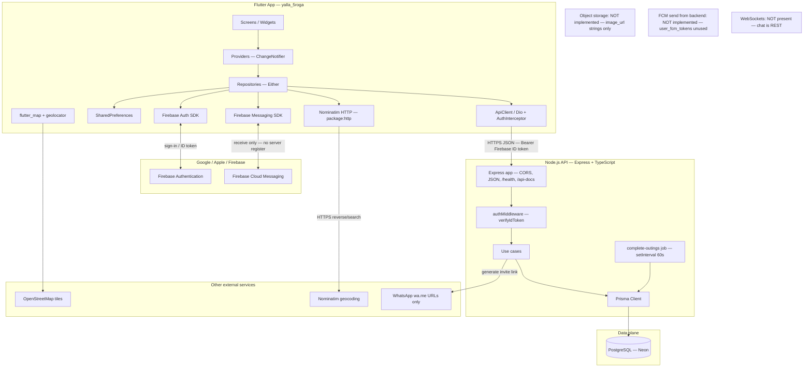

# 2.1 High-Level System Architecture

Verified against `backend/src/app.ts`, `backend/src/server.ts`, `backend/src/config/*`, `flutter/lib/core/di/app_dependencies.dart`, `flutter/lib/core/config/app_config.dart`.

## Communication protocols

| From → To | Protocol | Auth / notes |
|-----------|----------|--------------|
| Flutter → Backend | HTTP/JSON (Dio) | `Authorization: Bearer <Firebase ID token>` |
| Flutter → Firebase Auth | Firebase SDK | Phone OTP, email/password, Google, Apple |
| Backend → Firebase Admin | Admin SDK | `verifyIdToken`, create user, custom token |
| Backend → Firebase Client REST | HTTPS | Custom token → ID token exchange (`FIREBASE_API_KEY`) |
| Backend → Neon | Prisma / PostgreSQL | `DATABASE_URL` (pooled Neon URL) |
| Flutter → Nominatim | HTTPS | Public User-Agent; not proxied |
| Flutter → OSM tiles | HTTPS | Tile template from `AppConfig` |
| Backend → WhatsApp | None | Builds `wa.me` URL; does not send messages |
| FCM → Flutter | Push | Receive path only; token not synced to API |

## Confirmed absences

- No S3 / R2 / Cloudinary / Firebase Storage upload pipeline
- No SMTP / email provider
- No Redis, queue, or message broker
- No WebSocket / Socket.IO layer
- No CDN in front of the API (not configured in repo)
