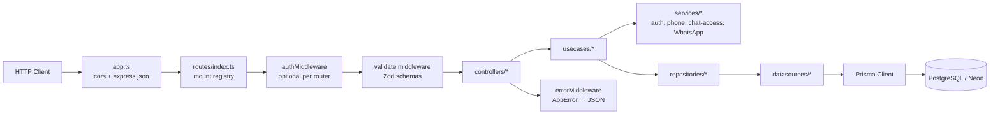
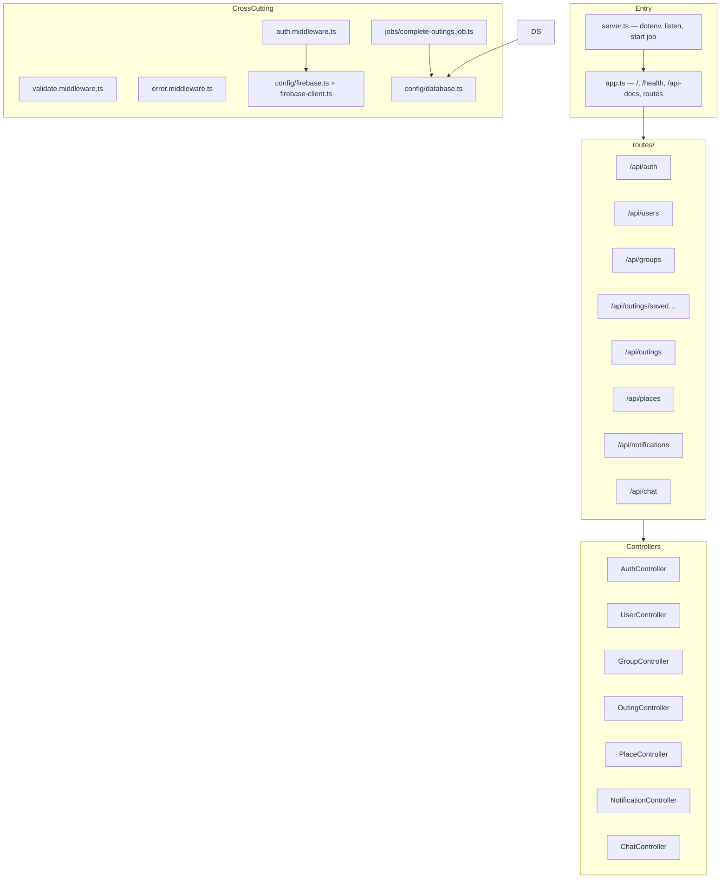

# 2.2 Backend Internal Architecture

Verified against `backend/src/routes/*`, `controllers/*`, `usecases/*`, `repositories/*`, `datasources/*`, `middleware/*`, `services/*`.

## Layered request flow

## Actual module map

## Dependency style (observed)

- Controllers instantiate use cases with **default constructors** (manual DI, no IoC container).
- Use cases default to concrete `*Repository` implementations.
- Repositories wrap datasources that call Prisma.
- Cross-cutting services (`password`, `firebase-identity`, `normalize-phone`, `chat-access`, `invitation-policy`, `whatsapp`) are imported directly.

## Success / error envelope

**Success** (typical): `{ success: true, data: T }`  
**Sync special case:** also returns top-level `invitations`  
**Error** (`error.middleware.ts`): `{ success: false, message: string }` with status from `AppError` subclasses (400/401/403/404/409/500).

## Background processing

| Job | Location | Behavior |
|-----|----------|----------|
| Outing completion | `jobs/complete-outings.job.ts` | Every 60s: `upcoming` → `past` when `COALESCE(ends_at, scheduled_at + 6h) <= now()` |
| Neon keep-alive | `config/database.ts` | Dev-only `SELECT 1` every ~4 minutes |
