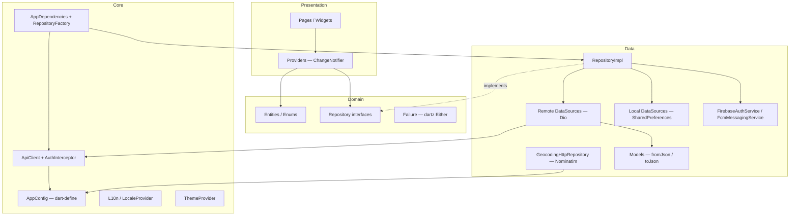
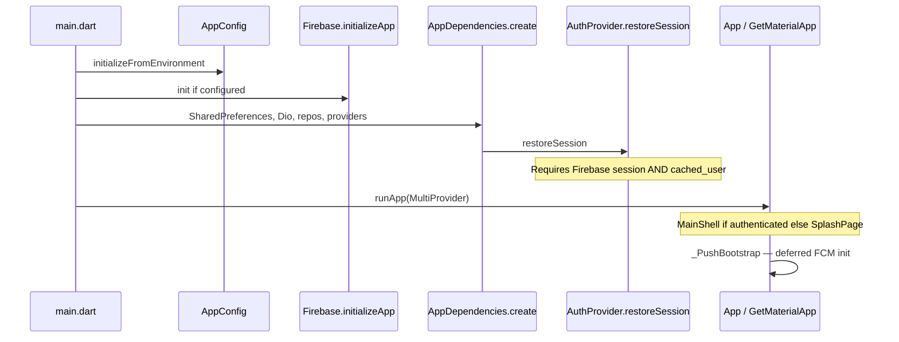

# 2.3 Flutter Architecture

Verified against `flutter/lib/main.dart`, `app.dart`, `core/di/*`, `core/network/*`, `features/*`.

## Feature-first Clean Architecture

## Boot sequence

## Feature modules (actual)

| Feature | Layers | Remote | Local |
|---------|--------|--------|-------|
| auth | full | Dio register/profile + Firebase | prefs user/token |
| groups | full | Dio CRUD/members/leave | — |
| outings | full | Dio list/create/votes/attendance | — |
| outings/saved | full | — | prefs saved + drafts |
| chat | full | Dio messages/read | prefs message cache |
| discover | full | Dio places | — |
| notifications | full | Dio feed/read + FCM receive | — |
| home / shell / splash / setting | presentation | via other providers | theme/locale prefs |

## Live Dio inventory (relative to `API_BASE_URL`)

Defined in `ApiConstants` and called from datasources:

1. `POST /auth/register`
2. `PATCH /user/profile`
3. `GET /notifications`
4. `POST /notifications/read`
5. `POST /notifications/{id}/read`
6. `GET|POST /groups`, `GET|PUT /groups/{id}`
7. `POST /groups/{id}/members`, `DELETE …/members/{memberId}`
8. `POST /groups/{id}/leave`
9. `GET|POST /outings`
10. `POST /outings/{id}/votes`
11. `POST /outings/{id}/attendance`
12. `GET|POST /outings/{id}/chat/messages`
13. `POST /outings/{id}/chat/read`
14. `GET /places`, `GET /places/{id}`

**Live only:** `RepositoryFactory` returns API-backed repositories. The former `USE_MOCK_DATA` / `lib/core/mock` demo stack has been removed.

## Architectural notes vs workspace docs

- Project context docs mention an `unread` feature module; **no `lib/features/unread` exists** — only `ApiConstants.unreadCounts`.
