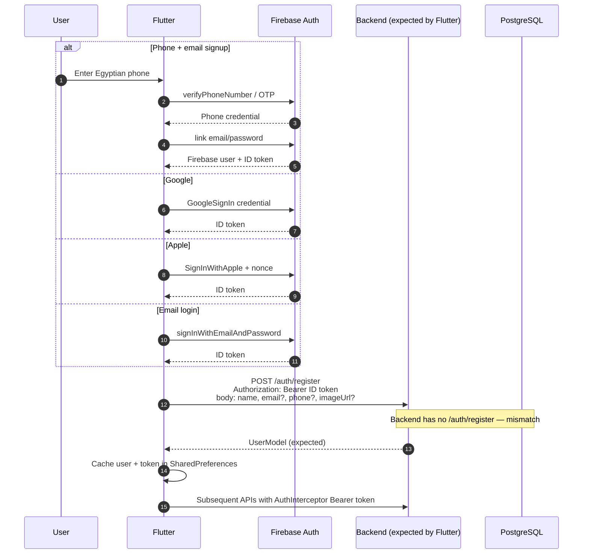
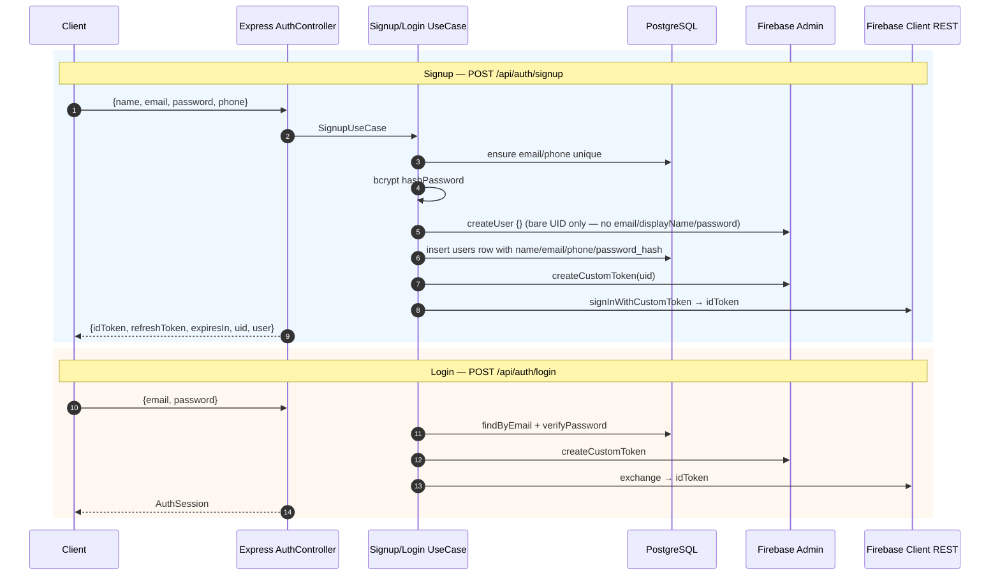
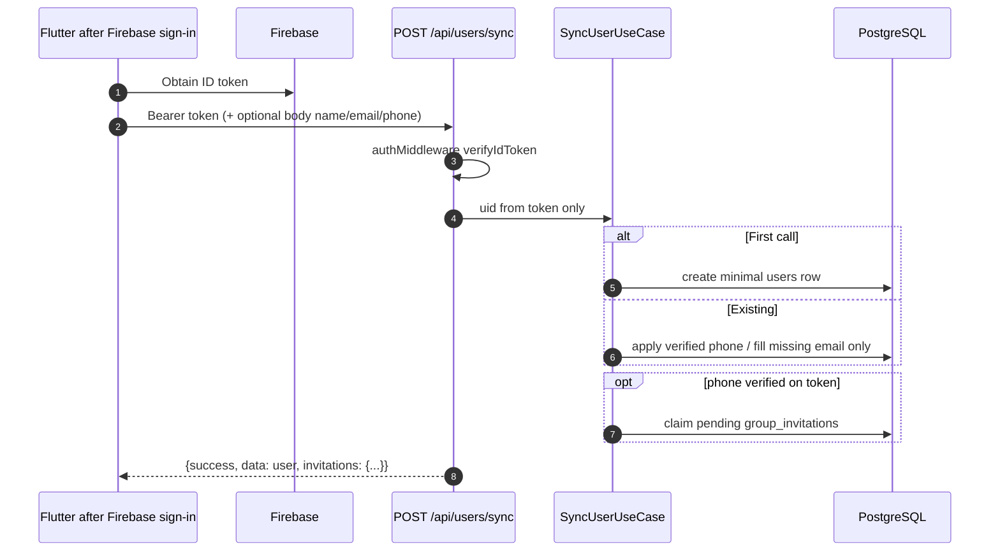
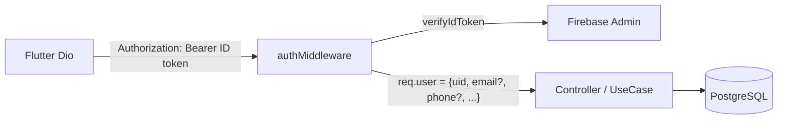

# 2.4 Authentication Flow

Sources:  
Flutter — `firebase_auth_service.dart`, `auth_repository_impl.dart`, `auth_remote_datasource.dart`, `dio_interceptors.dart`  
Backend — `auth.middleware.ts`, `signup.usecase.ts`, `login.usecase.ts`, `sync-user.usecase.ts`, `firebase-identity.ts`

## Important: two competing models exist today

| Concern | Flutter (implemented) | Backend (implemented) |
|---------|----------------------|------------------------|
| Email/password storage | Firebase Auth | Neon `users.password_hash` (bcrypt) |
| Signup API | `POST /auth/register` with Bearer + profile fields | `POST /api/auth/signup` with name/email/password/phone — creates Firebase user **without** Firebase password |
| Login API | Firebase `signInWithEmailAndPassword` only | `POST /api/auth/login` verifies Neon hash → Firebase custom token → ID token |
| Social / phone provisioning | After Firebase → `POST /auth/register` | Documented as `POST /api/users/sync` |
| Comments in Flutter `ApiConstants` | “no passwords in PostgreSQL” | Backend stores passwords in PostgreSQL |

These are **confirmed divergences**, not documentation drift alone.

---

## A. Flutter-intended flow (Firebase-first)

---

## B. Backend email/password flow (Neon credential store)

---

## C. Backend sync flow (intended for Google / Apple / phone)

Flutter currently calls `POST /auth/register`, **not** `/api/users/sync`.

---

## D. Authorized API access (shared once a valid ID token exists)

`optionalAuthMiddleware` exists but is unused on current routers.

## Google / Apple

| Layer | Status |
|-------|--------|
| Flutter Google Sign-In | Implemented via Firebase credential |
| Flutter Apple Sign-In | Implemented via Firebase OAuth provider |
| Backend dedicated Google/Apple endpoints | **None** — expect `POST /api/users/sync` after Firebase |
| Flutter post-social provisioning | `_provisionBackendUser` → `POST /auth/register` (path/contract mismatch) |
