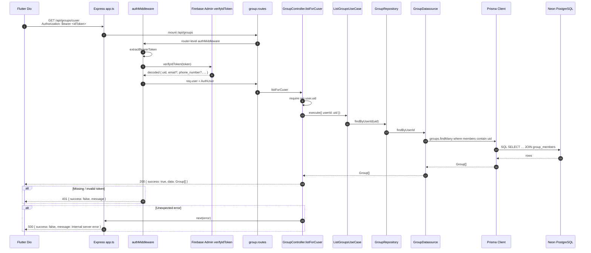

# 2.6 API Request Lifecycle (Real Endpoint)

Example: **authenticated list of the current user’s groups**  
Backend: `GET /api/groups/cuser`  
Files: `group.routes.ts`, `group.controller.ts`, `list-groups.usecase.ts`, `group.repository.ts`, `group.datasource.ts`, `auth.middleware.ts`

> Flutter currently calls `GET /groups` (no `/api`, no `/cuser`). This sequence documents the **backend** path that exists today.

## What Flutter would need to match this call

| Concern | Backend today | Flutter today |
|---------|---------------|---------------|
| Method | `GET` | `GET` — matches |
| Path | `/api/groups/cuser` or filtered `GET /api/groups?userId=` | `/groups` |
| Auth header | Bearer Firebase ID token | AuthInterceptor attaches token — OK if path hits backend |
| Response | `{ success, data: Group[] }` snake_case Prisma fields | Parses `data` via `apiPayload`, then expects camelCase aliases (`image`/`coverUrl`, `people`/`members`) |

## Alternate example: cast a vote

Backend `POST /api/outings/:id/votes` body `{ option_id }` → `CastVoteUseCase` → Prisma upsert on `outing_votes`.

Flutter sends `{ optionIndex, toggle: true }` to `POST /outings/:id/votes` — **contract mismatch**; see consistency audit.
