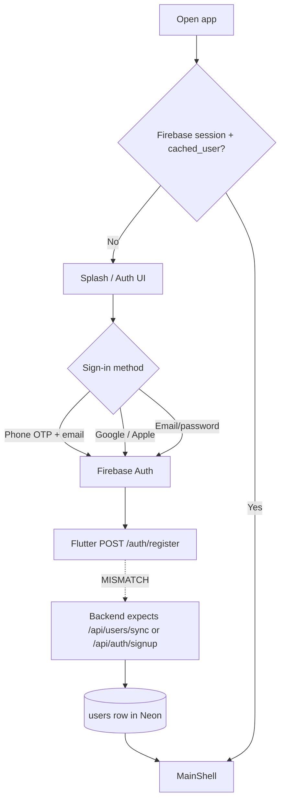
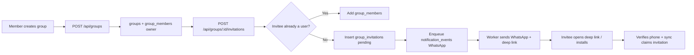
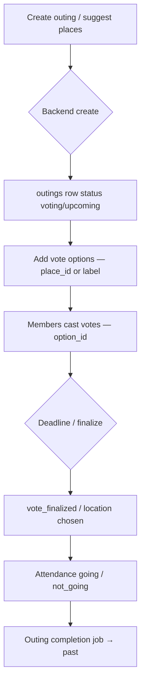
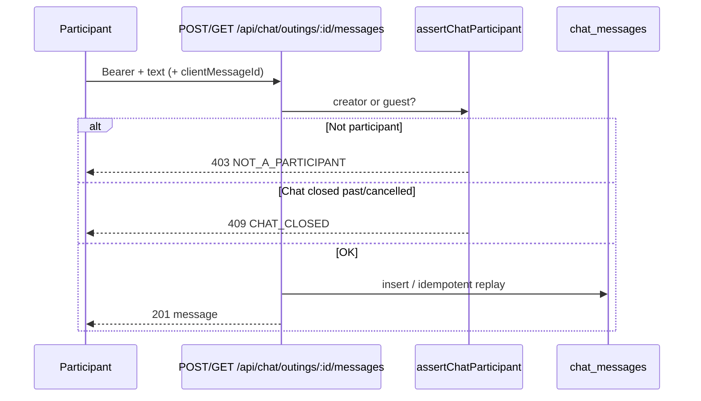
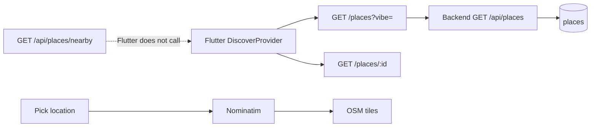
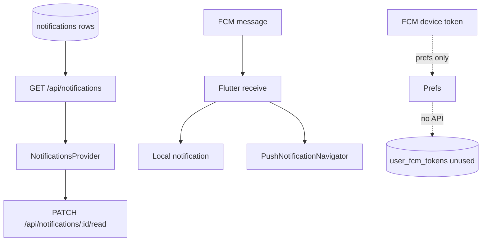

> **Historical reference — corrected 2026-11-13:** Endpoint paths and PASS claims below describe an older implementation/run and are not current verification. Current registered routes use `/api/outings/:outingId/messages` and `/api/outings/:outingId/read`, `/api/invitations/:invitationId/decline`, and `/api/users/cuser/fcm-token`. There is no registered `POST /api/outings/hydrate`; Flutter hydrates via the existing current-user/detail/voting/attendance GET operations. Prefer `../API_CONTRACTS.md` and the current confirmed-fixes report.

# 2.7 Critical Business Workflows

Workflows below are derived from **implemented** backend use cases and Flutter features. Gaps are called out explicitly.

---

## 1. User onboarding & identity sync

**Backend invitation claim:** when sync sees a Firebase-verified phone, pending `group_invitations` are accepted into `group_members` (`ClaimGroupInvitationsUseCase`).

---

## 2. Create group & invite by phone

Non-user invites now use the notification outbox (`notification_events` → worker → WhatsApp channel). The API still returns `whatsapp_url` (click-to-chat fallback) and `deep_link` (`https://yalla5roga.com/invite/{invitationId}?groupId=…`). Set `WHATSAPP_PROVIDER=meta` with Cloud API credentials to send server-side; `stub` logs locally.

Flutter today: `POST /groups/{id}/members` with `GroupMember.toJson()` (id/name/avatar/role/phone) — **does not match** backend `phoneNumber`-based invite/add schemas. Leave endpoint `POST /groups/{id}/leave` has **no backend route**.

Invite deep links: Flutter `InviteDeepLinkProvider` (`app_links`) parses HTTPS + `yalla5roga://` invites, stashes while logged out, then `MainShell` flushes into `GroupDetailsPage` after groups refresh (membership claimed on sync). Host verification files: `docs/system-design/deep-links/`.

---

## 3. Plan an outing with voting

**Flutter divergence:** single `POST /outings` with nested `places` / `votePlaces`, and vote actions via `optionIndex` / `finalize` / `clear`. Backend separates create, option CRUD, cast/unvote, and update fields.

---

## 4. Outing chat

Flutter path nesting differs; mark-read hits `/outings/:id/chat/read` which is **missing** on backend (table `chat_reads` exists).

---

## 5. Discover places

Backend also exposes hours/images/prices nested resources; Flutter discover models a flatter `SuggestedPlace`.

---

## 6. Notifications & push

Backend does **not** send FCM. Flutter mark-all-read (`POST /notifications/read`) has **no** backend counterpart. Mark-read method differs (`POST` vs `PATCH`).

---

## 7. Saved outings & drafts

| Capability | Backend | Flutter |
|------------|---------|---------|
| Saved outings | `GET/POST/DELETE /api/outings/…/save` | SharedPreferences only |
| Drafts | `/api/outings/drafts` CRUD | SharedPreferences only |

Until Flutter switches to the API, saved/drafts will not sync across devices.
